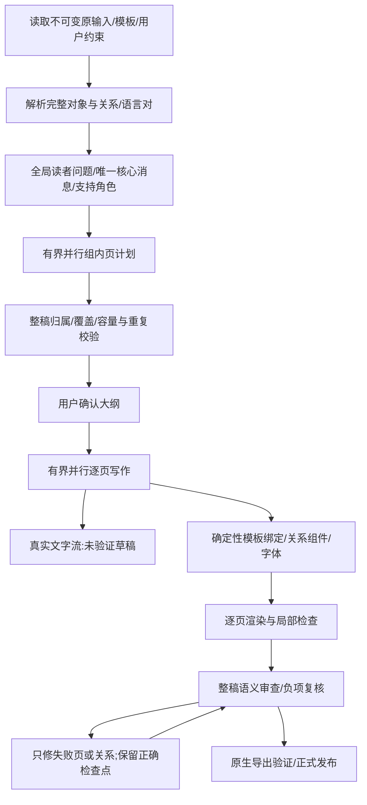

# Gamma 生成流程、23 页对照与实施计划

创建：2026-10-15。最新状态：W1–W6代码已实施；完整回归2926项（2925通过/1跳过）、生产Chrome UI 26/26、生产构建及原生诊断导出已验证。18页和20页真实整稿仍quality_blocked，未正式发布；新A–G方案待实施。提交只记录已验证增量与未解决问题，不宣称全部验收完成。

## 授权与证据

本轮用户要求完整流程分析、23/10 页同源对照、详细 code/prompt 方案、逐项实施测试后 commit。保留他人 3141；本项目前端 3143、后端 3142。附件作为资料，不执行其中的指令。不注入手工 Gamma 大纲，不降低 threshold，不以诊断导出冒充正式发布。

源文件 gamma.md SHA256：4719e945a729935e9462c93f98a73bd8cc4c33accae0dfa7d5e94ef8838a8f6b。Gamma-AI.pptx：bd99c5e3329ae594a2aabf7ecf68a66f23d7483154cb6e4192e62d85400848f7。用户指定旧 module 23 页：Gamma_Architecture_Workflow_Diagnostic_23p.pptx，a31c37f54d49ce5420e6a0a15b9d5f4559b01407dcd1dd5bb904ff42d43adcd9。23 页是历史诊断稿，publishedRevision=0；最新 18 页也未完成正式模型发布审查，不能当作已通过的基线。

前序详细报告：../../research/ppt-gamma-ai-same-input-review-20261014.md（包含 23 页原始逐主题评审及后续 18 页局部修复记录）。本文件新增生成体验、并发依赖、故障传播和本轮具体实现，不覆盖历史证据。

## 1. Gamma 可确认的流程及不能确认的内部实现

依据官方资料（查阅日期 2026-10-15）：

- [Agent 创建](https://help.gamma.app/en/articles/15002203-how-do-i-create-with-agent-in-gamma)：输入可以含文字、文件、模板；Plan 先澄清并确认计划，Express 跳过计划确认，Research 配合 Plan。生成期间能看见逐渐出现的 slides 并打开已生成页；修改可以定向进行。
- [经典生成器](https://help.gamma.app/en/articles/7838093-how-do-i-create-a-new-presentation-document-or-webpage-in-gamma)：区分 Generate、Paste、Import，内容可后续编辑。
- [官方生成 API](https://developers.gamma.app/guides/generate-api-parameters-explained.md)：textMode 支持 generate/condense/preserve，cardSplit 支持自动或输入分隔，numCards 与拆分模式配合；API 用 generationId 查询最终状态和导出链接。API 的异步状态不能证明网页内部的 token 流或线程实现。

以上可以重建产品行为：输入/模式 → brief与约束 → 故事计划/outline（需要时确认）→ 内容、设计、媒体构建 → 可编辑原生文档 → 导出。不能从成品推断 Gamma 私有 IR schema、具体 worker 数量、模型分工、token 协议或卡片完成次序。gamma.md 与附件里的 compiler、AIJSX、Kafka、CRDT 等同时包含公开信息和作者推断；架构推断要随对应主张保留限定。

用户推测的判定：

| 推测 | 证据与决定 |
|---|---|
| 内容切割后并行规划每页 | 技术上合理，但官方未证明该私有实现。本模块采用全局规划完成后有界并行 group/page 规划，来源边界不是叙事边界。 |
| 仅展示生成完成和正在生成的页 | 与官方逐渐出现的 live grid 行为一致；具体隐藏策略未公开。本模块生成视图默认隐藏未启动页，保留真实页码和总数。 |
| 看见文字生成 | 官方说明可看 deck 渐次构成，不等于公开 token 协议。本模块已有真实 streamText → progress → SSE → draft，需修复模板元素提前存在时 draft 被遮住的问题；不显示模型隐藏推理。 |

## 2. 建议采用的依赖模型（本模块设计，不冒称 Gamma 内部）

全局主张归属是 barrier，组间规划和页写作有界并发（现有默认 3；本地测试可配置 1）。不能为了模拟并行而让每个 writer 重新理解全文，亦不能在没有全局主张表时让每页自主决定相同核心结论。媒体仅在有真实依赖时阻塞页面；无图分支直接渲染。单页完成不等于整稿通过；UI 分开显示写作、渲染和整稿评审。

## 3. 23 页与 Gamma 10 页详细评审

统计来自实际 PPTX 可见文本，不以字数替代语义评分：Gamma 5360 字符、23 页稿 9340；分别平均 536/406 字符每页。module 字更多而平均负载更低，主要问题是重复、拆分与层级。两稿使用不同主题，不能以替换 Deal Review 字体模仿 Gamma 外观。

| Gamma 页/读者任务 | 23 页位置 | 问题、应改层与验收 |
|---|---|---|
| 1 主题 | 1 | 副标题应说明视角；生成操作提示移出可见主层。模板绑定代码保留字体及可编辑性。 |
| 2 compiler 核心结论与机制 | 2、4、11 | 核心原则重复独立成页，优势与有限布局族机制分离。全局规划新增 coreMessage 和 evidence roles；writer 只解释本页增量，禁止重讲前页主张。 |
| 3 分层架构 | 3 | ASCII 展平输入、规划、设计、输出以及并行关系。关系 prompt 要求层级/顺序/分支分别表达；保留解析器真实关系，不按模板装饰重排因果。 |
| 4 输入路径及 Agent | 5–7 | 模式、步骤、条件拆散。规划将定义、机制、fast path 条件联合分配；较慢 Agent 条件不能为压页而丢掉。 |
| 5 Brief→Card IR→设计 | 8–11 | 字段两行续页、抽象定义页、几何坐标对照被误用为 schema 示例。角色合同区分 definition/example/comparison/condition；schema 必须属于本对象，几何对照不能变成 Gamma 原生 IR。 |
| 6 媒体与模型路由 | 12 部分 | 多个独立 router 不等于同一因果链，No→render 分支不可丢失。规划与 writer 明确独立机制，已有源图分支守卫继续执行。 |
| 7 软件化 prompt/异步/原生文档 | 12–14 | 各能力跨度过大；Native 一页留白较多。先联合编排问题；提到 source of truth/CRDT 时保留原文推断。 |
| 8 workflow 任务族 | 15–16 | 全表机械按行数拆页。overview/notes 用真实任务族代表行，不能以选行理由冒充渲染结果；Data→Deck 的确定性计算不可丢。 |
| 9 延迟模型 | 17–18、11 | 串行成本→并行机制→概念公式→条件顺序应连贯。公式不冒充实测；reflow 减少 QA 循环不等于无需视觉 QA。 |
| 10 原则与来源 | 19–23 | 收尾五页，单句原则重复，来源独占页。短引用和证据状态随本页主张或进入备注，不自动成为早期完整章节；真实结论收尾。 |

描述/逻辑：Gamma 更擅长让一页完成一个理解任务；module 更擅长完整对象/备注保全，但不能让对象数决定页数。精炼不是删限定或压字号。完整原文进入授权备注、关键限定仍主稿可见；不同页面允许共享背景引用，但只能有一个主讲核心消息。续页必须说明新的机制、例子或完整对象范围。模板有限容量确有必要时允许续写，不硬编码 10/12 页。

Gamma 参考也不能盲抄：私有实现有确定化措辞、慢 Agent 条件弱化、无需 Screenshot QA 过强、原则标题计数未逐项对应。module 以其组织水平为标准，同时保持源证据边界。

### 3.1 23 页逐页处理意见

下列字符是重新直接读取 slide XML 的文本 run 长度（不含 run 间插入换行），因此不同于上文用于历史比较的含换行统计；两种口径均不等于字号/面积密度。

| 页 | 文本字符 | 当前理解任务与具体改法 |
|---|---:|---|
| 1 | 46 | 主题基本正确，备注说明占据主层；封面只留主题与视角。 |
| 2 | 722 | 引言、证据分类、技术栈混杂；开场只建立主张与机制，技术栈附于对应系统，推断状态随主张。 |
| 3 | 983 | 系统图文字最多；层级关系比罗列更多文字重要，按输入/内容规划/设计渲染分层，编号缺口不补造。 |
| 4 | 95 | 仅核心设计思想；并入第2页，不独立占页。 |
| 5 | 325 | 模式表有清楚比较维度；与第6/7页的路径差异联合规划。 |
| 6 | 235 | 源章节剩余设计原则被拆为一页；作为模式页的机制和快路径条件。 |
| 7 | 302 | Agent阶段本身有顺序；保留全部必要阶段与“更慢”的条件，与模式共享section。 |
| 8 | 361 | Brief定义与字段示例关联正确但说明过散；保留规范化→下游复用关系。 |
| 9 | 126 | 只有visual_style/length，属于机械表格续页；overview选完整代表字段组，完整表留备注。 |
| 10 | 259 | Card IR树缺少设计作用解释；与语义/几何职责共同说明，native schema未知保持限定。 |
| 11 | 485 | 坐标对照+设计四步有价值；不能被导航称作真实Card schema，机制归并到相关解释链。 |
| 12 | 833 | 媒体、模型路由、AIJSX、API同页标题过宽；媒体与模型可共享问题，AIJSX/API应转软件架构问题。 |
| 13 | 256 | 单纯事件队列链；与异步generationId/status和文档编辑模型建立能力关系。 |
| 14 | 290 | Native/CRDT推断边界重要，但独页负载较低；作为原生编辑及导出职责解释。 |
| 15 | 694 | 16行表前9行按行数分割；overview按任务族选择，原始单元格和完整表备注保持。 |
| 16 | 425 | 表后7行，无新读者问题；不能因为物理分片生成第二段相同总论，续页标题指出增量。 |
| 17 | 306 | 串行15步有说明力；先解释成本来源，再与DAG对应，不引入无来源实测速度。 |
| 18 | 403 | DAG/公式/reflow需完整关系；公式紧邻定义与假设，减少QA循环不等于关闭QA。 |
| 19 | 489 | 原则本身相对完整；按职责组合并保持10条可识别，避免再重复核心宣言。 |
| 20 | 230 | 推荐实现流水线可以构成结束行动；与原则对应，不另起第二个抽象收尾。 |
| 21 | 86 | 再次重复模型/确定性分工；并入核心优势或结束决定。 |
| 22 | 468 | 12条链接保留；短概览以备注或紧凑末尾来源区承载，无需整页来源前置。 |
| 23 | 120 | 独立免责声明太晚；推断限定应在有关页可见，此页可并入结论/来源。 |

## 4. 超时与传输错误：已有证据与设计

历史：Qwen 18 页全部 writer 完成，rubric16 的负项复核约 109544 bytes，真实 transport/timeout 中止；DeepSeek 新项目在 semantic-groups 阶段即失败。两者 publishedRevision=0。无凭据 origin GET 10 秒超时只说明该请求无响应，不能推断认证失败或整个供应商宕机。

现有模型/队列总预算分别 240/300 秒，大审查 420/450 秒；waiting 与 claimed 执行预算分开。某些实际失败远短于此上限，所以不能一律增加总超时。streaming 已启用以减少网关等待首包；格式 fallback 仅支持已识别 schema 不兼容/编译器 500，一次有界；认证、限流、输入容量和语义错误不应被当作 format fallback。

需要记录的安全证据：stage、HTTP status、允许列表 SDK/网络错误类型、elapsedMs、firstTokenMs、receivedChars、失败来自排队还是执行。绝不存 provider URL/headers/body/SDK message 或凭据。区分传输未完成、格式无效和质量未过，用户看到实际失败步骤与可重试范围。重试后旧 failure 进入历史，避免页面仍显示旧错误；正确 checkpoint 不清零。复核负项分小批，保留全原始 source 与全可见 witness，不能截断证据换取小 prompt。

## 5. 本轮逐项实施清单

| ID | 类型/改动位置 | 具体实施 | 验收 |
|---|---|---|---|
| W1 | code+prompt: semantic-groups/global-outline/protocol | 为新规划引入 v2 coreMessage、narrativeRole、完整 sourceUnit→supportRole 分工；每一核心消息唯一，reference 不默认独立页，解释链先于分组并发；已有 v1 已确认项目兼容。记录可复用 contract 失败候选，重试只修该候选不重新调用全局创造规划。 | 重复主张、缺失角色、错误归属阻止；v1兼容；真实新 outline 检查。 |
| W2 | prompt: planner/writer joint context | 每个组得到全局主张归属与本组角色；规定定义/机制/例子/条件一组、其他组只保留必要背景；续页需增量；来源在末尾/备注；几何对照和原生 IR 不混。 | 通用 fixture 而非写死 Gamma 页数；原始限定/关系门禁保留。 |
| W3 | code: generation/editor | 默认仅已启动/完成页；canvas 与 thumbnail 共用真实状态筛选；自动跟随选正在进行页，未启动页不因空 skeleton 出现在 canvas。 | 实际 CDP 访问/截图；手动浏览不跳回、真实页码不重排。 |
| W4 | code: draft rendering/worker | writer 草稿在模板提前有元素时仍可见，显示实际 typing 文本；已完成/其他 epoch 草稿不显示；progress 有界合并、序号单调且最终片段送达后 complete。 | stream fixture、提前绑定模板/最终片段/陈旧草稿回归；未验证草稿不进入导出。 |
| W5 | code: worker→queue→project→error UI | 安全诊断全链路传递并显示实际 stage/耗时/首字延迟/HTTP；区分 queue/execution；retry 将旧失败归档；修正嵌套 HTTP 401/403/503 分类。 | 身份/lease/敏感字段伪造被拒；错误信息不泄密，历史保留。 |
| W6 | code: negative finding confirmation | 按最多 3 个 finding 分批，所有原文与可见证据保留；独立合同修复各批一次；聚合前任何批失败不能移除负项/发布，已有 v2 缓存不当作新协议批准。 | 多批完整性/contract repair/not_evaluated/transport原样传播。 |
| W7 | regression/native QA | 延续模板字体/完整来源备注/分支/推断/公式守卫；不为压页改变字号或冻结页数；前序计划缺口纳入本次对照。 | 完整 npm run test、PPT专测、UI smoke/CDP，真实 LLM 创建及失败恢复；有正式输出才称正式通过。 |
| W8 | docs+commit | 本文逐点更新证据与状态；用户交付同名 Markdown；仅提交相关改动，不提交输出、密钥/运行配置或无关现有修改，不 push。 | git diff --check、测试记录、commit hash。 |

## 6. 验收与执行记录（实施后填写）

以下按实际执行记录。任何真实 LLM 阻塞、未通过的质量/原生验证、未完成提交，均明确记录，不标为完成。

### 6.1 首次真实 v2 规划发现的缺口与修正决定

真实新项目 9e9588bb34a4751cc748afc01510fe87 使用完整 gamma.md、原 Deal Review 模板和 qwen3.8-max，首次 v2 全局合同通过：69 个源单元各有支持角色、13 个问题组。但结果仍把 AIJSX、异步、Native Model 等短主题分为各一组，与期望的解释链组合有距离。唯一来源和不同主张检查只能证明归属，不能证明编辑质量。

因此 W1 增加独立整体编辑 pass：在初始全局分配之后、并行页计划之前，让真实模型看整稿消息表及原来源目录，仅提出有语义理由的 group merge patch（不写正文）。代码验证索引互斥、来源完整并集、支持角色不变、未涉及组内容和相对顺序不变；所有合并后重新进行原全量归属/关系合同。两种不同的独立子系统可以在同一个读者问题下使用不同块，并不意味着它们构成同一因果链。初始合格计划先落 checkpoint，编辑 pass 超时只重试该 pass，不重做已有全局规划。最多一次格式修复，禁止为了凑 Gamma 页数强制合并。该改动通过 fixture 与新一轮真实测试后才算验收。

### 6.2 真实过程中的进度传输背压

第一次真实并行规划阶段，监控出现两次 GET projects 连接重试。模型端仍在持续返回流，不能把这两次本地读取超时称为供应商失败。检查发现本轮最初的 progress 有序队列会把慢 HTTP 上报累积成无界 FIFO，最终模型完成也要等待每个旧片段。已改为“最多一个在途请求、一个最新待发片段”，中间片段被合并，seq 可跳号但单调，最终片段仍在 complete 前送达。outline 的持久候选快照节流为 2.5 秒，writer 真实草稿流保持 700ms 更新，不把每个 token 写成全项目快照。该问题有慢端点专测；后续真实端到端需再次确认读取/暂停响应与完成时间。

### 6.3 构建与首轮浏览器结果

完整 `npm run build -- --turbopack` 成功（含 TypeScript 和全部 169 个静态页面）。记录了既有 SDK external/动态模块解析警告；不能把构建成功扩展为所有非 PPT 功能已无警告。该构建发生在流上报背压修正之前，实际新轮模型测试继续使用当前工作树的开发服务，避免部署旧 FIFO worker。最新修正另跑类型检查与全部回归。

首轮 25 个 Chrome 冒烟 21 通过、4 失败：四项都在首次页面 ready/加载状态的 5 秒等待处失败，尚未进入各自业务断言；截图中页面随后已出现。把隔离开发环境的首次 ready 等待改为 15 秒后重跑，业务断言与无 console error 要求不变，不以跳过测试规避。

### 6.4 真实合并 patch 的长度失败

第二轮 ec1e976515de53c51ff1421b6472858a 的 69 单元全局 v2 归属通过，真实模型提出合并 Input/Brief 和 IR/Design。但两个 coreMessage 超过 320 字符；旧 prompt 没有说明字段上限，旧错误仅称 shape invalid，格式修复还重复了同样长段，导致 coverage_invalid。已补齐 title 80、readerQuestion 240、coreMessage 320、reason 700 的明确限制和逐字段实际长度错误；只要求重新精炼该元数据字段，不截断源资料。新增 editorialCandidate 持久检查点，格式修复传输失败后仅重发该 patch 修复，初始全局归属保持。测试包含 321 字符失败、具体原因与一次定向恢复。此项目继续从相同归属检查点重试，不注入人工 merge。

类型检查曾与 Next 开发服务启动/生成路由类型并发，读到了未写完的 `.next-ppt-workflow-dev/dev/types` 文件并报语法错误；这是验证顺序错误，不能据此修改源代码或宣称测试通过。后续将完整 npm test 放在服务就绪、生成类型稳定之后顺序重跑。

### 6.5 已通过的稳定验证与进一步局部修复

官方 typegen 重建后完整 npm test：2917 tests，2916 pass、1 skip、0 fail；最新 UI 单独 tsc 通过。随后完整真实 Chrome/CDP 冒烟 26/26，通过桌面/390px移动端、未启动页隐藏、预绑定模板文字流、保持手动浏览、真实页码、故障自动弹窗和具体结构原因。测试结果来自实际 React 应用；工具环境未提供 chrome-devtools MCP，使用已安装 Chrome 的 CDP 会话完成点击和截图。

合并元数据恢复再次检出第二条 coreMessage 403 字符：模型确实只修了第一条已报告字段。验证器现一次收集全部不合格字段，反馈每个 mergeIndex/field/max/actual；纠正结果还要逐字段比对，不能顺手修改未报错的标题、问题、页数、合并索引或其他已正确决定。新增断言拒绝“顺手重写”并确认断点恢复只调用 contract 修复。源码没有截断资料、删除来源或放宽上限。

提交范围包含本轮改进及继续任务中尚未提交的 PPT 前置实现/回归/文档；不包含生成产物、本机凭证配置、复制前端、其他项目或无关全局构建/字体改动。提交及真实整稿终态仍待完成。

### 6.6 截图复核后的单画面修正

实际 390px 截图显示已绑定对象+草稿时，原实现同时渲染 skeleton 和旧 canvas，且缺少显式 pages stage 时错误显示“等待”。现共享 generationPageStage 从真实 node/draft/render_ready 推导状态；未就绪且有当前草稿的页面只渲染生成画面，ready 后才替换为真实 canvas。预绑定模板不再冒称来源对象已校验，该提示要求真实 componentCommit。回归要求 writing 阶段、一个 article、不出现第二个旧 Topic 画布、无伪校验提示，并复查新截图。字体、内容/来源对象与导出逻辑不变。

### 6.7 本地队列超时的真实根因与启动探针

最新一次 300006ms 超时的诊断为 origin=queue、receivedChars=0，并非上游 LLM 请求超时。实际 POST `/api/ppt/model-jobs/run` 返回 HTML 404，源文件却存在；路由类型表遗漏此入口，队列未被领取。此前启动检查只检查了页面和项目列表，错误地报告“就绪”。

发现 Next 将 TypeScript config 作为 CommonJS 加载，`import.meta.dirname` 实际为 undefined，原先 root pin 没有生效；开发 webpack 的忽略正则又会匹配当前工作目录祖先的 `.ppt-build`/`outputs`，把工作树源文件也排除。改为兼容 CommonJS 的真实 PROJECT_ROOT，同时设置 Turbopack/root/file tracing，并将忽略范围锚定到项目内的产物目录。单测证明源 route 不再被忽略、outputs 仍被忽略；实际相同入口由 HTML404恢复为预期 JSON400（Invalid model job ID，无模型调用）。

新增前端启动探针同时检查 UI、项目 API 和真实本地执行 route；故意无效的 ID 必须在领取/provider lookup 前得到 JSON400，不消耗 LLM token。缺失的执行入口不能再被认为页面已就绪。客户端遇到 HTML 错误也给出安全 HTTP 状态，不吞掉 JSON 解析错误并把任务默默留在队列中。本次根目录与启动配置变动需重新完成生产构建和真实链路测试。

### 6.8 原计划保护与 field delta

执行入口恢复后的真实模型调用已完成，但修复第二条 coreMessage 时，模型连同第一条正确 coreMessage 一起重写，被 untouched-field 校验拦截；这不是新的 source 失败，原始候选仍完整保留。现在纠正协议只返回 `{version:1, updates:[{index,field,value}]}`，目标必须恰为全部 invalidFields，代码合入原 patch。未报错字段由服务器保留，LLM 不再复写整份 JSON。独立 response schema 将 index/field 固定到实际目标，并限制 coreMessage 320 字符。编译器仍检查所有来源、分组、关系和容量；这只是缩小纠正动作，不是放宽质量门槛。回归验证未授权字段被拒绝，原对象不变，候选恢复只调用一个字段 delta。

### 6.9 真实 delta 恢复已通过

同一 ec1e9765… 项目未重新创建原始分工：从保留的失败 patch 发起窄字段 schema/模型纠正，成功通过，13 个原始主题组合并为11组，69个原始来源单元及其支持角色均保留。随后真实生产流程进入并行 outline group、ownership 和 summary 校验；没有注入人工大纲。记录在 `outputs/ppt-gamma-workflow-20261015/live-delta`。此为阶段成功，尚不代表正式整稿发布。

手机截图人工复核确认：一页一个生成画面，“写作中”与真实节点一致，草稿/typing可见，未验证且不可编辑；不再重复呈现旧画布。两项针对性 Chrome/CDP 回归通过。完整浏览器验证将在生产构建完成后顺序重跑，避免构建负载影响首次 hydration 等待。

### 6.10 主题串组与近乎照抄守卫

真实窄字段纠正通过结构合同后，IR 合并组的 coreMessage 却近乎复制了 Input/Brief 组的主旨；仅 exact string 判重不足。新增长文本近抄守卫（去空白标点、至少80字符、长度比≥0.65、12字符片段覆盖≥0.82），只识别高重合复制，不冒充模型语义判定。原全局分组及合并 patch 都执行此检查；patch 错误精确定位对应 coreMessage，保留其他字段和来源归属。纠正请求同时列出目标 mergeIndex/原值/title/readerQuestion/所属原组，明确 mergeIndex 不等于原 groupIndex，防止拿其他组的正确句子来填字段。回归包含实际这两段相似主旨及独立 IR 主旨的反例。

当前真实 run 已确认20页大纲（候选12页经原模板容量修复增加），正在执行原生写作；没有更改已确认大纲。20页并不自动满足精炼目标，后续整稿评审与实物检查仍需检查无效拆页/单句收尾。该次错误元数据的历史证据保留，不以改存储伪装修复。

### 6.11 参考链接被误当可见清单义务

实际20页稿出现第4页独立 References，原因不是字体容量：12条纯 Markdown 链接被显式清单分类为 TaxonomyBlock，selectionConstraints 将所有显式清单强制主稿，模型理由甚至写成“Mandatory reference links on main page”。新增狭窄 referenceNotesContract：仅新建、自动页数、overview/notes、无额外用户/锁定约束、非 mustDisplay 的纯参考章节链接列表，去向必须为完整备注。带说明/条件的参考条目不命中；显式要求可见、full_source、已确认项目保持原合同。来源中真实证据状态和推断限定仍由原主张完整显示，不随链接挪走。代码修复该结构分类例外，planner 同时通过 selection_constraints 获得明确原因，不靠泛化“更简短”提示。测试覆盖纯链接、注释条件、显式可见与完整源模式。

### 6.12 生产构建追踪误收测试产物

真实完整生产构建已成功（164个静态页），但发现 standalone 的文件追踪把工作目录 outputs 收入9.4GB，包括隔离测试 profile 与生成文件；运行时不需要这些。根因是通用目录遍历的保守静态追踪，既有 excludes 没覆盖本轮产物。新增 outputs/**、.ppt-build/**、.playwright-mcp/** 追踪排除，源目录仍被编译；不以删除真实项目/凭据解决。只清除本次生成 standalone/outputs 的冗余副本，原隔离状态保留。再次完整构建并检查新 standalone/NFT 不含本机测试目录；测试固定这些排除规则。旧构建已用于快速恢复真实失败页，新排除配置不改变writer/模型合同。

### 6.13 结构化 schema 接线及 instrumentation 追踪实证

新增真实项目479fb176…以同一完整原文/模板/默认模型创建，初次与合同纠正均返回15组（当次上限13），还有 support role=process（process只允许作叙事角色）。代码审查发现先前传入modelCall options的jsonSchema被生产默认桥忽略，只有通用prompt识别器产生的schema能进入队列。已修复显式可信stage schema优先转发，并在生产modelCall→HTTP claim自测中直接断言schema一致；不是仅测试schema构造函数。初始/纠正全局规划和编辑合并均有独立结构schema，绑定实际来源ID、组数、角色枚举和字段长度；精确来源/关系/相似主旨/语义门禁继续独立验证。合同失败也保存最新纠正候选及具体数量错误，重试不再从较旧的失败JSON开始。

构建第二次实物检查显示普通route NFT已排除outputs，但instrumentation NFT仍含19182个本机测试文件。Next16.2.1已安装源码显示Turbopack的route-excludes pass未覆盖该入口；不能把配置项存在当作排除已生效。使用[官方生产编译生命周期钩子](https://nextjs.org/docs/architecture/nextjs-compiler)，在standalone复制前仅清理instrumentation trace中根目录outputs/.ppt-build/.playwright-mcp项，保留源码及名为src/outputs的代码目录。单测用隔离目录验证，随后再次完整构建和NFT/standalone实物检查。此hook不操作真实测试状态，不修补Next依赖源码。

浏览器最终生产验证26/26通过；完整新构建和真实整稿终态仍在进行。

### 6.14 生产UI与传输恢复证据

26项实际Chrome浏览器冒烟全部通过（约1.7分钟，retries=0），含desktop/390px、估算页数修改与竞态、模型设置、模板切换、当前文字流、只显示已启动页、手动浏览、故障详情、原生表格/图表/公式等。复核native-stream-mobile.png显示单画面、写作中及持续文字，未验证草稿不可编辑。此UI fixture标识demo-model，不冒充真实模型；另有真实项目ec1…截图显示实际qwen3.8-max和增长中的参考页中文段落。

原20页项目19页已完成时，参考页调用发生真实ECONNRESET（execution约20552ms，首字9714ms，receivedChars500）；这与本地route缺失的queue超时分开记录。保留19页后通过实际retry API继续，仅重新调用该失败content node，24秒进入整稿审查。其余已完成内容通过既有确定性检查重新验证，不等于重做19次模型写作。整稿负项按3项小批确认，之后仅受影响页进入critic修复；正式发布尚未宣称通过。证据live-delta/result.json与live-retry-page/ui-events.jsonl。

### 6.15 20页真实整稿终态与合同一致性修正

第一轮传输恢复后20/20页完成，经过真实整稿审查、负项确认和局部critic修复，最终quality_blocked、publishedRevision=0。保留真实阻断，不把文件生成当作正式通过。具体问题分两类：

- 确定性合同冲突：source_table_rows_missing按原16行检查，而当前有hash有效的summary选中8行、完整原表在notes。改为只对合法选中原行检查；选中行缺失仍阻断、过期ledger恢复检查全表、标题仍宣称完整数量也阻断。
- 定性证据页面已显示完整绑定原来源文字，但原子提取器只抓到了另一表格中的一条Unknown约束，宽泛Evidence标题误触发“无证据”。增加完整来源单元与当前可见绑定节点的逐字证明；虚构/不完整文字、无真实绑定仍不通过，Results/Benchmark与显式requiredEvidenceIds保持原严格守卫。语义审查仍独立决定解释是否充分。
- 真实内容问题：Brief节选虽合法，但story/visual_style/length的作用可能是解释下游机制所必需；只在备注里完整保存不自动代表解释已清晰。writer提示要求用来源支持的一句机制补充，不改原表单元格或把整表重写。收尾页继承了“推荐PPTAI架构”次级标签，与本页核心思想不符；writer明确检查全部非来源次级标题，保持用户已确认主标题，修复不相关遗留标签。以上负面不由代码直接判成通过，必须真实writer和review再验。

最新12项定向测试通过。新生产构建已通过，实物扫描所有NFT无根目录测试产物，standalone/outputs不存在；新服务已加载此构建和最新后端。再用同一失败分组候选测试真实schema纠正，用同一20页项目测试局部修复；全量npm test与最后生产浏览器测试进行中。

### 6.16 最终完整回归与新schema真实阶段通过

最新完整`npm run test`通过：2924 tests、2923 pass、1 skip、0 fail；包含类型检查和新12项workflow/合同测试。真实生产modelCall的显式schema已由实际HTTP claim验证。最后生产构建完成164静态页；全NFT扫描无测试目录，standalone/outputs不存在，见build-trace-verification.json。

同一479fb176…失败候选经过真正schema纠正与整体编辑，得到9个叙事组；69个来源单元全部归属，后续组规划遥测outputMode=schema、finishReason=stop。没有手工重写Gamma大纲。规划完成及原生容量拟合仍待最终接受，阶段通过不能代替最终整稿通过。

### 6.17 新18页大纲接受及20页原生快照复核

479fb176…从保存的失败候选完成真实schema修复、整体编辑、9组并行规划与原模板容量/标题修复，在约327秒进入outline_ready，共18页。完整来源69单元；References纯链接选择为notes，主稿owner为空。大纲由页面实际点击确认后进入逐页写作，未注入参考Gamma的手写10页方案。

20页ec1…的当前已完成writer快照已只读导出并通过生产原生校验，语义键不被exporter改变、manifest与canonical一致；没有改项目发布状态。实际PPTX含20slides/17notesSlides，Libre Baskerville Bold与Source Sans 3保留，CJK/数学用Arial Unicode MS/等线/STIX Two Math回退。PDF20页已渲染并逐联系表复核，文字无明显越界，源表格/公式可读。该文件仍是中间诊断快照，不能替代整稿语义通过；联系方式/链接保存在相应备注与实际引用。未在Microsoft PowerPoint桌面应用检查。

快照仍暴露与Gamma的差距：Card IR/几何对照/Native Model等页较疏，图关系主要借层级文字呈现；模板色板/装饰与正文的语义对应不一定清晰。新18页已移除独立References并合并更多主题，但保留结构与模板字体使物理页数高于Gamma10页。不能以压字号、删除条件或无来源填字消除该差距。最终18页实物和整稿审查仍待检验，不提前声称达到Gamma全部组织与视觉水平。

### 6.18 冻结示例权限的根因与最新需求方案

20页最后仅剩的mandatory失败已定位到ob-63c8ed4804a1d7961182：`length: 10 slides`，basis=source_summary_detail，属于Brief字段示例，并非用户要生成10页。初次自动规划允许字段示例选择，但确认后pageDecision变为explicit，schemaExampleSelection重新计算时把合法权限撤掉，导致同一冻结选行反被要求显示所有示例数字。修正仅在完整source/ledger hash仍有效、已确认且确有该表summary选行时保留原授权；用户新增明确要求、过期台账或一般表格不能获此例外。13项定向回归通过；最新完整npm test为2925项，2924pass/1skip/0fail。

18页真实测试在17个完成节点时另遇ECONNRESET（12751ms，首字4166ms，301字符），保留完成节点后有界重试，已18/18进入审查。为加载上述冻结合同修复，实际生产pause保留完整检查点，再重启本轮服务；不操作3141。

用户新增的页数/三档/移除细节去向/模板页面角色/生成媒体需求已完整单列：[页数预算、三档详细度、模板角色与媒体适配方案](ppt-page-budget-depth-template-media-20261015.md)。附件旧JSON为不同sourceHash的10页未接受候选，原模板页5强制覆盖失败且含空续页占位，不能与本轮18页混淆。新文件是详细设计及只读可行性复核，不声称新三档/新角色调度已实现；当前concise确实400、原生8页最多100只是复用上限。下一阶段须按A–G联动改动，不能只删除控件或改一个prompt。

### 6.19 实际引文三元组交叉错配与单一标识修复

冻结示例合同修复后，20页项目再次完成20个writer节点，但finding确认连续两次返回过期/错误的visibleEvidence绑定，schema_invalid，未发布。实际schema把slideId、nodeId、quoteId分别设为独立枚举，三者各自合法仍可能交叉配错。修复wire schema为只要求当前quoteId，由服务器解析当前不可变页面/组件/文本绑定；旧三字段读兼容仅接受完全一致的绑定，过期ID、跨页组合和无证据false_positive继续阻断。协议升级4、review rubric18，旧结果不作为新审核批准。回归覆盖唯一ID解析、schema不允许多余身份字段、旧错配/过期拒绝、真实负面及not_evaluated保留。

18页项目已通过真实resume API恢复，完成页保留；正在以最新后端审查。该修改不把格式失败改成语义通过，不修改用户内容或threshold。新需求A–G方案仍未实施，详见独立设计文档。

### 6.20 本轮最终真实状态与尚未完成的验收

- 最新完整npm run test：2926tests、2925pass、1skip、0fail（npm-test-quote-final.log）。新增协议回归后第一次全量仅旧自测仍断言protocol3而失败；同步断言4后完整重跑通过，不隐藏该失败。lint-staged通过77个TS/TSX文件；生产Chrome/CDP26/26、164静态页完整生产构建与NFT扫描沿用本次已验证结果，最后窄修复仅后端MJS与测试，无新UI代码。
- 479fb176…18页：实际resume约705秒后quality_blocked，publishedRevision=0。确定性门禁包含媒体保留不足：仅68%模板插图保留、12项被退役（第4/5/7/17/18页），低于70%既有门禁；未降低门槛或伪造用户排除。语义仍有IR确定性措辞/缺推断限定和Workflow跳选行标题不符。critic有界修复失败的原稿、原源和检查点保留。
- ec1e976…20页：约256秒后quality_blocked、publishedRevision=0；真实Qwen新quoteId协议通过，保留Brief必要机制缺失和次级标题错配负项。critic对Brief补充内部b_0028/c_008编号，压缩时删除编号被数值守卫拒绝；原生冻结slot路径也导致次级标签修复无进展，未覆盖旧页。
- 18页与20页只读诊断导出分别通过生产原生校验、manifest一致性和semanticReviewKey不变检查；18页17notes、20页17notes。全部18页与20页联系表均人工查看。18页字体保留Libre Baskerville Bold/Source Sans3，CJK回退Arial UnicodeMS/等线。两份均为诊断快照，不是正式已发布PowerPoint；未用桌面Microsoft PowerPoint验证。
- 此轮未再自动重试相同语义阻断；两个项目保持可在3143打开的真实终态，3141未动。后续应依新A–G方案先修预算/投影/角色/媒体联合合同，并补齐内部ID数字守卫与次级标签局部修复；不能把测试全绿写成PPT内容验收全绿。

W7的自动回归/构建/UI/原生诊断已完成，正式整稿语义/媒体验收尚未通过。W8按相关文件提交已验证的阶段增量，保留所有未解决事项；新需求设计不冒充实现。
