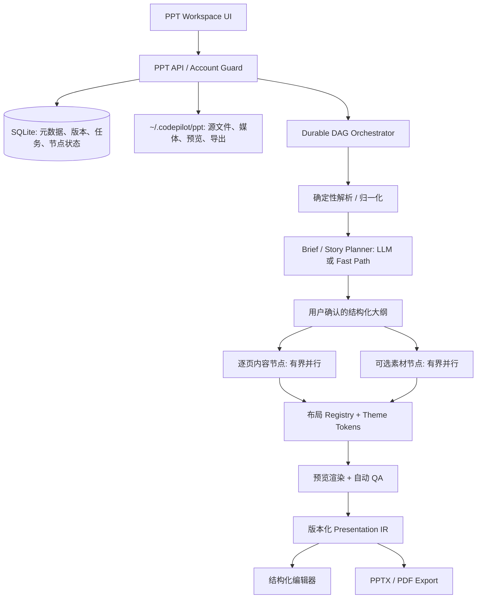

# 办公区 PPT Workspace 开发计划（M1–M5 本地实现）

> 创建时间：2026-09-18
> 最后更新：2026-09-20
> 状态：M1–M5 代码已在本地实现并通过本地门禁；PPTX 媒体与中文字体保真加固复核已完成；真实 Cowork 部署验收待补。下文原始 Phase 清单同时保留规划记录，不代表远端均已验收。
> 输入：[交互原型](../../../../prototype.html)、[需求文档](../../../../requirement.md)、[Gamma 架构分析](../../../../gamma.md)。三份输入位于仓库父目录，实施时不要把原型中的模拟数据、定时器和假导出当成生产逻辑。

## 0. 一页结论

### 2026-09-20 PPTX 媒体与中文字体保真加固（本地完成）

1. **模板包结构保真**：定位并修复 PPTX round-trip 重写图片节点、SVG/PNG fallback 与 relationship 的问题；最终产物以原始模板包为基底，只移植文字形状的 `p:txBody`，避免 PowerPoint 选择被重写的白色 SVG 分支。
2. **生成字体保真**：PPTX 文本 run 同时保留模板 Latin 字体和明确的 East Asian 字体；中文 run 写入 `a:ea` 与 `zh-CN`，导出后解析 OOXML 并拒绝缺少东亚字体或含替换字符的产物。
3. **导入编辑保真**：外部 PPTX 的对象级编辑在修改中文后补齐东亚字体，同时扫描文字形状和表格单元格，避免继承不支持中文的原字体。
4. **预览与发布一致性**：PDF 渲染按文字脚本选择模板的 East Asian 字体；质量门禁覆盖 native text、表格和嵌套节点，并将 Unicode 替换字符作为发布硬错误。
5. **回归验证**：补充生成、外部 PPTX 编辑、字体 fallback、质量门禁和示例文件的包级测试；运行 M1–M5 PPT 自测与全仓测试，记录无法在本机完成的真实 Cowork/PowerPoint 验收边界。

复核发现：v5 虽已恢复全部模板媒体字节，但 Artifact Tool round-trip 还重写了图片 shape ID、relationship ID/target，以及 SVG 与 PNG fallback 的 OOXML 结构。Artifact Tool 预览使用 PNG fallback，因此预览正常；Microsoft PowerPoint 会解析被改写的 SVG 分支，所以第 2、3、6、7 页仍显示白色方框。最终修复不再把 round-trip 产物作为包基底：构建器先生成受控文字，再以原始 Gamma 模板 PPTX 为最终包，只按稳定 shape ID/name 移植 slide 与 notes 的 `p:txBody`。图片、SVG fallback、relationship、几何、层级、主题和嵌入字体全部保持模板原样；同时清理原模板中指向不存在 slide master 的 9 条陈旧 Content Types 声明，避免包校验误报且不改变视觉。

v6 包级验证结果：全部媒体字节一致、全部 relationship 字节一致、全部图片节点一致、除文字体以外的 slide/notes XML 一致，Unicode 替换字符为 0；PPTX 包检查 0 finding，401 个文本脚本片段通过字体策略。另用本机 **Microsoft PowerPoint 原生打开 v6 并导出 PDF**，逐页渲染复核 10 页，第 2、3、6、7 页均无白色方框。这次验证覆盖 PowerPoint 实际解析路径，不再以 Artifact Tool 预览代替客户端验收。

### 2026-09-19 M5 质量门禁执行计划（本地完成）

按产品要求严格依次交付：

1. **版式注册表与模板字体事实源**：为封面、摘要、大数字、对比、图表、表格、图文、时间线、结论建立版本化 registry、语义选择器和确定性几何；模板快照必须包含标题/正文字体及东亚字体。PPTX/预览/PDF/质量检查读取同一 token；上传模板只有在字体和颜色都能可靠提取时才允许 `mapped`，不得用统一硬编码字体覆盖模板。
2. **有界并行 DAG**：来源检查、内容页和媒体检查成为可恢复节点；内容模型 worker 使用独立 Cowork sid/容器与凭证作用域，避免并行共享 Claude HOME。默认并发 3、受服务端总并发继续约束；`keep` 页复用且不占模型节点。
3. **确定性质量检查与修复**：检查字体 token/中文覆盖、最小字号、布局区域重叠、颜色对比度、图片像素和来源完整性；先用布局 fallback、去重和安全颜色修复，硬错误未解决时不得 publish。
4. **一次整稿模型评审**：只把 brief、压缩后的全稿和来源编号送给无工具模型；唯一输出为 missing/repeated/conflicts/unsupported 四类结构化发现，不接收坐标、字体、布局或改写后的 PPTX。模型评审每次初始生成只调用一次；确定性 repair 后发布。
5. **`review → repair → publish` 状态接线**：质量报告、节点耗时、修复记录与模板字体快照持久化；UI 展示真实阶段与最新质量报告；未通过项目保存为可编辑但不可导出的 `quality_blocked`，编辑保存继续跑确定性检查，通过后才发布；模型整稿评审不因普通保存重复烧调用。

本地验收：新增模块单测覆盖九类版式、模板字体提取/冻结、并发上限、节点恢复、五类确定性检查、一次模型评审和未通过禁止 publish；M1–M5 服务端自测通过，PPT 浏览器用例验证质量报告、字体和版式交互。10 页样例通过 PPTX 包检查和布局几何检查（0 finding、0 warning）。真实模型并行度、容器冷启动、Windows PowerPoint 字体和跨设备仍须在部署环境复验。详见 [M5 交接](../../handover/ppt-workspace-m5.md)。

### 2026-09-18 M4 执行计划（本地完成）

1. 扩充 slide IR 为受限内容块：图片（PNG/JPEG，尺寸与字节上限）、数据图表（有限标签与数值）、表格（有限行列）、基础形状。服务端统一校验并保存，旧版纯文本 slide 向后兼容；模型不能输出坐标或编造图表数据。
2. PPTX/PDF 确定性渲染同一 IR；编辑与演示预览消费相同块，图片、图表、表格与形状均可修改并导出。有限布局族由代码选择；溢出上限在 IR 校验阶段拒绝。
3. 选中页 AI 改写仅接收当前页及用户指令，验证结果后重渲染；模板切换只重渲染不调用模型；编辑器增加撤销/重做、搜索、排版与格式设置，只显示已实现功能。
4. 用本机真实 PPTX/PDF 产物样本检查元素类型/页数，补 API 与浏览器回归；执行 typecheck、全仓单测和生产构建。真实远端 Cowork、跨设备及安装包仍在部署环境验收。

**本地实施**：新增受限视觉块 IR 与每页两种布局，支持图片、图表、表格、形状的结构化编辑及确定性 PPTX/PDF 绘制；图片在浏览器缩放，图表数值只能由用户输入。选中页 AI 改写保留视觉块；图片说明与形状标签可局部改写，主题切换只重渲染；编辑器加入撤销/重做和页面搜索。含图片的编辑请求采用局部页补丁，列表省略旧稿快照，减少传输。真实 PPTX 重新打开检出图片、原生图表与表格；临时本机 Matplotlib 环境下真实 PDF 重新打开核对 3 页。M1–M4 PPT 浏览器 5/5、全仓 UI 冒烟 22/22、全仓单测 2799 通过/1 跳过、`next build --webpack` 均通过；桌面与 390px 截图核对。远端 Cowork 行为待验收；详见 [M4 交接](../../handover/ppt-workspace-m4.md)。

### 2026-09-18 M1 → M2 验收闸门

先前用户要求 **M1 可用闭环全部实现且运行无误之后才开始 M2**；随后明确发出“现在 implement M2 内容输入与项目管理”的新指令，因此开始 M2 本地实现。M1 真实 Cowork 验收闸门仍未通过，不能把模拟 API 的浏览器测试或本机 `python-pptx` 自测记为远程验收。

| 检查项 | 当前结果 |
|---|---|
| 代码类型与全仓单测 | `npm run typecheck` 通过；`npm run test` 2799 通过、1 跳过 |
| M1 HTTP 工作流 | 使用可控模型/渲染依赖验证创建、大纲、逐页失败及节点续跑、跨账号隔离、修订冲突、编辑、导出；通过 |
| PPTX 文件 | 本机用 `python-pptx` 生成并重新打开含中文文件；通过；已明确设置东亚字体 |
| UI 浏览器路径 | PPT 定向 Playwright 1/1 通过；验证实际模型 ID 与配置 ID 一并提交，但服务端响应为 mock |
| 真实 Cowork 与跨设备 | **未验收**：已通过账号 OAuth 登录，在隔离的本地验收环境同步 18 个模型配置和 Cowork 地址/令牌，三者均已验证存在；但 `/api/ppt/projects` 经远程代理返回 HTTP 404，当前远程控制面尚无 PPT 路由。本机无 Docker；需将本次 `apps/cowork-server` 代码部署到可用测试服务，再实测创建→模型生成→重启恢复→另一设备读取→下载并打开 |
| webpack 构建 | `next build --webpack` 完整通过，含编译、TypeScript、164 个静态页与 trace；尚未打开 Electron 安装包。普通 `npm run build` 仍因仓库现有 Turbopack/webpack 配置冲突失败 |

在真实环境验收和安装包验证完成前，不标记 M1–M3 为已上线。

### 2026-09-18 M1/M2 复核与 M3 本地实施记录

- **M1/M2 复核**：重跑 M1、M2 服务端自测和浏览器用例；发现 M2 回收站批量恢复/永久删除只有 API、缺 UI 入口，已补齐。清空超过 100 个回收站项目按批处理。M1/M2 的真实容器、跨设备及 PDF 产物仍因本机无 Docker、远端 PPT 控制面未部署而不能声明通过。
- **版本更新**：Workspace 中已完成项目或本地文件可作为上一版；新进展接受 Prompt、Paste、File。旧版内容以快照保存在新项目中，原项目保持独立可打开和导出。新项目记录 `rootId/parentId/number` 和版本列表；更新创建使用请求幂等键，重复提交同一输入返回原项目。模型做语义页规划，服务端验证旧页 ID、来源编号与 6–30 页边界，输出保留/改写/新增/移除差异。确认大纲后，保留页复用旧版内容节点；改写/新增页才调用模型，全部页面按新模板重新确定性渲染。两份上传文件分别保留原始字节并在 Cowork 容器解析。
- **模板中心**：五类内置模板与个人上传库，搜索、分类、预览、置顶、删除、使用；支持 `.pptx/.potx/.pdf` 上传。容器内解析页数、示例标题和稳定背景/强调色；能映射的 PPTX/POTX 生成冻结 palette 快照并用于 PPTX/PDF 渲染，不能映射的文件与 PDF 明确标为“仅供参考”，不可选为生成模板。删除模板不破坏已有项目的 palette 快照。原文件存储在用户服务端模板库，分析临时容器完成后清理。
- **本地验证**：M3 服务端契约覆盖跨账号、模板兼容性、真实 PPTX/POTX/PDF 分析与 PPTX 颜色渲染、旧版不变、版本谱系、重复提交幂等、未变节点复用、双文件更新；PPT 浏览器 4/4 通过；全仓 `npm run test` 2799 通过、1 跳过。桌面与 390px 截图显示模板中心和更新大纲正常，页面错误为零。`next build --webpack` 已通过编译、TypeScript、164 页生成与 trace。
- **远端验收边界**：部署 Cowork 控制面后必须实测模板上传分析、旧版/进展双文件解析、版本更新、重启恢复、另一设备查看、PPTX/PDF 下载打开和永久删除；本机测试中的依赖注入与本机 Python 脚本不能替代这一步。

### 2026-09-18 M2 本地实施记录

- **内容输入**：新增粘贴文本与文件导入；受支持格式为 UTF-8 Markdown/HTML、DOCX、PDF、XLSX、PPTX。原始文件保存在该项目的 Cowork 持久卷，同时服务端保存来源 hash、位置标注与有界文本。`.doc/.xls` 明确拒绝并提示转换；扫描/加密且无可抽取文本的文件报错。粘贴原文变动使大纲失效并重新生成；上传失败可从原文件重试解析。
- **粘贴图片补充（2026-09-19）**：新建 PPT 的 Paste 模式支持文字与剪贴板图片同时输入，也可从文件选择器补充图片。PNG/JPEG 在客户端缩放压缩后显示缩略图，最多 4 张；服务端再次校验签名、大小、ID 并随 `source.images` 保存。文本重新读取保留图片。内容页生成完成后，确定性代码按每页最多 2 张分配到非封面页并写入视觉块，模型不接收图片坐标、不修改图片；编辑、演示、PPTX/PDF 共用该 IR。项目列表不返回图片数据，打开详情时才读取。
- **大纲与生成**：可改章节、标题、主张，增删页并重新规划；来源编号进入大纲与逐页文案节点。模型只写结构化叙事/文案；解析、引用校验、渲染由确定性代码执行。
- **项目管理**：服务端按账号保存文件夹、收藏、置顶、标签、复制、批量移动/删除、回收站/恢复/永久删除；客户端增加检索、排序、状态过滤、网格/列表与快捷搜索。项目列表只返回摘要，详情再取完整 IR 与来源，避免文件库载入大量源文本。
- **导出与演示**：完成项目可请求 PDF，按项目修订缓存并从 Cowork 容器下载；新增前后翻页、Esc 退出的演示视图。PDF 与 PPTX 都从同一内容 IR 生成。
- **本地验证**：`selftest-ppt-m2.mjs` 验证创建、来源失效、跨账号隔离、文件夹/复制/批量/回收站，并用真实 DOCX/PDF/XLSX/PPTX/HTML/Markdown 样本跑解析脚本；PPT 浏览器定向测试 3 条通过；`npm run test` 2799 通过、1 跳过；TypeScript/ESLint 通过；`next build --webpack` 完成编译、TypeScript、164 页生成与 trace（仅有既存 `claude-status` ESM 警告）。桌面与 390px 页面截图检查通过。**PDF 产物未在本机实测**：本机 Python 缺 `matplotlib`，Cowork 镜像 Dockerfile 声明已预装，仍需部署后在真实容器下载并用 PDF 阅读器打开验证。
- **部署边界**：远端 Cowork 控制面此前对 `/ppt/projects` 返回 404，本机无 Docker，因此本次没有真实容器生成、跨设备同步或 PDF/PPTX 远端导出的 E2E 验收。上线前需部署新控制面并运行 M1/M2 验收脚本。

### 2026-09-18 M1 实施记录

- 执行位置：生成大纲、逐页文案和 PPTX 渲染都在每个项目独立的远程 Cowork 容器中。模型只输出受限 JSON；布局、主题和 PPTX 序列化由 `python-pptx` 确定性代码完成。
- 跨设备事实源：Cowork 服务端按 `uid/projectId` 原子保存项目 JSON，PPTX 在该项目的持久 volume。Next 仅代理用户鉴权与下载；另一台已登录设备可列出、打开、编辑和导出同一项目。
- M1 状态链：`outlining → outline_ready → generating(content[slideId] → rendering) → completed`，失败可重试。已完成的逐页节点持久化，服务重启恢复未完成节点；同一项目内容保存使用 revision 乐观锁。
- 已落代码：办公侧栏 `/ppt`、项目库与表单、大纲确认、后台进度、逐页标题/要点编辑、新增页、文件名保存、PPTX 导出、三语 UI；服务端的持久化 API、逐页执行与渲染。
- 已验证：`npm run test` 2799 通过、1 跳过；`selftest-ppt.mjs` 检查跨用户隔离、未完成禁止导出、任务恢复数据、IR 校验，并用 `python-pptx` 生成及重新打开中文 PPTX；开发页面以浏览器检查加载、表单与 console；PPT 定向 Playwright 测试 1/1 通过。全仓 `test:smoke` 13/17，通过项外的 4 项位于既有 mention-picker、plugins/MCP/settings 测试。真实远程 Cowork 端到端须在部署环境验收。
- 构建验证：普通 `npm run build` 被现有 Next 16 Turbopack 与 webpack 配置冲突阻断；改用打包脚本采用的 `next build --webpack`，编译、TypeScript、164 页静态生成和 trace 完整通过。Electron 安装包尚未打开验收。
- 后续切片：导入、PDF、模板上传、版本更新、丰富视觉元素及项目管理属 M2–M4。原始 §3 的本地 SQLite 目标架构已被本次“必须跨设备同步”决策取代；M1 以远程 Cowork 服务端为事实源。

在现有「办公」tab 的侧栏中新增 **PPT** 入口，进入独立的 PPT Workspace 路由。Workspace 有项目库、模板、任务、回收站和编辑器。生成系统的核心是**结构化演示文稿 IR + 持久化任务 DAG + 确定性布局/渲染/导出**：LLM 负责目标理解、叙事规划、文案和视觉意图；解析文件、数字计算、布局几何、主题、溢出检测、PPTX/PDF 序列化由软件负责。

不建议以「让通用聊天 Agent 直接调用 PPT skill 写 PPTX」作为主架构。它难以满足局部重生成、模板一致性、后台任务、结构化编辑和版本更新。现有 Agent/Provider 能力可以作为模型调用基础设施，但 PPT 工作流应是独立的领域编排器。

## 1. 与现有产品的结合点

| 现状 | 对 PPT 模块的影响 / 接入方式 |
|---|---|
| `src/components/layout/ChatListPanel.tsx` 已有「办公 / 研发」切换，办公入口现有「新对话 / 文生图 / 定时任务」 | 在**办公**入口列表增加 PPT；高亮由 `/ppt` 路由决定。切换办公/研发、直接打开深链、返回聊天时都要保持侧栏和主内容一致。原型额外的整列 office rail 不宜照搬进现有 AppShell。 |
| `src/components/layout/AppShell.tsx` 承载全局 shell，`src/app/*` 为 App Router 页面 | 新增 `/ppt`、`/ppt/create`、`/ppt/projects/[id]` 等路由；PPT 内的二级导航可在模块内部实现，避免重建全局侧栏。 |
| `src/lib/provider-resolver.ts`、`text-generator.ts`、`image-generator.ts` 已有 Provider/生成能力 | 复用凭证解析、受管模型和错误治理；PPT 模型下拉展示**当前实际可用模型**及能力，不照抄原型十个固定名称。结构化输出能力需先做 POC。 |
| `src/lib/db.ts` 为本地 SQLite（WAL），办公会话按 `current_user_uid` 隔离 | M1 仅用本地 DB 获取当前登录 uid 与远程 Cowork 配置；PPT 项目和任务以远程服务端为事实源，不写入 `chat_sessions`。 |
| `src/components/editor/PptxViewer.tsx` 及文件预览 API 已支持 `.pptx` **查看** | 可用于已导入 PPTX 的只读预览；不能当作生成器、编辑器或导出器。编辑画布优先从自有 IR 渲染，导出器另做。 |
| Cowork 提供隔离执行（本地 vfkit / 远程容器），办公聊天受 `sandbox_enabled` 约束 | PPT 属办公区独立模块；用户已确认生成必须在远程 Cowork 沙箱执行。每个 PPT 项目独立容器和持久卷，按 uid 隔离。 |
| Electron 主进程监护 Next standalone 服务，服务可能重启；Next `instrumentation.ts` 可做启动初始化 | 生成任务必须脱离页面生命周期，进度/阶段/产物可恢复；不能沿用原型内存数组、`setTimeout` 或浏览器标签页驱动执行。 |
| i18n 为 `en.ts`、`zh.ts`、`zh-HK.ts` | 新入口与全流程文案同步三语；遵循现有主题 token、键盘与窗口尺寸规则。 |

## 2. 产品范围与交付切片

需求文档描述的是完整产品，而不是一个简单生成按钮。建议分四个可验收切片，逐步覆盖原型能力：

| 切片 | 用户可完成的任务 | 不应以假能力交付 |
|---|---|---|
| **M1 可用闭环** | 办公侧栏进入 PPT；Prompt → brief/大纲确认 → 选择内置模板与可用模型 → 后台生成 → 项目库查看 → 编辑标题/要点 → 保存 → 真实 PPTX 导出；失败可重试 | 不显示无功能的导出、模型或工具按钮；生成进度以真实节点为准 |
| **M2 内容输入与项目管理** | 粘贴文本、导入常见文件并编辑大纲；搜索/排序/筛选、收藏/置顶、文件夹、复制、批量操作、回收站；PDF 导出、演示模式 | 文件类型按真实解析能力开放，不用“上传成功后按扩展名伪造大纲” |
| **M3 版本更新与模板扩展** | 选 Workspace 旧版或上传旧版，加入新进展、查看差异、编辑更新大纲、选择模板、生成新版本；模板上传经过解析/兼容性验证 | 更新不覆盖旧版本；上传任意 PPTX/PDF/POTX 不自动宣称可作为可编辑模板 |
| **M4 丰富编辑与优化** | 真实图片、图表、表格、形状、局部 AI 编辑、模板/主题切换、生成质量与性能优化 | 原型预留的搜索/排版/AI 润色按钮只有实现后才开放 |

M1 是建议的首个发布门槛，M2–M4 是完成 `requirement.md` 全量范围的后续切片。**范围与优先级需在实施前确认**；下文将全部列为 To-do，避免遗漏。

## 3. 目标架构（原始方案；M1 以 §0 的远程架构为准）

下方 §3.1–3.5 保留最初的长期设计推演，其中本地 SQLite、Next worker 与本地文件库**不适用于已确认的 M1**。M1 实际链路为：`/ppt` UI → Next `/api/ppt`（仅鉴权代理）→ Cowork 服务端项目 JSON/任务状态 → 项目专属容器中的无工具模型调用 → 服务端逐页节点检查点 → 容器内 `python-pptx` 渲染 → 持久卷中的 PPTX → 授权下载。后续 M2–M4 要继续以远程事实源演进。

### 3.1 唯一事实源：Presentation IR

- 保存 `schemaVersion`、`deckId`、`versionId`、`brief`、`themeId`、`templateVersion`、slides、assets、provenance；PPTX/PDF 是**导出产物**，不是主要编辑源。
- Slide 使用稳定 ID、语义角色（cover/problem/comparison/data/timeline/summary 等）、`layoutIntent`、受限内容 block（标题、段落、要点、指标、图片、图表、表格）及内容约束。Block 不由 LLM 输出自由 `x/y/w/h`。
- 文档标题（文件名）、封面第一页标题、版本名称分离。文件名失焦自动保存；页面内容显式保存；项目库封面标题只随页面内容保存更新，按原型语义实现。
- 每次保存形成可恢复的版本修订；更新旧版必须创建新 `versionId`，原版本保持可打开与导出。编辑期间用乐观版本号防覆盖。
- 使用 schema 校验与迁移；模型输出即使 JSON 合法也要经过字段、长度、页数、引用和资产存在性验证。

### 3.2 LLM 与确定性代码分工

| 工作 | 执行者 | 约束 |
|---|---|---|
| 目标、受众、语气、叙事顺序、每页主张、文案、视觉意图 | LLM；简单输入可用较短的规划路径 | 只输出受 schema 限制的 Brief / Outline / SlideContent；可编辑、可追溯 |
| 文件类型识别、解包/文本抽取、去重、长度限制、内容分段、数字与表格计算 | 解析器与确定性代码 | 来源页/段/单元格引用保留；未知数据不让模型编造 |
| 模板匹配、布局族选择、具体位置、字体/颜色/间距、溢出检测、重排 | 验证过的 Layout Registry + Theme Tokens | 模型只给语义 role/intent；导出和预览消费同一套布局结果 |
| 封面、页缩略图、PPTX、PDF、下载文件名 | 确定性渲染/导出器 | 同一 IR 同一模板版本应产出稳定结果；页数与内容一致 |
| 研究和图像 | 独立可选节点 | 用户未要求或来源已有充分内容时不触发；有外部来源时显示来源与许可信息 |

### 3.3 DAG 节点与失效边界

1. `ingest`：Prompt/Paste/Import/旧版/新增进展统一变成可追溯 `SourceBundle`；按输入模式走不同 Fast Path。
2. `brief`：根据源生成目标/受众/约束；粘贴完整正文优先保留原文事实，避免重复研究。
3. `outline`：生成或确定性分段；用户修改/确认后冻结 `outlineRevision`，再提交生成任务。
4. `content[slideId]`：按页并行生成内容；每页携带本页源片段与全局 brief，限制并发、token、重试。
5. `media[slideId]`：仅需要图片的页启动；可与其他页内容并行，生成失败可降级为无图布局并明确提示。
6. `layout[slideId]`：选择有限布局族并做 fit/reflow；不调用 LLM 修像素。无法适配时反馈结构化 overflow，触发缩短文案或拆页的**有限次数**修复。
7. `render[slideId]` → `deck-qa`：预览与确定性检查（文本裁切、空页、缺媒体、字体、越界、页数、资源可达性）。
8. `persist` → `export`：原子发布新版本；导出可延迟执行并缓存。阶段进度与错误码写库。

依赖/缓存键至少包含源文件 hash、prompt 修订、outlineRevision、模型标识、prompt 版本、模板版本、主题版本和生成器版本。**只重跑失效节点**：改一页文案只重排/渲染该页；换主题重排/渲染全部页，不重新写文案；换源或更新 brief 才重算相关语义节点。节点结果、尝试次数与耗时可查询，便于重试和成本诊断。

### 3.4 后台任务与故障恢复

- `POST` 创建任务后立即返回 `taskId`；详情/事件接口供页面重连与轮询，SSE 只传通知，不作为状态唯一来源。
- SQLite 持久化任务、节点状态、输入快照、幂等键、lease/heartbeat、错误分类与可重试性；生成执行者独立于 React 页面。Next 进程重启后扫描过期 lease，恢复幂等节点；发布新项目/版本用事务或临时文件原子替换，避免双写与半成品。
- 同时运行数、每任务并行页数、Provider 速率/成本预算和磁盘预算均有限制。排队、取消、后台、失败、重试需要真实状态机；重复点击/窗口重开不能重复创建项目。
- 可先在 Next 服务进程做持久化 worker，但**启动机制和多进程竞争**必须 POC 验证；若打包态不稳定，再使用独立 Node/Electron 子进程 worker。不要直接复用现有轻量定时任务 scheduler 充当 PPT 作业队列。
- 前台生成页展示真实阶段、当前已完成页与可预览内容；不以打字动画伪装真实百分比。后台完成时按现有通知能力提醒，回到模块后状态从服务端恢复。

### 3.5 存储、安全与边界

- SQLite 保存项目、版本、文件夹、模板元数据、任务与 DAG 节点；大文件按账号/项目/版本存于应用数据目录，DB 存相对键、hash、大小、MIME。所有下载用受控 ID，不接受任意绝对路径。
- 项目、版本、源文件、任务、导出、回收站均带 `ownerUid`；API 层统一当前账号归属校验。登录切换后旧账号项目不可见，不因直接访问 ID 泄露文件。
- 上传先检查大小、扩展名、文件签名、解压膨胀、路径穿越与嵌入脚本/外链；HTML 解析需净化。解析器对不支持/加密/损坏的文件给可操作错误，不产生假大纲。
- 保存用户源文、模型摘要、外发范围的事实链；默认不把企业文件送到额外研究/图库服务。PPT 生成跑本地还是 Cowork 待确认，实施前按选定边界设计凭证、出网与文件传输。
- 50 项目配额是原型值，建议按**当前账号的非回收站项目**计数，并在服务端并发创建时原子校验；是否真正限制为 50 待产品确认。

## 4. 详细 To-do（原始规划；M1 进度见 §0）

### Phase 0：技术与产品定版 / POC

- [ ] 与产品确认 §6 中的未决项，冻结 M1 验收范围、文件格式矩阵、模板契约和 PPTX 可编辑性标准。
- [ ] 在目标 Electron/Next 打包环境 POC：结构化模型输出、真实 PPTX 写入和重新打开、PDF 导出、字体与中文换行、图片、表格/图表、现有 PPTX 预览器兼容；记录选型及依赖许可。**不在当前方案中凭猜测固定新库。**
- [ ] POC 本地 worker 对路由热更新/服务重启/双窗口并发的行为；测 10/30/50 页耗时、内存和峰值并发，确定 worker 部署位置。
- [ ] 做 3 类真实输入样本（短 prompt、长篇粘贴、复杂 PPTX/PDF），建立内容抽取与导出质量基线和失败样本。
- [ ] 确定首版内置模板数量及布局族（建议先少量但完整：封面、章节、要点、左右图文、对比、指标、时间线、结论），给每种做溢出样本。
- **Gate**：能够从固定 IR 导出真实可打开的 PPTX/PDF，并从应用渲染相同内容；后台任务在服务重启后可恢复，才进入全面实现。

### Phase 1：领域模型与基础设施

- [ ] 新建 `src/lib/ppt/`：IR/schema、repository、file-store、source bundle、template registry、layout registry、renderer、export adapters、orchestrator、job worker；公共类型置于 `src/types/` 或领域目录。
- [ ] 扩展 `src/lib/db.ts` 迁移：`ppt_projects`、`ppt_versions`、`ppt_folders`、`ppt_templates`、`ppt_sources`、`ppt_jobs`、`ppt_job_nodes`、`ppt_assets`、`ppt_exports`。定义 FK、owner 索引、软删除/恢复与数据清理策略；不复用 `media_jobs`、`scheduled_tasks`、`chat_sessions` 的语义。
- [ ] 完成账号隔离、路径白名单、原子写入、内容 hash、容量限制、删除与回收站清理；数据目录迁移策略及备份/恢复说明。
- [ ] 建立可版本化提示模板、模型调用适配、Zod/JSON Schema 验证、错误分类、任务事件与结构化日志（不记录敏感原文）。
- [ ] 定义任务状态机和 DAG 节点状态机；lease、幂等、取消、重试、超时、服务重启恢复的单测与故障注入测试。

### Phase 2：办公导航与项目库骨架

- [ ] 在 `ChatListPanel.tsx` 办公入口加入 PPT，处理可用性、路由高亮、办公 tab 切换和深链；补 `en/zh/zh-HK` 文案。
- [ ] 新增 `/ppt` Workspace 页面与模块内部二级导航（最近/全部/收藏/模板/任务/文件夹/回收站）；沿用 AppShell、主题 token，不在外壳重建原型的第一列 rail。
- [ ] 项目 API：分页列表、详情、创建草稿、收藏、置顶、重命名、复制、移动、软删/恢复/永久删除；批量操作事务化。卡片点击与多选 checkbox 互不触发。
- [ ] 实现搜索/筛选/排序、Grid/List、sticky header、项目详情抽屉、文件夹计数、空态与加载/错误态；项目标题与封面页标题分离。
- [ ] 验证侧栏入口只在办公 tab 显示，研发路由不受影响；窄窗口、键盘操作、CDP 截图与交互验证。

### Phase 3：M1 Prompt → PPT 闭环

- [ ] 新建入口和 Prompt 表单：标题、目标/受众、页数识别（默认 10、允许 3–50）、模板/模型选择；模型来自实际 Provider catalog，并按结构化输出能力/可用性过滤。
- [ ] 生成 Brief/Outline，显示可编辑的章节/子章节、来源或假设；用户确认后冻结 revision，才进入异步任务。
- [ ] 首批内置模板的 design tokens、布局族、字体策略、测量与 reflow；同一 IR 用于缩略图、编辑画布、演示画布及导出布局。
- [ ] DAG worker：按页有界并行、缓存、进度事件、失败重试；支持离开页面继续生成、前台完成自动进编辑器、后台完成出现在项目库并通知。
- [ ] 真实 PPTX 导出、可下载并经 PowerPoint/LibreOffice 至少一种打开验证；首版只暴露已验证的可编辑元素类别。
- [ ] M1 可编辑页面：标题/要点编辑、增加页面、文件名失焦保存、页面内容显式保存、未保存退出保护、重新进入内容不丢。
- [ ] 真实样本验收：页数正确、无截断/空白/丢字、中文字体可用、重新打开后版式可接受；任务失败不生成“成功项目”。

### Phase 4：Paste / Import 与来源追溯

- [ ] 粘贴文本解析、分段与 Fast Path：已有完整正文时优先结构化映射；源文本变化立即使旧大纲失效，需重新读取。
- [ ] 导入矩阵逐格式落地：Markdown/HTML、DOCX、PDF、XLSX、PPTX；老 `.doc/.xls` 如无可靠解析器应暂不开放或给明确转换引导。原型列出的每种格式必须分别实测后才显示“支持”。
- [ ] 抽取结果含源页码/段落/单元格、表格数值与单位；用户可预览抽取文本、编辑大纲、手动纠正。无法提取内容、扫描 PDF、加密文件单独提示。
- [ ] Import 生成页数由用户确认/内容决定，不沿用原型固定 12 页；大纲编辑区独立滚动。支持重试解析而不重复上传。

### Phase 5：模板中心、PDF、演示与项目治理

- [ ] 模板搜索、分类、预览、使用、收藏；模板以**版本化 IR 布局 + design tokens**存储。
- [ ] 对上传 `.pptx/.potx/.pdf` 建兼容性分析；只读参考、可映射模板、完全支持三种状态明确展示。无法提取设计规则时不得静默变成可编辑模板。
- [ ] 真实 PDF 导出、缓存与文件名处理；演示模式（前后翻页、页数、Esc/箭头键、窗口尺寸）。
- [ ] 完成文件夹 CRUD/置顶、回收站和批量移动/删除/恢复/清空；永久删除同时清理源文件、版本、预览与导出缓存，失败可重试。

### Phase 6：基于上一版更新

- [ ] 选择 Workspace 旧版或上传旧版；最新进展支持 Prompt、粘贴或文件，并对“旧版 + 新进展”建立 source provenance。
- [ ] 先做语义 diff：保留/替换/新增/删除的章节及事实，标出来源和待确认冲突；用户在大纲与模板预览页批准后生成。
- [ ] 仅受影响页面重写内容；未变页面复用已批准 IR，换模板则仅重排。输出新版本，不覆盖旧版；文件夹、命名、标签按需求规则，可人工修改。
- [ ] 验收：旧版可再次打开与导出，更新版能说明变化来源；连续更新、失败重试、重复提交不产生重复版本。

### Phase 7：丰富编辑与 AI 局部操作

- [ ] 按 block 类型实现图片、图表、表格、形状的真实编辑和导出；图表数值由结构化数据计算，不让模型直接编数。
- [ ] 仅对选中页/选中 block 做 AI 改写，保留撤销/重做和原版本；主题切换只触发重排/重渲染，不重写内容。
- [ ] 完成工具栏剩余功能（搜索、格式、布局、AI 润色）。未交付的控件从 UI 中隐藏或清楚标为不可用。
- [ ] 完成响应式布局、无障碍、快捷键、长文案/多语言排版、性能与内存基线。

### Phase 8：整体验收与发布准备

- [ ] 单元/契约测试覆盖 IR 校验、页面布局边界、DAG 失效传播、幂等/恢复、权限、文件格式和导出内容；使用固定 IR golden samples。
- [ ] 实机 E2E：新建三路径、更新、后台任务与重启恢复、编辑/保存/退出、模板、项目管理、回收站、导出与再次导入。
- [ ] 按仓库规则执行 `npm run test`、`test:smoke`、`test:e2e`；UI 用 CDP 验证窗口和交互；打包变更完整打包并打开 macOS/Windows 目标产物。
- [ ] 检查新增依赖体积、原生 ABI、Next standalone 文件追踪、Electron 资源路径、模型费用、磁盘占用、隐私和账号切换；更新 `ARCHITECTURE.md`、handover、帮助文档与发行说明。

## 5. 接口草案与关键验收契约

以下是接口**责任划分草案**，不是本轮要创建的路由清单；实施前按项目命名规范定稿。

| 资源 | 主要动作 | 契约重点 |
|---|---|---|
| `/api/ppt/projects`、`/[id]` | 列表、元数据修改、复制、回收站 | 当前账号校验、版本号、分页、服务端过滤排序 |
| `/api/ppt/sources` | 上传、解析、抽取预览 | 文件签名/大小/内容限制、来源 hash 与错误分类 |
| `/api/ppt/outlines` | Brief/大纲生成、编辑、确认 | schema、source revision、修改后失效规则 |
| `/api/ppt/templates` | 浏览/预览/导入验证 | 模板版本与可编辑能力分级 |
| `/api/ppt/jobs`、`/[id]`、`/[id]/events` | 创建、状态、取消、重试、进度 | 幂等键、可恢复状态、前后台一致 |
| `/api/ppt/projects/[id]/versions` | 版本列表、保存、更新 | 乐观锁、旧版本只读保留、原子提交 |
| `/api/ppt/exports` | PPTX/PDF 生成与下载 | 从指定 IR 版本生成、缓存键、账号校验 |

**首版验收样例**：用户从办公侧栏打开 PPT，输入“面向管理层的 10 页季度业务复盘”，检查/修改大纲，选模板和当前可用模型，离开生成页后任务继续；返回看到真实进度与可恢复任务，完成后打开编辑器，修改第 2 页并保存，改文件名失焦即保存但封面标题不变，导出 PPTX，在办公软件中打开并可编辑文本。整个过程重启应用一次仍能恢复，失败任务可重试且不会产出重复项目。

## 6. 待产品确认的决策（建议默认值）

1. **首版范围**：已确认 M1；M2–M4 后续实施。
2. **PPT 生成执行位置**：已确认必须在 Cowork 沙箱执行；M1 模型调用与 PPTX 渲染均在远程项目容器。
3. **数据存放与跨设备**：已确认跨设备同步；M1 项目数据与导出产物留在 Cowork 服务端，按 uid 隔离。
4. **PPTX 的可编辑标准**：建议首版文本、基础形状、图片可编辑；复杂 SmartArt/动画/母版保持视觉但不承诺完全可编辑。若要求与上传模板逐元素一致，必须先重新评估引擎。
5. **模板上传**：建议 M1 仅内置验证过的模板；M3 再支持用户文件，并展示兼容性等级。是否要求首版就能上传 `.pptx/.pdf/.potx` 并作为模板？
6. **模型与费用**：建议使用现有受管/BYOK Provider，按任务选择真实可用模型；不同模型可分配 planning/content 角色但不呈现不存在的固定清单。是否需要锁定单模型或计费/额度上限？
7. **研究和图片来源**：建议首版不默认外网研究或自动生图；可复用已授权的文生图服务，主动触发并显示来源。是否要求自动搜集事实/生成视觉素材？
8. **50 个项目配额**：原型限制 50；建议先确认为产品/服务端规则，且明确回收站是否计数。
9. **旧格式与扫描件**：`.doc/.xls`、扫描 PDF 是否必须首版支持？建议提供明确不支持/需转换提示，避免假解析。

## 7. 决策日志

- 2026-09-18：根据原型与需求文档提出上述分期和架构方案；所有 Phase 均待开始。Gamma 文档中的内部实现推断只用作设计启发，不当作已验证事实。
- 2026-09-18：建议以结构化 IR 和真实后台任务为核心，不依赖原型浏览器内存模拟；建议模型只做语义工作，确定性组件负责几何、布局和导出。待用户评审确认。
- 2026-09-18：用户确认 M1、Cowork 强制执行、跨设备同步、生成成功后保留在 PPT 模块并随时可导出。实现位置改为 Cowork 服务端，Next 只做代理。

## 状态

| Phase | 内容 | 状态 | 备注 |
|---|---|---|---|
| 0 | 决策与 POC | 🚧 进行中 | M1 范围和部署位置已定；实机验证待补 |
| 1 | 数据模型与任务基础设施 | 🚧 M1 初版 | 远程项目存储与逐页节点；原计划本地 DB 方案废止 |
| 2 | 侧栏与项目库 | 🚧 M2 本地实现 | 搜索、排序、收藏、文件夹、复制、批量、回收站已落；远程待验收 |
| 3 | Prompt 生成闭环 M1 | 🚧 初版实现 | 待测试和实机验收 |
| 4 | Paste / Import | 🚧 M2 本地实现 | 六类格式解析自测通过；真实 Cowork 导入待验收 |
| 5 | 模板、PDF、演示、项目治理 | 🚧 M2/M3 本地实现 | PDF、演示、项目治理、模板中心已落；容器产物与跨设备待验 |
| 6 | 上一版更新 | 🚧 M3 本地实现 | 版本谱系、快照、差异大纲、节点复用、模板映射已落；真实 Cowork 待验收 |
| 7 | 丰富编辑 | 🚧 M4 本地实现 | 视觉块、布局、单页 AI、撤销/重做、主题切换已落；远端与质量/性能实测待补 |
| 8 | 整体验收 | 📋 待开始 | 每批次也需阶段验收 |
