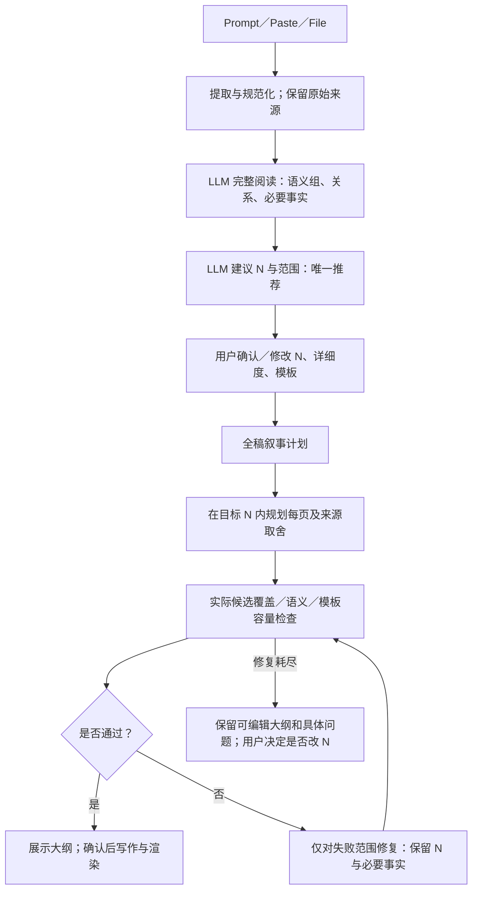

# 以 LLM 阅读建议为唯一页数估算的改进方案

> 2026-10-19；执行顺序、code/prompt、验收均记录于本文件。当前：P1–P8 已实施并完成本地／3143 模拟验收。

## 1. 决策与用户要求

新 v2 流程的推荐页数和推荐区间只能由 LLM 完整阅读产生；用户手动页数优先于推荐。代码负责合同校验、来源覆盖、结构保真和真实页面容量，不能再计算另一套推荐页数覆盖 LLM，也不能通过自动合页／拆页绕过这个约定。保留手动“读取并估算 → 生成大纲 → 确认生成”步骤。真实 LLM 沿用此前 simulate 指示，不调用收费接口，3141 保持不动。

## 2. 当前根因：为什么 13 变成 34

上一轮审计知识库失败记录：LLM 阅读建议 13（11–15）；`measuredPageEstimate` 对原始结构估计 46；`sourceDensityPlan` 估计 34（33–41）；`reconcilePageBudget` 取 max 后变为 34（33–46）。它将尚未做叙事取舍的原始对象成本混入已经完成语义阅读的推荐。

具体缺陷：

1. **对象不同**：原表／目录树的全量字面展示，不等于简洁叙事选定的主稿表示。没有真实 selection 时，“全量成本”不能否决语义建议。
2. **不可加性**：单对象高度相加无法模拟横向比较、原生图、合并解释和共享版面；用单页字体、90% 可用区域、对象向上取整还会扩大偏差。
3. **阶段错误**：先测未生成的候选，把粗略成本说成可读容量下限；最终实际组件／标题／来源范围此时并不存在。
4. **两套权威**：modelEstimate、recommended、range、measured 同时进入 API、任务计数、Wizard 与历史增长提示，容易再次出现不同推荐。
5. **隐式增页**：只改 reconcile 还不够。`automaticPages` 控制 pack、空页裁剪、容量分片、稀疏合页和后续自动增长，仍可把建议变成另一页数。
6. **提示冲突**：旧自动 prompt 允许增页／分片；模型按 13 页规划后，代码又按结构成本扩张。这是目标定义冲突，不应靠不断重试解决。

结论：移除读取阶段的全量结构页数校准；保留逐候选实际容量硬门禁。不能把校准数简单隐藏而继续影响 N。

## 3. Gamma 参考：已知与推断分开

Gamma 官方 Agent 帮助说明 Plan 模式先理解需求并展示可调整计划，确认后构建，修改可限定到指定范围；这支持“计划先行、局部调整”的产品方向。[官方 Agent 流程](https://help.gamma.app/en/articles/15002203-how-do-i-create-with-agent-in-gamma)

Gamma 官方生成参数区分文本生成／精炼／保留，自动切卡时使用目标卡片数，按输入分隔符切卡时则以分隔为准；文本量单独控制。这是分段权威必须明确的可观察接口设计。[官方生成参数](https://developers.gamma.app/guides/generate-api-parameters-explained)

Gamma 的新演示模式说明使用固定 16:9 画布与网格；文档还保留其他模式的尺寸说明，不能把“所有 Gamma 卡片都可无限纵向延伸”当作 PPTX 容量解决方案。[官方 slides 说明](https://help.gamma.app/en/articles/11016396-what-are-slides-in-gamma-and-how-do-they-work)

上述资料没有公开其内部 NLP 模型、调度 DAG 或页数估算公式。以下架构是本项目方案，不声称是 Gamma 的内部实现。

## 4. 先估算还是先生成 outline：定义三种不同规划

| 阶段 | 产物 | 是否已有逐页大纲 | 页数含义 |
|---|---|---|---|
| 完整阅读和语义理解 | 主题、读者问题、独立核心消息、关系、来源归属、必要事实 | 否。逻辑组不强制一组一页 | 模型据此判断需求 |
| 页数建议 | recommended / min / max / reason，含封面及确需的目录／结束页 | 否。输出一个可调整建议 | LLM 唯一估算，不是容量证明 |
| 预算内大纲 | 每页角色、消息、来源选择、表／图范围、媒体意图及布局候选 | 是 | 用户 N 优先，否则采用 LLM recommended；代码按此检查 |

不采用“先猜 N 再读 input”；也不采用“先生成完整 slides 再以数量充当估算”。语义理解与建议可在同一次 LLM 调用内完成，因为建议需要依赖已读内容。逐页规划在用户看到建议、可调整后执行。

## 5. 权威、状态和数据定义

- `inputUnderstanding.recommended/min/max/reason`：模型阅读判断，唯一估算来源。
- `pageBudget`：该判断的投影，`authority=llm_reading`；不再保存用于推荐的 measured、codeEstimate、adjusted 或 measuredExceedsRequest。
- `pages/pageDecision`：本轮大纲目标；source=user 表示手动覆盖，source=estimate 表示取模型建议。auto 只表示建议来源，不表示代码可以自行增删页面。
- `outline.length`：实际候选长度，必须与目标一致；不一致是可修复的模型合同问题，不反过来覆盖目标或建议。
- `densityFit / frozenSourceIssues`：已选候选的局部几何检查，既不能生成推荐页数，也不能替代语义覆盖证明。
- 历史任务读取时，所有推荐出口优先用原 LLM reading，旧代码校准不再显示为推荐；继续同一未确认读取任务时，重建预算投影，auto 回到模型建议，explicit 保留用户目标。
- 已确认／已发布旧文稿不能被后台迁移截断；其“估算”和“已规划／已发布”数量可不同，界面清楚区分。

## 6. 具体执行清单（按顺序）

| # | 修改点 | code / prompt | 实施内容 | 验收 |
|---|---|---|---|---|
| P1 | 唯一推荐函数 | code | 纯函数读取合法模型 recommended/range；reconcile 不再扩大模型值，兼容历史数据 | LLM13＋代码34／46仍为13（11–15） |
| P2 | 阅读与缓存迁移 | code | 不调用全量结构估页；重建 authority 投影；缓存读取不多调模型；用户 N 保留 | 同输入缓存 auto13、explicit9；改详细度重新读 |
| P3 | 给模型正确上下文 | prompt + code | 阅读提供真实模板几何／字号等约束，而非代码推荐页数；先理解再建议，三档深度解释独立 | prompt 无竞争 N；不会据字数或源标题数计页 |
| P4 | 统一出口 | code + UI | page-estimate、事件、planning、任务计数、Wizard 只用 reading；去掉校准／结构页数增长提示 | 历史34不能在 UI 覆盖 reading13 |
| P5 | 阻断隐式再分页 | code | v2 代码不自动合并／裁剪／加页；保留语义分组与并行批次规划；v1 兼容原路径 | capacity 失败后目标仍13；全稿语义分组仍可用 |
| P6 | N 不符的定向修复 | code + prompt | 初始候选过多／过少只修非锁定范围，准确恢复目标 N；恢复后容量修复不得再增删页 | 5→4／3→4可修；未改来源和用户锁定页 |
| P7 | 预算内选材与局部容量修复 | prompt + code | 全稿先规划来源取舍，不把完整输入等于全量逐句上页；失败范围可在已有页间重排，完整选中表格／必要事实不删、不进备注 | 真超载保留阻断态，无代码第二推荐 |
| P8 | 回归、文档、3143 | tests + docs | 单元、真实 API 模拟、原始失败快照、Chrome/CDP、构建与服务更新；保留3141 | 所有出口同 N；不能绕过来源／容量门禁 |

## 7. Prompt 责任与边界

读取：先分析完整 input 的核心消息、逻辑依赖、必要证据与可合并短段；依据来源及详细度推荐总页数。模板约束是写作提示，非另一个 N。若用户要求完整原表、原代码或 full_source，明确该模式所需展开；不得为了迎合较小 N 隐去条件或风险。

大纲：总预算包括封面、正文、必要导航、结束及附录；先分配全稿主题再生成各页；短近义主题合并，跨页只承载新增消息。overview 的合法摘要与代表性行必须在大纲 selection 明示并通过原有规则，确认后冻结。每个必须保留的比较对象、条件、数字与限定仍是义务。

局部修复：使用原始 ID 和行范围及真正测量信息，在失败位置之间重排来源／合法版式／冗余表述。不得宣称放宽字号／删原表即可成功。仅在初始候选数量已违约时允许在受控范围合并／拆分以回到目标；正常容量修复保留总 N。

如果固定模板的不可拆整对象确实无法在 N 内展示，不能保证“永远成功”。展示具体页和对象，用户可以调 N、改模板、改已授权展示范围。系统不擅自生成第二个推荐或假成功。

## 8. 兼容性、测试和完成标准

- 不引入新的网络服务或第三方依赖；不需要迁移数据库 schema。
- 不改写已发布 deck、不删历史来源；读取缓存迁移仅在继续任务时执行，GET 推荐投影可即时避免旧校准数。
- 保留真实容量硬门禁、语义和数值事实验收，修改的是预算权威与阶段，而不是降低质量阈值。
- 负项：缓存34不能复活；后续 pack／merge／split不能改变v2目标；模型仍返回错误页数必须定向修；超载不能生成或导出；代码校准数不能出现在正常推荐提示。
- 验收分别记录模拟调用、本地实际几何、真实浏览器和真实 LLM。没有真实 LLM 整稿验收就不声称生成质量已与 Gamma 相同。

## 9. 进度与结果

P1–P8 均已完成。本轮遵循用户指示模拟 LLM；不声称真实模型整稿质量或新的 PowerPoint 已验收。

### 实际代码地图

| 文件 / 入口 | 现在的责任 |
|---|---|
| `ppt-input-understanding.mjs` | 完整 input 与模板几何交给 reader；先形成语义组再建议 N；没有 recommended 时向模型请求修正，不用区间中点补一个代码页数；缓存命中只迁移预算投影。 |
| `ppt-page-floor.mjs` | `llmPageRecommendation` 验证模型判断，`applyReadingPageBudget` 复用它；旧全量测量函数仅用于离线情景诊断，不进入 v2 pipeline。 |
| `ppt-planning.mjs` / `ppt-page-counts.mjs` | 推荐、范围及任务估算只取 reading；已规划、已确认、已发布数量仍分别记录。 |
| `ppt/project-view.mjs` / `ppt-api.mjs` | 普通和 live 项目响应均使用纯投影清除旧校准推荐；不修改已有成品与存储。`input.ready` 与 `/page-estimate` 同源。 |
| `PptCreateWizard` / `PptWorkspace` / `PptInputReview` | 读取结果、实时进度和恢复任务只展示 LLM 推荐；自动读取的旧 pages 字段不能倒灌覆盖推荐；用户手动值优先。 |
| `ppt-density-profile.mjs` | v2 的 auto 是预算来源，不是允许代码变更数量；关闭隐式合页、拆页、补目录、结尾加页及容量增长路径。 |
| `ppt-outline-compile.mjs` | 语义归属判断与再分页权限解耦：优先同语义组已有页；缺少合适 owner 时给出 source ID 和受控 ownership 修复合同，不按距离硬塞，也不凭空加页。 |
| `ppt-outline-protocol.mjs` | 普通规划 schema 约束目标 N；初始数量违约可在最多16个未锁定位置合并/拆分，每次缩小差值；所有来源 ID 保持，selection 冻结；恢复 N 后容量修复不可再增删页。 |
| `ppt-outline-concision.mjs` / `PptOutlineConcision` | 采用 reader N 约束全稿；历史代码结构页数和增长建议不再作为 v2 提示。 |

### 大纲调用的上下文修复

reader 与 planner 是独立调用，不能假设后一次记得前一次读过的全文。此前大纲目录只包含160字符 preview、表头与行数，planner 可能没有足够事实决定哪些行属于哪个读者问题。现在 `planning_source_content` 提供完整的当前所属来源单元、表格各行、语义 reading 和目标 N。较长来源继续使用有界分组调用，每组拿自己的完整来源；全稿组合后统一检查 N、来源取舍、条件/数值义务与模板 fit。

这不会授权任意删减来源：完整表/流程和必要事实仍由原有选择约束、冻结范围及硬门禁检查。超过模型输入预算时按已有错误分类提示，不能截短事实冒充读完。

### 已执行的关键反例

- 阅读13（11–15）与旧代码34/46并存：推荐/API/任务估算/界面均取13；既有34页文稿不被 GET 改写。
- 初始5→4、3→4，以及原案例14→13：只在许可位置修复，封面和锁定页不动，来源 ID 不丢。
- 自动与显式模式的正常容量修复都不能通过分成多页更改目标；语义组与有界批次仍启用。
- 原始13页超载案例：保留 `outline_ready` 可编辑状态，问题页3/4/5/6/13；生成和导出均409，推荐仍13。
- Prompt / Paste / File 先读取、同ID继续、不变来源缓存复用、改详细度重读、失败读取重试均通过独立 API 自检。
- Chrome 开发环境14项 smoke（含CDP截图、旧缓存推荐冲突、13→用户9、恢复后用户12）已通过。

### 验收解释边界

“13页”是模型建议；“第3页超高5.30英寸”是实际候选问题，它们不是两套推荐。页数估算阶段没有可供认证的最终正文、表行选择、标题及组件分布，因此不能宣称 N 已保证通过。新流程把真实 fit 放在候选生成后，而且只用它定位与修复选定内容。修复耗尽仍不能满足 N 时，用户可调整页数、模板或已授权选择范围；系统不会把另一代码数字重新包装成推荐。

语义逻辑组也不是逐页大纲。一次阅读可以得到若干逻辑组及 N，但一组可占多页，多个短组也可同页。后续实际大纲才能决定这些归属，不能按标题数、文件大小或表格行数机械换算。

仅改目标页数时复用 reading，避免反复调用和相互漂移；修改输入/来源、模板或生成策略（含详细度）时按照现有 identity 失效后重读。语义组的局部页数份额属于 N 内调度，不是第二套全稿建议。旧已确认的34页成品不会被新推荐13截断；分别显示估算与计划/发布数量。

### 最终验收（2026-10-19）

| 验证 | 结果 |
|---|---|
| `npm test`（最终后端补丁后重跑） | typecheck、vendor 检查及单元测试通过；3018 pass / 0 fail / 1 skip（总3019） |
| 开发环境 Chrome smoke / CDP | 14/14，包含原容量诊断、读取边界、旧34/新13冲突、用户9页覆盖、恢复后12页；截图与 console 检查通过 |
| 3143 生产 Chrome smoke | 14/14，同样的真实点击工作流；模型响应拦截模拟，未调用收费模型 |
| 3143 生产 CDP 单独检查 | 旧响应夹带34时，仅显示13（11–15），手动9仍保留；截图查看无明显渲染问题，console/page error 0 |
| 实际3143后端只读检查 | 原失败项目的 reading、普通/ live budget、planning、任务 estimated、`page-estimate` 全部13；reasonBase与原reading一致；没有重写原任务／原始来源 |
| 原失败 API 复放 | 初始14页受控修回13；容量问题页3/4/5/6/13仍blocking，生成/导出409；推荐13，不产生34或46第二推荐 |
| 生产构建 | `.next-ppt-engine-20261019-v33-llm-page-authority-webpack` 成功，228561ms；构建过程中源码快照一致 |
| 构建后的后端补丁边界 | 仅清理旧 `reasonBase`/风险字段及其测试断言；后端独立加载当前模块；完整 npm test 再次通过。前端运行源码与已构建版本一致，差异文件和哈希记录于 runtime manifest。 |
| 服务与数据 | 已更新3143/3142；3141没有重启或改动（监听状态与开始时一致）；保留模型配置和历史任务 |
| 真实 LLM / 新整稿导出 | 0次真实模型调用；本轮验证页数权威、流程与容量门禁，不以模拟证明真实生成语义质量 |

验收证据位于本工作树的 `outputs/ppt-llm-page-authority-20261019/`（忽略目录，不提交来源快照／个人数据）：`acceptance.json`、`npm-test.log`、`input-api.log`、`real-failure-replay-result.json`、`browser-report.json`、`production-browser-report.json`、`3143-api-result.json`、`3143-reading-ui-result.json`、`3143-reading-authority.png`、`runtime-source-manifest.json`。

P1–P8 完成；没有为“看起来通过”放宽容量、来源或语义门禁。后续真实 LLM 验收应在额度恢复后另行执行，不属于本轮已授权的模拟验证结果。
