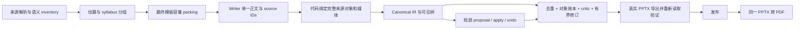

# PPT 写作、重复内容和来源媒体完整性

> 更新：2026-10-08。对应 [问题与优先级审计](../research/ppt-factor-zoo-repetition-media-gamma-review-20261007.md)。本地实现与回归记录；真实模型、部署容器和桌面 PowerPoint 验收须单独进行。

## 已落实的原则

信息密度来自不同的主张、证据、条件、关系和解释。不能用同一句话的复制或同义改写达到字数目标。自动页数是候选分组与实际容量的结果：相关且完整的内容能放在同一页时合并；必要结构放不下时拆分。用户明确指定或确认的页数保持原有约束，冲突要暴露，不能删事实或填重复句应付。

保持既有 workflow：输入方式 → LLM → 模板 → input/生成要求/估算 → syllabus 确认 → 生成中的要求修改 → 可视化编辑与局部候选 → 发布/导出。未增加确认阶段，未引入 Gamma 成本模型，未硬编码 Factor Zoo、10 页或 42 张图片。

`PPT_PROMPT_CONTRACT_VERSION=5`、`REVIEW_RUBRIC_VERSION=5`。内容、来源媒体、样式、几何、模板及排除义务变化会影响评审指纹；旧评审不能为新内容背书。

## 审计问题与实施对应

| 优先级 / 问题 | 实施 | 主要文件 |
|---|---|---|
| P0-A：subtitle/body/takeaway、不同 heading 下的重复正文 | 共用 NFKC/空白/大小写归一化；确切冗余归一；长完整句同页/跨页重复硬门禁；短术语、表头、数学、翻译和声明的 recap/application 有例外 | `ppt-copy-integrity.mjs`、`ppt-presentation-writing.mjs`、`ppt-quality.mjs` |
| P0-A：repair 把删掉的 takeaway 从 factSynthesis 插回 | 删除回填路径；writer 正文只有一个权威表示；repair 幂等，不靠补重复字修密度 | `ppt-prompt-contracts.mjs`、`ppt-quality.mjs` |
| P0-A：legacy/IR/局部编辑多份 truth source | canonical nodes 为权威，legacy 投影派生；整稿兼容保存保留源结构、数学、图注、原生对象和 stable IDs；更新普通正文时同步 copy，避免旧文案回流 | `ppt-api.mjs`、`ppt/ir.mjs`、`ppt/command-service.mjs` |
| P0-B：公式/变量、表格列与分片行、流程、清单、末尾总结消失 | 建立必保留对象账本，按 source ID 绑定完整 payload；表格逐单元格与分片行并集核验；流程/清单有序、类型与内容核验；总结也是义务 | `ppt-object-integrity.mjs`、`ppt-source-artifacts.mjs`、`ppt-content-inventory.mjs` |
| P0-B：mapped 没有结构、preserve 只剩旧模板图案 | 两个 adapter 使用同一来源义务；source-owned 区域支持可编辑表、数学、流程、清单与解释；区域替换清除旧正文及附属编号/连接线，保护标题、背景、区域外照片 | `ppt-density-capacity.mjs`、`ppt-template-fidelity.mjs`、`ppt-source-artifacts.mjs`、`ppt-render.mjs`、`ppt/import-pptx.mjs` |
| P0-B：用照片尺寸阈值处理所有媒体 | 取消 640×360 通用筛选；来源小图与图注完整预算、contain；区别来源必要图、背景/装饰、旧主题图；逐资产记录保留/替代/有理由省略 | `ppt-template-fidelity.mjs`、`ppt-blocks.mjs`、`ppt-object-integrity.mjs` |
| P0-B：文件输入媒体静默丢失 | PPTX/DOCX/PDF/XLSX 的嵌入图、HTML img/inline SVG、Markdown 内嵌媒体提取；常见图片转 PNG；SVG 用现有 LibreOffice 转图，保留原图 hash；无法解析的必要媒体硬阻断 | `ppt-source.mjs`、`ppt-fonts.mjs` |
| P0-C：ID/ref 被当作结构完成 | 只认 visible nodes 完整 payload，不认引用、隐藏节点或旧计数；原生源公式转回结构化 TeX，原生源表保持全部单元格关系 | `ppt-object-integrity.mjs`、`ppt-content-qa.mjs`、`ppt-source.mjs` |
| P0-C：缺结构仍 editorialReady、空/未评估 critic 假通过 | deterministic/source-object/model 门禁并用；`not_evaluated` 阻断；malformed finding 报错而非悄悄丢弃；有界 critic 修订、无进展停止；普通保存变更使旧模型评审失效，发布刷新 | `ppt-quality.mjs`、`ppt-api.mjs`、`ppt/publish-service.mjs`、`ppt/versioning.mjs` |
| P0-C：只核 IR、不核文件 | 重新打开真实 PPTX，核文本、全表、图 hash、图表数据和完整 OMML 树；验证失败不能发布；PDF 来自同一已发布 PPTX | `ppt-export-integrity.mjs`、`ppt-render.mjs`、`ppt/import-pptx.mjs`、`ppt-pdf.mjs` |
| P0-C：模拟脚本锁页、切模式、导出改色、伪 PDF/图 | 新 runner 仅模拟 LLM；其余生产解析/模板/auto 估算/拟合/syllabus/critic/repair/渲染/发布真实执行；本地 transport 只改变 Python 的执行位置 | `test/ppt-local-runtime.mjs`、本轮 `run-factor-zoo.mjs` |
| P1：把重复字数当成密度 | raw layout load 与 unique information 分开；完整结构/图注占用进入 fit；同问题的相邻及非相邻页可在确认前合并；确认后仅提建议 | `ppt-density-packing.mjs`、`ppt-density-qa.mjs` |
| P1：按旧模板几何误算容量/重排后不复验 | 按最终候选模板重测；source-owned 可使用正文区域空闲高度，保留标题/footer/图片区域；原生标题字体行高与内边距进入预算，不只认文本框高度 | `ppt-density-capacity.mjs`、`ppt-api.mjs` |
| P1：主题背景、CJK、公式字体和预览不一致 | 解析 theme/layout/master/clrMap/背景；按真实 glyph coverage 选字体并记录路径；PDF/SVG 转换设置进程内 fontconfig；UTF-8 采用流式 decoder；预览安全 MathML | `ppt-theme.mjs`、`ppt-fonts.mjs`、`ppt-template.mjs`、导出器、`PptCanvas.tsx` |
| P1：句中截断、标题代替正文、数学只留 where | 可见正文超界要求重写/分配，不截断；正文必须展开机制/条件/对照；保留完整数学和尾部对象；保护代码/数学标识符 | `ppt-presentation-writing.mjs`、`ppt-prompt-contracts.mjs`、`ppt-evidence.mjs` |
| P1/P2：AI 编辑再次丢组件、候选仅比较文字 | source-owned 可进入组件编辑；元数据、claim/source IDs 随 patch/undo 保留；候选受对象门禁；UI 显示保留/变更结构数量；内容/样式/几何变化使评审失效 | `ppt/proposal-service.mjs`、`ppt/command-service.mjs`、`ppt/versioning.mjs`、`AiBeforeAfterPreview.tsx` |
| P2：假矩形图、不可编辑数学和流程 | 删除无语义矩形位图生成；提供原生可编辑 OMML、完整表、timeline/list；没有真实资产时保留适用模板图或明确失败，不把装饰算成事实 | `ppt-semantic-media.mjs`、`ppt-math.mjs`、render/preview adapters |

上述服务端文件位于 `apps/cowork-server/lib/`；UI 位于 `src/components/ppt/`。原始调研保留为历史证据，不将其中“尚未实施”的日期结论改写成当时已实现。

## 数据流与边界



### 唯一正文和重复控制

Writer 输出 `contentBlocks` 时，旧 `bullets`/factSynthesis 不再是另一份可写正文。正文保留 `claimId`、`sourceRefs` 与有用途的 `repeatPurpose`。同一 primary claim 跨页有多个 owner 会阻断；声明 recap/application/translation 不等于允许凭空产生新事实。

确切重复可确定性归一化。共享术语、数字、否定句与翻译不能按相似词比例直接删。近义重复、浅薄和语义矛盾由所选模型 critic 处理，最多两轮、每轮有限目标页，保留失败与无进展状态。长重复正文不能靠改变 heading 或多写 takeaway 避过检查。

### 来源结构和媒体义务

Formula/Table/Process/Checklist 及 Summary 的完整内容由代码读取 inventory，模型选择对象/范围/解释，不提供几何或重造数据。模型漏写已分配的 `sourceArtifacts` 时，代码仍绑定计划义务；未计划或容量冲突不能通过引用 ID 蒙混。

图像的大小不决定是否必须保留。必要图像核实际 bytes，并核可见图注；布局使用 contain。小公式图、照片、图标、SVG 有各自来源 provenance。SVG 转换不允许外部资源、活动内容、无界尺寸/复杂度；失败产生可见硬诊断。相对/远端图片引用没有随输入提供资产时，不把 URL 当正文，也不自行下载。

表的所有列和分片行并集必须与来源一致。非表对象必须保留正确组件类型、全步骤/表达式/总结，不能重复分配成多个 primary 页。明确排除须带 user approval、reason 和当前 source hash，不能靠 writer 自称已批准。

### 数学与最终文件

KaTeX 在 bounded、`trust:false` 条件下生成 MathML；Python 转为 `a14:m > m:oMathPara > m:oMath`，支持分式、上下标、根式、矩阵、限式、常见重音。数学框按自然宽高拟合，避免把一个分式水平拉满整页。保留原 TeX、display text、状态及警告。

实际 PPTX 核验比较数学结构树，而非仅比较 token 序列；把分式改成下标但保留相同字符，也必须失败。无法支持的语法保留完整来源文本并给出 fallback 警告，不能声称原生数学已通过；结构转换失败不能被“文件能打开”掩盖。

`contentReady`、`exportable`、`visualVerified` 分开。真实文件验证通过后才设置 exportable；这不自动设置 visualVerified。导出的 PNG/PDF 人工查看是本轮证据，不是假定每个未来项目已视觉验收。

### 旧版保存与局部编辑

兼容 PATCH 不把 `blocks` 投影重新当作生成输入：源表、大图、公式、图注、native refs 和 stable IDs 保持 canonical。普通 title/body 的改动同步其 IR/copy；源对象的编辑使用组件入口，不能通过旧版整稿保存顺手删掉。

Source-owned 表/公式/流程编辑后的义务仍受完整性检查。格式变化、解释扩写和合法重排可以通过；缩短必要结构导致单元格/条件缺失会阻断候选。无需新增 workflow：发布动作刷新过期 critic，缺失仍以原 quality_blocked 反馈。

## 验证与复跑

本轮证据目录：[ppt-copy-media-integrity-20261007](../../outputs/ppt-copy-media-integrity-20261007/)。历史坏样例保持原样。

| 验证 | 结果 / 证据 |
|---|---|
| 全仓 typecheck + unit | `npm test`：2,808 passed，0 failed，1 skipped；`npm-test-delivery.log` |
| PPT 后端专项 | 全部 29 个 `selftest-ppt*.mjs` 通过，0 失败；`backend-delivery.json`，最后媒体去重改动另重跑真实文件专项通过 |
| 全仓标记 smoke UI | 37/37 passed，包含 PPT 创建、估算、syllabus、生成修改、pause/resume、局部候选/undo、模板与导出；`ui-smoke-delivery.log` |
| CDP 实际浏览器 | desktop/mobile 数学、局部 AI 候选/取消、保留对象计数、console；`ui-cdp.ts`、`ui-cdp.log`、三张截图；产品 API 使用 fixture |
| 精确重复/写作 | takeaway 不回填、跨角色/cross-page、claim owner、幂等、否定/术语/翻译/recap 例外 |
| 通用来源 | research/business/architecture，均含 rich structure 和尾部 Summary；非 Factor Zoo 专用规则 |
| 页数缩减 | density selftest 的 4→3 页合并保留两条不同观点和全部结构；不同问题保持 4 页；显式 4 页保持约束 |
| 真实文件损坏 | 改表格单元格、删公式、改数学关系但保留字符、删图片、改图注均被拒绝 |
| 中文与媒体 | 真实 PDF 的中文标题、中英混排表格验证；small image、原生源表/公式 round-trip、SVG/HTML 媒体提取及恶意 SVG 拒绝 |
| 两种模板模式 | Factor Zoo 来源 + Mood Board 模板，从真实 API auto 到发布/PPTX/PDF；`preserve-workflow.json` / `mapped-workflow.json` |

复跑使用 Node 22.22.0。包运行时要求 Node >=22.12；本机 bundled Python 已有 python-pptx、Pillow、pypdf。核心命令：

```sh
# 仓库根目录；PPT_TEST_PYTHON 只控制 test transport 的 Python。
npm test
PORT=3017 npx playwright test --grep '@smoke'
node apps/cowork-server/selftest-ppt-copy-media-integrity.mjs
PPT_TEST_PYTHON=/path/to/python3 node apps/cowork-server/selftest-ppt-export-integrity.mjs
PPT_TEST_PYTHON=/path/to/python3 node outputs/ppt-copy-media-integrity-20261007/run-factor-zoo.mjs
```

Factor Zoo 复跑不指定页数、不改模式、不做导出补丁、不造 PDF。两个模式各自独立运行；各自 auto 估算/fit/确认与最终页数保存在 workflow。模型模拟选择较多原文并完整保留中英来源和全部必要结构，因此该模拟的页数与低密度页不能作为真实模型写作/压缩质量基准；不是将更高页数设为产品目标。真实模型仍需把不同证据和解释写成更紧凑的完整内容，再由同一 packing 校验，不复制填字。

本轮实际文件审计（相同原生段落口径，不做公式图片 OCR）：

| 指标 | preserve | mapped |
|---|---:|---:|
| 最终 auto/fit 页数 | 46 | 48 |
| 必保留结构完成 | 31/31 | 31/31 |
| 原生数学 | 18 | 18 |
| 原生表格实例（含完整分片） | 10 | 11 |
| 直接图片实例 | 17 | 0 |
| 原生非空白字符（含表） | 20,745 | 20,860 |
| 同页精确重复额外字符 | 0 | 0 |
| 跨页 ≥40 字符精确重复段落 | 0 | 0 |

Markdown 来源没有图片；mapped 的 0 图片不代表媒体义务未完成，数学/表/流程为原生可编辑对象。preserve 的模板图逐项有 disposition，替换旧正文区域时不会盲保留旧流程编号/连线。源图像保留另由真实图片/SVG round-trip 专项验证。

已查看两稿全部 contact sheets，并放大数学、混合语言表格和尾部页。修复了检查中发现的标题贴表、中文 tofu、公式水平拉伸和旧流程残留；低密度及模拟写作未作质量胜出声明。最终 SHA 和页级证据见 [file-audit-final.json](../../outputs/ppt-copy-media-integrity-20261007/file-audit-final.json)；交付示例：[preserve PPTX](../../outputs/ppt-copy-media-integrity-20261007/factor-zoo-preserve.pptx)、[mapped PPTX](../../outputs/ppt-copy-media-integrity-20261007/factor-zoo-mapped.pptx)。

## 运行环境与未验证范围

- 容器镜像新增 `fonts-stix`，已有 Noto CJK/fontconfig/LibreOffice。部署需按现有 build-image 流程重建；本机 Docker daemon 未运行，本轮没有构建或部署远端镜像。
- 本机 headless LibreOffice 私有 fontconfig 未可靠加载 CJK。转 PDF/SVG 时现已设置仅该进程的 fontconfig/可写 cache；宿主字体和 Office 安装未修改。真实中文 PDF 回归覆盖这一故障。
- 没有调用真实 LLM；模拟不能证明其所有近义重复、事实正确性和叙事判断。没有验证 Windows 或桌面 PowerPoint 的最终字体替换/编辑交互。
- 现有文件/媒体安全与容量上限继续有效；超限、缺失资产、未支持的数学结构会明确报错或警告，不意味着支持任意格式。扫描件/OCR、PDF 矢量图完整语义重建和所有 OfficeMath 语法仍有能力边界。
- 本轮新增的公式、表、流程、资产及候选完整性能力已进入现有模块；更广的生成装饰图/视觉风格 A/B 不作为 P0 完整性通过条件。

实现依据的主要原始规范：[KaTeX options](https://katex.org/docs/options)、[KaTeX security](https://katex.org/docs/security)、[Microsoft Office math](https://learn.microsoft.com/en-us/office/math/)、[DrawingML math wrapper](https://learn.microsoft.com/en-us/openspecs/office_standards/ms-odrawxml/38b13e1f-1102-4bb7-819a-dd5d9abdb176)、[Debian STIX fonts](https://packages.debian.org/bookworm/fonts-stix)。具体运行表现以本轮文件、测试和渲染证据为准。
