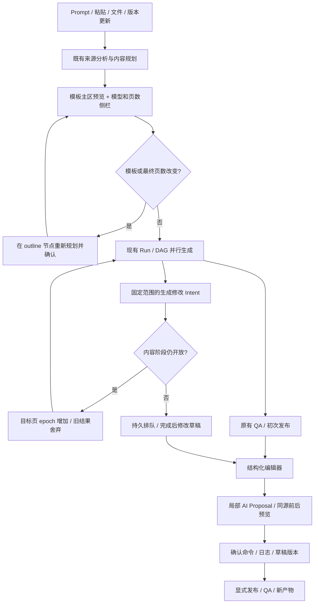

# PPT 模板确认、生成修改与局部 AI 优化

更新：2026-09-30。需求依据：工作区 `requirements.md` 第 84–89 节及 `prototype.html`。本次将建议架构接入现有 PPT 模块，不替换现有 IR、Run/DAG 或模型适配器。

## 1. 接入后的流程

四入口保留各自的输入步骤，复用 `TemplateSettingsLayout` 和 `TemplateBrowser`。模型在入口锁定；页数建议来自服务端来源与内容规划，最终人工页数作为硬参数。修改页数或模板会要求重新生成并确认大纲，避免复制、截断旧页充数。版本更新先取得服务端建议；同源返回和更换来源时保留已经人工调整的页数，再重新分配内容。

原生 PPTX 的“保真打开编辑”沿用独立流程。生成模式才进入模板与页数确认。

## 2. 领域边界与文件地图

| 领域 | 文件 | 职责 |
|---|---|---|
| 上下文 / 能力 | `apps/cowork-server/lib/ppt/edit-context.mjs` | source/plan 指纹、目标页指纹、模板和原生编辑能力 |
| 候选服务 | `ppt/proposal-service.mjs` | 模型语义 patch、来源/锁/节点/QA 校验、服务端持久候选、应用和丢弃 |
| 生成修改 | `ppt/generation-edit-service.mjs` | 固定 scope、幂等 Intent、每页 epoch、部分失败、恢复和失败重试 |
| 模板预览 | `ppt/template-preview-service.mjs` | 内置示例 IR 或上传原生模板 → 共享 SVG renderer，上传解析缓存有界 |
| 提交与恢复 | `ppt/command-service.mjs` / `repository.mjs` | 项目队列、命令 journal、定向撤回、写前恢复标记 |
| 现有执行器 | `ppt-api.mjs` | content epoch 栅栏、内容阶段关闭、组装、初次发布、兼容接口接入 journal |
| 发布 | `ppt/publish-service.mjs` / `ppt-render.mjs` / `ppt-pdf.mjs` | draft/published 区分、独立产物路径、按发布快照导出 PDF |
| 创建 UI | `create/TemplateSettingsLayout.tsx` / `TemplateBrowser.tsx` / `PptCreateWizard.tsx` / `PptM3.tsx` | 共用确认布局、真实模板预览、大纲重规划、来源请求失效 |
| 生成 UI | `generation/PptGenerationMonitor.tsx` / `GenerationEditDialog.tsx` / `PptWorkspace.tsx` | 浏览页与执行页分离、跟随开关、固定范围、未提交草稿、结果历史 |
| 完成后 UI | `editor/StructuredPptEditor.tsx` / `AiBeforeAfterPreview.tsx` | 选页、预设指令、候选前后对照、应用和定向撤回 |

## 3. 数据与版本

继续使用 IR v3，不增加数据库或顶层 DAG 阶段。

- `creationContext`：迁移时派生 draftId、sourceRevision/hash、modelRef、templateRef/capabilities、outlineRevision、推荐/请求/确认页数、压缩确认、planKey。实际权威仍是来源、规划、大纲、pageDecision 和模板快照，派生字段不作为客户端写入接口。
- `project.editing`：schemaVersion=1，含 contentOpen、epochs、累计 instructions、scopes、intents；只持久化用户已提交的修改。
- scope：id、projectId、runId、baseRevision、planKey、打开时间、当前 stable slideId、打开时未开始的 AI slideIds、按页 hash。有效期 24 小时；每项目最多 100 个未过期 scope。
- Intent：id、idempotencyKey、actor、scopeSnapshot、instruction、modelRef、targetEpochs、perSlideResults、status、时间。每项目最多 200 条记录，超限明确报错。
- Proposal：独立 `projects/<id>/proposals/<proposalId>.json`，绑定 source/plan/目标 hash、baseRevision、节点 patch、changedNodeIds、前后渲染 hash、QA、模型引用、有效期和状态。候选预览不增加正式 revision。
- Operation：复用既有 journal。应用 Proposal 的 commandId 等于 proposalId；重复确认或进程恢复只提交一次。

单进程 `enqueueProject` 串行提交。模型调用在队列外；短提交重读最新对象并检查 run/epoch/hash。发布渲染和兼容保存的产物生成目前占用项目队列，以确保发布快照完整；这可能短暂阻塞同项目其他提交，模型请求不占队列。

`pending-command.json` 在项目/版本快照/journal 写入前落盘。读取时补齐中断提交；JSONL 尾部半条记录在下次 append 时修复。它是单进程写前恢复机制，不是跨进程数据库事务，也不修复任意中间损坏。

## 4. 生成时修改

1. 浏览中的页有独立 stable ID，点击缩略页停止自动跟随。并行 running 页都可见，不以“第一条 pending”截断列表。
2. 打开面板时由服务器冻结 remaining；排除 running、done/completed、manualBlank。此后进度变化、手动插页或重排不会扩展原范围。
3. 内容仍开放：对目标页累计指令、增加 epoch、重置 pending。同页旧模型结果不能落盘；其他页继续原任务。同页较早的未完成 Intent 标为 superseded，指令仍累计。
4. 内容关闭后：接受修改为 draft 阶段。完成生成后串行走 Proposal → Command；每页记录成功、失败或冲突。
5. 部分失败可只重试 failed/conflicted 页；已成功页面不重复提交。重启可复用已持久 Proposal 和 operation，不再次生成同一结果。
6. 生成完成后追加修改只更新 durable draft，不自动覆盖已发布文件。同页多条 draft 修改若目标 hash 已变化会显式冲突，需要重试；不会静默合并覆盖。
7. 未提交的 current/remaining 输入各自保存在 sessionStorage。关闭、任务完成、刷新后可继续；恢复不自动执行。已提交修改结果可从“生成修改记录”重新打开，继续查看或重试。
8. scope 过期/失效时保留输入；生成中可显式重新确认范围。取消状态不接受新提交，迟到的失败不会覆盖取消结果。

空白页插入在项目队列中处理。它增加实际输出页数，不计入 AI 进度或 remaining；原生模板缺少插页能力、内容阶段已关闭、超过 100 页时禁用并说明原因。

## 5. 生成后局部优化

三个入口复用同一面板：顶部、工具栏、当前页按钮。支持目标页选择及精简、丰富、管理层、强化结论、双栏预设。

- 模型仅生成现有可编辑节点的语义 content patch；不能输出任意坐标、样式、主题或新节点 ID。
- relayout 只允许注册的 layoutId，再交由既有布局与 point-layout 计算位置。原生 preserve 在模型请求前拒绝 relayout；未知原生对象继续锁定。
- 提供检索来源、每页契约、证据和相邻页叙事。图表数据/维度/单位/类型以及表格维度、表头和数字单元格由服务端禁止修改；锁定标题和必要可见证据不得丢失；候选不得引入新的 QA 硬错误。已有 QA 阻断可分步修复，预览如实展示剩余问题。
- 原页、候选页和正式命令使用同一 applyToDeck/finalizeDeck 与 Render Tree。前后对照是真实 SVG，不是 JSON 文本或另造一套示意图。
- 候选超过 30 个可编辑对象要求选择对象，避免截取前 30 个后假装全页优化。
- 应用请求只提交 proposalId，由服务器读取 patch；客户端篡改 patch 无效。模型请求迟到、切页或关面板不会重新打开旧候选。
- 应用失败保留输入和候选；只有成功才清空。撤回绑定本次 operationId：其他页后续修改可保留，目标页冲突返回 409。

## 6. 接口（路径相对 `/ppt`）

| 方法 / 路径 | 语义 |
|---|---|
| GET `/templates/:id/preview?slide=n` | 鉴权后读取实际 SVG；不调用模型、不增加版本 |
| POST `/projects/:id/ai-edit` | 生成并持久化候选；preview:false 为兼容调用，也经过候选和命令校验 |
| POST `/projects/:id/proposals/:proposalId/apply` | 幂等确认 |
| POST `/projects/:id/proposals/:proposalId/discard` | 丢弃未应用候选 |
| POST `/projects/:id/generation-edit-scopes` | 冻结范围，body={slideId} |
| GET / POST `/projects/:id/generation-edits` | 读取记录 / 提交 scopeId+scope+instruction+idempotencyKey |
| GET `/projects/:id/generation-edits/:intentId` | 按页结果 |
| POST `/projects/:id/generation-edits/:intentId/retry` | 只重试失败/冲突页 |
| POST `/projects/:id/undo` | 可传 operationId 定向撤回；不传仍沿用历史撤回 |

409 表示状态/版本/能力冲突；422 表示模型返回越界对象或候选质量不合格。所有对象按现有 uid/project 访问边界读取。新增事件复用 run seq/replay：edit.accepted、edit.started、edit.applied、edit.failed。

## 7. 草稿、发布与导出

应用/撤回走 journal，UI 显示草稿已同步与待发布状态。新 PPT 沿用初次生成 QA/发布；后续 AI 优化必须用户显式发布。PPTX 使用独立 `/workspace/published-<revision>-<artifactId>.pptx`，只有渲染成功才更新 publishedArtifactPath/publishedRevision。质量阻断或渲染失败仍能导出上一次发布版本。

PDF 以 publishedRevision 的 deck/template/renderTree 快照生成，缓存按发布版本标识，不能把未发布草稿当已发布文件。旧项目未记录 artifact path 时仍读取原 `presentation.pptx`。首次 draft 命令前补齐旧发布版本的模板快照；若历史发布快照已缺失且当前存在较新草稿，PDF 明确要求发布草稿，不用草稿主题冒充旧发布主题。

## 8. 本地验证与边界

- Node 22.22.0；`npm run test`：2806 通过，1 skipped，0 失败；含 typecheck。
- `npm run test:smoke`：28/28 通过，覆盖四入口、版本更新、模板与既有编辑流程。
- 新增 `selftest-ppt-edit-intent.mjs`：只读预览、确认幂等、冲突、丢弃、定向撤回、写前恢复、JSONL 半记录、固定范围、并行 epoch、局部失败重试、恢复复用候选、发布失败保留旧产物。
- PPT 历史自检共 16 项额外执行：12 项通过；M3、M4、semantic、template-scheduler 失败。使用 git archive 的未改动 HEAD 副本确认这四项本身也失败；M4 基线先在兼容保存返回 500，修复 QA 的 sourceText 暂时性死区后，本次执行推进至过时的媒体块严格等值断言（新增 assetId/hash）。M3 fixture 未达到 completed、semantic 仍断言旧 planning.version=4、scheduler 的供图替换断言均须独立修订。未修改质量门禁来放行这些 fixture。
- CDP：实际启动 localhost:3000；当前工具未提供 chrome-devtools MCP，改用 Playwright connectOverCDP，调用 Runtime/Log/Page/Emulation，桌面 1440×980、移动 390×844，完成点击/输入/截图检查，0 console/page exception。`scripts/verify-ppt-editing-cdp.mjs` 在临时状态目录使用真实 handlePpt/领域服务及确定性模型适配器，前端接口通过 route 接入；不是远端 Cowork HTTP/凭据的端到端验收。
- 模型仍沿用实际适配器，回归使用模拟模型；本次未验证真实模型内容质量、远端容器导出、Electron 打包态或 Windows。
- 模板 SVG 对未知原生组对象/媒体的呈现能力仍有限，界面提示“样式与结构预览；原生媒体以导出为准”。跨设备未提交草稿、跨进程锁、过期 Proposal/Intent/产物清理是后续治理项。

本次截图与摘要保存在 `outputs/ppt-edit-intent-proposal-verification-20260930/`（summary.json、verification.json、桌面/移动 PNG）；该目录为本地输出，不作为源码提交。
