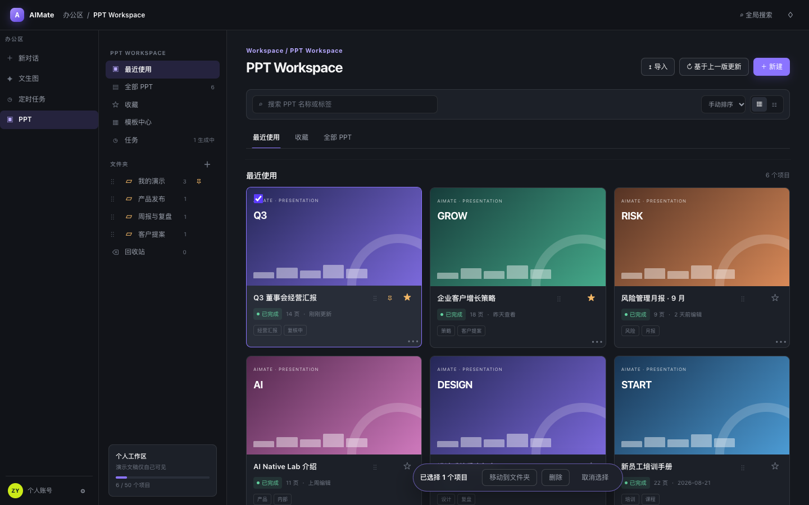
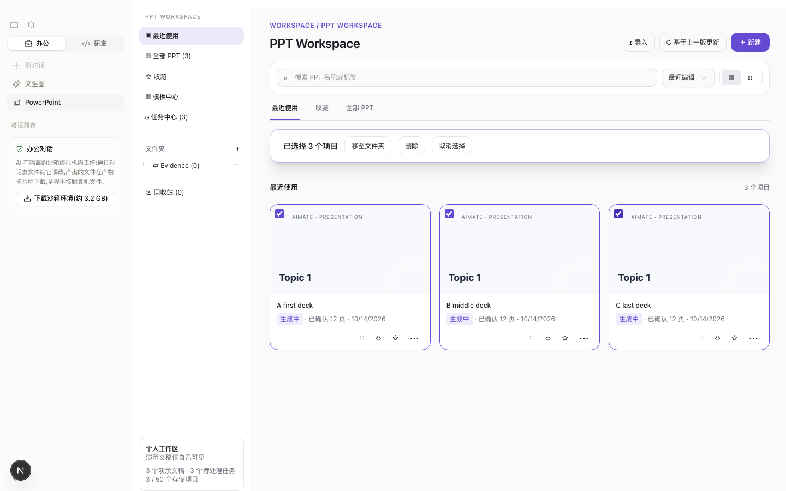

# PPT Round 7：Gamma 逐页生成、展示合同与大纲编译

对应：[产品思考](../insights/ppt-gamma-parity-round7.md)、[执行计划](../exec-plans/active/ppt-gamma-parity-round7-20261013.md)。

## 工作区与事实源

实施位置为 `LabCodepilot-claude-round7` / `claude/ppt-gamma-parity-round7-20261013`；集成基点 `a95ee28` 已合并主线与 Claude run17。Round 6 保留计划原件，本轮不修改它或其他工作树。3140/3141 属于另一轮测试，本轮生产 PPT API + Next 前端统一从 Round 7 启动，使用 3146/3147。

## 实现入口

| 问题 | 入口与行为 |
|---|---|
| A1 图片与图表 | `ppt-source.mjs` 读取 PNG/JPG/PDF/DOCX/XLSX/HTML；DOCX drawing 在实际正文位置绑定 alt/相邻段落和来源 ID，孤立图片以原始位置作说明。`ppt-source-chart.mjs` 只把明确数值序列/请求绘图的数值表转换为 ChartBlock，不编造数字；语义索引、媒体台账、原生导出共用来源数据。创建界面只保留一个 paste 处理入口和一个媒体预览区。 |
| A2/A7 逐页预览 | `project-view.mjs` 只给当前未完成页建立模板草稿；`StructuredPptEditor` 画布过滤为完成页 + 当前页，未来标题只列在侧栏。`GenerationSkeleton` 是同一张可增高的流式页面，使用模板字体/颜色，不先画整张空模板再把文字排在页外。跟随默认开启，wheel/touch/键盘浏览暂停跟随，“回到当前页”恢复。 |
| A3 平衡布局 | `fitComponents` 对单组件居中；主图/表 + 短说明优先 65/35 分栏，各自垂直居中；字体下限不变。`ppt-layout-balance.mjs` 检查内容中心/留白，手动 geometry 优先。 |
| A4 修改面板 | `GenerationEditDialog` 固定标题/底部操作，主体与聊天记录独立滚动；保留原始需求及各轮结果/状态，新消息滚到底部；Enter 发送、Shift+Enter 换行，输入法 composition 不误发送。 |
| A5 内容 | 大纲压缩/回填同节备注/合并薄页；文案检查新增卡片复述标题、卡片互相重复。选行表格不再加可见“完整表见备注”，完整来源仍保留在备注。 |
| A6 标题与结束语 | `ppt-page-titles.mjs` 去掉续/上/下等分片标记，按本页来源区分标题；`normalizeSlide` 最后一页使用主要语言结束语，并保留本页实质内容。 |
| B1 展示合同 | `ppt-presentation-contract.mjs` 统一主要语言，覆盖封面/副题/页标题/section/eyebrow/目录/结束语；正文双语保留选项独立。删除旧双语主题提示冲突。`body=primary` 用主要语言一侧承载互译对，未成对事实仍保留。 |
| B2 工作区 | 勾选框常驻且可命中，封面眉题避让；批量栏在列表标题下吸顶，支持 Shift 连选、Esc 清空；卡片预留操作区，不覆盖日期。 |
| B3 大纲 | `ppt-outline-compile.mjs` 补/纠去向、唯一归属、关系闭包、表格范围、元数据；修正报告进入确认页。主请求使用按组 schema、检查点和失败组重试。确认保留页面数量与模板分配，写稿只能在页内修复容量。目录标签在完整词边界压缩后仍需独立语义审查，不跳过事实门禁。 |

## 性能与流式

真实长稿 CPU 采样显示九成以上时间花在反复判断主要语言。容量/去向循环对每个单元调用它，每次都重新扫描整稿。`dominantInputLanguage` 现以实际 prose 字符串缓存，24 项 / 约 8 MiB 上限；不是按 project ID 缓存，原地修改 segment 也失效。长稿复制项目 500 次查询实测 26 ms。大纲独立容量测算前后让出事件循环，真实测试继续核对状态接口延迟。

BYOK 的 planning/translation 也采用流式传输，减少等待完整 JSON 期间的网关沉默；最终输出仍走相同 schema/来源校验。托管 CLI 只消费真实 `text_delta`，700 ms 节流并刷新最后片段；旧 CLI 仅在明确不支持该参数时重试，不从最终回答伪造打字动画。

模板测算中的深拷贝改为独立复制 JSON 可变容器、共享不可变媒体字符串。压缩/回填/合并已使用异步测算，长稿循环之间允许查询和模型回传执行。列表和模型可启动检查使用 `ppt-store.getProjected/listProjected`：仅缓存小投影，按原子文件的 inode/mtime/ctime/size 身份失效；普通 `get` 每次仍返回完整独立可变项目，避免共享编辑状态。缓存按账号/项目/用途隔离，最多 128 项 / 8 MiB。BYOK 的 3 个 lease 上限在服务端按账号生效。

## 验证与边界

证据目录：`outputs/ppt-round7-20261013/`。运行配置、加密 profile、源数据及模型原始响应留在忽略目录，不提交。`scripts/ppt/verify-round7-live.mjs` 通过实际 Chrome CDP 创建/确认/跟踪项目，不注入模型答案、成稿或通过状态。

- 全量回归：`npm-test-final-confirmed-title.log` 为 2890 pass / 1 skip / 0 fail；后续追加的连续读取失败恢复由实际浏览器回归验证，最终收尾时复核最新代码。
- `domains-final-after-source-fixes.log` 为 75/75 全部通过。之后确认标题编译的变更再跑 content-titles、user-controls、round5-copy、unified-workflow 四组全部通过。早期旧断言/缺测试参数/图片等待超时及其修复记录保留。
- PPT e2e 最初 40/41；粘贴事件/预览重复的真实问题修复后原用例通过。最新完整 smoke 57/58，唯一的首页加载超时原样复跑通过（`home-smoke-final-rerun.log`）；新增 CDP 检查覆盖批量栏、Shift/Esc、聊天快捷键/滚动、长草稿/媒体比例/跟随及临时读取失败恢复。
- 原生文件校验：六类输入的所有提取图片哈希出现在实际 PPTX；四类 Prompt 原生图表的分类/数值与输入逐项相同，且包含可编辑 XLSX。
- **真实三份完整稿仍在验收**。此前超时、目录标签失败、UI 创建失败均保留记录，不计通过；真实页数/密度/无裁剪/结束页/首轮接受率待最终结果填写。上述 fixture 通过不能替代 Phase 7。

## 真实成稿发现的额外根因

- 富文本新增原生框曾把所有 run 的 italic 重置；默认富文本保留局部强调，仅显式用户样式覆盖全框。结束语宽度改为整数百分之一计量，消除 20 个 ASCII 字符的浮点尾差。
- 薄页从备注提回主要语言时，先建立已审查的互译承载关系，再应用闭包，防止另一语言被错误重复提回。合并用整页原生容量测算，保留字号和确认后的页数。
- 已校验的 `design_only_template` 旧报告媒体处置属于策略解消，不伪称用户批准；source/evidence/brand/artwork 等仍受原门禁约束。
- `ppt-read-retry.ts` 只重试暂时性 GET，单次 30 s、最多四次退避；非暂时 4xx/解析错误立即失败，写命令不自动重放。创建流程耗尽后保留项目，再次读取接续同一大纲，不 POST 新项目/重做大纲。
- writer 的确认标题由代码编译回确认值并同步原生标题槽，保存 `writerCorrections`。这不改来源、正文、字号、页数；显式标题编辑/输出语言变更仍走原路径。真实 Alpha 第 9 页曾因标题反复修复而引入过长说明，修复后待真实 checkpoint 审查与导出。
- 备注合同修复：`obligationRegistry` 原先在任一单元含摘要时，把整份原文所有 mandatory summary facts 都重列为正文义务。现只解消当前来源 hash/台账 hash/`notes_by_contract` 标记一致且选择约束允许的可选备注；独立 `source_condition`、可见互译承载、非法 notes、用户明确要求仍保留。真实 Alpha 的 14 条误提升已对账，新增过期台账/无效标记/用户要求/必须展示等反向回归。
- 来源分句保护 Markdown/code/math 片段边界，完整字符不变；删除生成的备注指引 frame/页脚和空间预留，来源和完整备注保留。
- Factor Zoo 原文两处 `2×3×3 (27 portfolios)` 为算术矛盾，新增预检在模型之前明确报出 18/27，原件不自动修改。实际创建 UI 已验证拒绝，不将其当成完整稿通过；验收副本勘误仍待用户决定。

## 原型逐项对照（1440 × 900）

参照用户指定的 `prototype.html`，通过实际 Chrome 打开原型；应用截图来自实际 Next 页面与明确标识的 UI fixture。应用使用用户当前浅色主题与已有 AppShell，保留功能与交互的对照，不宣称像素级复刻。原型当前 CSS 实际把批量栏固定在底部；本轮按计划明确要求改为页头吸顶，属于有意改进。

| 项目 | 对照与验收结果 | 自动交互证据 |
|---|---|---|
| 新建、方式、LLM 与模板 | 按方式 → LLM → 模板 → 内容，前进/后退按钮和固定底栏可达 | `ppt-workspace` M1；`ppt-prototype-parity` template-first |
| 导入 | 选择 LLM 后才打开实际文件输入，保留原文件页数 | `ppt-workspace` fidelity import；`ppt-prototype-parity` editable import |
| 基于上一版更新 | 沿用来源、对比变更、模板兼容及版本链 | `ppt-workspace` M3 |
| 搜索、收藏 | 搜索筛选可恢复，收藏入口与项目状态一致 | `ppt-workspace` M2 library |
| 排序 | 最近编辑/创建、名称、手动顺序选项存在，手动顺序与置顶分组持久化 | `ppt-workspace` manual ordering |
| 拖动与置顶 | 拖动更新组内顺序；置顶与非置顶不混排 | `ppt-workspace` manual ordering |
| 卡片菜单 | 收藏、置顶、详情、移动、删除入口存在 | `ppt-workspace` M2 library |
| 文件夹与计数 | 新建/移动/计数/侧栏筛选一致 | `ppt-workspace` M2；`ppt-round7` selection |
| 回收站 | 删除移入回收站，恢复和计数随状态刷新 | `ppt-workspace` M2 library |
| 勾选与批量 | 命中 checkbox，封面文字避让；Shift 连选、Esc 清空；操作栏改为页头吸顶 | `ppt-round7` selection（包含真实点击坐标命中与 move/delete 请求断言） |
| 详情抽屉 | 打开详情、源要求/状态与编辑入口 | `ppt-workspace` M2 library |
| 创建流程底栏 | 内容很长及 390 × 500 窗口仍能读取/确认大纲 | `ppt-prototype-parity` paste syllabus；`ppt-progressive-input` |
| 大纲确认 | 编辑最后一页、显示修正/容量警告，显式确认前不写页面 | `ppt-workspace` M1；`ppt-prototype-parity` template-first/paste syllabus |
| 编辑工具栏 | 字体/字号/样式/撤销/重做/局部 AI/保存/导出沿用结构化编辑命令与持久化 | `ppt-workspace` structured editor；`ppt-prototype-parity` local translate/expand |
| 生成中预览 | 完成页 + 当前页，未来标题仅在左侧；手动滚动暂停跟随、按钮恢复；实际序号保留 | `ppt-round7` native-template draft；`ppt-live-follow` |
| 修改要求 | 输入与聊天保留、状态回显、自动滚底、Enter/Shift+Enter、固定操作区 | `ppt-round7` chat；`ppt-prototype-parity` generation dock |

同尺寸截图：

| 原型（底部浮栏） | Round 7（页头吸顶、fixture） |
|---|---|
|  |  |

这些截图只证明 UI 对照；真实模型成稿的来源/密度/最终渲染需要下一项独立验收。
