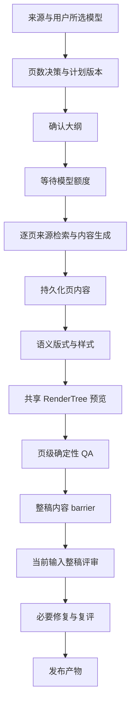

# PPT 统一修改与恢复运行时交接

> 2026-09-30。按用户批准的优化顺序实施；文本 LLM 暂时固定使用用户选择的 configId/model。
> 本文补充并更新 [上一轮编辑架构](ppt-edit-intent-proposal-architecture.md) 的运行时、审查缓存、类型化修改和验收口径。

## 1. 实施范围与模型策略

本轮依次完成 P0 基础一致性、P1 修改与恢复协议、P2 类型化局部优化、P3 前端与验收。沿用既有 IR v3、远端 Cowork 项目存储、Command Journal、Run/Event、模板保真机制和共享 RenderTree。

- 文本任务不自动切换模型。计划、生成、局部修改、整稿审查均记录并使用项目的用户选择。
- 图片任务沿用已有图片模型配置，单独记录 attempt；没有把文本模型自动分流到多个供应商。
- 模型额度不足时 PPT 等待 FIFO 槽位；原有定时 routine 的跳过策略保留。获得槽位后再检查项目是否仍可执行。
- Research、多模型路由、视觉模型 critic 不隐式启用。当前分类是确定性规则并允许用户明确选择修改类型。

## 2. 领域模型与版本含义

| 模型 | 事实与用途 |
|---|---|
| PlanRevision | 由来源、brief、storyArc、逐页 contract、coverage、outline、页数决策、模板和所选模型构成 hash；变化递增 version，保留最近 32 份计划历史 |
| ConstraintSet | version + entries；每条有 slideId/scope/type/kind/instruction/intentId/active。相同范围、同类偏好采用最新值；标题长度与正文深度分开 |
| Mutation / Intent | 记录修改类型、固定目标范围、影响维度、modelRef、逐页 epoch 与结果。生成中的 intent 持久化，不只存在于前端 |
| Proposal | 服务端生成并校验的候选变化、前后真实 SVG、affected afterSlides、pageDelta、质量结果、baseRevision、planKey 和目标 hash；确认前不写正式草稿 |
| SlideRuntime | 页级 phase、epoch、contentHash、renderHash、真实预览、确定性 QA、accepted 状态 |
| Attempt | 输入 hash、计划/约束版本、模型、开始/结束时间及结果；区分内容生成、布局、预览、质量与媒体重试 |
| AssetTask | 既有可编辑图片的独立任务，target hash、plan key、attempts、running/failed/proposed/applied/discarded/conflicted；最多 200 条任务 |
| ArtifactRevision | Command 提交后的草稿版本；publishedRevision 仍指向最近成功发布的产物，修改草稿不自动覆盖已发布文件 |
| ReviewBinding | reviewInputHash + 所选模型 + rubricVersion + reviewState；只有当前输入绑定才可复用整稿评审 |

IR 的 componentGraph 由稳定对象 ID、阅读顺序、语义角色、样式引用、来源引用和 contains-point 边派生。它提供可解释组件关系，尚不是通用图数据库或实时协作模型。

### 版本校验

- 页级 epoch 防止旧生成任务写回；目标内容指纹防止迟到提案覆盖手动修改。
- 结构变化和整稿主题变化要求 exact baseRevision；普通对象提案同时校验计划与目标指纹。
- 内容、标题、数据、结构变化使旧语义审查失效；仅坐标/样式变化仍执行确定性 QA，但可复用内容评审。
- revision snapshot 现在包含 planning、constraints、pageDecision，历史还原与结构 Undo 同时还原页数预算。
- checkpoint 记录 run、输入版本、artifact revision、页级 epoch、缓存内容、预览和事件位置。恢复只补回版本匹配的有效结果，不能用旧快照覆盖新手动版本。

## 3. 生成 pipeline

单页先保存内容，再生成真实预览和 QA。Run 记录 source→content→layout→preview→quality 依赖；内容完成与预览完成是两个里程碑。renderer 失败保留成功内容，恢复时补渲染，不重新向模型索取同一页文字。

生成监控直接使用共享渲染器的 SVG，不再用标题和 bullet 拼一个近似页面。编辑器、单页预览、发布导出复用同一 canonical deck / RenderTree 与版本口径。修复后刷新预览；compatibility save 改为保存草稿，后续手动修改显式 publish。

来源图片仅在 image-text 页面存在明确 topic/source/assetId 匹配时绑定，保留对象样式；不把文档媒体轮流填到不相干页面。媒体 inspect 的调度元数据仍可逐项分配，它不等于页面展示绑定。

### 暂停、恢复与所有权

- 点击暂停：禁止启动后续步骤，已启动的原子步骤到安全边界后落 checkpoint，Run 和项目进入 paused。
- 点击恢复：queued→active，复用已完成内容、当前 epoch 的 intent 和有效预览；取消是终态，不因恢复扫描自动重新启动。
- 本地 generation lease 记录 PID/token，避免重复运行同项目；进程退出后可清理失效所有权。
- 暂停后的可编辑草稿发生手动 Command 时，将变化同步到生成 node.slide 缓存并推进 epoch；更早排队的同页 AI 结果标记 conflicted，不会在恢复时覆盖手动内容。
- 当前仍是有界、专用 coordinator。DAG 用于依赖、状态与恢复记录，并非支持任意 DAG 的分布式调度平台。

## 4. 生成过程中修改

五种范围为当前页、同章节、当前页后续所有页、打开面板时尚未开始的页、整稿。打开面板时冻结 slideId 范围，随后任务状态变化不会偷偷扩大或缩小本次目标。没有章节元数据时按现有范围协议处理；已保护页不进入内容变化范围。

| 类型 | 生成中执行策略 |
|---|---|
| title | 针对已有标题做最小修改，正文/图表/数字不随之重写；已有正文深度偏好不强迫本次标题请求重生成正文 |
| content | 受影响页推进 epoch 并重生成，保留来源与既有数值/单位校验；已成功页不会在 retry 时整批重跑 |
| layout / style | 使用与完成后相同的类型化执行器，真实变更注册布局或合法样式；不靠写一个 stylePreference 伪装优化完成 |
| structure | 当前页受理为持久 intent；整稿生成 barrier 完成后形成拆/并/增/删的预览提案，用户确认才提交 |
| asset / data | 生成中对话入口明确拒绝，指向完成后选择具体图片、图表或表格的编辑器 |

每个范围保留独立 sessionStorage 草稿，包含修改类型。历史显示逐页结果、错误与 retry；结构提案可查看、应用或放弃。未提交草稿目前只在当前浏览器会话，未提供跨设备同步。

### 内容保护

用户必须看到当前真实预览才能接受/保护该页。接受请求校验 render hash 或 revision，正在执行/排队同页修改时不能接受。保护阻止 AI 改动标题、正文、数据、结构；布局与样式仍可优化并通过 QA。自动内容修复跳过受保护页。用户可解除保护或通过明确的手动编辑继续修改；保护不是文件只读锁。

## 5. 生成完成后的 AI 局部优化

| 类型 | 限定输出与保护规则 |
|---|---|
| title / content | 现有文本或列表对象的内容 patch；数字与单位不能无故丢失/替换，稳定 ID、来源、锁定对象保留 |
| layout | 只返回一个兼容的注册 layoutId；包含额外文字 patch 的模型输出直接拒绝。仅清理可编辑且未锁定对象的手动 geometry |
| style | 合法节点 style；字体必须来自模板。整稿范围可调整 palette/tokens，模型不得替换内容、布局或原生结构 |
| asset | 独立图片任务返回有效图片数据，先创建 asset Proposal，再确认替换原图片；不重写正文 |
| data | 选择既有 chart/table，必须提供有效来源引用，数值与单位须能由提供来源支撑；后续发布重新做语义审查 |
| structure | 拆页只允许分配原 point ID 并给子页标题，每个 point 恰好保留一次；合并限定可安全合并的文本页；插入校验来源；删除保留开场/结尾及最小页数 |

拆页同步 outline、pageDecision、逐页 contracts、必要 evidence 分配、storyArc.slideSequence、转场与渲染页码；整笔操作走内部 deck.replace，Undo 不只还原画面。删除页的 after 预览明确显示删除状态，不加载空 SVG。

原生保真模板沿用能力门禁：禁止重排与结构替换，限定原生文字/形状的安全内容或样式修改。它不拥有 reflowable 模板的全部能力。

### 图片失败与迟到结果

AssetTask 失败只标记媒体任务失败；同 task retry 增加 attempt，旧 attempt 返回被拒绝。手动改变图片目标或计划后，旧结果不能成为可应用提案。前端保存本次请求捕获的目标/attempt，确认和放弃均同步状态。服务端不持有用户图片供应商凭证，图片生成仍复用已有前端 provider 路径。

## 6. 质量闭环

整稿审查现在读取 canonical 组件里的标题/说明/列表/图片说明/图表 labels、values、unit 和表格 rows，避免 legacy bullets 之外的数据未被审查。图片 base64 与几何不发给文本 critic；原生模板仍使用 visibleSlots/visiblePoints。

评审绑定当前来源、计划、约束和 canonical content 的输入 hash；审查期间有内容变化则拒绝旧审查发布。必要修复再次改变语义时重新绑定评审。确定性 QA 覆盖原有重复、证据、字体、布局和溢出规则。局部提案阶段做 schema/证据/确定性渲染检查，确认后的整稿语义 critic 在发布时执行；尚无 VLM 截图审查。

外部 imported PPTX 沿用保守的 deterministic-only 发布评审策略，不能宣称完成与原生生成 deck 相同的全文语义审查。数据值的来源字符串检查不是完整的事实证明；长表格/高组件密度整稿的 critic 上下文预算仍需后续优化。

## 7. 接口与文件地图

以下均为 Cowork 域接口，前端通过既有 BFF 代理，沿用身份校验：

| 接口 | 用途 |
|---|---|
| POST projects/:id/pause、resume | 安全暂停、恢复 generation |
| POST projects/:id/slides/:slideId/accept | 接受/解除页级内容保护 |
| GET projects/:id/slides/:slideId/preview | 生成/暂停时读页 runtime；完成后读 canonical 预览 |
| POST projects/:id/generation-edit-scopes | 冻结五种范围 |
| POST projects/:id/generation-edits；/:intentId/retry | 持久修改、仅失败目标重试 |
| POST projects/:id/ai-edit | 类型化候选 Proposal |
| GET projects/:id/proposals/:proposalId；POST apply/discard | 前后预览与显式确认/放弃 |
| POST projects/:id/asset-tasks；/:taskId；/:taskId/retry | 注册、提交结果或失败、同任务重试 |
| POST projects/:id/commands、undo、redo、publish | 保留既有 Command / 发布主通道 |

主要新增模块在 `apps/cowork-server/lib/ppt/`：`versioning.mjs`、`mutation-router.mjs`、`runtime.mjs`、`typed-proposal.mjs`、`semantic-review-service.mjs`、`asset-task-service.mjs`；扩展 `generation-edit-service.mjs`、`proposal-service.mjs`、`command-service.mjs`、`api.mjs`，并接入 `ppt-api.mjs` coordinator。共享额度在 `lib/model-capacity.mjs`。

UI 对应 `PptGenerationMonitor`、`GenerationEditDialog`、`StructuredPptEditor`、`AiBeforeAfterPreview`；en/zh/zh-HK 同步。移动端生成头部改为自然换行，CDP 验证按钮不与进度条重叠。

## 8. 验收与部署边界

完整证据见 [本轮验收报告](../../outputs/ppt-runtime-verification/acceptance-report.md)。十项领域验收、18 组 PPT 自检、全仓 typecheck/单测、smoke、真实 dev 页面 CDP 检查均有记录。浏览器测试使用真实领域服务和确定性模型适配器；外部供应商返回与 export I/O 的部分场景用 fixture，不冒充真实远端运行。

当前可交付本地代码与交互；上线前仍需真实模型、远端 Cowork、macOS/Windows Electron 打包验证。M2 的宿主 PDF 分支因没有 matplotlib 跳过，容器相关分支需远端复核。

JSON 项目队列/Journal 是单进程保证；本地 PID lease 不提供跨主机事务。多个服务写同一目录前必须迁移到数据库事务、分布式 lease、持久队列。尚无 CRDT 多人编辑；proposal/intent/artifact TTL 和归档待治理。初次生成自动发布与后续显式 publish 共用评审/渲染协议，但保留两个调用入口，不能称为一个统一 publisher 函数。
