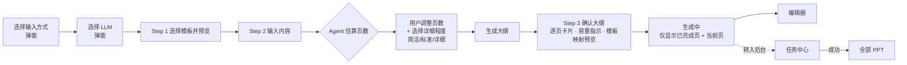
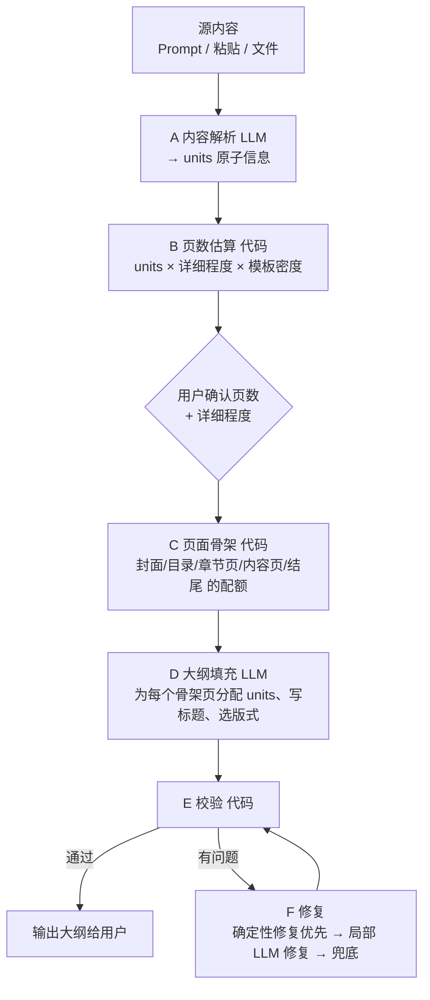

# AIMate PPT 模块改进方案

> 覆盖范围：Outline 生成（页数估算、`ppt_semantic_groups_invalid` 报错、capacity 超限）· 内容详细程度（简洁 / 标准 / 详细）· 生成过程（对标 Gamma）· 生成结果评审 · 任务中心与全部 PPT 分离 · Home 按钮
>
> 依据：
> - `prototype.html`（AIMate · PPT Workspace 原型）代码走查。下文行号指该文件。
> - Gamma（https://gamma.app）公开的生成流程，作为参考产品。
> - 你整理的问题点。
>
> **重要说明**：本次只收到了 prototype 附件，**没有收到 Gamma 的输出和模板文件**。因此第 6 章的评审依据是：原型的模拟生成逻辑 + 模板中心的模板定义与描述 + Gamma 的公开行为。6.8 节提供一张评分表，拿到真实的生成结果、模板、Gamma 输出后，可以直接按表逐页打分复核。
>
> 文中后端代码以 Python 示意，前端代码以原型的原生 JS 风格示意，落地时请按实际代码库调整命名。

---

## 0. 结论摘要

| # | 主题 | 核心结论 | 优先级 |
|---|---|---|---|
| 1 | Outline 流程 | 三种输入方式统一为：**输入内容 → Agent 估算页数 → 用户调整页数并选择详细程度 → 生成逐页大纲 → 确认大纲 → 生成**。目前 Prompt 输入完全跳过大纲；大纲最多 7 章，与 3–50 页的页数无对应关系。 | P0 |
| 2 | `ppt_semantic_groups_invalid` | 根因在于"局部修复（scoped repair）"让 LLM 回传整份大纲，再按位置或全文比对。修复思路：**稳定 ID + 补丁式输出 + 服务端合并 + 越权改动直接丢弃（不报错）+ 确定性兜底**。单页问题不应导致整个任务失败。 | P0 |
| 3 | Capacity 超限 | 容量由**代码**根据模板版式槽位和详细程度计算预算，写进 prompt，并由代码校验。超限时按阶梯处理：**换版式 → 字号收缩 → 定向压缩 → 移入备注 → 标记待确认**。不静默加页。 | P0 |
| 4 | 详细程度 | "内容详细程度"和"生成质量"合并为一个选项：**简洁 / 标准 / 详细**，放在"生成大纲"按钮旁边。质量不再让用户选择，校验每次都做。三档分别对应不同的 prompt 模块和预算参数。 | P0 |
| 5 | 生成过程 | 对标 Gamma：**只显示已完成页 + 正在生成页**，文字按块流式出现。生成中与完成后使用**同一个渲染器**，避免完成时版式跳变。进度来自真实事件，而不是按时间推算。 | P1 |
| 6 | 生成结果 | 目前所有页面同一版式、要点内容相同、没有任何媒体组件，而且**没有使用用户确认的大纲**。与模板描述（如"以图表为核心"）明显不符。需要建设版式库、媒体规划和自动质检。 | P0/P1 |
| 7 | 任务 vs 项目 | 任务中心与全部 PPT 分开。**项目只来自成功的任务**；进行中和失败的任务只出现在任务中心。项目上不再出现"生成中/生成失败"状态。 | P0 |
| 8 | Home 按钮 | 新建流程的所有全屏步骤左上角放两个按钮："← 上一步"和"⌂ 返回 PPT 首页"。 | P1 |

---

## 1. 原型现状走查

| 编号 | 区域 | 现状（代码位置） | 影响 |
|---|---|---|---|
| A1 | 大纲 | `buildOutlineFromTitles` 1698：`normalizedTitles.slice(0,7)`，每章固定补齐 2 个子章节；`beginImportOutlineRead` 1833 同样 `slice(0,7)` | 页数可设 3–50，大纲最多 7 章，两者不对应。生成阶段只能自行补页或压页，这是超容量和反复修复的源头 |
| A2 | 大纲 | `flowNextControl` 1974：只有 paste / import 需要大纲，Prompt 直接"开始生成" | Prompt 输入（最常用的方式）没有让用户确认结构的机会 |
| A3 | 生成 | `startTask` 2342：`previewDeck = buildDeck(title, pages, cover)`；`buildDeck` 1136 不读取 `flowSyllabus`。大纲只作为 `creationDraft.outline` 存档 | **用户编辑过的大纲不影响生成结果** |
| A4 | 页数估算 | `promptPageEstimate` 1866 按字数和标题数做规则估算；`estimatePastePages` 1926 为每 1800 字 1 页再加 3；导入的二进制文件固定 12 页（1886） | 估算与详细程度、模板版式无关 |
| A5 | 详细程度 | `generationPolicyMarkup` 1585：只有"标准 / 详细"两档，加一个"来源使用规则"，放在 Step 2 侧栏；`generationPolicyLabel` 只用于展示 | 选项只被记录，没有作用于生成；与"生成质量"重复 |
| A6 | 生成中页面 | `generationStage` 2269：进度按时间推算（`generationContext` 2180）；正文卡片标签固定为"核心结论 / 关键洞察 / 行动建议"；用 `ai-gen-paper` 单独渲染 | 生成中和完成后（`slideCanvasMarkup`）是两套视觉，完成时会跳变；标签与内容无关 |
| A7 | 生成中页面 | 生成中可以"＋ 新建页面"（`generation-add-slide` 2650） | 与"只显示已完成和正在生成的页面"冲突；流式写入时会产生顺序和 ID 冲突 |
| A8 | 版式 | `buildDeck` 不设置 `layout`，所有页面都是 `standard`（标题 + 列表）；封面与内容页结构相同 | 版面单调，与模板不符 |
| A9 | 内容 | 每个内容页的要点都是同一个 `base` 数组的 3 条；标题在 7 个固定名称之间循环（`SLIDE_NAMES` 935） | 内容重复，没有叙事 |
| A10 | 媒体 | 生成结果中图片、图表、表格数量均为 0。图表、表格、图片只能在编辑器里手动插入，图表默认为"示例数据"（1264） | 媒体组件相比模板全部缺失 |
| A11 | 任务/项目 | `statusLabel` 950 为项目定义了"生成中 / 生成失败"；`coverMarkup` 954 显示生成中转圈；`projectDrawer` 1053 时间线中有"生成失败，需要重试"；任务 `k4` 带有 `folder / tags / cover` 等项目字段 | 项目和任务概念混在一起 |
| A12 | 任务/项目 | `startTask` 2337：项目数达到 50 时禁止**开始任务**；`finalizeTask` 2359：成功但项目已满时不创建项目，任务页显示"已保存"（1040） | 成功任务没有对应的项目，提示有误导性 |
| A13 | 任务 | `retry-task` 2743：重试会创建一个全新任务，与原失败任务没有关联 | 失败记录无法追溯，任务列表变得杂乱 |
| A14 | 导航 | 新建流程 Step 1 的 ← 返回 LLM 选择，Step 2 的 ← 返回上一步；而"基于上一版更新"的 ← 直接退出整个流程（`close-update-stage` 2149） | 同一个按钮在不同流程里含义不同；也没有 Home 按钮 |
| A15 | 导航 | 侧栏的"最近使用 / 全部 PPT / 收藏"与项目页顶部的 tabs 重复（990–991 与 1022） | 次要的信息冗余 |
| A16 | 遗留代码 | `createModal` 1045、`workflowModal` 1108 是旧流程，在最后一步还有 LLM 下拉框（`llmFieldMarkup`），与"先选 LLM"的新流程矛盾 | 维护成本高，容易误用 |
| A17 | 颜色 | 项目卡片封面使用 `cover-*` 色板，PPT 本身使用模板的 `t1–t6` 渐变（`templateGradient` 1759） | 列表缩略图与实际 PPT 的颜色不一致 |

---

## 2. 新建流程重排

### 2.1 目标流程



步骤条从当前的 `['选择模板并预览','输入内容','开始生成']` 改为 **`['选择模板','输入内容','确认大纲']`**（三个全屏步骤），"开始生成"作为 Step 3 的主按钮。

### 2.2 Step 2 右侧面板改为"大纲设置"

把原来的"页数估算与设置"和"内容生成策略"合并为一个面板，放在"生成大纲"按钮的正上方：

```
┌─ 大纲设置 ─────────────────────────────────┐
│ 生成页数    [ − ]  12 页  [ ＋ ]              │
│ Agent 建议 12 页 · 简洁 9 / 标准 12 / 详细 15  │
│ 依据：识别到 5 个主题、14 个关键事实…  [采用建议] │
│                                            │
│ 内容详细程度                                 │
│ (○ 简洁) (● 标准) (○ 详细)                    │
│ 标准：可讲可读，每页 3–4 个要点 + 一句解释         │
│                                            │
│ ▸ 高级：来源使用规则（仅来源 / 来源+通用解释）     │
│                                            │
│            [ 生成大纲 → ]                    │
└────────────────────────────────────────────┘
```

交互规则：

1. 用户输入内容后，Agent 自动估算页数（沿用原型的防抖和 token 机制，见 `refreshPromptEstimate` 1905）。
2. 估算同时给出三档详细程度对应的页数。用户切换详细程度时，**如果页数没有被手动锁定**，页数自动更新为该档的建议值；已手动设置过的页数保持不变（沿用 `flowPagesManual` 语义）。
3. Prompt 中写明的页数（如"控制在 12 页"）视为用户锁定，与现有 `explicit` 逻辑一致。
4. 大纲生成之后，如果再修改页数或详细程度，**不整体重新生成**，而是提示"按新设置调整大纲"（rebalance，见 3.7），只影响相关卡片，用户编辑过的卡片不受影响。
5. 来源使用规则保留，但折叠到"高级"中，默认值为"仅来源内容"。

"基于上一版更新"流程同样处理：`updateTemplatePage` 2099 中的 `generationPolicyMarkup()` 移到大纲生成前的设置面板中。

---

## 3. Outline 生成设计

### 3.1 现状问题

- **大纲粒度错误**：章节 / 子章节结构与页数没有映射关系，见 A1。生成时必须自行决定"一章几页"，模型随意补写或压缩，容量问题因此在生成阶段才暴露。
- **大纲不生效**：见 A3。
- **估算与大纲割裂**：页数估算在前端按规则计算，大纲由另一个过程生成，二者互不知晓。

### 3.2 目标：逐页大纲（Slide Plan）

参考 Gamma 的做法：大纲的每一项就是一页（Gamma 称之为 card），**页数 = 卡片数**。章节作为分组标题保留。

```jsonc
// SlidePlan：Outline 阶段的唯一产物，也是生成阶段的唯一输入
{
  "deck": {
    "title": "Q3 经营复盘",
    "page_count": 12,              // 用户确认的页数，硬约束
    "detail_level": "standard",    // concise | standard | detailed
    "knowledge_rule": "source_only",
    "language": "zh-CN",
    "template_id": "t5"
  },
  "sections": [
    { "id": "sec_a1", "title": "经营概览", "order": 1 }
  ],
  "groups": [                       // 一个 group = 一页 = 一个语义单元
    {
      "id": "g_7f3a",              // 稳定 ID，生成后不变
      "section_id": "sec_a1",
      "order": 3,                   // 只用于排序，不参与内容比较
      "role": "content",           // cover | agenda | section | content | summary | closing
      "headline": "Q3 营收同比 +18%，新客贡献过半",
      "key_message": "增长主要来自新客户与海外市场",
      "unit_ids": ["u_12", "u_13", "u_15"],  // 本页负责呈现的内容单元
      "layout_hint": "kpi-3",       // 版式原型，见 6.7
      "media": [{ "type": "chart", "chart": "bar", "data_unit_ids": ["u_12"] }],
      "est_fill": 0.72,             // 预估容量占用（0–1）
      "locked": false,              // 用户编辑过则为 true，修复流程不再修改
      "status": "ok",              // ok | warn | needs_review
      "warnings": []
    }
  ],
  "units": [                        // 内容解析得到的原子信息
    { "id": "u_12", "type": "metric", "text": "Q3 营收 3.2 亿，同比 +18%",
      "importance": 3, "must_keep": true, "source_ref": "file:p3" }
  ]
}
```

### 3.3 生成管线



职责划分的原则：**结构和数量由代码决定，语言和归纳由 LLM 负责。**

- **A 内容解析（LLM）**：把源内容拆成原子信息 `units`（事实、数字、观点、步骤、对比、引用），并标注 `type / importance / must_keep / source_ref`。只做抽取，不做编排。如果输入是一句很短的 Prompt，就让 LLM 提出主题扩展点（标记为 `origin: "expansion"`，并在"仅来源"规则下禁止编造数字）。
- **B 页数估算（代码）**：见 3.4。
- **C 页面骨架（代码）**：根据页数 N 确定固定页：
  - 封面 1 页；N ≥ 8 时加目录 1 页；N ≥ 12 且章节数 ≥ 3 时，每章加 1 个章节过渡页；总结或结尾 1 页。
  - 其余为内容页，按各章节 units 的权重比例分配页数（最大余数法）。
  - 骨架中每页的 `id / role / section_id / order` 由代码生成，**LLM 不能增删或重排页面**。
- **D 大纲填充（LLM）**：输入是骨架、units 和每页的容量预算，输出每页的 `headline / key_message / unit_ids / layout_hint / media`。
- **E 校验（代码）**：规则见 3.5.4。
- **F 修复**：见 3.5。

### 3.4 页数估算

```python
DETAIL_PAGE_FACTOR = {"concise": 0.8, "standard": 1.0, "detailed": 1.3}
UNIT_WEIGHT = {"metric": 0.6, "fact": 0.5, "claim": 0.7, "step": 0.4,
               "comparison": 1.0, "quote": 0.6, "narrative": 0.8}
UNITS_PER_SLIDE = {"concise": 2.0, "standard": 3.2, "detailed": 5.0}  # 按加权单位计

def estimate_pages(units, sections, template_density=1.0):
    weight = sum(UNIT_WEIGHT.get(u.type, 0.6) * (1.2 if u.must_keep else 1.0) for u in units)
    result = {}
    for level, factor in DETAIL_PAGE_FACTOR.items():
        content = math.ceil(weight / (UNITS_PER_SLIDE[level] * template_density))
        fixed = 2 + (1 if content >= 6 else 0) + (len(sections) if content >= 10 and len(sections) >= 3 else 0)
        result[level] = clamp(content + fixed, 3, 50)
    return result  # {"concise": 9, "standard": 12, "detailed": 15}
```

- 估算理由由代码拼装，例如："识别到 5 个主题、14 个关键事实（其中 6 个为数据），按'标准'每页约 3 个要点估算"。不让 LLM 自由发挥估算理由，避免理由和数字对不上。
- `template_density` 由模板版式的平均正文容量决定（版式偏图片的模板取值小于 1）。
- 估算只是建议，用户确认后的页数才是硬约束。

### 3.5 `ppt_semantic_groups_invalid: Scoped repair changed an unrelated valid group`

#### 3.5.1 报错含义（结合报错文案推断）

校验发现某些 group 不合法（例如超容量、缺少必须保留的信息），于是只针对这些 group 发起**局部修复**。修复返回后，守卫逻辑比较修复前后的大纲，发现**修复范围之外、原本合法的 group 也变了**，于是判定修复结果不可信，抛出 `ppt_semantic_groups_invalid`，并且很可能导致整个大纲生成失败。

这个守卫本身是对的：它防止"修一页、改坏三页"。问题在于**越权改动是可以预见的**，系统应该消化掉，而不是直接失败。

#### 3.5.2 排查步骤

1. 对失败请求保存完整 trace：修复前的大纲、issues 列表、发给修复模型的输入、模型原始输出、守卫判定出的 diff。
2. 对 diff 分类，并统计各类占比：

| 类型 | 典型 diff 表现 | 根因 |
|---|---|---|
| (a) 真的改了内容 | 非目标页的标题或要点被改写、润色 | 修复 prompt 发送了**整份大纲**并要求**整份返回**，模型顺手"优化"了其他页 |
| (b) 只是格式不同 | 空格、全半角标点、序号"1/3"、key 顺序、`order` 字段 | 比较方法过严：对整个 JSON 或包含派生字段的内容做字符串比较 |
| (c) 位置偏移 | 第 5 页拆成两页后，第 6 页及以后都被判为"变了" | **按下标或位置识别 group**，而不是按稳定 ID |
| (d) 信息被挪走 | 修复 A 页时从 B 页"借"了一条事实（去重或补全），导致 B 页变化 | units 没有归属约束，修复可以随意挪用其他页的信息 |
| (e) 连锁再平衡 | 修复 A 页超容量时把内容挤到相邻页 | 局部修复里混入了全局再平衡 |
| (f) 用户编辑被覆盖 | 用户改过的卡片被模型改回或重写 | 没有 `locked` 概念 |

3. 按占比最高的类型优先修复。根据经验，(a)、(b)、(c) 通常占大头。

#### 3.5.3 修复设计

**原则：LLM 只能提出补丁，最终由服务端合并；越权部分直接丢弃，不作为错误。**

1. **稳定 ID**：骨架阶段由代码生成 group ID；拆页时新页面使用 `derived_from: <原 id>`；排序只依赖 `order` 字段；比较一律按 ID。这可以解决 (c)。
2. **修复输入只给目标页**：目标 group 提供完整内容；其他页只给只读摘要（标题和 key_message 各一行），用于保持叙事连贯；同时提供每个目标页的容量预算和问题描述。
3. **修复输出为补丁格式**，只能包含目标 ID 或由目标派生的新 ID：

   ```jsonc
   { "patches": [
       { "op": "replace", "id": "g_7f3a", "group": { /* 新内容 */ } },
       { "op": "split",   "id": "g_9c1d", "into": [ { "derived_from": "g_9c1d", ... }, { ... } ] },
       { "op": "transfer_unit", "unit_id": "u_31", "from": "g_9c1d", "to": "g_7f3a" }
   ] }
   ```

4. **服务端清洗补丁**（sanitize）：ID 不在允许集合内的补丁直接丢弃，并记录 `repair_out_of_scope` 告警，**不抛出错误**。这可以解决 (a)。
5. **语义指纹比较**：只比较语义字段，并先做规范化（去空白、统一标点和全半角、`unit_ids` 排序后比较），派生字段一律不参与比较。这可以解决 (b)。

   ```python
   def fingerprint(g):
       return hash((norm(g.headline), norm(g.key_message), tuple(sorted(g.unit_ids)),
                    g.layout_hint, tuple(sorted(m.type for m in g.media))))
   ```

6. **units 归属约束**：每个 unit 只属于一个 group。修复只能使用"目标页自己的 units"和"未分配的 units"。如果确实需要借用其他页的 unit，必须显式输出 `transfer_unit`，并且在借出页仍能通过校验时才接受，否则丢弃该 transfer。这可以解决 (d)。
7. **再平衡与局部修复分开**：跨页挪内容属于 rebalance 操作（见 3.7），只在用户修改页数或主动点击"AI 重新整理"时运行，不在局部修复中发生。这可以解决 (e)。
8. **`locked` 保护**：用户编辑过的卡片会被标记为 `locked`，修复目标中自动排除这些卡片。如果锁定的卡片本身超容量，只提示用户，不自动修改。这可以解决 (f)。
9. **失败降级**：同一页最多尝试 2 次 LLM 修复（第二次温度设为 0）。仍不通过时使用确定性兜底（3.6.4），将该页标记为 `needs_review` 并在大纲中显示黄色提示。**只有在 schema 始终无法解析，或者 must_keep 信息的覆盖率低于阈值时，才让整个大纲生成失败**。

#### 3.5.4 校验规则（代码）

| 规则码 | 说明 | 级别 | 首选修复方式 |
|---|---|---|---|
| `page_count_mismatch` | groups 数量 ≠ `page_count` | error | 代码：按骨架补齐或截断（LLM 不参与） |
| `unit_unassigned` | 有 must_keep 的 unit 未被分配 | error | 代码：分配给同章节余量最大的页；放不下则交给 LLM 局部修复 |
| `unit_duplicated` | 同一个 unit 被分配到多页 | warn | 代码：保留在 importance 匹配度最高的页 |
| `group_empty` | 内容页没有 unit 且没有 key_message | error | LLM 局部修复 |
| `group_over_capacity` | `est_fill > 1.0` | error | 见 3.6 的阶梯 |
| `group_under_fill` | 在"详细"档下 `est_fill < 0.35` 且源内容还有可用 units | warn | LLM 局部修复（只能使用未分配的 units） |
| `headline_too_long` | 标题宽度超过该档上限 | warn | 代码：在标点处截断；LLM 改写为备选 |
| `layout_media_mismatch` | 例如选了 `chart` 版式但没有数字类 unit | warn | 代码：换为同类无图表版式 |
| `layout_monotony` | 连续 3 页以上使用同一版式 | warn | 代码：从同等容量的版式中轮换 |

#### 3.5.5 修复编排伪代码

```python
def repair_plan(plan: SlidePlan, issues: list[Issue], llm) -> SlidePlan:
    plan, issues = deterministic_fixes(plan, issues)          # 先做不需要 LLM 的修复
    targets = {i.group_id for i in issues if i.group_id} - plan.locked_ids()
    for attempt in range(2):
        if not targets:
            break
        raw = llm.repair(
            targets=[plan.get(t) for t in targets],
            context=plan.readonly_summary(exclude=targets),
            budgets={t: plan.budget(t) for t in targets},
            issues=[i for i in issues if i.group_id in targets],
            temperature=0.2 if attempt == 0 else 0.0,
        )
        patch, dropped = sanitize_patch(raw, allowed=targets, plan=plan)
        if dropped:
            metrics.incr("repair_out_of_scope", tags={"model": llm.name, "n": len(dropped)})
        candidate = apply_patch(plan, patch)                    # 按 id 合并
        assert_untouched(plan, candidate, exclude=targets | patch.affected_ids)  # 语义指纹比较
        issues = validate(candidate, scope=targets | patch.affected_ids)
        plan = candidate
        targets = {i.group_id for i in issues if i.level == "error"} - plan.locked_ids()
    for i in issues:                                            # 剩余问题走兜底，不让任务失败
        plan = deterministic_fallback(plan, i)                  # 截断、移入备注、标记 needs_review
    return plan
```

`assert_untouched` 在 `sanitize_patch` 之后理论上永远成立。它保留为内部断言，用来发现合并逻辑本身的 bug，**不再作为面向用户的报错**。

### 3.6 Capacity 超限

#### 3.6.1 容量的来源

容量必须是**由版式算出来的数字**，而不是 prompt 中"请简洁"之类的描述。

```python
@dataclass
class Slot:
    id: str; kind: str            # title | lead | bullets | body | caption | media | table
    w: int; h: int                # 槽位尺寸，基于 1280×720 逻辑像素（与原型 PPT_PAGE_SPEC 一致）
    font_px: int; min_font_px: int
    line_height: float = 1.45
    max_items: int | None = None  # 要点数上限

def em_width(s: str) -> float:   # 估算文本宽度（以 em 为单位）
    w = 0.0
    for ch in s:
        if is_cjk(ch): w += 1.0
        elif ch.isdigit(): w += 0.58
        elif ch.isalpha(): w += 0.55
        else: w += 0.35
    return w

def slot_capacity(slot: Slot, profile: DetailProfile) -> Capacity:
    em_per_line = slot.w / slot.font_px
    lines = int(slot.h // (slot.font_px * slot.line_height))
    return Capacity(em_per_line=em_per_line, lines=lines,
                    usable_lines=int(lines * profile.fill_ratio),
                    max_items=min(slot.max_items or 99, profile.bullets[1]))

def fits(items: list[str], slot: Slot, profile) -> tuple[bool, float]:
    cap = slot_capacity(slot, profile)
    used = sum(math.ceil(em_width(t) / cap.em_per_line) for t in items) + 0.4 * max(0, len(items) - 1)
    return used <= cap.usable_lines and len(items) <= cap.max_items, used / cap.lines
```

参考值（全宽正文槽位 1120×440，正文 22px，与原型的默认 `bodySize` 一致）：每行约 50 个汉字，约 13 行。按 `fill_ratio` 计算后，可用行数大约为：简洁 7 行、标准 9 行、详细 11 行（详细档同时允许字号降到 16px）。这些参数**需要用真实模板标定**，标定方法见 3.8。

#### 3.6.2 三层校验

| 层 | 时机 | 方法 | 作用 |
|---|---|---|---|
| L1 大纲层 | 大纲生成和用户编辑大纲时 | 根据 units 数量、类型和版式估算 `est_fill` | 在规划阶段避免"一页塞太多"，并在大纲卡片上显示容量条 |
| L2 文本层 | 每页正文生成后 | `fits()`，基于字宽估算 | 确定修复动作，速度快 |
| L3 渲染层 | 每页完成前 | 用真实字体排版测量（前端可复用原型的 `slideOverflows` 1153；后端可使用 headless Chromium，或与导出 PPTX 时相同的排版引擎） | 最终把关，消除估算误差 |

#### 3.6.3 超限处理阶梯

按顺序尝试，任一步成功即停止：

1. **换版式**：在同一版式原型内换为容量更大的变体（例如 `bullets-3col` → `bullets-2col`、`image-right-40%` → `image-right-30%`）。
2. **字号收缩**：在该档允许的 `min_font_px` 以内逐级收缩（每次 -2px），标题与正文的层级比例保持不变。
3. **定向压缩（LLM，局部）**：只针对溢出的槽位，给出明确的字数预算（"本槽位最多 4 条，每条 ≤ 28 个汉字宽度"），要求保留数字和专有名词。
4. **移入备注**：importance 最低的 unit 移入 `speaker_notes`，页面上不再显示。
5. **标记待确认**：页面标记为 `needs_review`。编辑器中显示原型已有的溢出提示（`ppt-overflow-note`），并提供"一键拆页"按钮。

**页数策略**：用户确认的页数是硬约束，**系统不静默加页**。如果第 5 步之后仍然无法容纳，在任务结果中提示"第 7 页内容较多，建议拆为 2 页"，由用户决定。

#### 3.6.4 确定性兜底（不需要 LLM）

- 标题过长：在最后一个标点或词边界处截断，完整标题放入备注。
- 要点过多：按 importance 保留前 K 条，其余移入备注。
- 单条要点过长：在句号或分号处截断，保留第一句。
- 表格行数过多：保留前 N 行，加上"完整数据见附录 / 备注"。

### 3.7 大纲编辑器交互

在现有 `flowOutlineEditorMarkup` 1840 的基础上调整：

- **一张卡片就是一页**：以章节为分组标题，卡片显示页码、标题、要点摘要、版式图标和容量条（绿色 < 85%，黄色 85–100%，红色 > 100%）。
- **页数实时同步**：增删卡片时，顶部的"共 12 页"同步更新，与 Step 2 设置的页数保持一致。偏离估算值时只提示，不阻止。
- 拖拽排序卡片；也可以把卡片拖到另一个章节下。
- 用户编辑过的卡片显示锁定标记。"AI 重新整理"会跳过锁定卡片，弹窗中可选择范围："仅当前卡片 / 当前章节 / 全部未锁定卡片"。
- `needs_review` 的卡片显示黄色徽标，悬停可查看原因和建议（"压缩 / 拆页 / 移入备注"）。
- 修改页数后提示 rebalance："将从 12 页调整为 10 页：合并第 6、7 页；第 9 页移入附录。[预览差异] [应用]"。rebalance 也按 3.5 的补丁机制执行。
- 右侧保留模板预览，翻页时显示**当前卡片套用模板对应版式**的效果，而不是现在的通用渐变页（`templatePreviewMarkup` 1783）。

### 3.8 测试与监控

- **离线评测集**：30–50 份真实输入（Prompt、长文本、PDF、Excel、PPTX 各若干），× 3 档详细程度，× 3–5 个模板。每次修改 prompt 或代码后回归运行，记录以下指标。
- **线上指标**（按模型分组）：
  - `outline_invalid_rate`：大纲生成最终失败率，目标 < 0.5%
  - `repair_rate`：需要 LLM 修复的大纲占比
  - `repair_out_of_scope_rate`：修复越权率，用于比较不同模型是否"听话"
  - `needs_review_pages / total_pages`
  - `overflow_after_render_rate`：L3 渲染层仍然溢出的比例，目标 < 1%
  - `estimate_vs_final_pages`：估算页数与用户最终页数的差异
- **容量参数标定**：每个模板的每个版式，用 3 档 × 10 段文本实际渲染测量，回填 `fill_ratio` 和字宽系数，使 L2 估算与 L3 实测的误差 < 1 行。

---

## 4. 内容详细程度：简洁 / 标准 / 详细

### 4.1 合并方式与放置位置

- "内容详细程度"和"生成质量"实际上控制的是同一件事：每页写多少、写多深。保留一个选项即可，即**内容详细程度：简洁 / 标准 / 详细**，默认值为"标准"。
- **生成质量不再作为用户选项**。校验、修复和溢出处理每次都执行，用户不应该能选择"低质量"。如果原来的"质量"选项实际控制的是成本（模型档位、思考预算），建议作为内部策略：例如"详细"档自动给更多输出 token。
- 位置：放在 Step 2 的"大纲设置"面板中，与页数并列，位于"生成大纲"按钮上方（见 2.2）。**不再放在选择 LLM 和模板之前**。理由是：详细程度直接影响页数估算和大纲中每页的要点数，必须在生成大纲前确定；而它与 LLM 或模板的选择无关。
- 修改原型中的 `generationPolicyMarkup` 1585：`detail` 的取值从 `balanced / detailed` 改为 `concise / standard / detailed`，用分段按钮代替下拉框，并显示每一档的一句话说明。

### 4.2 三档定义

| 维度 | 简洁 concise | 标准 standard | 详细 detailed |
|---|---|---|---|
| 定位 | 演讲辅助：讲者讲，页面只放结论 | 可讲可读：脱离讲者也能看懂主线 | 阅读型：会后发送、自主阅读 |
| 页数系数 | 0.8 | 1.0 | 1.3 |
| 每页 units | 1–2 | 2–4 | 4–6 |
| 标题 | 结论句，≤ 16 个汉字宽度 | 结论句，≤ 20 | 结论句，≤ 24，另加导语 ≤ 40 |
| 要点数 | 2–3 | 3–4 | 4–6 |
| 每条要点 | 8–18 字，短语或"数字+含义" | 小标题 ≤ 10 字 + 1 句说明 ≤ 30 字 | 小标题 + 1–2 句说明 ≤ 70 字，包含依据、条件或边界 |
| 正文目标填充率 | ≤ 55% | ≤ 75% | ≤ 90% |
| 正文最小字号（1280 宽画布） | 24px（约 18pt） | 18px（约 13.5pt） | 16px（约 12pt） |
| 媒体比例 | 约 70% 的页面有主视觉；优先使用大数字、图片、图标 | 约 50%；每页最多 1 个主视觉 | 约 50%；数据页"图表 + 解读"，对比页优先使用表格 |
| 偏好版式 | statement、kpi、image-split、icon-grid | bullets、two-column、chart-insight、process | bullets-dense、table、chart-insight、comparison |
| 来源标注 | 不显示 | 可选显示 | 显示 `source_ref` 脚注 |
| 演讲者备注 | ≤ 60 字（被删减的要点） | ≤ 120 字（过渡语） | ≤ 200 字（补充说明） |

### 4.3 Prompt 设计

采用"**基础 prompt + 详细程度模块 + 代码计算的逐页预算 + 同题三档示例 + JSON schema**"五段式结构。详细程度模块是唯一随档位变化的文本；预算数字全部由代码注入，不让模型自己理解"简洁"有多简洁。

#### 4.3.1 大纲阶段（D 大纲填充）

```text
[System]
你是演示文稿结构规划师。你会收到：页面骨架（页面 id、角色、所属章节均已固定）、内容单元列表、每页容量预算。
请为每个页面填写规划。

硬性约束：
1. 只能填写骨架中已有的页面 id；不得新增、删除或重排页面。页面总数必须为 {page_count}。
2. 每个 must_keep=true 的内容单元必须且只能分配到一个页面。
3. 每页只表达一个核心信息；headline 必须是结论句，宽度不超过 {headline_em}。
4. 每页分配的内容单元数量在 {units_min}–{units_max} 之间，不得超过该页 budget。
5. layout_hint 只能从 {allowed_layouts} 中选择；没有数字类单元的页面不得选择图表版式。
6. {knowledge_rule_text}
7. 只输出符合 schema 的 JSON。

{DETAIL_MODULE}

[User]
页面骨架：{skeleton_json}
内容单元：{units_json}
每页预算：{budgets_json}
```

#### 4.3.2 页面写作阶段（逐页生成正文）

```text
[System]
你是演示文稿撰稿人。为指定页面撰写内容，并严格填入给定版式的槽位。
- 每个槽位都有预算：max_items（条数上限）、max_em（每条宽度上限，1 个汉字 = 1）。超出预算视为错误。
- 只使用分配给本页的内容单元；数字必须与来源一致，保留单位和口径。
- 槽位 media 只输出规格（图表类型、数据引用的 unit id、图片描述），不要编造数据。
{DETAIL_MODULE}

[User]
页面：{group_json}
版式槽位与预算：{slots_with_budget_json}
上一页标题：{prev_headline}；下一页标题：{next_headline}（用于衔接，不要重复其内容）
```

#### 4.3.3 三档 DETAIL_MODULE

**简洁**

```text
【详细程度：简洁】
定位：讲者现场讲解用。页面只放观众需要记住的结论。
- 标题：一句结论，直接给出判断或数字。
- 要点：2–3 条；每条 8–18 字，使用名词短语或"数字 + 含义"，不写完整句，不写解释和原因。
- 优先可视化：有数字就用大数字或指标卡，有流程就用步骤图标，能用图片表达的不写文字。
- 删除背景铺垫、方法细节、重复表述和修饰语。
- 被删掉但有价值的信息写入 speaker_notes（≤ 60 字）。
```

**标准**

```text
【详细程度：标准】
定位：可讲可读。不看讲者也能理解主线逻辑。
- 标题：一句结论。
- 要点：3–4 条；每条 = 小标题（≤ 10 字）+ 一句说明（≤ 30 字）。说明回答"为什么"或"影响是什么"，不重复小标题。
- 每页最多 1 个主视觉（图表、图片或图示），与要点互相印证，不重复文字内容。
- speaker_notes ≤ 120 字，写与上下页的过渡语。
```

**详细**

```text
【详细程度：详细】
定位：阅读型文档。会后发送，读者独立阅读。
- 标题：一句结论；在 lead 槽位加一句导语（≤ 40 字），交代背景或范围。
- 要点：4–6 条；每条 = 小标题 + 1–2 句说明（≤ 70 字），覆盖机制、依据（数据和出处）、适用条件或边界中的至少一项。
- 数据页同时给出图表规格和关键数字解读；对比内容优先使用表格。
- 每条使用了来源的要点都填写 source_ref。
- 如果来源信息不足以支撑详细写法，保持真实：宁可少写，在 warnings 中说明"来源信息不足"，不得编造、注水或重复。
- speaker_notes ≤ 200 字。
```

#### 4.3.4 同题三档示例（few-shot，放在 DETAIL_MODULE 之后）

> 示例数据仅用于演示写法。

| 档位 | 示例输出 |
|---|---|
| 简洁 | 标题："Q3 营收 +18%，新客贡献过半"；要点："新客收入 +32%" / "续费率 94%" / "海外占比 21%"；版式 `kpi-3` |
| 标准 | 标题同上；要点："新客驱动增长：渠道伙伴带来 120 家新签，贡献 54% 增量" / "老客稳定：续费率 94%，客单价持平" / "海外起量：东南亚上线 2 个区域，占比升至 21%"；版式 `chart-insight`（柱状图：分来源增量） |
| 详细 | 导语："本页拆解 Q3 营收 3.2 亿（同比 +18%）的增量来源，口径为确认收入"；要点在标准档基础上补充"渠道伙伴政策 7 月生效，Q4 预计继续贡献但边际递减" / "续费率按合同金额计，不含试用客户" / "海外收入以美元结算，按季度均价折算"等依据和边界；版式 `chart-insight` + 来源脚注 |

### 4.4 代码设计

```python
@dataclass(frozen=True)
class DetailProfile:
    key: str; label: str
    page_factor: float
    units_per_slide: tuple[int, int]
    bullets: tuple[int, int]
    bullet_em: tuple[int, int]
    headline_em: int
    lead: bool
    fill_ratio: float
    min_body_px: int
    media_ratio: float
    preferred_layouts: tuple[str, ...]
    notes_max: int
    max_output_tokens_per_slide: int

DETAIL_PROFILES = {
    "concise":  DetailProfile("concise", "简洁", 0.8, (1, 2), (2, 3), (8, 18), 16, False, 0.55, 24, 0.7,
                              ("statement", "kpi-3", "image-split", "icon-grid"), 60, 500),
    "standard": DetailProfile("standard", "标准", 1.0, (2, 4), (3, 4), (16, 40), 20, False, 0.75, 18, 0.5,
                              ("bullets", "two-column", "chart-insight", "process"), 120, 900),
    "detailed": DetailProfile("detailed", "详细", 1.3, (4, 6), (4, 6), (30, 80), 24, True, 0.90, 16, 0.5,
                              ("bullets-dense", "table", "chart-insight", "comparison"), 200, 1600),
}
```

详细程度在代码中的作用点（**一个配置驱动全链路**，不散落在各处 prompt 中）：

| 环节 | 使用的字段 |
|---|---|
| 页数估算（3.4） | `page_factor`、`units_per_slide` |
| 骨架与大纲填充（3.3） | `units_per_slide`、`headline_em`、`preferred_layouts` |
| 版式选择（6.7） | `preferred_layouts`、`media_ratio` |
| 槽位预算（3.6） | `bullets`、`bullet_em`、`fill_ratio`、`min_body_px` |
| 正文写作 prompt | `DETAIL_MODULE[key]` + 注入预算数字 |
| 校验 | 条数、宽度、填充率的上下限（详细档检查 `group_under_fill`，简洁档不检查） |
| 溢出阶梯 | `min_body_px` 决定字号收缩的下限 |
| 备注 | `notes_max` |
| 成本 | `max_output_tokens_per_slide` |

前端改动：`state.generationPolicy.detail` 的取值改为三档；`generationPolicyLabel` 1580 同步更新；修改详细程度时调用 `refreshPromptEstimate()`，使用对应档位的建议页数（仍遵守 `flowPagesManual`）。

### 4.5 边界情况

- **来源很短但选择了"详细"**：不注水。按 4.3.3 的规则少写，并给出 `warnings`，在大纲页提示"来源信息不足以支撑详细写法，建议减少页数至 8 页或切换为标准"。
- **来源很长但选择了"简洁"**：未上页的 must_keep 信息进入备注。大纲页提示"有 6 条关键信息仅保留在备注中"。
- **用户在大纲中手动加了很多要点**：用户内容优先，不删减；只做容量提示（红色容量条），生成时走溢出阶梯的第 1、2 步，第 3 步压缩需用户确认。
- **多语言**：`em_width` 已区分 CJK 和拉丁字符。英文的 bullet 预算按单词数再做一层约束（简洁 ≤ 6 词，标准 ≤ 14 词，详细 ≤ 28 词）。

---

## 5. 生成过程（对标 Gamma）

### 5.1 参考行为

Gamma 的生成流程大致为：输入 Prompt 并选择卡片数 → 生成逐卡大纲（可编辑、增删卡片）→ 选择主题、文字量和图片来源 → 生成。生成时卡片**一张接一张出现**，文字逐步写入，图片在文字之后异步加载（先显示占位）。**尚未开始生成的卡片不显示。**

### 5.2 原型的差距

| 项 | 原型现状 | 目标 |
|---|---|---|
| 页面可见性 | 基本符合：只显示 `aiIndex <= current` 的页面（2278）；但"＋ 新建页面"会插入手动页 | 只显示已完成页 + 当前页；生成期间禁用新建页面（完成后在编辑器中新建） |
| 文字出现方式 | 按时间比例截取字符串，先标题后要点 | 由真实流式事件驱动，按"标题 → 导语 → 要点 → 说明 → 图注"的阅读顺序追加 |
| 渲染 | `ai-gen-paper` 单独一套视觉；固定 3 张卡片和固定标签 | 与编辑器使用同一个 `slideCanvasMarkup` 和版式系统；每页先确定版式，文字流入固定槽位 |
| 媒体 | 无 | 槽位先显示骨架占位，文字完成后异步填充；未就绪时不阻塞下一页 |
| 进度 | 按时间估算的百分比 | "第 5 / 12 页 · 正在写正文"；百分比 = 已完成页 / 总页数 + 当前页阶段 |
| 完成时 | 关闭生成页、打开编辑器（视觉跳变） | 原地切换为可编辑状态（同一渲染器，无跳变） |

### 5.3 流式事件协议（SSE / WebSocket）

```text
event: slide_start   {slide_id, index, layout, slots:[{id, kind, box}]}   // 版式先确定 → 前端渲染空槽位
event: block_delta   {slide_id, slot_id, text}                              // 追加文字
event: block_done    {slide_id, slot_id}
event: media_pending {slide_id, slot_id, media_type}                        // 显示骨架占位
event: slide_fit     {slide_id, action: "layout_swap"|"font_shrink"|"compress", detail}
event: slide_done    {slide_id, status: "ok"|"needs_review", warnings:[]}
event: media_ready   {slide_id, slot_id, asset_url | chart_spec}            // 可以晚于后续页的 slide_start
event: deck_done     {task_id, project_id}
event: error         {code, message, slide_id?, retryable, resume_from}
```

- **不发送"整份计划"事件给 UI 来渲染未来页面**，以满足"只显示已完成和正在生成的页面"。总页数只用于进度条。
- `slide_fit` 期间当前页显示"正在排版调整…"的短暂状态。只有通过 L3 渲染校验后才发 `slide_done`，保证用户看到的已完成页不会溢出。
- 生成中的修改（原型中的"修改生成要求"聊天）作用于已完成页时，走与编辑器相同的局部修改逻辑；作用于后续页时，修改的是这些页在 SlidePlan 中的生成指令。

### 5.4 前端要点

- 左侧缩略栏随 `slide_start` 增加一项，当前页显示脉冲状态；已完成页可以点击查看（保留原型的"正在查看第 X 页 · 回到正在生成"，2304）。
- 跟随模式：默认自动跟随当前页；用户手动查看其他页时退出跟随，出现"回到正在生成"按钮。
- 光标效果只出现在当前写入的槽位。
- 图片占位比例与槽位一致，加载完成后淡入，不改变版面高度，避免抖动。
- `deck_done` 最多等待未完成的媒体 20 秒；超时则保留占位，并在该槽位提供"重新生成图片"按钮，不阻塞完成。

### 5.5 失败与中断

- 失败时已完成的页面保留在任务中（`partial_deck`），任务状态为"失败"，并记录 `resume_from`。
- 任务中心提供"从第 9 页继续"：复用同一份 SlidePlan 和已完成页面，作为同一任务的第 2 次尝试（见第 7 章）。

---

## 6. 生成结果评审

### 6.1 评审方法

评审对象：原型 `buildDeck` 生成的 PPT（即当前的模拟生成结果）、生成中页面（`generationStage`）、编辑器渲染（`slideCanvasMarkup`），以及模板中心的 6 个模板定义（`templates` 926–933）。参照对象：Gamma 的公开生成效果。

### 6.2 排版

| 问题 | 证据 | 建议 |
|---|---|---|
| 所有页面同一版式 | `buildDeck` 不设置 `layout`，渲染时全部为 `ppt-layout-standard`（标题 + 列表） | 引入版式库（6.7），按内容类型选择版式，并约束连续重复 |
| 封面没有独立设计 | 封面与内容页结构相同，只是 kicker 不同（1146） | 封面、目录、章节页、结尾页使用模板中的专用版式 |
| 缺少目录、章节和结尾页 | 骨架中没有这些角色 | 由 3.3 的骨架阶段自动生成 |
| 背景没有层次 | "模板同色"主题把同一渐变铺满所有页（`paperStyle` 1135） | 模板应提供母版和多种版式：封面满版色、内容页浅底、强调页深底 |
| 生成中与完成后视觉不一致 | 生成中使用 `ai-gen-paper`（顶部色带 + 3 列卡片），完成后使用渐变满版 + 列表 | 统一渲染器（5.2） |
| 字号固定 | 标题 40、正文 22，不随内容量和档位变化；溢出只提示 | 按档位设置字号区间，并执行溢出阶梯（3.6.3） |

### 6.3 内容分布

| 问题 | 证据 | 建议 |
|---|---|---|
| 要点完全重复 | 每页都是 `base` 数组中的同样 3 条（1136） | 由 SlidePlan 的 units 驱动每页内容 |
| 标题重复 | 7 个固定名称循环，14 页时"核心结论"出现两次 | 标题来自大纲的 `headline`（结论句） |
| 没有使用大纲 | 见 A3 | `startTask` 以 SlidePlan 作为输入 |
| 卡片标签与内容无关 | 生成中固定为"核心结论 / 关键洞察 / 行动建议"（2302） | 标签来自槽位语义或要点小标题 |
| 没有叙事结构 | 页与页之间没有递进 | 骨架采用"总 → 分 → 总"；每章开头有章节页，结尾有总结页 |
| 文字量不受详细程度控制 | `generationPolicy` 只被记录 | 见第 4 章 |

### 6.4 媒体组件：与模板对比

模板中心只定义了名称、分类、页数和描述，下表的"应有组件"**根据模板描述推断**。拿到真实模板文件后，应以模板中实际的版式和占位符为准。

| 模板 | 描述（原型） | 应有的媒体组件（推断） | 当前生成结果 | 缺失 |
|---|---|---|---|---|
| 季度业务复盘 | 用数据讲清楚增长、风险与下一步 | 指标卡、趋势折线图、风险矩阵或表格、路线图时间轴 | 仅有文字列表 | 全部缺失 |
| 产品发布会 | 从用户问题到产品亮点的完整叙事 | 封面主视觉图、功能卡片和图标、产品截图或样机、发布时间线 | 仅有文字列表 | 全部缺失 |
| 客户解决方案 | B2B 客户提案与方案演示 | 架构图、方案对比表、实施流程图、案例页（logo、引言） | 仅有文字列表 | 全部缺失 |
| 培训课程讲义 | 结构清晰，适合内部培训 | 目录、步骤流程、检查清单、示意插图、练习页 | 仅有文字列表 | 全部缺失 |
| 数据报告 | **以图表和关键结论为核心** | 柱状、折线、饼图，指标卡，数据表，结论标注 | 仅有文字列表 | 全部缺失，与模板定位直接矛盾 |
| 品牌故事 | 用更有节奏的视觉讲述品牌故事 | 满版图片、引言页、时间线、图文交错 | 仅有文字列表 | 全部缺失 |

编辑器支持的组件：图片（占位或上传）、图表（柱状、折线、饼图、指标卡，默认"示例数据"）、表格、形状（`aiPartMarkup` 1254）。这些组件**全部需要手动插入**，生成流程从不使用。

Gamma 的对应能力：每张卡片自动配图（AI 生成、图库或网络图片），提供图标、时间线、对比列等智能版式，图片在文字之后加载。

### 6.5 协调性

- **颜色**：项目卡片封面使用 `cover-*` 色板，PPT 使用模板的 `t1–t6` 渐变（A17），列表缩略图与实际 PPT 颜色不一致。建议项目封面直接使用 PPT 首页的渲染缩略图。
- **示例数据泄漏**：图表组件默认在说明文字中带"· 示例数据"（1264）。自动生成的图表只能使用来源中的真实数据；没有数据时不选择图表版式（3.5.4 的 `layout_media_mismatch`）。
- **视觉层级**：`focus` 版式的标题为 48px，其他为 40px，正文统一 22px，没有导语、小标题和说明的层级。建议版式库为每个槽位定义字号区间和字重。
- **图文关系**：图片与要点没有语义关联。媒体规格应由大纲中的 `media.data_unit_ids` 或 key_message 生成，与要点互相印证，而不是装饰。

### 6.6 与 Gamma 的对比总结

| 维度 | Gamma（参考） | 原型现状 | 差距 |
|---|---|---|---|
| 大纲 | 逐卡大纲，可编辑，卡片数即页数 | 章节式，最多 7 章，Prompt 没有大纲，且不生效 | 大 |
| 文字量控制 | 生成前选择文字量档位 | 两档，只记录不生效 | 大 |
| 版式 | 每张卡片有不同版式（侧图、分栏、智能图示） | 全部为标题 + 列表 | 大 |
| 媒体 | 自动配图和图标 | 无 | 大 |
| 生成过程 | 逐卡出现，文字流式写入，图片异步 | 形式接近，但使用另一套渲染，由时间驱动 | 中 |
| 溢出 | 卡片可伸缩（网页式），PPT 导出时另做处理 | 固定 16:9，只提示溢出 | 中（需要使用 3.6 的阶梯） |

注意：Gamma 的卡片本质上是**可变高度的网页**，所以它较少遇到容量问题。AIMate 坚持 PowerPoint 16:9 固定页面（原型的 `PPT_PAGE_SPEC`），因此**容量控制必须比 Gamma 更严格**。这也是第 3 章把容量放在规划阶段前置处理的原因。

### 6.7 改进方案

**(1) 版式库（Layout Archetypes）**

模板 = 主题（颜色、字体、背景）+ 一组版式原型的视觉实现。建议的最小版式集合：

| 原型 | 槽位 | 适用内容 |
|---|---|---|
| `cover` | 标题、副标题、主视觉 | 封面 |
| `agenda` | 标题、条目 3–7 | 目录 |
| `section` | 章节号、章节标题、一句话 | 章节页 |
| `statement` | 一句大字结论 + 补充 | 简洁档的核心观点 |
| `bullets` / `bullets-dense` | 标题、要点 3–4 / 4–6 | 通用内容 |
| `two-column` | 标题、左右两栏 | 并列、前后对比 |
| `kpi-3` / `kpi-4` | 标题、3–4 个指标卡 | 数据结论 |
| `chart-insight` | 标题、图表、解读 2–3 条 | 趋势、构成 |
| `table` | 标题、表格（行列上限） | 详细对比 |
| `process` / `timeline` | 标题、3–6 个步骤或节点 | 流程、路线图 |
| `comparison` | 标题、2–3 列对比 | 方案对比 |
| `image-split` | 标题、要点、图片（左或右） | 叙事、产品 |
| `quote` | 引言、出处、头像或logo | 客户声音 |
| `summary` / `closing` | 要点回顾、行动或致谢 | 收尾 |

用户上传模板时（`renderUploadTemplateModal` 2378），解析 PPTX 中的版式和占位符，映射到上述原型。缺少的原型由主题自动派生，并在模板中心标出"该模板缺少：图表页、时间线页"。

**(2) 版式选择规则（代码）**

- 由内容类型决定版式：数字类 → `kpi` 或 `chart-insight`；步骤类 → `process`；对比类 → `comparison` 或 `table`；叙事类 → `image-split`。
- 偏好由详细程度决定：`preferred_layouts`。
- 多样性约束：同一版式不连续出现超过 2 次；N ≥ 8 时至少使用 4 种版式。
- 封面、目录、章节页、结尾页的版式固定。

**(3) 媒体规划与自适应**

- **图表**：只使用来源中的真实数字。根据数据形状选择图表类型（时间序列 → 折线；构成 → 饼图或堆叠；对比 → 柱状；单值 → 指标卡）。系列数和类目数超过槽位容量时，只取 Top N，其余合并为"其他"。
- **图片**：根据 key_message 和模板风格生成提示词（AI 生成或图库）。按槽位比例裁剪，并保留主体焦点。没有合适图片时退回图标或色块，**不留空占位**。
- **表格**：行列上限由槽位计算；超出时保留前 N 行，并加"完整数据见备注"。
- **图标**：`icon-grid`、`process` 版式自动匹配图标库。

**(4) 自动质检（每次生成后运行，结果写入任务详情）**

| 指标 | 定义 | 阈值 |
|---|---|---|
| 溢出率 | L3 渲染溢出的页数 / 总页数 | 0（`needs_review` 单独统计） |
| 版式多样性 | 使用的不同版式数 / min(总页数, 8) | ≥ 0.5 |
| 最长连续同版式 | 同一版式连续出现的最大页数 | ≤ 2 |
| 媒体覆盖率 | 有主视觉的内容页 / 内容页 | 达到该档 `media_ratio` 的 ±15% |
| 模板槽位填充率 | 已填充的媒体槽位 / 版式提供的媒体槽位 | ≥ 90% |
| 大纲一致性 | 页面标题与大纲 headline 的一致率 | ≥ 95% |
| 要点重复 | 跨页要点相似度 > 0.85 的条数 | 0 |
| 填充率合规 | 正文填充率在该档区间内的页数占比 | ≥ 90% |
| 占位文本泄漏 | 出现"示例数据 / 核心要点 / 新章节"等占位文本 | 0 |
| must_keep 覆盖率 | 必须保留的信息出现在页面或备注中的比例 | 100% |

### 6.8 人工评分表

拿到真实生成结果、模板和 Gamma 输出后，同一输入生成 3 份进行对比，逐项打 1–5 分。

| 维度 | 权重 | 5 分标准 | 1 分标准 | 对应自动指标 |
|---|---|---|---|---|
| 版式多样性与适配 | 15% | 版式贴合内容类型，节奏有变化 | 全部为标题 + 列表 | 版式多样性、最长连续同版式 |
| 与模板一致 | 15% | 使用模板的母版、版式、颜色、字体，与模板样张接近 | 只套了颜色 | 模板槽位填充率 |
| 内容分布 | 15% | 每页一个核心信息，密度均匀，无重复 | 疏密悬殊或重复 | 填充率合规、要点重复 |
| 叙事结构 | 10% | 总分总，章节清晰，过渡自然 | 页面之间无关联 | 大纲一致性 |
| 媒体丰富度与相关性 | 15% | 图表数据真实，图片切题，数量符合档位 | 无媒体或与内容无关 | 媒体覆盖率、占位文本泄漏 |
| 媒体自适应 | 10% | 裁剪、比例、图例合理，不变形、不溢出 | 变形、遮挡或留空占位 | 溢出率 |
| 文字质量 | 10% | 结论式标题，数字准确，符合详细程度 | 空泛、注水或编造 | must_keep 覆盖率 |
| 视觉协调 | 10% | 层级清晰，对齐，留白合理，配色统一 | 层级混乱 | — |

---

## 7. 任务中心与全部 PPT 分离

### 7.1 概念定义

| | 任务 Task | 项目 Project（PPT） |
|---|---|---|
| 含义 | 一次生成请求及其执行过程 | 一份可编辑的演示文稿 |
| 产生方式 | 用户点击"开始生成" | **只由成功的任务产生**（或导入已有 PPTX） |
| 状态 | 排队中 → 生成中 → 成功 / 失败 / 已取消 | 无生成状态（只有正常和已删除） |
| 出现位置 | 只在任务中心 | 只在最近使用、全部 PPT、收藏、文件夹 |
| 计入 50 个项目配额 | 否 | 是 |

### 7.2 数据模型

```ts
type TaskStatus = 'queued' | 'running' | 'succeeded' | 'failed' | 'canceled';

interface Task {
  id: string;
  kind: 'prompt' | 'paste' | 'import' | 'template' | 'update';
  title: string;
  llm: string;
  templateId: string;
  input: CreationDraft;           // 输入快照（含 SlidePlan、detail_level）
  status: TaskStatus;
  progress: { done: number; total: number; stage: string };
  attempts: Attempt[];            // 重试记录在同一任务下，而不是新建任务
  error?: { code: string; message: string; stage: 'outline' | 'slides' | 'media' | 'export';
            retryable: boolean; resumeFrom?: number };
  partialDeckId?: string;         // 失败时已生成的部分，不是项目
  projectId?: string;             // 仅 succeeded 时存在
  createdAt: string; finishedAt?: string;
}

interface Project {
  id: string; title: string; folderId?: string; slides: number;
  tags: string[]; favorite: boolean; pinned: boolean;
  sourceTaskId?: string;          // 反向关联，用于"查看生成记录"
  deckId: string; createdAt: string; updatedAt: string;
}
```

需要从原型中移除的部分：项目上的 `generating / failed` 状态（`statusLabel` 950、`coverMarkup` 中的转圈 954）；任务上的 `folder / tags / cover` 等项目属性（`k4` 942）。生成完成后的保存位置（文件夹）作为任务的输出参数 `input.saveFolderId` 保存。

### 7.3 规则

1. **成功与项目创建是原子操作**：任务变为 succeeded 时，必须在同一事务中创建项目并写入 `projectId`。创建失败时任务为 failed（`code=project_create_failed`），不能出现"成功但没有项目"（修复 A12 中"已保存"的情况）。
2. **配额检查在开始前，并预留名额**：开始生成时检查"现有项目数 + 运行中的任务数 < 50"，避免生成完成后才发现无法保存。失败或取消的任务释放预留名额。
3. **重试不新建任务**：在原任务下新增 attempt（修复 A13）。可以"从头重试"，也可以"从第 N 页继续"（复用 SlidePlan 和 `partialDeck`）。
4. **失败任务的部分结果**：可以在任务中心"查看已生成部分"（只读预览）。用户明确点击"另存为 PPT"时，才把已生成部分创建为项目，项目标题加上"（部分）"。
5. **删除关系**：删除项目不删除任务，任务显示"PPT 已删除（在回收站）/ 已永久删除"。删除任务只删除记录，不影响项目。
6. **保留期**：失败和已取消的任务保留 30 天；成功的任务保留与项目相同的时间，或保留 90 天。
7. **基于上一版更新**：同样产生新任务，成功后创建新项目，并在项目详情中显示"基于《X》更新"。

### 7.4 界面

**侧栏**：分为两组，用分隔线隔开。

```
PPT
  ▣ 最近使用
  ▤ 全部 PPT        6
  ☆ 收藏
  ▦ 模板中心
──────────
  ◷ 任务中心   ● 1 生成中   （有未读失败时显示红点）
文件夹
  ...
```

**任务中心页**：
- 筛选：全部 / 进行中 / 成功 / 失败。可按时间和输入方式排序。
- 每行显示：标题、输入方式、模型、模板、页数、详细程度、提交时间、耗时、状态。
- 每种状态的操作：
  - 进行中：查看生成、转入后台、取消
  - 成功：打开 PPT；PPT 已删除时显示"在回收站中查看"
  - 失败：失败原因（使用面向用户的文案，例如"模型服务暂时不可用"，并可展开错误码）、从第 N 页继续、从头重试、查看已生成部分、另存为 PPT
- 去掉任务页上的"＋ 新建"，避免把任务中心当作创建入口。新建入口保留在 PPT 页面。

**全部 PPT 页面**：
- 卡片上不再显示状态标签，只显示页数、更新时间、标签。
- 项目详情抽屉中，把"生成时间线"（1053）替换为"生成信息"：来源任务（可跳转）、模型、模板、详细程度、生成时间。
- 生成完成时 toast 提示："《X》已生成，[打开]"。生成中的任务不出现在 PPT 列表里，最多在"最近使用"顶部显示一条可关闭的提示："1 个 PPT 正在生成 → 任务中心"。

---

## 8. Home 按钮

### 8.1 需求

进入新建 PPT 的流程后，所有全屏步骤的左上角显示两个按钮：

```
[←] [⌂]  A  新建 PPT / 输入内容          LLM · Opus 5.5
```

- **← 上一步**：返回流程中的上一步（语义统一，见 8.3）。
- **⌂ 首页**（房子图标）：返回 PPT 模块初始界面，即 `section='projects', folderId='all', tab='recent'`（最近使用）。

适用范围：
- 新建流程的所有全屏步骤（Step 1 选择模板、Step 2 输入内容、Step 3 确认大纲）。
- "基于上一版更新"的全部步骤。
- 生成中页面：Home 等同于"转入后台并回到首页"，任务继续运行。
- 输入方式和 LLM 这两个弹窗已有 × 关闭按钮，关闭即回到首页，不需要再加 Home。

### 8.2 行为

1. 如果当前流程中有用户输入（Prompt、粘贴文本、文件、已编辑的大纲），先弹出确认框："离开新建流程？已输入的内容将不会保存。" 按钮为"取消"和"离开"。
   - 可选增强：提供"保存为草稿"。草稿保存在任务中心之外的"草稿"区或下次点击新建时恢复。原型中已有 `flowDraftActive` 状态，可以复用。
2. 确认后：取消所有进行中的请求（复用 `suspendCreationRequests` 1068），关闭浮层，重置导航到首页并渲染。
3. 在生成中页面点击 Home 不需要确认（任务不会丢失）：调用 `backgroundGeneration()` 后跳转首页。

### 8.3 统一"← 上一步"的语义

| 页面 | 现状 | 调整后 |
|---|---|---|
| 新建 Step 1（选择模板） | 返回 LLM 选择 | 保持不变（上一步就是 LLM） |
| 新建 Step 2 / Step 3 | 返回上一步 | 保持不变 |
| 更新流程 Step 1 | ← 直接退出整个流程（`close-update-stage`） | 改为返回 LLM 选择（`update-back-llm`），退出交给 ⌂ |
| 更新流程 Step 2 / 3 | ← 退出整个流程 | 改为 `update-back` |
| 生成中页面 | ← 转入后台 | 保留 ← 转入后台，另加 ⌂ |

### 8.4 原型实现参考

```js
const HOME_SVG='<svg viewBox="0 0 24 24" width="16" height="16" fill="none" stroke="currentColor" stroke-width="2" stroke-linecap="round" stroke-linejoin="round" aria-hidden="true"><path d="M3 10.5 12 3l9 7.5"/><path d="M5 9.5V21h5v-6h4v6h5V9.5"/></svg>';
function stageNavMarkup(backAction, backLabel) { return `<button class="icon-button" data-action="${backAction}" aria-label="${backLabel}" title="${backLabel}">←</button><button class="icon-button" data-action="go-home" aria-label="返回 PPT 首页" title="返回 PPT 首页">${HOME_SVG}</button>`; }
function hasCreationInput() { return state.modal==='flow-stage' ? !!(String(state.flowPrompt||'').trim()||String(state.pasteText||'').trim()||state.importFileName||state.flowOutlineReady) : state.modal==='update-stage' ? !!(state.updateBase||updateProgressValue()||state.updateOutline.length) : false; }
function goHome(force=false) {
  if (state.generationOpen) { backgroundGeneration(); }
  else if (!force && hasCreationInput()) { showOverlay(renderLeaveCreationModal()); return; }
  suspendCreationRequests(); closeOverlay();
  state.section='projects'; state.folderId='all'; state.tab='recent'; state.editorOpen=false;
  renderMain();
}
function renderLeaveCreationModal() { return `<div class="overlay" data-action="cancel-go-home"></div><section class="modal confirm-panel" role="dialog" aria-modal="true" aria-labelledby="leaveCreateTitle"><header class="modal-head"><div><h2 id="leaveCreateTitle">离开新建流程？</h2><p>已输入的内容将不会保存。</p></div></header><footer class="modal-foot"><button class="btn" data-action="cancel-go-home">取消</button><button class="btn danger" data-action="confirm-go-home">离开</button></footer></section>`; }
```

需要修改的位置：
- `createFlowStage` 1979：把 header 中的单个 `←` 按钮替换为 `stageNavMarkup(first?'flow-back-llm':'flow-back', first?'返回选择 LLM':'返回上一步')`。
- `updateStage` 2149：替换为 `stageNavMarkup(step===1?'update-back-llm':'update-back','返回上一步')`。
- `generationStage` 2305：替换为 `stageNavMarkup('generation-background','转入后台')`。
- 事件处理中新增三个动作：`go-home` → `goHome()`；`confirm-go-home` → `goHome(true)`；`cancel-go-home` → 重新渲染当前步骤（`showOverlay(state.modal==='update-stage'?updateStage():createFlowStage())`）。

注意：确认弹窗同样渲染在 `#overlayRoot`，会替换掉当前步骤。取消时需要重新渲染当前步骤；如果希望保留滚动位置，可以把确认框改为渲染到 `#editorModalRoot`（与编辑器工具面板同一层级）。

---

## 9. 其他发现（建议顺带处理）

1. **清理遗留流程**：`createModal`、`workflowModal`、`openImportWorkflow` / `openPasteWorkflow` / `openTemplateWorkflow` 及相关事件处理（A16）。这些旧流程在最后一步还有 LLM 下拉框，与"先选 LLM"的新流程矛盾。
2. **去掉重复导航**：侧栏和项目页顶部 tabs 重复（A15），保留其中一处即可，建议保留侧栏。
3. **导入二进制文件的页数估算**：PDF、Word、PPTX 固定估算 12 页（1886）。真实实现中应先在后端解析正文，再走 3.4 的估算。
4. **大纲的"AI 重新整理"**（`flow-syllabus-regen`）需要按 3.7 支持选择范围并跳过锁定卡片，否则会成为新的"越权修改"来源。
5. **模板预览**：Step 1 的模板预览目前是通用渐变页，与模板实际版式无关（`templatePreviewMarkup`）。版式库落地后，预览应展示模板的真实版式样张。

---

## 10. 实施计划与验收标准

### 阶段 1（P0：止血）

- [ ] 局部修复改为补丁式输出 + 服务端合并 + 越权丢弃 + 语义指纹比较 + 稳定 ID（3.5.3 第 1–5 项）
- [ ] 修复失败时降级为 `needs_review`，不再让整个任务失败（3.5.3 第 9 项）
- [ ] 代码计算容量预算并注入 prompt；超限阶梯第 1–5 步（3.6）
- [ ] 详细程度合并为"简洁 / 标准 / 详细"，放到大纲设置面板（4.1、2.2）
- [ ] 任务与项目分离：数据模型、原子创建、配额预留、重试归档（第 7 章）
- [ ] Home 按钮，并统一"← 上一步"的语义（第 8 章）

**验收**：
- `ppt_semantic_groups_invalid` 导致的任务失败率 < 0.5%
- PPT 列表中不再出现"生成中 / 失败"
- 所有新建流程步骤都有 Home 按钮

### 阶段 2（P0/P1：大纲与生成链路）

- [ ] 逐页大纲 SlidePlan；三种输入方式和更新流程统一走"估算 → 调整 → 生成大纲 → 确认"（2.1、3.2–3.4）
- [ ] 生成阶段以 SlidePlan 作为唯一输入（修复 A3）
- [ ] 大纲编辑器：卡片、容量条、锁定、rebalance（3.7）
- [ ] 流式事件协议 + 统一渲染器；生成期间只显示已完成页和当前页（第 5 章）
- [ ] 三档 DETAIL_MODULE、预算注入、校验（4.3、4.4）

**验收**：
- 生成结果标题与大纲的一致率 ≥ 95%
- L3 渲染层溢出率 < 1%
- 同一输入下三档的页均正文字数明显分层（按 4.2 表的中位数，约为 1 : 3 : 8），且 ≥ 90% 的页面落在对应档位的区间内

### 阶段 3（P1：结果质量）

- [ ] 版式库与模板解析映射（6.7 (1)）
- [ ] 版式选择与多样性约束（6.7 (2)）
- [ ] 媒体规划：图表、图片、表格、图标（6.7 (3)）
- [ ] 自动质检指标与离线评测集（6.7 (4)、3.8）
- [ ] 用 6.8 评分表，与 Gamma 和模板样张做对比评审

**验收**：
- 版式多样性 ≥ 0.5，最长连续同版式 ≤ 2
- 媒体覆盖率达到对应档位目标
- 模板槽位填充率 ≥ 90%
- 人工评分的加权平均 ≥ 4.0
