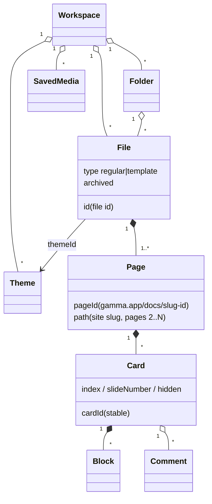
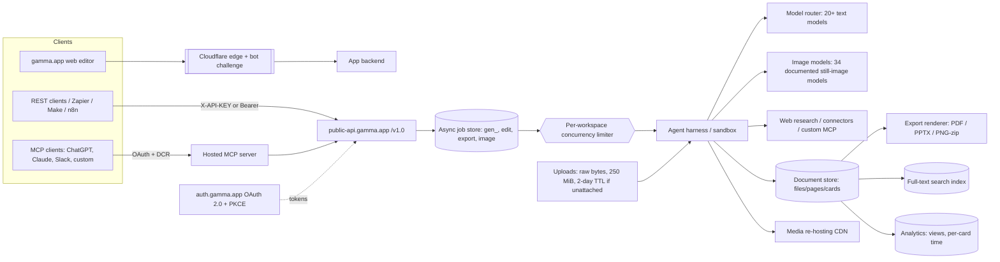

# Gamma architecture and document model

> Part of the Gamma reverse-engineering set: [index](README.md)

Markers: 🟢 confirmed (Gamma's docs, REA browser evidence, or this repo's hands-on sessions, cited) · 🟡 inferred (evidence stated) · 🔴 unknown.

Doc links below are to pages on developers.gamma.app, cited by page name (for example [Explore the API](https://developers.gamma.app/get-started/understanding-the-api-options)). "REA evidence" is passive browser observation recorded with [REA](https://github.com/morluto/rea) on 2026-11-05; see [verification.md](verification.md).

---

## 1. Observability: what can and cannot be seen

| Surface | What is observable | Marker |
|---|---|---|
| `gamma.app` (app, marketing, published decks) | Only a Cloudflare challenge page ("Just a moment..."). REA's passive inspection found 148 DOM nodes and 2 scripts: the challenge-platform orchestrator (621,044 bytes) and one inline script. There were no app bundles, 0 network requests recorded after attach (a lower bound: REA notes sections were filtered by policy or limited by attach timing), empty storage, and one `manifest.json` link. Evidence `ev_70b82f13…`. | 🟢 REA evidence |
| `developers.gamma.app` | A GitBook site (images proxied through `/~gitbook/image`). 40 scripts and 2,361 DOM nodes, plus `llms.txt` and `llms-full.txt`, which hold every page and 25 embedded OpenAPI operations. Evidence `ev_8092f4cb…`. | 🟢 REA evidence |
| `public-api.gamma.app/v1.0` | REST API (needs a key) | 🟢 [Explore the API](https://developers.gamma.app/get-started/understanding-the-api-options) |
| `auth.gamma.app` | OAuth 2.0 authorization server (metadata, register, authorize, token, JWKS) | 🟢 [Authenticate with OAuth](https://developers.gamma.app/get-started/authenticate-with-oauth) |
| `static.gamma.app` | Static asset CDN (favicons, the social banner image referenced by the challenge page's meta tags) | 🔴 unverified: not in the REA evidence record (REA does not retain page bodies) or the docs corpus |
| Frontend bundles, internal GraphQL/REST, collaboration transport | Not reachable without passing the bot challenge. Not attempted, by policy. | 🔴 |

**Consequence:** everything below about internals is reconstructed from the public contract (field shapes, id formats, limits, error codes, documented behaviour) and from hands-on UI sessions. None of it comes from Gamma's code.

---

## 2. Document model

### 2.1 Hierarchy

| Entity | Identity and fields | Evidence | Marker |
|---|---|---|---|
| **File** ("a gamma") | File id, typically `g_`-prefixed (`g_l0mf2jvf1fpmi1v` in the quickstart and `GET /gammas/{gammaId}`; Error codes: "typically starts with `g_`"). The MCP reference's example `g5aykcic8ujm71s` has no prefix and also appears as the trailing id of its example URL, so it may be a doc id (🟡). `type` is `regular` or `template`; `archived`; `themeId`; `title`; `description`; `thumbnailUrl` (signed, ~7 days); `author{name, avatarUrl}`; `createdTime`; `updatedTime`. | `GetGammaResponse` in [GET /gammas/{gammaId}](https://developers.gamma.app/management/get-gamma) | 🟢 |
| **Page** | A file has one main page; Classic `pages` creates 1–50 pages in one request (the per-file maximum is not documented). A page has its own id: the doc id in a `gamma.app/docs/<id>` URL (the MCP example URL has the form `docs/My-Deck-<id>`). Pages 2..N carry a `path` slug when published as a site; the first page is the file's main page. | `PageGeneration`, `pages[]` in `GenerationStatusResponse`; [POST /agent/gammas/{gammaId}/edits](https://developers.gamma.app/agent-gamma-5/edit-gamma) | 🟢 |
| **Card** (a "slide") | Stable `cardId`; `index` (0-based, counts hidden cards); `slideNumber` (1-based, visible cards only, `null` when hidden); `hidden`; title = the card's first heading; text preview up to 200 characters. | `get_gamma_outline` in the [MCP tools reference](https://developers.gamma.app/mcp/mcp-tools-reference) | 🟢 |
| **Block** | Text, headings, lists, images, shapes, layouts, diagrams (timeline, funnel…), charts, tables, callouts, columns, videos, embeds, forms. | Add-block catalogue observed in the UI in one session (2026-09-29, one 4-card deck): [editing-queue study §4](../gamma-ai-editing-generation-queue-2026-09-29.md) | 🟢 observed |
| **Comment** | `id`; `cardId` (`null` = page-level); `targetText` and `targetHtml` (anchored to a text range); `contentText`; `status` open/closed; `archived`; `mentionedUsers`; `replies[]`; timestamps. | `CommentItem` in [GET /gammas/{gammaId}/comments](https://developers.gamma.app/management/get-gamma-comments) | 🟢 |
| **Theme** | `id`, `name`, `type` standard/custom, `colorKeywords[]`, `toneKeywords[]`. | `ThemeItem` in [GET /themes](https://developers.gamma.app/workspace/list-themes) | 🟢 |
| **Template** | A File with `type: template` (workspace), or an official Explore template (id usable only as `templateId` on the agent endpoint). | [Brand, template, and editing controls](https://developers.gamma.app/build-with-gamma/brand-template-editing-controls) | 🟢 |
| **Saved media** | A generated image lives in a workspace media library (`savedMediaId`). Archiving hides it; the URLs keep working. | [POST /images/media/{savedMediaId}/archive](https://developers.gamma.app/images/archive-image) | 🟢 |

### 2.2 Formats and card geometry 🟢

| `format` | Valid `cardOptions.dimensions` | Engine |
|---|---|---|
| `presentation` | `16x9`, `4x3`, `fluid` | `format`: Classic and agent |
| `document` | `pageless`, `letter`, `a4`, `fluid` | `format`: Classic and agent |
| `social` | `1x1`, `4x5`, `9x16` | `format`: Classic and agent |
| `webpage` | `fluid` | Classic only |

Source: the dimensions validation table in [Warnings](https://developers.gamma.app/reference/warnings). `cardOptions` itself is Classic-only: the agent endpoint has no dimensions field and points to a `templateId` that already has them ([Migrate from Classic to Gamma 5](https://developers.gamma.app/get-started/migrate-from-classic-to-gamma-5)).

- Help-centre wording changed between sessions. On 2026-09-29 it said cards grow with their content unless a fixed page setup is chosen ([editing-queue study §4](../gamma-ai-editing-generation-queue-2026-09-29.md)); by 2026-10-21 the same page said new-version presentations use a fixed 16:9 canvas and grid, with the fluid-card text kept lower down for the older version ([depth-capacity plan §2.2](../ppt-outline-first-depth-capacity-plan-20261021.md)). A fixed 1280×720 logical card canvas was measured in one deck ([alpha-mining review §18](../ppt-alpha-mining-layout-content-gamma-review-20261008.md)). 🟢 as relayed help-centre text plus one measurement
- Accent-image placement "works best with fixed-dimension formats like 16x9". 🟢 [Generate from text](https://developers.gamma.app/guides/generate-api-parameters-explained)
- 🟡 **Inference:** one document model drives every format, and format plus dimensions are presentation-layer settings on a shared card/block tree. Evidence: the same `cardOptions` object serves every Classic format, one export endpoint serves every format, and Classic accepts `format` per page inside one file.

### 2.3 Content as text: the `read_gamma` projection 🟢

`read_gamma` (MCP only) returns `Title: <title>`, then `=== Page N: <title> ===` per page or card in order. Bodies are human-readable text that includes images, videos, embeds, charts, tables and diagrams; it is not HTML or JSON. 🟢 [MCP tools reference](https://developers.gamma.app/mcp/mcp-tools-reference)

🟡 **Inference:** the document has a canonical structured form (blocks with typed media) that Gamma renders to text for agents. Raw JSON is deliberately not exposed, so the internal schema stays private.

---

## 3. Editor architecture

| Component | Evidence | Marker |
|---|---|---|
| A ProseMirror-based rich-text editor (Tiptap, and "built over about a year before the public launch", are from the forum post, which has no local copy and was not re-read in this review) | Gamma's [ProseMirror forum showcase](https://discuss.prosemirror.net/t/showcase-gamma-a-presentation-editor-built-in-prosemirror/4834) (title); "contenteditable/ProseMirror-style" nodes seen in the editor DOM ([alpha-mining review §18](../ppt-alpha-mining-layout-content-gamma-review-20261008.md)) | 🟢 ProseMirror · 🟡 Tiptap, timeline |
| Cards are nodes of one continuous document (the "document-style canvas": cards stacked vertically, "Insert slide" between them, a filmstrip of thumbnails) | Observed UI ([editing-queue study §4](../gamma-ai-editing-generation-queue-2026-09-29.md)) plus the ProseMirror base | 🟡 |
| A freeform canvas next to structured blocks ("Convert Heading / slide / all slides to freeform") | Observed UI ([editing-queue study §4](../gamma-ai-editing-generation-queue-2026-09-29.md); a Freeform rail entry in [alpha-mining review §27.8](../ppt-alpha-mining-layout-content-gamma-review-20261008.md)); conversion itself not tested | 🟢 entry points |
| Layout variants per card (No/Top/Left/Right/Background accent) plus "Suggested layouts" previewed with the card's real content | Observed UI ([editing-queue study §4](../gamma-ai-editing-generation-queue-2026-09-29.md); [alpha-mining review §27.8](../ppt-alpha-mining-layout-content-gamma-review-20261008.md)) | 🟢 |
| A style layer separate from content (Themes, Fonts, Colors, Logo, Button Design, Charts, Images, Custom styling) | Observed UI ([editing-queue study §4](../gamma-ai-editing-generation-queue-2026-09-29.md)) | 🟢 |
| Collaboration features (comments with mentions; edit/comment/view sharing) | `CommentItem`, `SharingOptions` | 🟢 features · 🔴 whether editing is real-time, and the sync technology (Yjs, Hocuspocus or custom are all possible; not observable) |

---

## 4. Service architecture (reconstructed)

| Box | Evidence | Marker |
|---|---|---|
| Separate API host behind its own auth (API key or audience-bound Bearer, `resource=https://public-api.gamma.app`) | [Authenticate with OAuth](https://developers.gamma.app/get-started/authenticate-with-oauth): RFC 8707 resource indicators | 🟢 |
| Auth server with PKCE, dynamic client registration (RFC 7591), metadata (RFC 8414 / RFC 9728) and refresh-token rotation. Access tokens last about 1 h; refresh tokens up to 90 days. Tokens are bound to one user and one workspace. OAuth 2.0 only (no OpenID Connect, no ID tokens). Scopes `generate` and `gamma:read`. | same | 🟢 |
| The MCP server is a thin layer over the public API | Its tools largely mirror the REST endpoints; the documented differences are `read_gamma`, `get_gamma_outline` and `get_gammas` (MCP only), archive/delete and Classic from-template (REST only), and MCP `generate` running either engine ([API scope and limits](https://developers.gamma.app/reference/common-feature-requests), [MCP tools reference](https://developers.gamma.app/mcp/mcp-tools-reference)) | 🟡 |
| Async job store (only agent generation ids carry a documented prefix, `gen_`; edit, export and image ids are opaque) and polling only (no webhooks) | [API scope and limits](https://developers.gamma.app/reference/common-feature-requests) | 🟢 |
| Per-workspace concurrency limiter: 2 agent jobs in flight on Free, 10 on paid; `429 workspace_concurrency_limit_exceeded` with `Retry-After` | [Review access and pricing](https://developers.gamma.app/get-started/access-and-pricing) | 🟢 |
| Three-tier HTTP rate limiting (`x-ratelimit-remaining-burst`, `x-ratelimit-remaining`, `x-ratelimit-remaining-daily`) | [POST /generations](https://developers.gamma.app/generations-classic/create-generation) | 🟢 |
| Agent harness: uploads named by an `x-harness-upload-name` header; the agent "works in a protected execution environment" with web research, image generation, code and automated layout checks | Header name ([POST /uploads](https://developers.gamma.app/agent-gamma-5/create-upload)); BornCity launch report | 🟢 header · 🟡 sandbox details (third party relaying company claims) |
| Model router over 20+ text models (Anthropic, OpenAI, Google) chosen by internal evals | BornCity launch report | 🟡 |
| Per-card build workers with stages queued → writing → imaging → checking → polishing → done/failed | `AgentGenerationProgressStages`; UI "Writing slides / Adding images / Polishing slides" | 🟢 stages · 🟡 per-card workers |
| Media re-hosting CDN (Classic input image URLs are fetched and re-hosted on "Gamma's CDN"; the agent endpoint does not guarantee this) | [Optimize image URLs](https://developers.gamma.app/guides/image-url-best-practices); [API scope and limits](https://developers.gamma.app/reference/common-feature-requests) | 🟢 |
| Export renderer shared by every format (PDF, PPTX, PNG zip with one PNG per card; links anyone can use for about a week) | [POST /gammas/{gammaId}/export](https://developers.gamma.app/management/export-gamma), [GET /exports/{id}](https://developers.gamma.app/management/get-export-status) | 🟢 formats, links · 🟡 one shared renderer |
| Full-text search index separate from the document store, falling back to last-edited order (`workspaceDegraded: true`) | [GET /templates/search](https://developers.gamma.app/management/search-templates) | 🟢 fallback flag · 🟡 separate index |
| Analytics pipeline aggregated about hourly (views, unique viewers and editors, per-card view seconds and reach, per-viewer detail, 500-viewer cap) | Analytics endpoints | 🟢 |
| Signed screenshot thumbnails (~7-day expiry) | `GetGammaResponse.thumbnailUrl` | 🟢 |

---

## 5. Workspace, identity and permission model 🟢

| Concept | Values | Source |
|---|---|---|
| Plans | Free; Plus, Pro, Ultra, Teams, Business, Enterprise. Cards: Free 10, paid 100. Agent concurrency: 2 / 10. `quality: max`: Pro and above. Analytics: Pro and above. | [Review access and pricing](https://developers.gamma.app/get-started/access-and-pricing), [Generate from text](https://developers.gamma.app/guides/generate-api-parameters-explained) |
| Workspace access levels | `noAccess`, `view`, `comment`, `edit`, `fullAccess` | `SharingOptions.workspaceAccess` |
| External (link) access levels | `noAccess`, `view`, `comment`, `edit` (no `fullAccess`) | `SharingOptions.externalAccess` |
| Email invites | `access`: `view`, `comment`, `edit` or `fullAccess`, plus `recipients[]` | `EmailOptions` |
| Roles | Workspace admin (delete gammas, restrict API keys and sharing); manage permission (see all viewers in analytics); edit (edits, analytics for self); view (read, export) | [DELETE /gammas/{gammaId}](https://developers.gamma.app/management/delete-gamma); analytics docs |
| Billing identity | An API key spends its owner's credits in that workspace; an OAuth token spends the authorizing user's credits | [Review access and pricing](https://developers.gamma.app/get-started/access-and-pricing) |

🟡 **Inference:** `fullAccess` corresponds to "manage". Basis: it is the highest level in `SharingOptions`, and the analytics docs gate other viewers' data on "manage permission"; the docs never map the two names.

---

## 6. Identifier catalogue 🟢

| Id | Format or example | Where it appears | Accepted in place of |
|---|---|---|---|
| File id | `g_…` (e.g. `g_l0mf2jvf1fpmi1v`) | `gammaId` everywhere | — |
| Page (doc) id | The id in a `gamma.app/docs/<id>` URL | Edits target a page; exports resolve it to its parent file | File id, for edits, exports, `GET /gammas/{gammaId}` and analytics (not archive or delete) |
| Agent generation id | `gen_[A-Za-z0-9]+`, max 128 characters | Agent create and status | File id, in MCP `read_gamma`, `get_gamma_outline`, `edit_gamma`, `export_gamma` (not comments or analytics) |
| Classic generation id | Opaque string | Classic create and status | File id, in the same MCP tools (a non-`gen_` token is tried as a file id first) |
| Edit id, export id, image id | Opaque | `GET /agent/edits/{editId}`, `GET /exports/{id}`, `GET /images/{id}` | — |
| Upload id | Opaque, with a stored `filename` | `files[].uploadId` | One generation only; an upload never attached expires 2 days after creation |
| `savedMediaId` | Opaque | Media library | — |
| `cardId` | Stable | Outline, comments, card analytics | — |
| Theme, folder, template ids | Opaque | themes, folders, templates search | Explore template id: agent `templateId` only |

---

## 7. Implications for AIMate (short)

- Our project model maps one-to-one: project ≈ File (single page); `outline`/`deck.slides` ≈ Cards with stable slide ids; blocks ≈ `cardObjects` and `keyPoints`. Multi-page files, folders-as-sharing and comments have no counterpart. The engine is `apps/cowork-server/lib/ppt-api.mjs`; the Gamma facade is `src/lib/ppt-gamma-service.ts` plus `src/lib/ppt-gamma-compat.ts`, whose `toGammaStatus` uses the project id as `gammaId`.
- Gamma's split of agent, job store, export renderer and CDN matches our cowork-server (engine and jobs) plus the desktop model worker (model calls); we have no per-workspace limiter. The structural difference is that Gamma runs models server-side, while ours run in the user's desktop app (BYOK). That is why the facade documents "the AIMate window must be open".
- Gamma exposes a **text projection for agents** (`read_gamma`) and an **outline with stable ids** (`get_gamma_outline`). Both are cheap to add over our project view and would make an MCP surface for the PPT engine useful. See [09-aimate-gap-analysis.md](09-aimate-gap-analysis.md).

## Evidence limitations

- The docs describe the public API and MCP contract, not internals. Every box in §4 beyond the API surface is reconstructed; Gamma's code, bundles and internal APIs were never observed (gamma.app served only the bot challenge).
- REA saw two pages passively on 2026-11-05. "0 requests" and "empty storage" are lower bounds limited by attach timing and policy filtering, and no page bodies were retained.
- UI observations come from a handful of decks (2026-09-29 to 2026-10-21, at least two on a Free plan). Labels and help-centre wording changed between sessions (for example the fluid-card versus fixed 16:9 description), so UI rows describe those dates, not current behaviour.
- `get_gamma_outline`, the main source for the card model, is "rolling out gradually" and was read from docs only, not called.
- Tiptap, the editor's build history, the agent sandbox and the model router come from third parties or Gamma's own posts that have no local copy (ProseMirror forum, BornCity relaying company claims); none was re-read here.
- The id formats come from doc examples (`g_…`, `gen_…`); the docs are inconsistent about whether the unprefixed MCP example is a file id or a doc id.

## Open questions 🔴

1. The internal document schema: whether a card is a ProseMirror node with a layout attribute or a separate container, and how freeform content is stored next to the block tree.
2. The collaboration transport (CRDT or OT) and how it merges with agent edits running on the server.
3. Whether PPTX export is native in general. Partly answered for one 11-page deck: text, colour blocks and a 6×2 table were native objects, while 4 math formulas and gradient backgrounds became pictures (no OMML) ([template-first audit §15.2](../ppt-gamma-template-first-editor-workflow-audit-20261019.md)). Charts and diagrams were not checked.
4. How "checking" works: rendered overflow detection or text-level checks.

## Sources

- Gamma developer docs (`llms-full.txt`, fetched 2026-11-05): [Explore the API](https://developers.gamma.app/get-started/understanding-the-api-options), [Authenticate with OAuth](https://developers.gamma.app/get-started/authenticate-with-oauth), [Review access and pricing](https://developers.gamma.app/get-started/access-and-pricing), [GET /gammas/{gammaId}](https://developers.gamma.app/management/get-gamma), [GET /gammas/{gammaId}/comments](https://developers.gamma.app/management/get-gamma-comments), [MCP tools reference](https://developers.gamma.app/mcp/mcp-tools-reference), [Warnings](https://developers.gamma.app/reference/warnings), [API scope and limits](https://developers.gamma.app/reference/common-feature-requests), [POST /uploads](https://developers.gamma.app/agent-gamma-5/create-upload), [Optimize image URLs](https://developers.gamma.app/guides/image-url-best-practices)
- REA passive browser evidence: [verification.md](verification.md)
- ProseMirror showcase: https://discuss.prosemirror.net/t/showcase-gamma-a-presentation-editor-built-in-prosemirror/4834
- BornCity Gamma 5 report: https://borncity.com/news/gamma-5-gamma-tech-stellt-den-groessten-umbau-seiner-praesentationsplattform-vor/
- In-repo hands-on: [gamma-ai-editing-generation-queue-2026-09-29.md](../gamma-ai-editing-generation-queue-2026-09-29.md), [ppt-alpha-mining-layout-content-gamma-review-20261008.md](../ppt-alpha-mining-layout-content-gamma-review-20261008.md), [ppt-gamma-template-first-editor-workflow-audit-20261019.md](../ppt-gamma-template-first-editor-workflow-audit-20261019.md), [ppt-outline-first-depth-capacity-plan-20261021.md](../ppt-outline-first-depth-capacity-plan-20261021.md)
