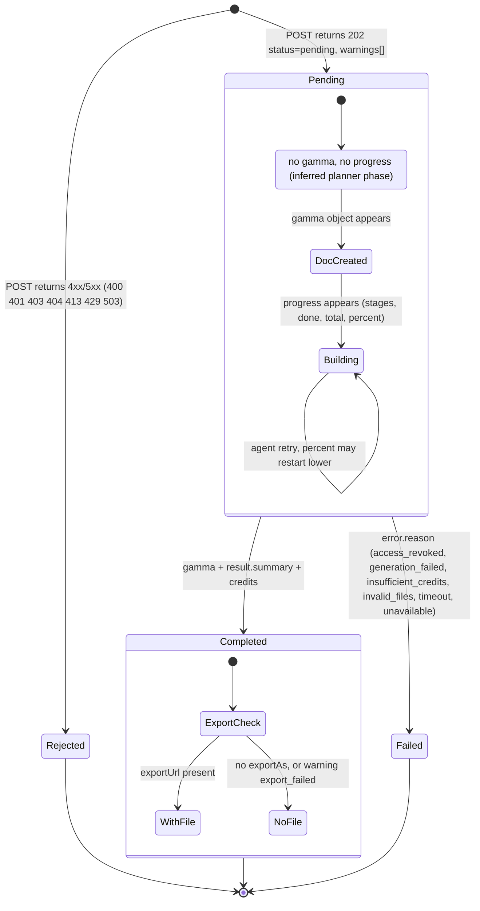
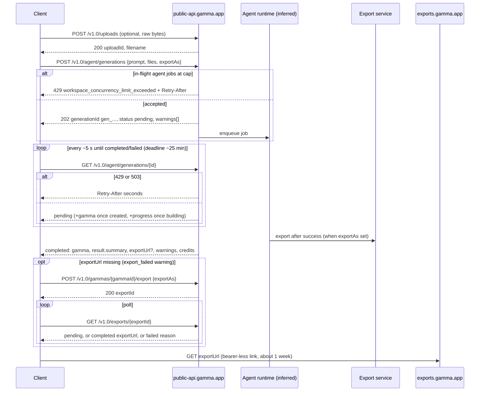
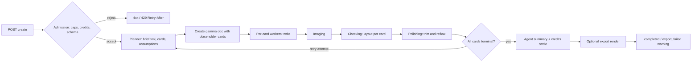

# Gamma generation pipeline

> Part of the Gamma reverse-engineering set: [index](README.md)

This report covers Gamma's generation pipeline from start to finish: the two engines (Gamma 5 agent and Classic), every request field, the job lifecycle and its response shapes, the in-app flow we observed hands-on, polling and rate limits, pricing, how Classic fields map to Gamma 5, how the pipeline changed over time, and what we infer about its internal design. It is based on Gamma's developer docs (fetched 2026-11-05) and on our own sessions in the Gamma app recorded in `docs/research/`.

**Confidence markers.** 🟢 confirmed: stated in Gamma's docs or observed hands-on (the source is cited). 🟡 inferred: the evidence is named. 🔴 unknown or a gap.

**Source shorthand.** Doc links point to `developers.gamma.app` pages (full list under [Sources](#sources)). "Hands-on" links point to in-repo session notes, which are written in Chinese.

---

## 0. Summary

| # | Finding | Marker |
|---|---|---|
| 1 | Gamma runs two engines behind one REST API. **Gamma 5** (`POST /v1.0/agent/generations`) is an agent that plans, writes, adds images, checks and polishes. **Classic** (`POST /v1.0/generations`, `/generations/from-template`) is driven by parameters. Gamma recommends Gamma 5; Classic remains the only way to generate webpages and multi-page gammas. | 🟢 [explore][D-explore] |
| 2 | Every job is asynchronous: create, then poll until `completed` or `failed`. There are no webhooks. | 🟢 [limits][D-limits] |
| 3 | Gamma 5 status responses carry per-card `progress` with seven stage buckets: `queued`, `writing`, `imaging`, `checking`, `polishing`, `done`, `failed`. `percent` runs 0–99 and never decreases within one attempt, but can restart lower when the agent retries. Only `completed` counts as 100. | 🟢 [agent status][D-agent-status] |
| 4 | In the app's default Plan mode, the user reviewed a plan before building (an optional clarify step, then plan/outline review, then Generate) in every observed run; Express mode skips the plan. The API has no plan-review or clarifying-question channel, so an API job runs the plan without a human gate. | 🟢 UI ([H-queue][H-queue] §2, [H-alpha][H-alpha] §16) · 🟡 API behaviour (no such endpoint or field exists) |
| 5 | Classic is priced per card and per image. Gamma 5 is priced "by the work the agent does", following the `quality` preset (`lite`, `standard`, `max`). | 🟢 [pricing][D-pricing] |
| 6 | Each workspace has a cap on in-flight agent jobs (2 on Free, 10 on paid; generations and edits count together). Exceeding it returns `429 workspace_concurrency_limit_exceeded` with `Retry-After`. | 🟢 [pricing][D-pricing] |
| 7 | Gamma does **not** validate output against the prompt, the template or `numCards`. | 🟢 [brand controls][D-brand], [agent create][D-agent-create] |

---

## 1. The two engines at a glance

| Aspect | Gamma 5 agent | Classic `generations` | Classic `from-template` | Marker |
|---|---|---|---|---|
| Create endpoint | `POST /v1.0/agent/generations` | `POST /v1.0/generations` | `POST /v1.0/generations/from-template` | 🟢 [readme][D-readme] |
| Poll endpoint | `GET /v1.0/agent/generations/{generationId}` | `GET /v1.0/generations/{id}` | same as Classic | 🟢 [readme][D-readme] |
| Create HTTP status | `202` | `200` | `200` | 🟢 OpenAPI in [agent create][D-agent-create], [classic create][D-classic-create], [classic template][D-classic-tpl] |
| Job id | `gen_` prefix, pattern `^gen_[A-Za-z0-9]+$` | no documented prefix | no documented prefix | 🟢 [agent create][D-agent-create] |
| Required fields | `prompt` | `inputText` or `pages` | `prompt` + `gammaId` | 🟢 [explore][D-explore] |
| Who decides structure | The agent, or the `templateId` source to the degree the prompt asks | Gamma, from your parameters | The template, by default | 🟢 [explore][D-explore] |
| Formats | `presentation` (default), `document`, `social`; `webpage` is rejected | `presentation`, `document`, `social`, `webpage` | follows the template | 🟢 [agent create][D-agent-create], [classic create][D-classic-create] |
| Multi-page / site | No | Yes (`pages`, `publish`) | No (template must be single-page) | 🟢 [classic template][D-classic-tpl] |
| Default theme | None (pass `themeId` or `templateId`) | Workspace default | The template's own theme | 🟢 [explore][D-explore] |
| Unknown fields | Rejected with `400` | Not documented | Not documented | 🟢 [migrate][D-migrate] · 🔴 Classic behaviour |
| Progress while pending | `progress` object | None | None | 🟢 schemas |
| Out of credits | `403 insufficient_credits`, or the job fails with `error.reason: insufficient_credits` | `402 "Insufficient credits remaining"` | `402` | 🟢 [poll][D-poll], [pricing][D-pricing] |
| Typical duration | "usually minutes", up to 20 min | "most within 1–3 minutes" | same | 🟢 [migrate][D-migrate], [classic status][D-classic-status] |
| Pricing | By the agent's work, per `quality` | Per card + per image | Same, "may cost slightly more per card" | 🟢 [pricing][D-pricing] |

---

## 2. Gamma 5 request: `POST /v1.0/agent/generations`

### 2.1 Fields

All fields below are from the `CreateAgentGeneration` schema in [agent create][D-agent-create] (🟢) unless marked otherwise.

| Field | Type | Enum / limits | Default | Semantics and interactions | Marker |
|---|---|---|---|---|---|
| `prompt` | string | max 400,000 chars | — (required) | The brief and any source text. The only required field. | 🟢 |
| `format` | string | `presentation`, `document`, `social` | `presentation` | `webpage` is rejected; use Classic for webpages. | 🟢 |
| `numCards` | integer | 1–100; plan cap 10 (Free) / 100 (paid) | Agent picks a count within the cap | **Soft target**: the agent "may deviate by a card or two" and the result is not validated against it. A value above the plan cap returns `400`. The cap also applies to decks the agent sizes itself. | 🟢 [pricing][D-pricing] |
| `quality` | string | `lite`, `standard`, `max` | "API default, capped at what the plan includes" | Same presets as the app. `max` needs Pro, Ultra, Teams, Business or Enterprise; otherwise `403 agent_premium_models_restricted`. Changes both output and cost. | 🟢 [pricing][D-pricing] · 🔴 which preset is the default |
| `themeId` | string | 1–128 chars; an id from `GET /themes` | none | Applied on Gamma's "Standard Brand Base" design for the format. **Cannot be combined with `templateId`** (`400`). An unknown theme returns `400`. | 🟢 |
| `templateId` | string | 1–128 chars | none | A workspace template, any gamma in the workspace, or an official Explore template (`exploreTemplates[].id`). The prompt decides how the source is used, from "fill its layouts" to "borrow only its look". The source is never modified. Unknown, unauthorized, other-workspace, archived and retired ids all return the same `400`, and **no substitute template is used**. An official template id names its currently published copy and can change when Gamma rebuilds that template. | 🟢 |
| `additionalInstructions` | string | 0–5,000 chars | none | Guidance on tone, audience, language and style. Treated as a soft target, never validated. | 🟢 |
| `sourceUrls` | string[] (URI) | max 10, http or https | none | URLs the agent reads. A link the prompt **depends on** (a deck to import, a report to build from) is required: if it cannot be read, the job fails and creates no gamma. A background link that cannot be read is skipped. | 🟢 · changed 2026-11-04 [changelog][D-changelog] |
| `files` | `AgentGenerationFile[]` | max 50 files, 250 MiB total | none | `{uploadId, filename, purpose?}` from `POST /uploads`. A `.pptx` or `.pdf` is imported with its own layout. `purpose: "import"` imports that file faithfully as the new presentation; at most one file may carry it. | 🟢 [uploads][D-uploads] |
| `files[].purpose` | string | `import` | omitted (ordinary source material) | Cannot be combined with `templateId`, `themeId` or `numCards`. The prompt still wins, so say "import it as is" when you want a faithful copy. | 🟢 [import][D-import] |
| `folderId` | string | an id from `GET /folders` | none | Requires edit or full access to the folder ([GET /folders](https://developers.gamma.app/workspace/list-folders)). A setting an admin restricts is ignored and reported in `warnings`. | 🟢 |
| `sharingOptions.workspaceAccess` | string | `noAccess`, `view`, `comment`, `edit`, `fullAccess` | workspace setting | An admin restriction makes it ignored, with a warning. | 🟢 |
| `sharingOptions.externalAccess` | string | `noAccess`, `view`, `comment`, `edit` | workspace setting | Same as above. | 🟢 |
| `sharingOptions.emailOptions` | object | `recipients` (≥1 email, required), `access` (`view`, `comment`, `edit`, `fullAccess`) | none | `fullAccess` only for workspace members (`email_full_access_members_only`). | 🟢 |
| `exportAs` | string | `pdf`, `pptx`, `png` | none | Exports after a successful generation. A failed export is a **warning** (`export_failed`), never a failed generation. `png` returns a ZIP with one image per card. | 🟢 |
| `disableConnectors` | boolean | — | not stated (omitting it leaves connectors on, 🟡) | Keeps this run away from workspace connectors (Notion, Slack, …). Gamma recommends it for files from untrusted senders, because they can carry text written to steer the agent. | 🟢 [import][D-import] |

**Fields that Gamma 5 does not accept** (🟢 [migrate][D-migrate]): `inputText`, `textMode`, `textOptions.*`, `imageOptions.*`, `cardOptions.*`, `cardSplit`, `title`, `folderIds`, `pages` and `publish`. "Unknown fields such as `textMode` or `textOptions` are rejected with `400`."

### 2.2 Create responses and errors

| Code | Meaning on `POST /agent/generations` | Marker |
|---|---|---|
| `202` | `{generationId, status: "pending", warnings: [...]}`. `warnings` is always present (empty array when there are none). | 🟢 |
| `400` | Invalid parameters, `numCards` above the plan cap, an inaccessible `templateId`, an unknown `themeId`, or `themeId` together with `templateId`. | 🟢 |
| `401` | Bad or missing key. `X-API-KEY` is a custom header, not `Authorization: Bearer` (except for OAuth tokens). | 🟢 [readme][D-readme] |
| `403` | Insufficient credits (`insufficient_credits`), a quality tier not on the plan (`agent_premium_models_restricted`), or access denied. | 🟢 (codes from [pricing][D-pricing]) |
| `404` | An upload in `files` does not exist or has expired. | 🟢 |
| `413` | `files` exceed 250 MiB in total. | 🟢 |
| `429` | HTTP rate limit, or too many in-flight agent jobs (`code: workspace_concurrency_limit_exceeded`, with `Retry-After`). | 🟢 |
| `503` | Service busy; retry. | 🟢 |

**Request-level warning codes** (`AgentGenerationWarning.code`, 🟢 [agent create][D-agent-create]): `email_full_access_members_only`, `email_invites_failed`, `export_failed`, `external_access_failed`, `folder_placement_failed`, `ignored_email_options`, `ignored_email_recipients`, `ignored_external_access`, `ignored_folder_id`, `ignored_workspace_access`, `workspace_access_failed`. Each entry is `{code, message}`.

### 2.3 Illustrative request

The example below is our own (🟡 illustrative). It combines source URLs, an uploaded file and an export.

```json
{
  "prompt": "Build a 12-slide board update from the attached Q3 report. Keep every figure exactly as written; condense prose to key results, risks and decisions.",
  "additionalInstructions": "Audience: board. Tone: concise. Write in English. One idea per slide.",
  "format": "presentation",
  "numCards": 12,
  "quality": "standard",
  "themeId": "abc123def456ghi",
  "sourceUrls": ["https://example.com/q3-press-release"],
  "files": [{ "uploadId": "upl_…", "filename": "q3-report.pdf" }],
  "exportAs": "pptx",
  "disableConnectors": true
}
```

---

## 3. Classic requests

### 3.1 `POST /v1.0/generations` (schema `Generation`)

All rows 🟢 from [classic create][D-classic-create] and [generate guide][D-gen-guide].

| Field | Type | Enum / limits | Default | Notes |
|---|---|---|---|---|
| `inputText` | string | 1–400,000 chars (~100k tokens, "may be lower" when the job needs extra reasoning) | — (required unless `pages`) | A topic, notes or full content. Image URLs placed inline are fetched and re-hosted. `\n---\n` marks card breaks when `cardSplit: inputTextBreaks`. |
| `pages[]` | `PageGeneration[]` | 1–50 | — | Multi-page File. Overrides the top-level per-page fields. Each entry needs `inputText`; optional `format`, `numCards`, `title`, `path` (slug, honoured for pages 2 and later), `textMode`, `cardSplit`, `additionalInstructions`, `textOptions`, `imageOptions`. |
| `publish` | boolean | — | false | Publishes the File as a Gamma site once all pages succeed (multi-page only). |
| `title` | string | 1–500 | inferred from content | — |
| `textMode` | string | `generate`, `condense`, `preserve` | — 🔴 no default stated in the REST guide (MCP `pages[].textMode` says `generate` is the default) | `generate` expands brief input, `condense` summarises long input, `preserve` keeps the exact text and adds structure such as headings. |
| `format` | string | `presentation`, `document`, `social`, `webpage` | `presentation` | — |
| `numCards` | number | ≥1, plan cap 10 / 100 | 10 | Used only with `cardSplit: auto`. |
| `cardSplit` | string | `auto`, `inputTextBreaks` | `auto` | `auto` follows `numCards` and ignores breaks. `inputTextBreaks` gives one card per `\n---\n` segment and ignores `numCards` (5 breaks make 6 cards). |
| `additionalInstructions` | string | 0–5,000 | — | Free steering for layout, visual style and tone. |
| `themeId` | string | — | workspace default | — |
| `textOptions.amount` | string | `brief`, `medium`, `detailed`, `extensive` | `medium` | Only applies to `generate` and `condense`. |
| `textOptions.tone` / `.audience` | string | 0–500 | — | Only applies to `generate`. With `preserve` they are ignored, with a warning. |
| `textOptions.language` | string | 67 codes (e.g. `en`, `zh-cn`, `zh-tw`, `ja`) | `en` | Sets the output language whatever the input language. |
| `imageOptions.source` | string | `aiGenerated`, `pictographic`, `pexels`, `giphy`, `webAllImages`, `webFreeToUse`, `webFreeToUseCommercially`, `themeAccent`, `placeholder`, `noImages` | `aiGenerated` | `model` and `style` only apply to `aiGenerated`; otherwise they are ignored, with a warning. |
| `imageOptions.model` | string | 38 enum values | auto-selected | Four values (`veo-3.1*`, `leonardo-motion-2*`) are in the enum but do not generate video. ([image models][D-image-models]) |
| `imageOptions.style` | string | 0–5,000 | — | — |
| `cardOptions.dimensions` | string | presentation: `fluid` (default), `16x9`, `4x3`; document: `fluid` (default), `pageless`, `letter`, `a4`; social: `4x5` (default), `1x1`, `9x16` | per format | A mismatch with `format` falls back to the format default, with a warning. |
| `cardOptions.headerFooter` | object | 6 slots (`topLeft`…`bottomRight`), each `{type: text\|image\|cardNumber, source: themeLogo\|custom, src, value, size: sm..xl}`; `hideFromFirstCard`, `hideFromLastCard` | — | Not applicable to `webpage`. |
| `sharingOptions` | object | same shape as the agent's | workspace setting | — |
| `folderId` | string | — | — | Needs edit or full access to the folder. View-only access returns `400` (since 2026-09-10). |
| `folderIds` | string[] | max 1 | — | Deprecated 2026-09-25. Ignored when `folderId` is present. |
| `exportAs` | string | `pdf`, `pptx`, `png` | — | One format per request. |

**Create response** (🟢): `{generationId, warnings?: string, pageWarnings?: (string|null)[]}`. Classic warnings are a **single free-text string**, for example `"cardOptions.dimensions 1x1 is not valid for format presentation. … Using default: fluid."` ([warnings][D-warnings]). Error codes: `400`, `401`, `402` (credits), `403`, and `429` (rate limit, or too many pending API-key jobs on a Free workspace).

### 3.2 `POST /v1.0/generations/from-template` (schema `FromTemplateGeneration`)

All rows 🟢 from [classic template][D-classic-tpl] and [template guide][D-tpl-guide].

| Field | Type / limits | Notes |
|---|---|---|
| `gammaId` | string, required | Must be a gamma marked as a template in your workspace, with exactly one page and a card count within the plan cap. Non-template, archived, multi-page, site-bound and Explore ids are rejected at submit. |
| `prompt` | 1–400,000, required | Same instruction surface as the app's Remix: retarget, transform, fill `[[placeholders]]`, reference "card 9", add, remove, lock or reorder cards. Part of the token budget is taken by the template itself. |
| `title` | 1–500 | — |
| `themeId` | string | Optional. **Replaces** the template's theme. This is the one place where theme plus template is allowed. |
| `imageOptions.model` / `.style` | as above | No `source`: new images follow the template's original source. |
| `sharingOptions`, `folderId`, `folderIds`, `exportAs` | as above | — |

Response: `{generationId, warnings?: string}`. Error codes: `400` (also "template not found"), `401`, `402`, `403` ("feature not enabled"), `429`.

---

## 4. Job lifecycle and response shapes

### 4.1 Agent status (`GET /v1.0/agent/generations/{generationId}`)

The response is a `oneOf` of three shapes (🟢 [agent status][D-agent-status]).

| Field | Pending | Completed | Failed |
|---|---|---|---|
| `generationId` | ✔ | ✔ | ✔ |
| `status` | `pending` | `completed` | `failed` |
| `gamma {gammaId, gammaUrl}` | **can appear** once the document exists | required | present if the doc was created before the failure |
| `progress {stages, done, total, percent}` | can appear once card building starts | — | — |
| `result.summary` | — | required (written by the agent) | — |
| `exportUrl` | — | only if `exportAs` was set and the export succeeded | — |
| `error {reason, message, statusCode}` | — | — | required |
| `warnings[]` | **always empty** | accumulated during the run (create-time warnings may repeat) | "usually empty"; keep the warnings from the create response |
| `updatedTime` | ISO-8601 time of the last state change | ✔ | ✔ |
| `credits {deducted?, remaining?}` | — (not included while pending, per [poll][D-poll]) | required object, members best-effort | required object, members best-effort |

**`progress` semantics** (🟢 schema descriptions, except where marked):

| Field | Meaning |
|---|---|
| `stages.queued`, `.writing`, `.imaging`, `.checking`, `.polishing`, `.done`, `.failed` | All are optional numbers with no description; that they count cards per stage is inferred from the names and the docs' "per-stage counts" wording (🟡). |
| `done` | Cards finished. |
| `total` | Cards in the gamma. |
| `percent` | Estimated completion, 0–99. Never decreases within one generation attempt, but can restart lower if the agent retries. `completed` is the only 100. |

- 🟡 We believe `stages` partitions `total`, so the seven counts add up to `total`. The schema says nothing either way; this rests on the names and on the per-card UI badges (§5.3).
- 🟡 We believe top-level `done` equals `stages.done`. Not stated.
- 🔴 It is unknown whether `total` can change mid-run, for example if the agent adds a card.
- 🔴 It is unknown how `percent` is estimated: it is "estimated", not `done/total`, and it may weight stages.

**`error.reason` values** (🟢): `access_revoked`, `generation_failed`, `insufficient_credits`, `invalid_files` (an upload could not be attached at run time, e.g. already used), `timeout`, `unavailable`. `statusCode` is "HTTP-style" for the reason.

**`credits` semantics** (🟢 `AgentCreditsResponse`):

- `deducted` is the credits actually debited "so far": the agent's model and tool spend settled from its ledger, plus image generation charged as it ran.
- `deducted` is not a list price. Spend that could not be charged because the balance was empty is left out.
- `deducted` can grow after completion if a late settlement lands. `0` means no charge was recorded, and the field is omitted when the record cannot be looked up.
- `remaining` is the live balance when the status was served, not what this job cost.
- Treat both as informational, not as a billing record ([pricing][D-pricing]).

Status codes: `200`, `400`, `401`, `404` (not found), `429`.

### 4.2 Classic status (`GET /v1.0/generations/{id}`)

The response is a single `GenerationStatusResponse` schema (🟢 [classic status][D-classic-status]).

| Field | Pending | Completed | Failed |
|---|---|---|---|
| `generationId`, `status` | ✔ | ✔ | ✔ |
| `gammaId`, `gammaUrl` (top level) | — | ✔ (`gammaId` since 2026-02-27) | — 🔴 not stated |
| `exportUrl` | — | if `exportAs` was set | — |
| `error {message, statusCode}` | — | — | ✔ (no `reason` enum) |
| `credits {deducted, remaining}` (both required) | — | ✔ | ✔ |
| `pages[] {gammaId, gammaUrl, status, error?, exportUrl?}` | multi-page only | multi-page only | multi-page only |

- 🟢 Classic has no `progress`, no `result.summary`, no `updatedTime`, and no `warnings` on the status schema; Classic warnings appear only on create.
- 🟢 Status codes listed in the schema: `200`, `400`, `401`, `404`. The docs still say every response carries rate-limit headers and that `429` should be handled.

### 4.3 Illustrative agent responses

These are our own sequence (🟡 illustrative). The field shapes are 🟢 from the schema; the values are invented.

```json
// t+3s — planning; no doc, no progress yet
{ "generationId": "gen_V1St", "status": "pending", "warnings": [], "updatedTime": "2026-11-05T10:00:03Z" }

// t+40s — document created, cards being built
{ "generationId": "gen_V1St", "status": "pending",
  "gamma": { "gammaId": "g_abc", "gammaUrl": "https://gamma.app/docs/abc" },
  "progress": { "stages": { "queued": 5, "writing": 3, "imaging": 0, "checking": 1, "polishing": 0, "done": 1, "failed": 0 },
                "done": 1, "total": 10, "percent": 18 },
  "warnings": [], "updatedTime": "2026-11-05T10:00:40Z" }

// completed
{ "generationId": "gen_V1St", "status": "completed",
  "gamma": { "gammaId": "g_abc", "gammaUrl": "https://gamma.app/docs/abc" },
  "result": { "summary": "Created a 10-card board update covering results, risks and decisions." },
  "exportUrl": "https://exports.gamma.app/…/deck.pptx",
  "warnings": [], "updatedTime": "2026-11-05T10:02:10Z", "credits": { "deducted": 15, "remaining": 485 } }

// failed (the doc may already exist)
{ "generationId": "gen_V1St", "status": "failed",
  "gamma": { "gammaId": "g_abc", "gammaUrl": "https://gamma.app/docs/abc" },
  "error": { "reason": "insufficient_credits", "message": "…", "statusCode": 403 },
  "warnings": [], "updatedTime": "…", "credits": { "deducted": 9 } }
```

### 4.4 State diagram (agent job)

🟢 The states and transitions come from the schemas. 🟡 The pending sub-states (planning, document created, building, retry) are inferred from which optional fields appear, plus the UI (§5).



### 4.5 Sequence: create, poll, export

All steps are 🟢 from [readme][D-readme], [poll][D-poll] and [migrate][D-migrate]. The "Agent runtime" lane is 🟡 inferred.



### 4.6 Export sub-job

All rows 🟢 from [export][D-export] and [export status][D-export-status].

| Item | Detail |
|---|---|
| Create | `POST /v1.0/gammas/{gammaId}/export {exportAs}` returns `200 {exportId}`. It accepts a file id or a page/doc id and needs view access. Archived gammas cannot be exported. |
| Poll | `GET /v1.0/exports/{id}` returns `{exportAs, exportId, status, gammaId, exportUrl?, error?}`. `gammaId` is always the canonical file id. |
| Failure reasons | `render_timeout` and `export_failed` are transient and safe to retry. `deck_too_large` and `no_content` mean the input has to change. |
| Link | Anyone holding the URL can download until it expires (about one week); access is not tied to the API key. Do not log it. |
| Cost | Exports don't charge credits ([migrate][D-migrate] code comment; [templates workflow][D-templates-wf]). |

### 4.7 Edits share the lifecycle (for completeness)

All rows 🟢 from [edit][D-edit] and [edit status][D-edit-status].

- `POST /v1.0/agent/gammas/{gammaId}/edits {prompt ≤10,000, quality?, disableConnectors?}` returns `201 {editId, gammaUrl}`.
- An edit changes one page, cannot add pages, and needs edit permission. A second edit while one is running returns `409 edit_in_progress`, with the running `editId` when it belongs to your workspace.
- Edits count toward the in-flight agent-job cap.
- Edit status has `gammaId` and `pageId` at the top level. It has **no `progress`** object.
- Failure reasons: `access_revoked`, `edit_failed`, `insufficient_credits`, `target_not_found`, `timeout`, `unavailable`, `unsupported_target`. A failed edit "may have been partially applied".

---

## 5. The in-app flow (observed hands-on)

### 5.1 Stage table

Each row describes the runs cited, on their dates (2026-09-29 to 2026-10-22); labels differed between runs, so none is a general rule.

| Stage | What we saw | Source | Marker |
|---|---|---|---|
| Intake | Format tabs (Presentation, Document, Carousel, Image, Beautify, Import). A composer with Add or connect (files and connector sources), Settings, Effort, Dictate. A template chip after "Use template". Long pasted text becomes an attachment ("Pasted text · 19 KB" / "60 KB"). | [H-alpha][H-alpha] §17.1, §27.1; [H-outline][H-outline] §1 | 🟢 |
| Mode and effort | Settings offers **Plan mode** (default) or **Express mode** (skips the plan). Effort: **Standard** (default), Lite, Max. No model name is shown. | [H-alpha][H-alpha] §16 table; [H-tplfirst][H-tplfirst] §13.1 | 🟢 |
| Setting up | "Setting up". The tab title becomes "· Working…". Tool activity reads "Prepped selected template → Opened the Plan view → Created Plan". | [H-alpha][H-alpha] §27.2 | 🟢 |
| Clarify (conditional) | A **Setup form**: text handling (condense keeping terms and facts / preserve original / expand; in one run the chat receipt read "Build it out" although Condense had been clicked, [H-tplfirst][H-tplfirst] §19.1), language (bilingual was preselected when paired paragraphs were found, English, Chinese, "Something else"), and sometimes length options. In other runs there was **no form**: the agent decided, then listed its assumptions under "**My calls to check**" (Language / Code / Imagery). For a specific prompt there were no questions at all. | [H-alpha][H-alpha] §17.1, §27.2; [H-outline][H-outline] §1; [H-queue][H-queue] §2 | 🟢 |
| Length choice | Varies by run: "not asked" in one run. In others: Quick overview 10 / 16 / 24 + Custom, or Quick overview 12 / Standard talk 18 / Deep dive 25. Plan length did not always match: a "10 slides" choice produced an 11-item plan and an 11-page deck. | [H-outline][H-outline] §1; [H-tplfirst][H-tplfirst] §13.1, §13.3, §19.1 | 🟢 |
| Plan (outline) | Streams in card by card (skeleton first). **Each card already holds condensed final content**, not just a title. Controls: Merge between cards, ⋮ menu, Add slide, per-card Instruction, inline text edit. Look and feel: Suggested template / Browse / Image source (AI images or Image placeholders). In one run the plan was a file the user could open (`gamma-agent/session/generations/<slug>/brief.xml`). In another, an interim state showed an extra card (5 settled to 4). | [H-queue][H-queue] §2; [H-outline][H-outline] §1; [H-alpha][H-alpha] §17.1, §27.2 | 🟢 |
| Plan revision by chat | A chat request ("merge to 10") gives "Deciding on next steps…", then the plan re-streams in place, then "Edited Plan" with a section mapping and a density caveat. Generate is disabled meanwhile ("Waiting for agent to finish"). | [H-alpha][H-alpha] §17.1, §27.2 | 🟢 |
| Plan cap notice | "Free includes up to 10 slides. Upgrade to generate all 24 slides." appears inside an un-truncated 24-card plan, so the content plan and the plan-tier cap are separate. | [H-alpha][H-alpha] §27.2 | 🟢 |
| Generate | The app jumps to the document URL. Status reads "Writing slides… 0/N". In the Sample Size run an overview grid showed **placeholder cards titled from the plan**; in the Further Study run some placeholders carried the template's old sample titles. | [H-alpha][H-alpha] §18, §27.5; [H-tplfirst][H-tplfirst] §14.3 | 🟢 |
| Build | In the Sample Size run: "Writing slides… k/N", then "Adding images…", then "Checking every slide…", then "Polishing slides… k/N"; 2–4 cards in progress at once; each card went from title-only to 430–660 characters within 1–2 sampling intervals of 2–5 s (the whole card at once, **not token streaming**); polishing trimmed text on four cards by 1–4%. Per-card badges across runs: Checking… / Polishing… / Done / **Couldn't finish** (Compiler run). The 2026-09-29 run showed "Polishing presentation… 3/4" instead. | [H-alpha][H-alpha] §18, §27.5; [H-outline][H-outline] §1; [H-depth][H-depth] §2.1 | 🟢 |
| Summary | The chat reports what was built and the layout-check results (paraphrased from the Chinese notes: 10/10 passed layout checks in one run; slide 2 overflowed the bottom and 9/10 passed in another), followed by a satisfaction prompt. The "ready" chat message can arrive a few seconds before the canvas stops "Working". | [H-alpha][H-alpha] §18, §27.5, §27.8; [H-tplfirst][H-tplfirst] §19.2 | 🟢 |

### 5.2 Messages sent during the build: queue and stop

- 🟢 In the 2026-09-29 run, a chat message submitted mid-build was shown as **Queued**, with "Edit queued message" and "Remove queued message". The build is not interrupted. When the deck finishes, the agent runs the queued item ("Editing…", "Checking…") and returns an Original/Modified comparison ([H-queue][H-queue] §2.1).
- 🟢 While the agent works, the composer shows a **Stop** control ([H-queue][H-queue] §2.1; [H-alpha][H-alpha] §18, §20.1). 🔴 What Stop does to a half-built deck was not tested.
- 🟢 The Help Center (cited in [H-queue][H-queue]) says the AI does not respond immediately while content is generating.
- 🔴 The API has no queue, stop or cancel endpoint. An API caller can only wait for a terminal state ([limits][D-limits] lists no cancel operation).

### 5.3 UI stages and API `progress`

| UI signal | API equivalent | Marker |
|---|---|---|
| Setting up, Created Plan, Outline ready (before Generate) | `pending` with no `gamma` and no `progress` | 🟡 inferred: the doc says `progress` appears "once the agent starts building cards" |
| Jump to the document URL with placeholder cards | `gamma` appears while still `pending` | 🟡 inferred: same moment, "once the document has been created" |
| Placeholder (not started) cards | `stages.queued` | 🟡 |
| "Writing slides… k/N" | `stages.writing` | 🟡 name match |
| "Adding images…" | `stages.imaging` | 🟡 |
| "Checking every slide…" / per-card "Checking…" | `stages.checking` | 🟡 |
| "Polishing slides… k/N" / per-card "Polishing…" | `stages.polishing` | 🟡 |
| per-card "Done" | `stages.done` / `done` | 🟡 |
| per-card "Couldn't finish" | `stages.failed` | 🟡. 🔴 The deck still "completed" with a card that couldn't finish, so a completed job may contain failed cards, and the completed response carries no `progress` to show it. |
| Plan review, Merge, Add slide, per-card instruction, clarifying form | **None.** No API field or endpoint. | 🟢 absence in the schemas · 🟡 API runs like the UI's Express mode |
| Queued chat instruction | None. Use `POST /agent/gammas/{id}/edits` after `completed`. | 🟢 |
| MCP app widget "live card progress" | The same progress, but only rendered in the widget, not in the tool result | 🟢 [mcp tools][D-mcp-tools] |

🔴 The UI's "k/N" counters are probably cards past that stage, not cards in it. "Adding images 14/19" and "Polishing 17/19" appeared in sequence ([H-outline][H-outline]), which fits a cumulative count, but this was not verified.

### 5.4 Observed timings (hands-on; sampled wall-clock, not server timings)

| Run | Send → plan ready | Generate → done | Pages | Source | Marker |
|---|---|---|---|---|---|
| alpha_mining, Hanifah, Standard | ~20 s setup + ~40 s outline | ~2.5 min | 19 | [H-outline][H-outline] §1 | 🟢 |
| factor_testing, Sample Size, Standard | ~40 s to "Outline ready" | ~114 s | 10 | [H-alpha][H-alpha] §27.1, §27.5 | 🟢 |
| 12_ml_quant, Further Study | ~70 s | ~82 s | 11 | [H-tplfirst][H-tplfirst] §13.2 | 🟢 |
| 12_ml_quant, Shoal, Standard talk | ~45 s after the form | ~129 s | 18 | [H-tplfirst][H-tplfirst] §19.2 | 🟢 |

These match the docs' guidance that Gamma 5 jobs "usually finish in minutes" ([migrate][D-migrate]) 🟢.

---

## 6. Polling, pacing, rate limits, concurrency

| Topic | Guidance | Marker |
|---|---|---|
| Interval | Every 5 s. Polling faster "will not speed up the generation" and raises the risk of rate limiting. | 🟢 [poll][D-poll] |
| Agent deadline | Keep polling past a few minutes. Jobs can run up to 20 min; the quickstart uses a 25 min deadline. **Don't resubmit** a job that is still pending. | 🟢 [readme][D-readme], [migrate][D-migrate] |
| Classic deadline | "Most complete in 1–3 / 2–3 minutes". A 5 min ceiling is a good default (60 attempts × 5 s). | 🟢 [poll][D-poll] |
| What affects duration | Deck size, AI images, higher-tier image models. A 5-card deck with no images can take under a minute; a 40-card deck with AI images takes several minutes. | 🟢 [poll][D-poll] |
| Per-request timeout | The examples use a 30 s HTTP timeout. | 🟢 [migrate][D-migrate] |
| Rate-limit headers | `x-ratelimit-limit-burst` / `-remaining-burst` (short window), `x-ratelimit-limit` / `-remaining` (per hour), `x-ratelimit-limit-daily` / `-remaining-daily`. Present on every response. | 🟢 [poll][D-poll] |
| Header values | The docs' example shows 10000 / 40000 / 200000. That is an example response, not a published quota. | 🟢 example · 🔴 real quotas per plan |
| Adaptive pacing | Gamma's example polls every 15 s when `remaining-burst` < 100, otherwise every 5 s. | 🟢 [poll][D-poll] |
| On `429` | Use `Retry-After` when present. Otherwise wait 30 s, then back off exponentially. The migration example retries `429` and `503` with `Retry-After`, defaulting to 5 s. | 🟢 [poll][D-poll], [migrate][D-migrate] |
| Concurrency cap (agent) | In-flight agent generations **plus edits** per workspace: Free 2, paid 10. Exceeding it returns `429 workspace_concurrency_limit_exceeded` + `Retry-After`. | 🟢 [pricing][D-pricing] |
| Concurrency cap (Classic) | Only on Free workspaces, only for jobs started with an API key: too many pending Classic, template or image jobs return the same `429` code. | 🟢 [pricing][D-pricing] · 🔴 the threshold |
| One `429` code, three causes | `workspace_concurrency_limit_exceeded` also covers plain HTTP rate limits on create routes. | 🟢 [errors][D-errors] |
| Parallel jobs | Stagger creates and poll the ids round-robin. | 🟢 [poll][D-poll] |
| Fire-and-forget | You can poll later with only the key and the id. | 🟢 [poll][D-poll] |
| Webhooks | None. | 🟢 [limits][D-limits] |
| Job retention | 🔴 Not stated for generations. For images, the MCP docs say the job "ages out of the status endpoint". | 🟢 [mcp tools][D-mcp-tools] · 🔴 generations |
| Debugging | Send `x-request-id` to support. | 🟢 [errors][D-errors] |
| Automation platforms | Zapier Delay 30–60 s (minimum 1 min), Make Sleep 30 s, n8n Wait 30–60 s. | 🟢 [poll][D-poll] |

---

## 7. Credits and pricing

### 7.1 Classic (per card, per image)

All rows 🟢 [pricing][D-pricing], [image models][D-image-models].

| Driver | Credits |
|---|---|
| Card (`numCards`) | 1–3 per card, depending on "the text generation model Gamma selects internally". |
| Image, Standard tier | 2–15 per image. |
| Image, Advanced tier | 20–33 per image. |
| Image, Premium tier | 34–75 per image. |
| Image, Ultra tier | 30–125 per image. |
| from-template | "May cost slightly more per card". |
| Worked examples in the docs | 10 cards + 5 basic images ≈ 20–60. 20 cards + 15 premium ≈ 320–1,070. 30 cards + 30 ultra ≈ 930–3,900. |

### 7.2 Gamma 5 (by the agent's work)

| Point | Detail | Marker |
|---|---|---|
| What is metered | "Writing, research, and the images it creates". The agent picks its own image models, so the per-card and per-image prices above do not apply. | 🟢 [pricing][D-pricing] |
| Variance | The same prompt can cost a different amount from run to run. Estimate by running representative prompts and comparing `credits.deducted`. | 🟢 |
| `lite` | All plans. MCP calls it "fastest". | 🟢 [pricing][D-pricing], [mcp tools][D-mcp-tools] |
| `standard` | All plans. The default in the app UI in the observed runs. | 🟢 docs + 🟢 [H-alpha][H-alpha] §16, §27.1 |
| `max` | Pro, Ultra, Teams, Business, Enterprise. "More capable models", can use more credits. Otherwise `403 agent_premium_models_restricted`. | 🟢 |
| Start condition | At least 1 available credit, otherwise `403 insufficient_credits`. A job that runs dry fails with `error.reason: insufficient_credits`. | 🟢 |
| Where the cost shows | `credits.deducted` on the completed or failed response. Over MCP, `get_generation_status` **omits** credits for `gen_` ids. | 🟢 [mcp tools][D-mcp-tools] |
| Free operations | Reads, searches, exports, archive. Generations, edits and images charge. | 🟢 [pricing][D-pricing], [limits][D-limits] |
| Whose credits | An API key spends the key owner's balance in that workspace. An OAuth token spends the authorizing user's balance. The app and the API share one balance and one set of rules. | 🟢 [pricing][D-pricing] |
| Concrete per-quality prices | Not published. | 🔴 |

### 7.3 Plan gating relevant to the pipeline

All rows 🟢 [pricing][D-pricing], [mcp tools][D-mcp-tools].

| Limit | Free | Paid |
|---|---|---|
| `numCards` cap (agent and Classic) | 10 | 100 (Plus and above) |
| In-flight agent jobs | 2 | 10 |
| `quality: max` | no | Pro and above |
| Image models | plan-dependent (MCP returns `availableImageModels`) | more tiers |
| Plan-limit failure payload (MCP) | `planLimitExceeded: true` and `currentPlanLimits {workspace, planTier, creditsRemaining, maxGenerateCards, availableImageModels, availableQualities}`, `upgradeUrl`, `guidance` | same |

---

## 8. Classic → Gamma 5 migration, field by field

| Classic | Gamma 5 | Notes | Marker |
|---|---|---|---|
| `POST /generations` | `POST /agent/generations` | Same key and header. | 🟢 [migrate][D-migrate] |
| `POST /generations/from-template` + `gammaId` | `POST /agent/generations` + `templateId` (same id) | Also accepts any gamma and Explore templates. The structure is no longer kept automatically: say "Follow this template's structure and style exactly; only replace the content." | 🟢 |
| `inputText` | `prompt` | State the job ("condense", "keep every figure") and append the source text. | 🟢 |
| `textMode: generate` / `condense` | A sentence in `prompt` | — | 🟢 |
| `textMode: preserve` | Explicit preservation request + verification | Not automatically validated. **Keep Classic** until tested on representative inputs. Gamma 5 may resolve `[TBD]` notes even when asked to preserve. | 🟢 |
| `textOptions.tone`, `.audience` | `additionalInstructions` ("Audience: … Tone: …") | — | 🟢 |
| `textOptions.language` | "Write in Japanese." in `additionalInstructions` | — | 🟢 |
| `textOptions.amount` | "Keep text per slide brief / detailed" | — | 🟢 |
| `title` | Ask for it in `prompt` | No field. | 🟢 |
| `format: webpage`, `pages`, `publish` | Not supported | Stay on Classic. | 🟢 |
| `numCards` (exact-ish with `auto`) | `numCards` (soft, ±1–2) | Adjust downstream code that expects an exact count. | 🟢 |
| `cardSplit: inputTextBreaks` | Say "each section is its own slide" in `prompt` | Check the slide boundaries afterwards. | 🟢 |
| `imageOptions.source`, `.model`, `.style` | No equivalent | Describe the style in `additionalInstructions`. You cannot pin a model or switch off a source. | 🟢 |
| `cardOptions.dimensions`, `.headerFooter` | No equivalent | Use a `templateId` that already has them. | 🟢 |
| `themeId` (default: workspace theme) | `themeId` (no default), mutually exclusive with `templateId` | From-template + `themeId` is a `400` on Gamma 5: drop it. | 🟢 |
| `folderIds` | `folderId` | — | 🟢 |
| `sharingOptions`, `folderId`, `exportAs` | Same | Admin-restricted settings are ignored and warned about. | 🟢 |
| — | `quality`, `sourceUrls`, `files`, `disableConnectors` | New on Gamma 5. | 🟢 |
| Create `200 {generationId, warnings: string}` | `202 {generationId: gen_…, status, warnings: [{code, message}]}` | Warnings become structured. | 🟢 |
| Top-level `gammaId`, `gammaUrl` | `gamma.gammaId`, `gamma.gammaUrl` | Wait for `completed`: `gamma` can appear while pending. | 🟢 |
| `error {message, statusCode}` | `error {reason, message, statusCode}` | Branch on `reason`. | 🟢 |
| `402` out of credits | `403 insufficient_credits` | — | 🟢 [poll][D-poll] |
| — | `result.summary`, `progress`, `updatedTime` | New. | 🟢 |
| `credits` (both fields required) | `credits` (members best-effort, can grow late) | Cross-check with Billing. | 🟢 |
| 5 min timeout | ~25 min deadline | — | 🟢 |

Gamma's pre-switch checklist ([migrate][D-migrate], 🟢): content fidelity, branding, slide count, elapsed time, credits, and how often `exportUrl` is missing.

---

## 9. Evolution (changelog and dated docs)

| Date | Pipeline-relevant change | Marker |
|---|---|---|
| 2025-07-28 | Beta of the Generate endpoints (create + retrieve). | 🟢 [changelog][D-changelog] |
| 2025-09-15 | Credit-based pricing. The Ultra tier unlocks more powerful models and **up to 75 cards** (today's paid cap is 100). | 🟢 |
| 2025-11-05 | Generate API GA as `v1.0`. From-template in beta. Webpage generation, headers and footers, image URLs in input, folder assignment, email sharing, List Themes and Folders. "Removed hard generation limits". | 🟢 |
| 2026-01-16 | `v0.2` endpoints disabled. | 🟢 |
| 2026-02-27 | From-template GA. New `stylePreset` parameter. PNG export. `GET /generations/{id}` returns `gammaId`. New image models. | 🟢 · 🟡 `stylePreset` is now only in MCP `generate.imageOptions`, not in the REST OpenAPI |
| 2026-07-13 | Export of existing gammas (`/gammas/{id}/export`, `/exports/{id}`). | 🟢 |
| 2026-07-20 | MCP `generate_multi_page_gamma`. | 🟢 |
| 2026-08-04 | Standalone `POST /images`. | 🟢 |
| 2026-09-10 | Folders replace channels. Placing a gamma in a folder needs edit access (otherwise `400`). | 🟢 |
| 2026-09-25 | `folderIds` deprecated. | 🟢 |
| ≤ 2026-09-29 | The in-app Gamma 5 agent (labelled "Beta") with plan review, queued messages and per-card build was already live **before** the API. | 🟢 [H-queue][H-queue] |
| 2026-10-05 | **Gamma 5 agent API launch** (`/agent/generations`, `/agent/gammas/{id}/edits`), priced by agent work. Custom MCP connectors for Enterprise. | 🟢 |
| 2026-10-20 | Brand/template/editing controls page "verified against Gamma 5 and Classic". | 🟢 [brand][D-brand] |
| 2026-10-22 | API keys on all plans, including Free (cap of 10 cards, 2 concurrent agent jobs, no `max`). | 🟢 |
| 2026-11-04 | `POST /uploads` + `files` (import PPTX/PDF). `invalid_files` failure reason. A **required** `sourceUrls` link that can't be read now fails the job with no gamma created. | 🟢 |

🟡 The direction is clear: the parameter knobs (`textMode`, `imageOptions`, `cardOptions`) are being replaced by a prompt-directed agent with richer inputs (files, URLs, connectors), cost-based metering, and structured warnings and errors. Classic is kept for webpages and sites.

---

## 10. Inferred internal architecture

Everything in this section is 🟡 inference unless a row says otherwise; each row names its evidence.

| Component | Inference | Evidence |
|---|---|---|
| Admission control | A per-workspace limiter counts in-flight agent jobs (generations and edits together) before accepting a create, and returns `Retry-After`. Classic has a separate pending-job counter on Free. | 🟢 the documented caps and shared `429` code; the edits endpoint returns the same `429` |
| Job store and status projection | Jobs are records with an `updatedTime` per state change. The status endpoint projects optional fields (`gamma`, `progress`) as they become available. | `updatedTime` description; the "can appear once" wording |
| Agent harness and session sandbox | Each job runs in an agent session with a working filesystem. Uploads are attached into one session ("each upload can be attached to one generation"). Tools are called by name. | The upload header is literally named `x-harness-upload-name` ([uploads][D-uploads]). The UI showed the plan as a file `gamma-agent/session/generations/<slug>/brief.xml` and tool activity "Prepped selected template → Opened the Plan view → Created Plan" ([H-alpha][H-alpha] §27.2). The umbrella doc cites launch coverage describing a sandbox ([H-umbrella][H-umbrella] §1.3) |
| Planner | A first model pass writes the brief and plan: card list, card content and assumptions ("My calls to check"). It decides the card count (`numCards` is only a soft target) and whether a `sourceUrl` is "required" or "background". In the API the plan is auto-approved. | Plan file; soft `numCards`; required vs background link semantics ([agent create][D-agent-create]); no plan endpoint |
| Document materialisation | After planning, a gamma document with placeholder cards is created **before** cards are written. | `gamma` appears while pending; the UI showed placeholder cards at Generate, titled from the plan in one run ([H-alpha][H-alpha] §27.5) and partly from the template's sample titles in another ([H-tplfirst][H-tplfirst] §14.3) |
| Per-card workers | Cards are built by a bounded-parallel worker pool. Each card moves through its own stages independently, and each card's content is written in one model call (not streamed). | 2–4 cards in progress at once; each card's text appears in one jump; cards at different stages at the same moment ([H-alpha][H-alpha] §27.5); per-card stage counts in `progress.stages` |
| Imaging pass | Images are a separate stage after writing. The agent picks the image model (routed by quality and plan) and is charged per image as it runs. | "Adding images…" after all cards are written in one run ([H-alpha][H-alpha] §27.5); `stages.imaging`; credits text "image generation charged as it ran"; MCP `availableImageModels` |
| Checking pass | A layout check per card, most likely render-based (geometry and overflow on a fixed logical canvas, measured at 1280×720 in one run), not purely textual. | "Checking every slide…", then "10/10 passed layout checks" or "slide 2 overflows the bottom, 9/10 passed", plus a "Couldn't finish" badge; the editor exposes "Show overflow guides" and "Scale content to fit" ([H-alpha][H-alpha] §18, §27.5, §27.8) |
| Polishing pass | A fit and refinement pass that rewrites (trims 1–4% of characters) and reflows layouts; it is not cosmetic only. | Character counts dropping during "Polishing" ([H-alpha][H-alpha] §27.5); layout reorganised after the write ([H-alpha][H-alpha] §18) |
| No semantic validation | Neither the checker nor the polisher validates content against the prompt or template; a plan/summary/canvas mismatch is possible. | 🟢 [brand][D-brand] "not validated"; observed plan facts missing on the canvas and a summary that did not match the canvas ([H-queue][H-queue] §5, §3.2) |
| Retry loop | The orchestrator can retry a whole generation attempt, resetting progress. | 🟢 the `percent` "can restart lower if the agent retries" |
| Time cap | The orchestrator has a hard runtime cap around the stated 20 min, surfaced as `error.reason: timeout`. | "can run for up to 20 minutes"; `timeout` reason |
| Model routing | `quality` selects a model tier. Classic picks its text model internally (hence 1–3 credits per card). The plan gates which tiers are allowed. | 🟢 [pricing][D-pricing] "higher presets use more capable models"; MCP `availableQualities` |
| Metering ledger | Each job has a ledger of model and tool spend that settles asynchronously (late settlements), plus image charges posted in real time. | 🟢 `AgentCreditsResponse.deducted` description |
| Research and connectors | The agent has tools for reading URLs, workspace connectors (Notion, Slack, Google Drive) and Enterprise custom MCP servers. These can be switched off per job. | 🟢 `sourceUrls`, `disableConnectors`, [custom MCP][D-custom-mcp]; the prompt-injection warning ([import][D-import]) |
| Import path | A deck in `files` with `purpose: import` goes through a converter that produces a native gamma; later steps (edit, restyle, template) run on the import. | 🟢 [import][D-import] prompt table |
| Export service | Export is a separate render job after success. A failure there downgrades to a warning. Reasons such as `render_timeout` and `deck_too_large` point to a headless renderer. Files are served from `exports.gamma.app`. | 🟢 the export schemas; `exportUrl` example in [readme][D-readme] |
| One backend, two front doors | Both engines write the same document model (`g_` file ids, the same themes, folders and exports). MCP `generate` / `generate_from_template` route to either engine server-side. | MCP: `quality` "applies to agent generations only; other generations ignore it"; `generate_from_template` fails on `themeId` "when it runs as an agent generation"; `gen_` id lookup rules ([mcp tools][D-mcp-tools]) |
| Classic engine | A single parameter-driven pass (outline → cards → images) with deterministic card splitting (`cardSplit`), no checker or polisher exposed, and no progress. | No `progress`; 1–3 min; per-card and per-image billing; deterministic split table ([generate guide][D-gen-guide]) |



🟡 The whole flowchart is inferred from the rows above. The order of imaging relative to checking is ambiguous: per-card badges overlap in time.

---

## 11. Implications for AIMate (short; see the gap-analysis report)

- 🟢 Our facade ([`src/lib/ppt-gamma-compat.ts`](../../../src/lib/ppt-gamma-compat.ts), [`src/lib/ppt-gamma-service.ts`](../../../src/lib/ppt-gamma-service.ts)) already projects engine page stages into Gamma's seven buckets:
  - `waiting` → `queued`
  - `retrieving`, `writing`, `binding` → `writing`
  - `rendering`, `layout`, `previewing` → `imaging`
  - `reviewing`, `validating` → `checking`
  - `repairing` → `polishing`
  - `ready` → `done`, `failed` → `failed`

  It caps `percent` at 99 and returns `progress` only for `generating` or `paused`. It advances the engine one step per poll (from `input_ready` it plans the outline; from `outline_ready` it generates). This mirrors Gamma's auto-approved plan.
- 🟡 Monotonicity risk: we compute `percent` as `done/total`. If our engine splits a card into continuation pages mid-run, `total` grows and `percent` can drop. Gamma allows a drop only on a retry, so `total` should be frozen per attempt or `percent` clamped to stay monotonic.
- 🟡 Contract drift:
  - The facade emits warning code `quality_review` (for `quality_blocked` with a published revision), which is not in Gamma's warning enum. Strict clients may reject it.
  - Failed jobs always use `reason: generation_failed` with `statusCode: 422`. `cancelled` and timeouts could map to Gamma's `timeout` and `unavailable` reasons.
  - `credits` is `{}`. That is schema-valid, since both members are optional.
- 🟡 Missing pieces worth considering:
  - A per-workspace in-flight cap returning `429 workspace_concurrency_limit_exceeded` + `Retry-After`.
  - (Unknown fields are already rejected: `rejectUnknown(body, AGENT_FIELDS)` in `src/lib/ppt-gamma-compat.ts` returns `400 unknown_field`.)
  - The app already has generation-time edit intents with `queued`/`applying` status (`src/components/ppt/generation/GenerationEditDialog.tsx`); whether they behave like Gamma's run-after-build queue was not checked here.
- 🟢 Our review stops (`outline_ready` with card facts to edit, `quality_blocked`) are human gates that Gamma's API does not have (no plan endpoint or field). 🟡 In the app they roughly correspond to Gamma's plan review and its "Couldn't finish" card status. Keep them in the app, but make sure the API path is documented as auto-approving.

---

## Evidence limitations

- The docs describe the public API contract (fields, enums, status codes), not the server. Everything in §10 and the "Agent runtime" lane of §4.5 is reconstructed from that contract plus UI behaviour.
- The evidence records no Gamma API call. Response shapes, warnings, timings and credit figures in §2–§4 are as documented; the §4.3 sequence is illustrative.
- The in-app evidence is six runs, one deck each, plus one user screenshot (2026-09-29 to 2026-10-22). Three runs were on Free accounts capped at 10 slides; all had a plan step, with Standard effort where recorded. Express, Lite, Max and the 24-slide plans were never generated.
- UI labels and steps changed between runs ("Polishing presentation… 3/4" versus "Polishing slides… k/N"; a Setup form in some runs and "My calls to check" in another), so §5 describes those runs, not a stable flow.
- Timings in §5.4 are approximate wall-clock times, sampled every 2–5 s where the notes say so. They include sampling delay and are not server timings.
- The hands-on notes are in Chinese. Quoted UI strings are given in English only where the notes record them in English; other wording is paraphrased.
- The UI-to-`progress` mapping in §5.3 is a name match. No session recorded the UI and the API status of the same job.

## 12. Open questions 🔴

1. Which `quality` preset is the API default per plan ("API default, capped at what the plan includes")?
2. Does `progress.stages` always add up to `total`, can `total` change mid-attempt, and how is `percent` estimated?
3. Can a `completed` job contain cards in `stages.failed` (the UI's "Couldn't finish"), and how would an API caller detect it, given that completed responses carry no `progress`?
4. The UI's "k/N" counters: are they cumulative (cards past the stage) or cards currently in the stage?
5. Is "checking" a rendered geometry check, a model critique, or both? Is "polishing" a model rewrite or a deterministic fit?
6. What triggers a whole-generation retry, and how many retries happen before `generation_failed` or `timeout`?
7. How long are agent and Classic job ids retained on their status endpoints?
8. What are the real rate-limit quotas per plan (the docs show only an example), and what is the Free pending-job threshold for Classic and image jobs?
9. Do API jobs behave like the UI's Express mode (no plan pass), or like Plan mode with an automatic approval?
10. What does Stop do mid-build in the app (keep finished cards, discard, roll back), and will the API ever get cancel or queue semantics?
11. What is the default `textMode` on REST `POST /generations` (MCP `pages[]` says `generate`)?
12. Credit prices per `quality` preset for typical decks (unpublished, and "subject to change").
13. Was the 2026-02-27 `stylePreset` withdrawn from REST, or just left out of the OpenAPI?

---

## Sources

### Gamma developer docs (fetched 2026-11-05 via `llms-full.txt`; page URLs from `llms.txt`)

- [D-readme]: Gamma Developer Docs (quickstart, endpoints)
- [D-explore]: Explore the API
- [D-pricing]: Review access and pricing
- [D-migrate]: Migrate from Classic to Gamma 5
- [D-templates-wf]: Generate from approved templates
- [D-import]: Import a presentation
- [D-brand]: Brand, template, and editing controls
- [D-uploads]: POST /uploads
- [D-agent-create]: POST /agent/generations
- [D-agent-status]: GET /agent/generations/{generationId}
- [D-edit]: POST /agent/gammas/{gammaId}/edits
- [D-edit-status]: GET /agent/edits/{editId}
- [D-classic-create]: POST /generations
- [D-classic-tpl]: POST /generations/from-template
- [D-classic-status]: GET /generations/{id}
- [D-export]: POST /gammas/{gammaId}/export
- [D-export-status]: GET /exports/{id}
- [D-gen-guide]: Generate from text
- [D-tpl-guide]: Generate from template
- [D-poll]: Poll for results
- [D-mcp-tools]: MCP tools reference
- [D-custom-mcp]: Add custom MCP connectors
- [D-image-models]: Image models
- [D-errors]: Error codes
- [D-warnings]: Warnings
- [D-limits]: API scope and limits
- [D-changelog]: Changelog

### In-repo hands-on observations (Chinese)

- [H-queue]: Gamma 5 generation, queued instructions, scoped AI editing (2026-09-29)
- [H-outline]: PPT outline vs Gamma simplification (2026-10-22)
- [H-alpha]: Alpha-mining layout/content Gamma review, incl. §27 second live run (2026-10-08)
- [H-tplfirst]: Template-first editor workflow audit, timed runs (2026-10-19)
- [H-depth]: Outline-first depth/capacity plan, "Writing slides 7/17" screenshot (2026-10-21)
- [H-umbrella]: Umbrella reverse-engineering report (2026-11-05)

### AIMate code referenced

- `apps/cowork-server/lib/ppt-api.mjs` (engine), `src/lib/ppt-gamma-service.ts`, `src/lib/ppt-gamma-compat.ts` (facade), `docs/handover/ppt-gamma-compat.md`

[D-readme]: https://developers.gamma.app/readme.md
[D-explore]: https://developers.gamma.app/get-started/understanding-the-api-options.md
[D-pricing]: https://developers.gamma.app/get-started/access-and-pricing.md
[D-migrate]: https://developers.gamma.app/get-started/migrate-from-classic-to-gamma-5.md
[D-templates-wf]: https://developers.gamma.app/build-with-gamma/branded-template-workflow.md
[D-import]: https://developers.gamma.app/build-with-gamma/import-a-presentation.md
[D-brand]: https://developers.gamma.app/build-with-gamma/brand-template-editing-controls.md
[D-uploads]: https://developers.gamma.app/agent-gamma-5/create-upload.md
[D-agent-create]: https://developers.gamma.app/agent-gamma-5/create-agent-generation.md
[D-agent-status]: https://developers.gamma.app/agent-gamma-5/get-agent-generation-status.md
[D-edit]: https://developers.gamma.app/agent-gamma-5/edit-gamma.md
[D-edit-status]: https://developers.gamma.app/agent-gamma-5/get-edit-status.md
[D-classic-create]: https://developers.gamma.app/generations-classic/create-generation.md
[D-classic-tpl]: https://developers.gamma.app/generations-classic/create-from-template.md
[D-classic-status]: https://developers.gamma.app/generations-classic/get-generation-status.md
[D-export]: https://developers.gamma.app/management/export-gamma.md
[D-export-status]: https://developers.gamma.app/management/get-export-status.md
[D-gen-guide]: https://developers.gamma.app/guides/generate-api-parameters-explained.md
[D-tpl-guide]: https://developers.gamma.app/guides/create-from-template-api-parameters-explained.md
[D-poll]: https://developers.gamma.app/guides/async-patterns-and-polling.md
[D-mcp-tools]: https://developers.gamma.app/mcp/mcp-tools-reference.md
[D-custom-mcp]: https://developers.gamma.app/connectors/custom-mcp-connectors.md
[D-image-models]: https://developers.gamma.app/reference/image-model-accepted-values.md
[D-errors]: https://developers.gamma.app/reference/error-codes.md
[D-warnings]: https://developers.gamma.app/reference/warnings.md
[D-limits]: https://developers.gamma.app/reference/common-feature-requests.md
[D-changelog]: https://developers.gamma.app/reference/changelog.md
[H-queue]: ../gamma-ai-editing-generation-queue-2026-09-29.md
[H-outline]: ../PPT_Outline_vs_Gamma_Simplification_20261022.md
[H-alpha]: ../ppt-alpha-mining-layout-content-gamma-review-20261008.md
[H-tplfirst]: ../ppt-gamma-template-first-editor-workflow-audit-20261019.md
[H-depth]: ../ppt-outline-first-depth-capacity-plan-20261021.md
[H-umbrella]: ../gamma-reverse-engineering-20261105.md
