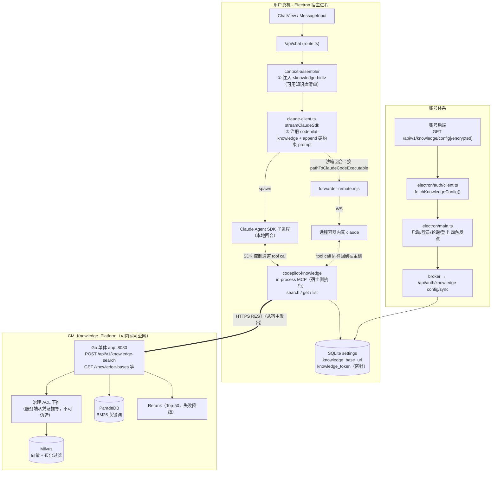
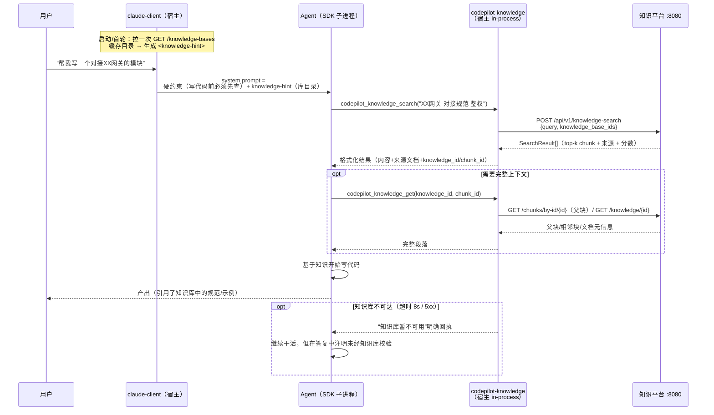

# 知识库平台对接方案 — Agent 写代码前先查知识库

> 调研日期：2026-08-20。对象仓库：本仓库（LabCodepilot / CMWork 客户端）+ `/Users/yuanqi/project/CM_Knowlege_Platform`（知识库服务）。
> 目标：Agent 在工作（写代码、答业务问题、做方案）前，**主动、自行**查询知识库获取所需知识，再开始干活。

---

## 0. 一页结论

- **推荐方案：在客户端内置一个 in-process SDK MCP server（`codepilot-knowledge`）**，照抄 `codepilot-memory` 的成熟模式：`createSdkMcpServer` + 硬约束 system prompt + `codepilot_` 前缀自动免批准。核心改动只有 **2 个文件**（新建 `src/lib/knowledge-mcp.ts` + 修改 `src/lib/claude-client.ts` 两处）。
- **决定性理由：只有 in-process 方案在办公沙箱（cowork）里能用。** 沙箱回合外部 MCP 会被整体丢弃（`claude-client.ts:1143-1153`），且容器 iptables 拒绝内网；而 in-process handler 跑在宿主进程，HTTP 从用户真机发出，内网/公网知识库都可达。
- **知识平台侧无需改代码即可跑通 MVP**：直接调 `POST /api/v1/knowledge-search`（混合检索 + rerank + 服务端 ACL，多库支持）。
- **凭证走账号下发链路**（仿 `cowork-remote-config`，7 个文件），MVP 阶段可先手动配置。
- **⚠️ 两个必须先处理的安全问题**（见 §8）：① 知识平台仓库 `docs/问答机器人对接API.md` 里**明文提交了生产 API Key** 且指向生产域名，需立即轮换；② API Key 调用者被硬编码为 Admin → **全租户内容可见（含他人 private、最高密级）**，与对接文档声称的"部门/密级约束"不符——共享 Key 方案有越权风险，按用户隔离必须走 JWT 或先修服务端。

---

## 1. 两仓库现状摘要

### 1.1 CM_Knowledge_Platform（知识库服务）

Tencent/WeKnora v0.6.0 的企业改造版（分支 `patch/kb-platform`，P1–P9 补丁）。**Go 单体（Gin+GORM，198 条 REST 路由，`:8080`）** + Python sidecar（docreader 解析 / gov-tagger 打标 / dify-shim 适配 / rerank-server）。主库 ParadeDB（PG17+BM25），**向量库锁定 Milvus**（治理 ACL 下推只有 Milvus 实现）。生产地址 `https://knowledge-platform.ai-native-lab.com`。

**对客户端最有用的接口（Base：`/api/v1`，统一包裹 `{"success":true,"data":...}`）：**

| 接口 | 说明 | 备注 |
|---|---|---|
| `POST /knowledge-search` | **纯检索无 LLM，最适合 Agent** — body `{query, knowledge_base_ids[], knowledge_ids[]}`，内部走完整混合检索（向量+关键词+RRF+rerank），服务端按调用者权限过滤 | 窄接口：不收 `gov_filters`/`match_count` |
| `GET /knowledge-bases/{id}/hybrid-search` | 全参数版：`match_count`、阈值、`gov_filters`、`rerank_model_id`、跨库、图谱召回 | **⚠️ GET + JSON body**，Node `fetch` 会直接抛错（spec 禁止），须用 `http.request` 或 axios |
| `POST /knowledge-bases/{id}/browse` | 标签直查/导航（P7），纯标量过滤不算 embedding | 扫描上限 2000 chunk |
| `GET /knowledge-bases` / `GET /knowledge-bases/{id}/knowledge` | 库列表 / 库内文档分页 | 用于目录 hint |
| `GET /knowledge/{id}`、`GET /chunks/{knowledge_id}`、`GET /chunks/by-id/{id}` | 文档详情 / chunk 列表 / 单 chunk | 用于"取更多上下文" |
| `POST /sessions` + `POST /knowledge-chat/{sid}`（SSE） | RAG 问答 | Agent 场景不推荐（我们要素材不要答案，且 SSE 累积成本高） |

**检索能力**：自适应三层分块（默认 512/overlap 80，父子分块 4096/384）；查询 embedding 只算一次再 fan-out；RRF 融合（权重来自租户 RetrievalConfig）；rerank Top-50、失败静默降级；返回 `SearchResult[]`（`content`/`knowledge_id`/`knowledge_title`/`score`/`parent_chunk_id`/偏移等）。**`score` 语义跨模式不稳定**（rerank 分 vs RRF 分 vs 原始相似度），客户端不要拿它做绝对阈值。

**认证**：一套路由双通道 — `Authorization: Bearer <JWT>`（人类用户，有 OIDC）或 `X-API-Key: sk-...`（机器，key 编码 tenantID）。权限三层：租户 RBAC（Owner>Admin>Contributor>Viewer）→ 资源级 ACL → **治理 ACL 在 Milvus 内下推过滤**（visibility/dept_path/sensitivity，默认拒绝语义，客户端无法伪造）。

**MCP 现状**：服务端**没有** HTTP MCP 端点；仓库自带两套 stdio MCP Server（Go 版 `weknora mcp serve` 10 工具只读但缺 gov_filters/browse；Python 版 `mcp-server/` 22 工具含写操作、已透出 gov_filters+browse）。均为外部进程封装 REST——**在我们的沙箱架构下不可用**（见 §3）。

### 1.2 LabCodepilot（客户端）侧集成点

- **两套运行时**：SDK Runtime（Claude Agent SDK 子进程，主路径）+ Native Runtime（Vercel AI SDK）。内置工具两边各注册一次。
- **内置工具 = in-process MCP**（`createSdkMcpServer`，`type:'sdk'`，handler 跑宿主 Node 进程），现有 9 个 `codepilot-*` server 全部注册在 `src/lib/claude-client.ts:1182-1342` 一段连续代码里。
- **自动批准两道门**：`allowedTools`（`claude-client.ts:962-973` 硬编码数组）+ `canUseTool` 正则兜底（`:1434-1448`，**工具名带 `codepilot_` 前缀即放行**）。Native 侧对应 `agent-tools.ts:116`。
- **system prompt 注入口**：`context-assembler.ts:49-251`（静态前缀/易变后缀分层保 prompt cache，`:93-102` 是 memory-hint 先例）+ `claude-client.ts:1108-1116`（转 SDK preset append，每个内置 MCP 块各自追加说明）。
- **账号下发链路成熟**（managed providers / bailian_image / cowork 三个先例）：账号后端加密端点 → `electron/auth/client.ts` 拉取解密 → `electron/main.ts` 四触发点（启动/登录/轮询/登出清理）→ broker → `/api/auth/xxx-config/sync` → SQLite `settings`（敏感键 AES 密封）→ 业务侧 `getSetting()` 透明读。最简模板是 `src/lib/cowork-remote-config.ts`。
- **现成先例 =「Agent 先查再干活」**：`memory-search-mcp.ts:26-40` 的 `MEMORY_SEARCH_SYSTEM_PROMPT` 明文要求"每次对话第一轮必须先调 `codepilot_memory_recent`"，配合 hint 预注入 + 未找到时诚实兜底，是现成文案模板。

---

## 2. 方案选型

| 方案 | 做法 | 沙箱可用 | 内网知识库 | 免安装 | 凭证下发 | 结论 |
|---|---|---|---|---|---|---|
| **A. in-process 内置 MCP** | 新建 `knowledge-mcp.ts`，走内置工具链路 | ✅ handler 在宿主执行 | ✅ 宿主网络 | ✅ | ✅ 直接读 settings | **✅ 推荐** |
| B. spawn 知识平台自带 stdio MCP（Go/Python 版） | 预置 `~/.claude.json` 条目或市场安装 | ❌ 沙箱回合整体丢弃 | ❌ 容器拒内网 | ❌ 需分发二进制/Python 环境 | ⚠️ 走 `${mcp_secret_*}` 占位符 | 放弃 |
| C. 知识平台加 HTTP MCP 端点，客户端连远程 MCP | 服务端扩展（Go SDK 支持 streamable HTTP） | ❌ 同上（外部 MCP 配置被丢弃） | — | ✅ | ⚠️ | 不必要 |

方案 A 同时是改动最小的：SDK Runtime 主路径只动 2 个文件；且知识平台侧 REST API 已够用，**双方仓库 MVP 均零服务端改动**。

---

## 3. 推荐架构

### 3.1 总体架构图

关键点：

1. **工具执行永远在宿主侧**。无论本地回合还是沙箱回合，`codepilot_knowledge_*` 的 handler 都跑在 Electron/Next 宿主进程里，由 SDK 控制通道回传结果——这就是沙箱兼容与内网可达的来源。
2. **知识平台是纯下游**。客户端只发 REST 请求；检索质量（混合召回、RRF、rerank、父子块补全）和权限过滤全部由服务端完成，客户端不承担检索逻辑。
3. **凭证不进 prompt、不进沙箱**。存 settings 密封键，handler 现取现用。

### 3.2 「先查后写」时序图

---

## 4. 工具设计（`codepilot-knowledge`）

命名带 `codepilot_` 前缀 → `canUseTool` 自动放行，零弹窗。

| 工具 | 参数 | 底层 API | 返回 |
|---|---|---|---|
| `codepilot_knowledge_search` | `query`(必填), `knowledge_base_ids?`, `limit?`(默认 5) | `POST /api/v1/knowledge-search`（多库、服务端 ACL、混合+rerank） | top-k：`content` + `knowledge_title` + `knowledge_id` + `chunk_id`，按序号列出，**明确标注来源** |
| `codepilot_knowledge_get` | `knowledge_id`, `chunk_id?` | `GET /chunks/by-id/{id}`（取父块 `parent_chunk_id`）→ 兜底 `GET /knowledge/{id}` + `GET /chunks/{knowledge_id}` | 命中块的完整父块/相邻上下文，或文档元信息+chunk 目录 |
| `codepilot_knowledge_list` | 无 | `GET /knowledge-bases`（启动拉取有缓存，此工具强制刷新） | 库清单（id/名称/描述/文档数），供 Agent 决定往哪个库查 |
| （P2 可选）`codepilot_knowledge_browse` | `tags?`, `domain?`, `visibility?`, `max_sensitivity?`, `page?` | `POST /knowledge-bases/{id}/browse` | 按标签导航的文档列表 |

实现要点：

- **超时与降级**：handler 内 `AbortSignal.timeout(8000)`；超时/网络错/5xx 一律返回明确的"知识库暂不可用，请继续任务但注明未经知识库校验"文本，**绝不 throw**（避免打断 Agent 回合）。参考 `context-assembler.ts:76-78` 的耗时告警模式。
- **结果格式化控 token**：每条 chunk 截断到 ~1200 字符，标注 `[来源: {knowledge_title} #chunk{chunk_index}]`，提示 Agent 用 `codepilot_knowledge_get` 取全文。不透传 `score` 绝对值（语义不稳定，见 §1.1），只保留服务端排序。
- **hybrid-search 的 GET+body 坑**：MVP 用 `POST /knowledge-search` 避开；P2 若需 `gov_filters`/`match_count`，用 Node 原生 `http(s).request` 发 GET+JSON body（`fetch` 会抛 TypeError），参考知识平台 `services/dify-shim/app.py` 的同款绕法。
- **沙箱回合约束**：返回文本不携带宿主绝对路径（与 `cowork-guards.ts:96` 的约束一致）。

## 5. 「先查后写」机制（三层，全部有现成先例）

1. **硬约束 system prompt**（照抄 `MEMORY_SEARCH_SYSTEM_PROMPT` 的语气强度，`memory-search-mcp.ts:26-40`）：

   > 开始编码任务、技术方案设计或回答业务/规范类问题前，必须先调用 `codepilot_knowledge_search` 查询相关知识（接口规范、编码规范、业务背景、历史方案）。搜到相关结果→用 `codepilot_knowledge_get` 取完整上下文再动手；确认无相关知识→告知用户已查询但未命中，再继续。不要凭猜测写与公司规范/内部系统相关的代码。

   注册块里 `systemPrompt.append += KNOWLEDGE_SYSTEM_PROMPT`（仿 `claude-client.ts:1192-1194`）。

2. **`<knowledge-hint>` 目录预注入**（仿 memory-hint，`context-assembler.ts:93-102`）：启动/登录后拉一次 `GET /knowledge-bases` 缓存（内存 TTL ~10min），拼一行：
   `<knowledge-hint>可用知识库：后端接口规范(kb_xxx)、前端组件库(kb_yyy)、发布流程(kb_zzz)。写代码前用 codepilot_knowledge_search 查询。</knowledge-hint>`
   只注入清单不注入内容，token 成本 ≈ 一行；同时让 Agent 知道**往哪个库查**（可带 `knowledge_base_ids` 收窄）。

3. **条件注册**（仿 `skill-mcp.ts:57-77`）：`getSetting('knowledge_base_url')` 为空 → 整块跳过不注册、不注入 prompt。已配置但目录拉取失败 → 仍注册工具（hint 降级为通用文案）。

> 为什么不做"强制预检索再发给模型"（即客户端先查好塞进 prompt）：检索需要 query，而好的 query 要理解任务后由模型自己提炼（一次任务往往要查 2-3 个不同角度）；工具化让模型按需多轮查询，比一次性预注入命中率高、token 更省。memory 功能已验证此模式有效。

## 6. 凭证与配置下发

### 6.1 分两阶段

- **P0（MVP）**：`settings` 手动配置两个键：`knowledge_base_url`、`knowledge_token`（加入 `db.ts:38-49` `SENSITIVE_SETTINGS` 白名单密封落盘）。本地 dev 无登录体系也能全链路验证。
- **P1（账号下发）**：照抄 `cowork-remote-config` 链路，7 个文件：
  1. `electron/auth/client.ts` + `fetchKnowledgeConfig()`（`/api/v1/knowledge/config[/encrypted]`，加密优先 503 回退，404=未开通不清既有配置）
  2. `electron/auth/types.ts` + `KnowledgeConfig` 类型
  3. `electron/auth/broker.ts` + sync/purge
  4. `electron/main.ts` + `refreshKnowledgeConfig()` 挂四触发点（boot/postLogin/轮询 onConfigsChanged/postLogout purge）
  5. 新建 `src/app/api/auth/knowledge-config/sync/route.ts`
  6. 新建 `src/lib/knowledge-config.ts`（get/set）
  7. `src/lib/db.ts` 敏感白名单加 `knowledge_token`

### 6.2 凭证选型：API Key vs JWT（关键决策）

| | 共享 API Key（租户级） | Per-user JWT |
|---|---|---|
| 实现成本 | 低（账号后端存一份，全员下发） | 高（需账号后端 ↔ 知识平台打通用户体系） |
| 权限粒度 | **⚠️ 无——`auth.go:246` 硬编码 Admin → `acl.go:71` SeeAll → 全租户可见，含他人 private 与 sensitivity=3** | ✅ 服务端按该用户真实 dept_path/clearance/个人域授权构造 ACL |
| Token 生命周期 | 长期有效，轮换靠 `POST /tenants/{id}/api-key` | 有过期，需 `/auth/refresh` 续期逻辑 |

**建议**：
- 若近期知识库内容全部是"组织公开"性质（无 private/高密级），P1 可先用**专用租户 + 共享 Key**：单独建一个只放公共知识的租户，SeeAll 无害；这也是最快上线的路。
- 一旦要放部门隔离/密级内容，**必须**二选一：① 知识平台修 `internal/middleware/auth.go:246`（引入"服务账号角色"而非硬编码 Admin，让 API Key 关联真实 ACL）；② 走 per-user JWT——知识平台已有完整 OIDC（`/auth/oidc/*`，含 Dex），账号后端做 OIDC 对接/token 交换后按用户下发 JWT+refresh，客户端在 `knowledge-config` 里存 token 对，handler 401 时走 `/auth/refresh` 重放（知识平台 `cli/internal/cmdutil/authretry.go` 有同款状态机可参考）。

## 7. 实施分期

| 阶段 | 内容 | 改动 | 验证 |
|---|---|---|---|
| **P0 MVP** | `knowledge-mcp.ts`（search/get/list + 硬约束 prompt + 超时降级）；`claude-client.ts` 注册 + `allowedTools` 加 `mcp__codepilot-knowledge`；`context-assembler.ts` 加 knowledge-hint；settings 手动配置 | 新建 1 + 改 2（+db.ts 白名单 1 行） | 本地起知识平台 docker compose，`npm run dev` 全链路：发"写个对接XX的代码"，观察 Agent 先查后写；再验超时降级、未配置不注册 |
| **P1 账号下发** | §6.1 的 7 文件 + 账号后端 `/knowledge/config` 接口（服务端排期） | 7 文件 | 借打包版密钥起 dev 验 managed 链路（同 cowork 先例） |
| **P2 检索增强** | `gov_filters`/`match_count`（http.request 发 GET+body 调 hybrid-search）；`codepilot_knowledge_browse`；per-user JWT + refresh | knowledge-mcp.ts 内聚 | 沙箱回合实测（内网知识库从宿主可达） |
| **P3 对等与打磨** | Native Runtime 对等（`builtin-tools/knowledge.ts` + `index.ts` group）；设置页 UI（配置状态/连通性测试）；i18n | 2-4 文件 | `npm run test:smoke` + CDP |

顺手修（与本功能无关但同区域）：`mcp__codepilot-routines` 不在 `allowedTools`（`claude-client.ts:962-973`）里，目前靠 `canUseTool` 正则兜住，建议补齐。

## 8. 风险登记册

| # | 风险 | 等级 | 处置 |
|---|---|---|---|
| 1 | **生产 API Key 明文提交在知识平台仓库** `docs/问答机器人对接API.md`（`sk-cGOU...mH8j`，指向生产域名） | 🔴 立即 | 轮换 key（`POST /tenants/{id}/api-key`），文档改占位符；结合风险 2，持有者可读全租户含 private |
| 2 | API Key = SeeAll（`auth.go:246` 硬编码 Admin），与对接文档"权限在检索引擎内部强制执行"表述不符 | 🔴 阻断部门/密级场景 | §6.2 两选一；上线共享 Key 前确认租户内无敏感内容 |
| 3 | `GET /hybrid-search` 需 GET+JSON body，Node `fetch` 不支持 | 🟡 | MVP 避开；P2 用 `http.request`（dify-shim 有先例） |
| 4 | `score` 语义跨模式不稳定 | 🟡 | 不透传绝对分，只保留服务端排序 |
| 5 | 知识库慢/不可达阻塞 Agent 回合 | 🟡 | 8s 超时 + 明确降级文案，绝不 throw；目录拉取放启动异步不阻塞首轮 |
| 6 | prompt 约束不够硬导致 Agent 不查 | 🟡 | 用 memory 同款强语气；hint 列出库目录降低"不知道有什么可查"的沉默失败；上线后抽样회话观察调用率 |
| 7 | 跨库检索要求 embedding 模型一致（否则 400） | 🟢 | `knowledge_base_ids` 分组调用或捕获 400 降级为逐库查询 |
| 8 | 知识平台 Swagger 在 release 模式禁用 | 🟢 | 用仓库内离线 `docs/swagger.json`（198 path）生成/核对客户端 |

## 9. 关键文件速查

**客户端（本仓库）**：
- 模板：`src/lib/memory-search-mcp.ts:26-40`（prompt 文案）、`src/lib/skill-mcp.ts:57-77`（条件注册）、`src/lib/notification-mcp.ts`（最简 server）
- 注册区：`src/lib/claude-client.ts:962-973`（allowedTools）、`:1182-1342`（内置 MCP 注册）、`:1434-1448`（canUseTool 前缀放行）
- hint：`src/lib/context-assembler.ts:93-102`
- 账号下发模板：`src/lib/cowork-remote-config.ts`、`electron/auth/client.ts:401-460`、`electron/main.ts:1267-1362`
- 敏感键白名单：`src/lib/db.ts:38-58`

**知识平台**：
- 对接规格：`docs/问答机器人对接API.md`（v2，含生产枚举）、`docs/swagger.json`
- 检索：`internal/handler/session/qa.go:453`（knowledge-search）、`internal/application/service/knowledgebase_search.go:87`（HybridSearch 主链路）、`internal/types/search.go:82/141`（SearchResult/SearchParams）
- 权限：`internal/middleware/auth.go:175-258`（双通道，`:246` 硬编码 Admin）、`internal/application/service/acl.go:42-84`（SeeAll）、`internal/application/repository/retriever/milvus/governance.go:82`（ACL→Milvus 表达式）
- GET+body 绕法参考：`services/dify-shim/app.py`；JWT 刷新状态机：`cli/internal/cmdutil/authretry.go`
