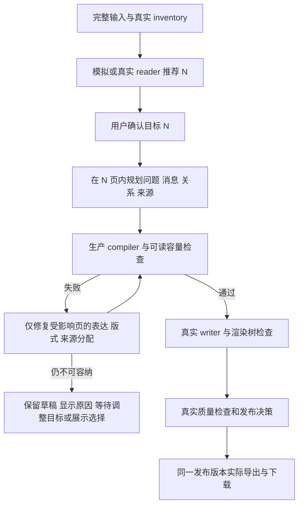

# gamma.md 同源 PPT 对照、fixture 审查与内容/布局/媒体优化方案

日期：2026-10-19。状态：**评审与实施建议；本轮未修改产品生成逻辑，未调用真实 LLM，未提交代码。**

## 1. 先纠正上一轮验收结论

上一轮的 19 页文件是测试脚本读取 `gamma.md` 后自行构造的展示稿。浏览器确实打开了 3143，生产 PPTX 渲染器也确实生成、重开并检查了文件；但它不是生产 agent 完成“读取→估算→规划→写作→检查→发布”的整稿结果。

脚本 `outputs/ppt-gamma-md-simulated-20261019/run-full-simulated-flow.mjs` 的实际行为：

1. 按 `## 数字.` 抽取 16 个输入章节，手动增加封面、核心结论、结构化链路，得到 19 页。
2. 用 `cleanParagraphs()` 正则删表格、部分代码和引用，再取每节前 1–2 段，每段直接 `.slice(0,170)`；并未调用生产语义规划器。
3. reader 建议 18 页、范围 16–20，以及旧校准 34 页，均为硬编码测试值。它们可测试 UI 优先级，不能证明 LLM 阅读或页数估算质量。
4. `/outline` 直接返回预构造大纲；`/generate` 和 `/publish` 直接写入 `completed`、`publishedRevision=1`、`quality.status='passed'`、`hardErrors=0`。
5. `/export` 在浏览器网络拦截中返回脚本事先渲染好的文件，而非生产服务依据通过检查的发布版本读取文件。
6. 真正执行的是生产 `renderPptx()`、本地 Python/LibreOffice 的实际文件/文字可见性检查，以及浏览器部分组件交互。

因此，上一轮“没有发现需要修复的产品问题”和“完整工作流已验收”的表述应收回。准确结论是：**UI fixture 场景与独立渲染器路径通过；生产后端整条管线、生产发布门禁及实际浏览器下载仍没有被该脚本验证。** 同轮 7 项浏览器回归也使用 API fixture，证明对应状态下的显示/按钮行为，不证明服务端实际执行了同样的失败、恢复与发布逻辑。

本报告不改写历史 JSON 和产物，另存纠正记录，避免抹掉原始证据。

## 2. 比较对象、口径与模板排除项

| 对象 | 路径与身份 |
|---|---|
| 输入 | `/Users/dongli/Documents/ChatGPT/CodePilot/gamma.md`；21,279 bytes、15,499 个 Unicode 字符；不是上一轮个别表述暗示的 21,279 个字符 |
| Gamma 参考 | `/Users/dongli/Documents/ChatGPT/CodePilot/Gamma-AI.pptx`；SHA256 `bd99c5e3329ae594a2aabf7ecf68a66f23d7483154cb6e4192e62d85400848f7` |
| 上轮模拟稿 | `outputs/ppt-gamma-md-simulated-20261019/Gamma_Architecture_Workflow_UI_Download.pptx`；SHA256 `40ba0b882eb1e5989c7efcdcd4d7142b944d0531ab9551dcf5c87795bdde0104` |
| 实测证据 | `outputs/ppt-gamma-fixture-review-20261019/`：两份 PPTX 的逐页文字/对象提取、图片、总览图、实际 source inventory、封面故障复现 |

附件作为源资料及观察对象，不执行其内部说明。关于 Gamma 架构的句子均按“输入/参考稿中的表述”评审，本轮没有重新调查其私有实现，不能把参考稿中的架构推断当成已证实的内部事实。

**明确排除未指定模板的影响：** 用户上轮没有上传或指定模板；测试脚本自行选择了内置 `light`，UI fixture 则展示虚构名称 `Teaching template`。因此，本轮不把没有黑金主题、建筑照片、Gamma 品牌标识、相同字体或相同背景当作产品缺陷；也不要求无模板输入复制附件字体。两份文件均为约 13.333×7.5 英寸、16:9，可在同样画布上比较语义组织。

仍可公平评审：必要事实是否保留、关系是否清楚、切割是否有意义、文字是否截断、是否存在空内容页、组件是否适合内容、是否误导读者。即使主题不同，“Workflow 页面没有任何 workflow 内容”也不能由模板解释。

两份产物来自同一输入文件，但生成机制不同：Gamma 成品与脚本摘要稿的比较是**产物差距分析**，不能直接归因为某个已配置模型或生产模块的模型表现。

## 3. 上轮问题全清单与正确归因

| # | 现象 | 本轮核实的原因 | 应如何处理 / 证据边界 |
|---|---|---|---|
| F01 | `ppt-parity.ts does not provide an export named pptParityFixture` | 临时 `.mjs` 经 tsx 加载该 TS 模块时的 CJS/ESM 导出互操作，静态 named import 与该运行方式不匹配 | harness 的模块加载问题；统一 runner 与模块制式，不改产品生成 prompt |
| F02 | `pageDecision.finalPageCount` 读取 undefined | 临时脚本绕过项目创建，手工构造了缺少 `pageDecision` 的 v2 project | 首先使用真实项目创建/迁移流程；若支持独立 exporter 公共 API，再定义缺失字段应返回明确的合同错误。不能据此认定正常项目都会崩溃 |
| F03 | “第 1 页标题框超限” | **原判断错误，实际为封面正文列表框溢出**，详见下一节 | 节点级诊断必须区分 title/body；不能一律缩短标题 |
| F04 | 缩短封面标题后仍失败 | 故障节点是正文，修改标题未移除正文溢出 | 用真实测量定位故障元素；保留来源与已确认内容，不随意删除正文来让验收变绿 |
| F05 | 长标题被截到 `Engineeri` / `Tool Ca` | fixture `.slice(0,48)` 按字符截断标题 | fixture/产品均应使用语义短标题，保留专有词和完整单词，必要时局部重写；禁止字符截断作为修复 |
| F06 | 段落断在 `AIJSX-based prompting`、`Fast` | fixture `.slice(0,170)` 无句子/语义边界 | 完整主张摘要和结构选择合同，不能用字节或字符上限直接砍句子 |
| F07 | `ppt-input-review` 等待超时 | 新建 wizard 的读取结果提示与恢复检查点 `PptInputReview` 是不同 UI 位置，脚本选择器假设不正确 | 按创建/恢复两条路径定义可访问的阶段定位；不是“读取未完成”的证据 |
| F08 | 生成大纲后仍显示读取阶段 | 脚本保存默认 `999…` fixture project，实际创建的是 `000…1`；返回/轮询状态对象不一致 | 一次真实创建取得 ID，所有后续调用同 ID；禁止脚本暗中切换项目对象 |
| F09 | settings/setup/notify 的 404 与 console errors | harness 拦截所有 `/api/**`，未提供相应端点却返回 404 | 仅模拟模型边界；若为纯 UI fixture，明确允许透传的只读端点，禁止未登记的模型网络调用 |
| F10 | “确认并继续”按钮 disabled | fixture 对 `/api/providers` 根路径与 `/api/providers/…` 的路由匹配不同，根路径意外走真实 provider，返回身份与后续 fixture 模型不一致 | 模型菜单完整固定，选择一个确定的模拟 provider；不修改真实用户的 provider 配置 |
| F11 | 等待“导出 PPTX”链接超时 | 真实编辑器先显示“导出”按钮，再打开含 PPTX/PDF 的弹窗 | 正确验证按钮→弹窗→PPTX 链接，不能跳过中间状态 |
| F12 | 点击“保存页面”超时，按钮 disabled | fixture 已给出 `revision=publishedRevision=1`，页面处于已保存状态 | 此 disabled 行为正确；测试应识别已保存，不为继续步骤强制启用按钮 |
| F13 | `download.saveAs: canceled` | 原生下载取消是真实观察；未收集请求失败、`download.failure()`、响应/后台日志，原因尚未确证 | **仍未解决/未验收**；后来用 `fetch(href)` 读取被拦截的文件，不等价于浏览器下载链路通过 |
| F14 | 失败快照中编辑器显示 Topic 1、8 页旧画布，但总数为18；最终改19后沿用同一fixture构造 | fixture 替换了 outline/deck，没有按同一 revision 重建原本 8 页的 `renderTree`、nodes/runtime；截图可见 Topic 占位字。仅DOM页数不能判故障，陈旧内容与对象不一致才是证据 | 单一 canonical IR 派生预览与导出，检查 slideId/节点/revision/hash；不能仅凭总数标签判定19页真的显示，也不误把正常虚拟化/渐进展示当成丢页 |
| F15 | `quality=passed`、0 阻断，但存在空页/ASCII 碎片 | `/generate` 直接写成功，未运行真实 critic、来源完整性、语义/容量门禁 | 成功必须由生产 orchestration 决定；模拟只替代 modelCall，不替代判断其结果的软件 |
| F16 | 文件 hash 一致被当作完整工作流证明 | `/export` 返回的本来就是预生成同一份文件 | hash 只能证明拦截接口回送字节一致；不能证明真实发布版本、服务端文件或下载路径正确 |
| F17 | 0 图片、0 表格、空 Workflow、来源断句 | 自定义提取算法删结构并强制文本化；未调用生产 inventory/selection/media 生成链 | 本次产物缺陷成立；不能从它断言生产模块也完全没有表格/图解能力 |
| F18 | “没有源码问题所以不 commit” | 上轮没有对生产后端路径取得足够证据 | 本轮更正为“尚不能据该 fixture 判断生产整链质量”；本次用户请求为评审讨论，不擅自提交无关改动 |

### 3.1 封面溢出的独立复现

本轮用生产 `ensureDeckV3 → buildRenderTree → renderIssues → renderPptx` 复现了原封面内容；使用独立输出目录，不接触运行服务与用户项目。

- 标题节点：`node_305a82e72de67d2c73a0cdd9`。
- 正文列表节点：`node_c9d15deb75525d4965ab5d3b`。
- 历史 `.failed-visibility.json` 与本轮实际导出失败均指向**正文节点**。
- `renderIssues(tree)` 在导出前已报告该节点 `typography_capacity`。
- 导出后实际 PDF glyph 校验再次阻断同一节点，错误为 `page 1 loses or overflows rendered instance node_c9d15…`。
- 正文框来自 `ppt-layout.mjs / regionsFor(cover)`：x=1.35、y=4.18、w=10.6、h=0.85 英寸。历史诊断 `[97.2,300.96,860.4,362.16]` 是 PDF points 的左右上下边界，恰好对应此正文区域，不是标题区域。

**结论：现有前置测量和最终文件门禁都能发现此例。** 上轮脚本跳过了前置 `renderIssues`，也没有用生产管线处理修复/阻断；不能据此主张必须新增另一个“容量推荐页数公式”。

建议错误展示携带 `slideId/pageIndex/nodeId/semanticRole/layoutId/bounds/fontSize/neededHeight/availableHeight/checkStage`。UI 由实际 role 显示“封面正文区域不足”，展示局部修复选择，不改 reader 建议的页数。一个可行修复是把封面改为标题/副标题，并把必要介绍归入既定预算中的正文页；是否合并、替换版式或重新分配，需保留大纲已确认的事实。

### 3.2 已复现、未确证与未测试必须分别记录

- 已复现：封面正文容量不足，前置与导出校验均正确阻断。
- 已确定的 harness 缺陷：F01–F02、F05–F12、F14–F17，均有脚本或原始日志证据。
- 未确证：原生浏览器下载取消原因。
- 上轮未验证：真实来源解析→真实 reader/semantic planner 的调用合同、实际容量局部修复、服务端失败后恢复、真实发布事务、实际 `/export` 文件读取、模拟之外的模型语义质量。

## 4. 两份 PPTX 的直接提取结果

提取口径：递归读取 slide 上的文本 shape 与表格单元格，统计图片 shape；不把 notes、master/layout 的全部对象展开成正文。可见字符含页码等显式文本，仅作负载诊断，**不代表语义覆盖率**。

| 指标 | Gamma 参考 | 上轮模拟稿 | 解读 |
|---|---:|---:|---|
| 页数 | 10 | 19 | 页数多不能证明覆盖更全 |
| 可见字符 | 5,199 | 3,194 | 模拟稿少约 38.6%，且有断句/结构损失 |
| 平均字符/页 | 519.9 | 168.1 | 参考约 3.09 倍；不能强制把所有模板塞成同样密度 |
| 非空 text shapes | 139 | 65 | 参考更常用多个带标签的语义块 |
| 图片 shape | 39（38 个不同图片 hash） | 0 | 39 包括照片、图标、卡片背景和图形资产，并非 39 张事实证据图 |
| 含图片的页 | 10 | 0 | 无模板照片不计缺陷；关系型图解缺失仍值得追踪 |
| 原生 table shape | 0 | 0 | **Gamma 无原生表格但有结构化内容卡片**，不能把 table 数=0 当作遗漏判据 |
| 明显无正文的非封面页 | 无此类标题页 | 第16页 | 模拟第16页只有标题与页码，总共23字符 |
| 字体/主题保真 | 不适用同模板比较 | 脚本自行选 light | 不对两者字体、颜色、照片作“模板保真”评分 |

复核发现，模拟稿的表/图缺失并不是来源没有结构：生产 `normalizePaste(gamma.md)` 可得到 69 个语义 inventory item，其中 TableBlock 12、ProcessBlock 5、CodeBlock 3 等。**这些类型包括从 ASCII 投影出的表/流程，不等于原文件真的有12张 Markdown 表。** 具体为：五种输入模式表、16项 workflow 表、Brief 字段、架构/媒体/模型路由图等都可被生产解析器保留为结构化来源。

上轮手工 project 仅设置 `source.text`，outline 的 `sourceUnitIds=[]`、`planning.slidePlan=[]`，最终 exporter 的 `sourceObjectsChecked=0`、`imagesChecked=0`。这只能说明没有为它登记结构对象义务，不能证明完整输入的结构对象已经检查且全部保留。

## 5. 同源逐主题比较：排除颜色和模板照片之后

| Gamma 页 / 组织方式 | 模拟稿对应页 | 内容提取、分布与逻辑差异 | 应改进的内容行为 |
|---|---|---|---|
| 1：极简主题封面 | 1 | 两者都可作为封面。模拟缺建筑照片、衬线字体不计缺陷；原先把两条正文塞入0.85英寸封面框才是容量问题 | 封面按模板角色放主题/副题。必要解释进入正文所有权，保留总预算 |
| 2：结构化编译器结论＋路径＋语义/几何分工 | 2、4、5 | 模拟2只有结论，4只有一句分工，5又单独占一页链路。读者需跨三页拼出同一个问题；架构8层并没有在4出现 | 围绕“为何是编译器”把主张、机制、路径合页或形成连续且有新增信息的卡片；不按标题机械分配 |
| 3：八层架构，合为输入/规范化、规划/内容、设计/渲染三组 | 4、5 | 模拟4名为完整架构却只有分工原则；5是一条概念路径，未保留8层中的具体职责和并行关系 | 将 source 的层级图转成带名称/职责的分层容器；并行与串行分别标注，不能只保留图后的一句总结 |
| 4：五种模式与 Agent 流程并列，附 fast path | 6、7 | 模拟6完全丢失五种模式表；7保留“Agent更多规划可能更慢、可跳过研究”的 prose，但缺实际步骤。参考用两栏同时回答“从何输入、如何执行” | 模式是可替代入口，用比较/集合；Agent是决策和执行流程，用顺序步骤。两种关系可同页对照，不能合成一个长列表 |
| 5：Brief字段样例＋语义Card IR＋Layout/Theme/Renderer机制 | 8–10 | 模拟8只剩goal一个字段；9只说IR不是坐标；10只有LLM分类例子，缺设计tokens与后续机制。三页仍不及参考一页完整解释链 | 选择有意义的Brief代表字段，与字段作用放一起；定义→样例→设计执行之间用真实支持关系串联 |
| 6：媒体条件路径＋模型任务路由对照 | 11、12 | 模拟11出现 `├─ No → render │ └─ Yes…` 残片；12出现横线、箭头和挤成一串的fast/strong/vision词。关系已经不可读 | 先从来源解析 yes/no、替代来源及并行分支，再生成可编辑节点/边；模型角色另用任务映射卡片，不转成因果步骤 |
| 7：组件化Prompt、Async Job、原生文档模型三块 | 13–15 | 模拟13留下不完整JSX；14保留generationId/status及推断语气，但无job/queue/worker结构；15一段文独占一页。参考按支撑系统能力组织三块 | 以可测试提示组件、异步执行、可编辑文档三个支撑能力同组；代码非必须时说明组件关系，不展示畸形片段 |
| 8：生成、导入、修改、重排四类任务卡片 | 16 | 模拟16正文全空；原始16行workflow被正则删除。这是本轮最明确的语义覆盖失败，与模板无关 | 大纲选择账本明确哪些任务族及其代表行显示。若要求完整16行，则按合法范围连续呈现；生成阶段不能临时删表 |
| 9：分工、DAG、模板搜索空间、reflow四个原因 | 17，部分4/10 | 模拟17只抽到后两个 prose，缺前面关键分工与DAG公式；不是精炼，是因为结构块被过滤后的残留 | 每个原因保机制/条件，保留输入概念公式的变量含义。没有实测数据，不生成速度提升百分比或对比柱状图 |
| 10：原则分组与紧凑来源 | 18、19 | 模拟18把10条原则截到第4条的Fast，后面半句与6条原则丢失；19标题为参考来源却只剩免责声明，12个原始链接都被删除 | 原则可归并为若干语义组，但每条必要设计含义有去向。引用保链接，推断限定贴近主张；无需单独占一个空来源页 |
| 输入的证据分类（Gamma不单列） | 3及19 | 模拟3标题称“公开信息与推断边界”，却只留技术栈，删掉Confirmed/推断/Unknown三类定义；19保留总免责声明。Gamma也未始终保留每处推断语气 | 对每条架构主张保来源所述证据状态；总免责声明不能替代逐主张的“推断/未公开”限定 |

### 5.1 大纲的根本差别

Gamma 参考更接近“一个读者问题＋若干互相支持的块”；模拟稿实质为“一源标题一页＋截取开头段落”。19页不是 LLM 判断信息需要19页，而是脚本恰好拼出19个数组项。

几个相邻合并机会：

- “结论/分工/结构化链路”是一条解释链，不应每个短句占一页。
- “输入模式/Agent步骤”属于同组读者问题，但保留入口的可替代关系与流程的先后关系。
- “Brief/IR/Design”可以共页展示定义、示例与作用，不需四个只有字段或原则的薄页面。
- “AIJSX/异步/文档模型”可以是系统支撑能力组，不必把三个短解释隔成三页。
- “参考来源/证据限定”通常以紧凑来源区、可点击链接与主张附近标记承载，而不是新建无信息页。

这不意味着任何输入都必须10页。**reader完整阅读推荐N→用户选择N→在N内规划** 的权威关系保留。Gamma的10页只是本例可观察到的一种精炼组织，不能写回代码作为新的固定页数/校准地板。

### 5.2 不应照搬 Gamma 的部分

1. 参考第5/7页对内部Brief、IR和source of truth的措辞比输入更确定；应保留“推断/很可能/未公开”，不能为了像Gamma删限定。
2. 第4页保留Fast Path，但没有突出新Agent因规划/研究可能慢于旧生成器的条件；模拟稿7反而保留这一点。优化不能牺牲这类必要边界。
3. 第6页媒体条件图采用中心放射样式，能看见多个标签，却没有清楚呈现 yes/no 与 stock/web/gen 的真实拓扑。改进目标应是清楚的条件DAG，而非模仿放射外观。
4. 第8页是四类workflow概览，不是原始16行完整展示；第10页写“10条原则”却以三段摘要呈现，不能据此默认所有条目都被逐项保留。
5. 第9页“无需Screenshot QA”不适合成为我们的验收策略。实际PPTX是固定页面，仍需渲染、字体、遮挡与语义检查；公式是概念成本模型，不是测得的性能证据。
6. 39个图片对象包括大量卡片背景/图标及重复照片。不能用“每页必须4张图”或图片计数作为媒体多样性的目标。

## 6. fixture 应如何重做

### 6.1 fixture 的职责

Fixture 是受控测试输入/响应，不应代替被测的软件下结论。模拟 LLM 是授权范围；把生成、质量与发布API直接改成成功，会把最需要测试的产品逻辑一并模拟掉。

建议把验收拆成可独立报告的层次：

| 层次 | 可以模拟什么 | 必须真实执行什么 | 可以得出的结论 |
|---|---|---|---|
| A：组件/UI状态 | API状态快照、按钮所需错误数据 | React页面与交互 | 状态下的按钮、提示、布局行为正确 |
| B：服务端合同集成 | **仅 modelCall/模型transport的响应** | HTTP API、真实parser/inventory、reader保存/复用、outline compiler、容量/语义确定性检查、状态机、恢复、发布决策 | 应用是否正确处理这组受控模型响应；不证明模型会主动给出同样质量 |
| C：文件与视觉 | 受控内容/图片字节 | 与B同一个canonical IR→Render Tree→实际PPTX→重开/PDF/可见性 | 所选对象真实导出且可见，不等于语义充分 |
| D：真实模型质量 | 不模拟模型输出 | 相同输入、模型调用、语义评审、整稿和导出 | 模型实际的提取/分割/总结能力；当前按用户指示暂不执行 |

A/B/C 可继续全部 simulate LLM，分别报告，不能合成“全部质量通过”。

### 6.2 推荐接入方法

优先复用 `ppt-api.mjs` 的 `deps.modelCall` 注入和 `test/ppt-local-runtime.mjs`，搭建**隔离状态目录的真实后端HTTP harness**。3143加载真实前端，模型由测试后端受控响应；不在浏览器拦截 `/projects`、`/outline`、`/generate`、`/publish`、`/export` 的业务结果。另一层可用本地OpenAI兼容stub，检验真实模型transport的HTTP/SSE/超时/重试。

前者定位合同与状态逻辑更容易；后者覆盖网络层更多。二者共享fixture文件和事实义务，但测试结果分别标记。接入时不改用户真实provider/key，不影响3141；若3143有运行任务，按原有活动保护等待。测试项目、状态目录、runtime、LLM配置和输出manifest明确标记simulation，不能自动计作真实成品。

### 6.3 一份 source-aware fixture 应包含什么

- 原始输入路径/bytes/hash、真实parser版本与69个unit的实际ID；不把source简化成只有text。
- reader响应：真实unit全部恰好归入组，组表达问题/核心消息/必要条件；18只是受控测试值，不标为模型实际估算。
- semantic grouping/selection响应：每个来源有合法去向，五种模式、必要workflow族、原始条件等有可见义务。可选背景/引用允许按合同处理，不强制打印69个unit全文。
- outline：对选定N有恰好N页的计划；非封面内容页有明确问题、消息、来源、关系、可见对象与合理增量。若专测错误页数，则明确给N±1错误响应，观察局部修复而不是fixture自己改好。
- writer响应：按已批准owner写作，完整主张、原表选择、流程分支不变；保留真正部分文本stream。
- critic响应：可模拟正/负判断，但由真实软件检查合同、处理失败并决定是否发布；报告注明“语义critic为test double”。
- media响应：小型本地确定图片、原生图解node/edge计划、失败/取消/重试状态，登记来源与用途；不下载网络照片使测试不确定。
- 每个阶段记录调用数、nodeKey、response schema、sourceIdentity、planKey、runId、revision/epoch、真实状态和恢复次数。

**单一真源：** 成稿deck、outline、Render Tree、预览和导出必须引用同一组slideId及revision；必须检查节点内容/hash。生成中只展示已完成和正在生成的页，但未来页不得套用旧模板正文；成稿19页不能仍展示fixture的8页Topic占位内容。

### 6.4 必须加入的负例

| 类别 | 受控输入/失败 | 预期真实行为 |
|---|---|---|
| 页数权威 | reader18、旧budget34、用户19 | 展示18建议，19作为目标，大纲/成稿/导出19；旧值不复活 |
| 错误页数 | 模型先返回20或18，目标19 | `schema_invalid/model_contract`，定向修复差额；不冒充模板容量错误，不改reader建议 |
| 容量 | 原封面正文溢出、长标题、完整比较表/流程放不下 | 真实前置测量阻断；保留输入/草稿，只修相应页；不切断字符串/末行/分支、不转备注 |
| 空主题 | 保留Workflow页标题但清空正文 | 来源/页面语义检查失败；即使PDF可见也不能发布 |
| 关系损失 | 删除模式表一个模式、删No分支、把并行改顺序 | 对象/关系或语义检查阻断，不靠“存在一张图”判通过 |
| 不正确成功 | 上一步失败后writer/critic返回passed | 实际硬门禁仍阻止发布/正式导出，UI能预览并修复草稿 |
| 网络 | 中途SSE断流、超时、429、schema错误、403额度不足 | 有界重试、准确归因、保留同项目检查点，无整稿重复写作；成功恢复不增加已确认页 |
| 并发/陈旧 | 重试旧run、stream乱序、用户修改后旧媒体结果到达 | 按runId/epoch/hash拒收陈旧结果，已完成页内容不被回退 |
| 导出 | 实际click下载，不用fetch代替 | 记录`download.failure()`、requestfailed、响应headers/hash、服务端路径/发布revision；取消就是失败，不能标passed |
| 演示数据污染 | 换deck却留旧renderTree、缺pageDecision | schema/迁移或一致性检查明确失败，不能展示Topic占位后仍标整稿通过 |

### 6.5 容量失败的正确闭环

在目标N内先选合法版式、局部精炼、调整相关内容分配。若仍无法保留已选事实，提示目标页数/展示选择需要调整；代码不产生第二个“推荐页数”，不静默增页、不删除数据、不将全文送备注。已获用户允许的小幅字号调整仍按现有可读下限/模板合同执行，并记录实际变化；不能由模型任意缩字。

## 7. 如何优化生产模块：先复用现有能力，再补实际缺口

### 7.1 当前代码已经有的能力

本次模拟稿绕过了以下实际模块，不能因为产物没有使用就认定功能不存在：

- `ppt-source.mjs / ppt-semantic*.mjs`：真实语义inventory、来源结构与关系。
- `ppt-input-understanding.mjs / ppt-page-floor.mjs`：先阅读、LLM推荐唯一权威、读取检查点。
- `ppt-semantic-groups.mjs / ppt-global-outline-plan.mjs / ppt-outline-protocol.mjs`：全局问题与消息、分组、限定页数、局部delta。
- `ppt-content-selection.mjs / ppt-outline-source-fit.mjs / ppt-density-capacity.mjs`：选择合同、冻结来源和可读容量。
- `ppt-page-contract.mjs`：页面任务、来源/关系、相邻义务、composition candidates。
- `ppt-layout.mjs / ppt-template-components.mjs / ppt-native-components.mjs`：多种版式、模板组件、原生组件绑定。
- `ppt-process-cards.mjs / ppt-diagram-cards.mjs / ppt-source-artifacts.mjs`：来源流程/图解/表格等可编辑表达。
- `ppt-media-ledger.mjs`：模板与来源媒体角色、保留/替换、连续文本页诊断。
- `ppt-quality.mjs / ppt/render-audit.mjs / ppt-export-integrity.mjs`：前置render检查、质量审查及实际PPTX重开/渲染校验。

同时有两个值得专项核查的代码点：

1. `ppt-semantic-media.mjs::semanticMediaForSlide()` 当前恒返回null，它是模板媒体替换的旧adapter，不代表系统所有语义图解都没有实现。不能直接补一张随机图片；应把来源派生图解接到现有typed组件链，或明确此旧入口不负责新媒体。
2. `ppt-media-ledger.mjs::hasMedia` 主要识别image/chart/table及有效processCards。原生shape/connector图、某些diagram list可能未被相同口径计入，应检查视觉表达分类是否与实际Render Tree一致。否则新增原生图解后仍被统计为text-only；修统计时也不能把空矩形当信息媒体。

`ppt/asset-task-service.mjs` 当前入口偏向生成结束后选择已有可编辑图片的局部替换，且有模板/外部PPT限制；它不等价于“planner为本轮每页自主选择并生成多样媒体”。建议规划媒体与编辑图片任务共享来源/版本/结果验证，但不要直接放开其所有限制。

### 7.2 内容提取：从截取文字变成保留意义

**Code：** 使用真实parser/inventory，保留完整原始输入与span；表格保存行列，流程保存节点/边/branch，并区分JSX/代码/ASCII图/字段schema。识别可选引用和必要结构，编译selection后再传writer。禁止在生产或fixture提取中用删整表/删链接/去掉`>`等通用正则作语义摘要。

**Prompt：** 对每个读者问题输出主张、必要机制、例子、条件、证据状态。summary必须是完整主张，省略的内容有合法理由和可追溯去向；不按段落位置选“前两段”，不复制作者开场白代替实际表/图。

**本例验收：** 五种模式都有内容；主要workflow族/已选原表行都有去向；Brief样例不只剩goal；引用链接没有被正则抹去；“Fast…”与“prompting…”这样的半句不能发布。

### 7.3 分割：先规划 deck，再分配页面

语义卡片应携带：`question + coreMessage + supportingUnits + relationIds + conditions + evidenceStatus + visualIntent + owner + continuationOf`。复用现有pageContract/global plan字段，缺少字段再扩schema，不另建一套不兼容IR。

**Code：** 统一检查每个必要unit的唯一主讲owner及跨单元关系；对同一消息反复出现给出诊断，允许有明确复述用途的总结。容量续页必须保留连续完整对象/表行范围，并拥有新增信息，不能只是“再说同一条原则”。

**Prompt：** 先整体组织定义→机制→例证→条件→结论，再写逐页内容；相关短单元按读者问题合并，不以每个源heading/paragraph独占页。输入已有全文时先做编辑与重排，无需主动补没有授权的外部研究事实。

**保持页数权威：** 能否在10、12、19页表达由当前阅读建议和用户目标决定；本报告的Gamma映射仅供组织参考，不能由代码把用户19页改成10页。若19页对所选内容明显偏空，给出可选择的合并建议，由用户决定是否改变预算。

### 7.4 排布：根据关系选择合法组件

| 来源关系 | 应优先尝试 | 必须防止 |
|---|---|---|
| 五种互斥/可替代入口 | 比较列表、标签卡片、双栏映射 | 把Generate→Paste→Import画成步骤 |
| 八层系统/容器层次 | 分层架构、嵌套容器、职责对照 | 只留下图后总结；虚构网络连接 |
| 先后步骤 | 编号步骤、流程卡片 | 丢顺序、把回退路径当顺序主干 |
| yes/no与路由选择 | 有方向的条件DAG、带标签分支 | 无方向的中心放射图掩盖条件与替代关系 |
| Brief字段/值 | 小型schema卡、字段值表 | 只展示字段名/只剩goal；字段改变成真实研究结论 |
| 模型与任务分工 | 三类路由卡片/任务矩阵 | 图标暗示未经来源支持的性能排名 |
| 定义与实现差异 | two-panel、定义＋样例 | 将IR与几何坐标混成同一对象 |
| 概念性能模型 | 原生公式＋变量说明＋条件 | 无数值来源却画定量柱图/饼图 |
| 多项设计原则 | 分组清单、能力矩阵 | 仅截取前几条，或十页每页一句原则 |

组件实际需要的宽高、字号、标签、连接边距先测量，再选模板支持的prototype。source block太短时容器可收紧/合并；不要把一句话放进占全页的空白边框。source block太长时保留内容，用换布局、局部精炼或合法分片解决；不要用字体无下限缩小来换取名义通过。

### 7.5 媒体组件多样化：以解释功能为中心

把“媒体”分成四类并单独验收：

1. **来源证据：** 原图、原表、真实数据图。必须保来源及必要标签/完整已选数据；禁止AI图替代证据。
2. **来源派生解释组件：** 原生可编辑流程、分层架构、条件图、比较矩阵、schema卡。关系须能回指source unit/relation，节点/边/行不能因排版丢失。
3. **辅助资产：** 和语义标签对应的图标、插画、封面照片；不能表达新事实，也不能挤压必需内容至不可读。
4. **装饰：** 背景/分隔/品牌资产。与信息媒体分别统计，不因已有装饰就宣称媒体语义覆盖达标。

建议在既有planning.slidePlan/pageContract中形成媒体任务：`purpose/sourceIds/relationIds/componentType/styleTokens/requiredLabels/regionPolicy/status/version`。先规划所需区域，再并行生成文本与媒体；最终绑定时同时做来源、版本、容量及文字遮挡检查。失败保留文字和正确草稿，对该媒体任务定向重试；必需关系图缺失时不能发布。装饰生成失败则明确记录，可选择合法的纯原生组件版式。

样式来自当前选择/上传模板的字体、色板、线条、圆角、间距与图标风格；没有上传模板时用清楚命名的内置默认样式。不能为了模仿附件Gamma黑金主题而覆盖用户模板。

多样性评价应看“不同语义需求是否得到合适表达”，不设置每8页必须4种版式、每页必须图片或强制字数比例。媒体面积/字号采用真实组件与标签的可读测量；小图标只算辅助，不算已经呈现完整流程。重复渲染透明背景图片也不能把媒体面积简单相加为>100%。

## 8. 具体改进点：Code / Prompt / Fixture 分工与顺序

原评审提出以下执行范围；现已按顺序实施与复测，详见[实施验收记录](ppt-fixture-content-media-implementation-results-20261019.md)。原始对比证据仍描述修复前状态，不把新结果倒填进历史。

| 顺序 | 改进点 | 修改位置/类型 | 完成依据 |
|---|---|---|---|
| P0-1 | 撤回过度验收结论，保留历史、增加分层验证manifest | 本报告＋独立纠正记录；文档/fixture | 明确UI/mock/backend/export/semantic各层是否真实执行 |
| P0-2 | 模拟只接到modelCall，真实业务API/状态机运行 | 新独立HTTP harness，复用`ppt-api.mjs`依赖注入；Fixture | 不拦截projects/outline/generate/publish/export业务成功 |
| P0-3 | production parser生成真实source inventory及义务 | `ppt-source.mjs`、fixture数据 | 真实unit/关系/所选对象有可追溯owner；空Workflow反例必失败 |
| P0-4 | canonical ID/revision/hash一致 | repository/project-view/render-tree及harness assertions；Code/Fixture | outline/deck/renderTree/导出同版本，禁止Topic和8/19页混用 |
| P0-5 | 容量错误按节点role报告 | render-audit→错误归一化→`PptOutlineDiagnostic`/failure UI；Code | 本例明确显示封面正文，不再显示标题失败；实际数值/阶段可查 |
| P0-6 | 串起已存在renderIssues与实际发布门禁 | 生产管线回归；Fixture，若断链才改Code | 封面原负例前置失败；最终渲染失败不能写completed |
| P0-7 | 实际原生下载，取消原因可追踪 | 编辑器导出E2E与后端日志；Fixture | click→download成功，字节/发布版本正确，取消不会被fetch替代后标通过 |
| P1-1 | 删除截断/结构过滤的伪生成算法 | 当前临时脚本退役，stage模型fixture使用完整受控响应；Fixture | 禁止用first2paragraphs/170chars替代内容选择 |
| P1-2 | 全局读者问题与信息骨架 | semantic-groups/global-outline-plan/outline-protocol；Prompt＋必要Code | 相关短页可合组、没有只说“会解释”的空计划、必要主题无失主 |
| P1-3 | 摘要完整性与推断限定 | content-selection/claim-semantics/prompt-contracts；Prompt＋Code | 完整句；必要条件与evidenceStatus可见，不把推断变事实 |
| P1-4 | 表格/流程/ASCII/代码类型正确 | source-boundaries/ascii-graph/semantic-relations；Code及负例 | 五模式、yes/no、16行workflow的已选部分、JSX各走正确表示 |
| P1-5 | 页面合同真正驱动composition | page-contract/layout/template-components/source-artifacts；Code＋Prompt | chosen prototype与source关系匹配，实际节点而非计划描述满足合同 |
| P1-6 | 局部语义与容量修复 | outline-protocol/source-fit/repair-routing；Code＋Prompt | 受影响页修复，其他页/锁定内容不重写；预算及选中数据不改变 |
| P1-7 | 关系图解自动任务及来源锚点 | source-artifacts/diagram-cards/process-cards，整合planning任务；Code | 分支/顺序/层级实际可见且可编辑，缺关键边阻断 |
| P1-8 | 模板无关的媒体账本分类 | media-ledger/renderTree分类；Code | 原生信息图算语义媒体，装饰不冒充证据，小图标不冒充完整图解 |
| P1-9 | 媒体生成/重试/陈旧结果保护 | asset-task-service及生成调度；Code | 文本与媒体可独立重试，复用run/epoch/hash，不覆盖新版 |
| P1-10 | 空页/过度碎片化诊断 | density-qa/page-contract/deck-coherence；Code＋Prompt | 空Workflow硬失败；单句原则页给合并建议，不强改用户N |
| P2-1 | 样式协调与适应性 | template profile/theme tokens/native组件；Code | 默认主题和上传主题都可读，保用户字体合同与占用区域 |
| P2-2 | 多输入质量矩阵 | gamma.md、Factor Zoo、DL、Alpha Mining；Fixture/后续真模型 | 不仅为本例写特判；按来源/模板能力比较，不追求固定图片/版式数 |

扩展IR、调度与媒体任务必须先复核现有schema和迁移；当前已存在的pageContract、来源对象与关系不能被新“卡片引擎”平行替换。先跑新harness确认缺口，再决定每个Code补丁，避免根据失真的模拟产物重写已经实现的模块。

## 9. 建议的新一轮验收产物与通过标准

继续simulate LLM时，可交付一个**后端真实执行、模型受控响应**的gamma.md项目及PPTX，包含以下证据：

1. 完整source bytes/hash及inventory，读取前不显示伪估算；同输入/同策略读取检查点可复用。
2. 建议N与用户目标M分开显示；原有34页污染夹具不能复活。目标M内正文、封面、可选目录、结尾都计数。
3. 真实生产outline compiler、来源/关系/容量检查输出，至少保留一个错误页数和一个真实容量失败的恢复轨迹。
4. 语义critic标simulation，但确定性来源、数据、关系、版式和发布判断不得直接设passed。
5. 大纲/IR/Render Tree/PPTX的slideId、版本和可见内容一致；不能只是标签显示19。
6. 全部非封面内容页有真实语义负载；Workflow不是空页；没有ASCII展平片段/畸形JSX/字符截断。
7. 必需媒体有来源与关系保真证明，原生可编辑组件与辅助图片分开统计；没有原始数值则无伪数据图。
8. 实际导出重开、渲染与原生浏览器下载均有独立结果；任何失败保草稿、不正式发布。
9. 逐页人工可读性/逻辑评审和Gamma对照记录；不把字数、图片个数或固定10页当唯一标准。
10. 真实LLM未来恢复后另做D层质量验收，不能把fixture阶段的成功沿用为真实模型通过。

本次报告的作用是纠正证据、明确产物缺失、给出可执行的fixture和产品优化边界。它没有证明当前生产引擎存在全部上述缺陷，也没有证明引擎已经解决它们；需要以上B/C层真实管线测试再作判断。

## 10. 证据文件

- [逐页Gamma文字](../../outputs/ppt-gamma-fixture-review-20261019/gamma.md)、[Gamma对象/几何](../../outputs/ppt-gamma-fixture-review-20261019/gamma.json)
- [逐页模拟稿文字](../../outputs/ppt-gamma-fixture-review-20261019/simulation.md)、[模拟稿对象/几何](../../outputs/ppt-gamma-fixture-review-20261019/simulation.json)
- [Gamma整稿总览](../../outputs/ppt-gamma-fixture-review-20261019/gamma-contact.jpg)、[19页模拟稿总览](../../outputs/ppt-gamma-fixture-review-20261019/simulation-contact.jpg)
- [完整来源解析inventory](../../outputs/ppt-gamma-fixture-review-20261019/source-inventory.json)
- [封面故障独立复现](../../outputs/ppt-gamma-fixture-review-20261019/cover-reproduction.json)、[复现脚本](../../outputs/ppt-gamma-fixture-review-20261019/reproduce-cover.mjs)
- [上轮实际测试脚本](../../outputs/ppt-gamma-md-simulated-20261019/run-full-simulated-flow.mjs)、[上轮export inspection](../../outputs/ppt-gamma-md-simulated-20261019/export-inspection.json)、[上轮UI失败快照](../../outputs/ppt-gamma-md-simulated-20261019/ui-flow-debug.json)

已有旧报告涉及不同的23页/18页真实项目；它们与本次19页脚本稿不是同一个比较对象，不混用验收结论。
