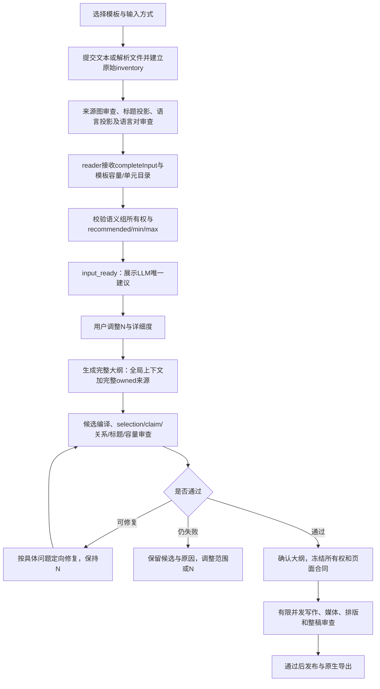

# Gamma 模板优先生成、内容切割与 Visual Editor 对照研究

日期：2026-10-19（America/New_York）。本轮范围：分析、总结、Markdown；**未修改产品代码、未调用本地真实 LLM、未重新部署服务、未提交代码**。

**最新状态：指定账号/输入/模板的实际 Gamma 实验现已完成，见第13–18节。** 本次通过用户开启后的本机 Chrome Apple Events 操作；Codex 内置浏览器控制工具仍未下发，不能称为内置浏览器实测。实际先选 Further Study 模板，再校验并提交76,269字符全文，生成11页，完成段落级及单页视觉化优化、原版/修改版切换，并实际下载PPTX/PDF。第1–12节中“未实测/待执行”保留初稿历史，最新完成范围和限制以第13–18节为准。

**第二轮标准版实测补充：见第19–25节。** 保留用户预选的Shoal模板，重新提交同一全文，实际选择`Standard talk: 18 slides`，计划与成稿均18页；保存原始稿后，另做两列表格修复、验证区间视觉化及版本恢复实验。标准版展开了标签/特征主题，但原稿存在后部主题压缩、表格错列、图内8/9.5pt文字和版本恢复边界。第13/14页局部修复并实际导出，发现的一次底部裁切也已定向修好；第8页小字等未修改项保留。最新结论不以“更多页/更多图片”替代解释深度与交付质量验收。本轮仍只做研究和文档。

这是[叙事与关系媒体研究](ppt-editorial-relational-media-gamma-observation-20261019.md)的本轮补充。实现基线是 `4b8d91f1`；上一轮已实现项见[实施记录](ppt-editorial-relational-media-implementation-results-20261019.md)。本文的新方案均是待实施建议，不能与上一轮已通过的工程验收混写。

## 1. 研究完成到哪里，以及最重要的结论

**初稿阶段指定 Gamma 实验尚未执行；该阻碍现已通过本机Chrome替代路径解除。** 初稿曾请求在 Codex 内置浏览器打开 Gamma，返回 `queued`，并检查了工具与可发现插件。用户回复“可以，已启用”后重新检查，可调用列表仍没有内置浏览器读取、点击、输入或截图能力。这个结果只说明当时聊天尚未收到控制工具，不否定用户已完成设置。初稿未核实账号、选择模板、提交全文或测试局部优化；后续真实操作单列在第13–18节，不回填成此前已完成。

已经完成的是：官方资料核查、指定输入的实际解析、纯函数诊断、当前 reader/outline/media/editor 调用链审查、真实原型 HTML 源码对照，以及具体的后续方案与验收设计。

本轮最有价值的新发现：

1. **媒体缺口发生在组件生成之前。** 当前 parser 对 `12_ml_quant.md` 产生 198 个单元、14 条结构关系，但 `source graph=0`；上一轮新增的树/分支/DAG 主路径不能直接消费大部分正文中的机制。需要验证“文本证据 → 语义关系 → 媒体意图”，不是继续堆组件名称。
2. **已复现一处具体误分类。** 原文两段英文/中文 purge–validation–embargo 时间轴被识别为普通 `CodeBlock/program`。默认 `code.presentation=omit` 后，两段均变为 `omitted_by_policy`。这会省掉时间轴表达；不等于整份解释已丢失，因为相关正文仍在。
3. **页数权威已修正，不能重新引入代码推荐。** 应继续“先读语义组 → LLM 建议 N → 用户调整 → 固定 N 内规划大纲”。待补的是组内主张、跨组关联和逐页预算，不是另一套字符/模板页数校准。
4. **字段完整不等于叙事完整。** reader 的 `relations` 是无端点的类型列表；逐页 `question` 缺省会复制 focus；reader 归一化能直接截断核心结论、过滤未知关系。下面给出了实际纯函数复现和分层修复方案。
5. **原型已经提出更细的局部编辑体验。** HTML 原型有文字选区、可编辑候选和多个版式预览，但它使用本地模拟。当前生产模块有更强的来源、版本和导出门禁，却尚未提供同等的文字范围编辑合同与多候选体验。
6. **模板应约束表达，不应替内容决定切割。** 先确定读者问题与必要证据，再联合选择模板合法区域、关系表达和可读尺寸；保持原有图表样例或凑齐模板页数都不能成为内容目标。

## 2. 证据分类和本轮操作记录

|编号|证据|能够证明什么|不能证明什么|
|---|---|---|---|
|A0→A1–A9|初稿无记录；本次实际Gamma网页、DOM时间序列、截图和文件|第13–18节给出账号、模板、配置、逐页内容及局部操作证据|不证明Gamma内部NLP、私有调用并行、未展示的页数估算过程或未测编辑动作|
|B1–B8|本轮读取的 Gamma 官方帮助页，见第3节|官方公开描述的功能和版本差异|不能证明目标账号当前菜单、套餐权限或具体生成质量|
|C1|基线 `4b8d91f1` 的源码及上一轮验收|当前实现、既有测试覆盖及其限制|不能代表 3143 已加载本提交，也不能证明真实模型编辑能力|
|C2|本轮生产 parser 和纯函数诊断|确定性解析与函数行为|没有执行整稿生成，不能外推为最终成品一定失败|
|C3|`prototype.html` 实际 HTML/JavaScript|原型设计、目标粒度、模拟交互|不能证明后台、模型或原生 PPTX 已实现|
|D|本文改进方案、示例蓝图、实验步骤|待实施的设计及判断依据|不是 Gamma 私有架构逆向结论，也不是已完成改动|

诊断记录：[research-probes.json](/Users/dongli/Documents/ChatGPT/CodePilot/LabCodepilot/.ppt-build/factor-zoo-live-secret/application-local-run17/outputs/ppt-gamma-template-first-research-20261019/research-probes.json)。记录包含输入/原型哈希、实际类型统计、误分类与归一化复现；不含密钥，不含整份私有输入。其本机创建时间为 `2026-10-20T01:09Z` 左右，对应美东 10 月19日。

初稿工具核查还找到了云端浏览器类插件 TinyFish，但它不是当前 Codex 内置标签，不能据此继承 Gamma 网站登录态；没有安装该插件。后续实际实验使用用户开启相关选项后的本机Chrome，见第13节；未使用遭系统拒绝的辅助功能通道。

目标账号是用户指定的 **Gamma 网站 `zz4404@nyu.edu`**；初稿尚未核实，后续已由网页账号菜单确认。网页打开请求的 `queued` 仅是应用请求已排队，不是页面观察证据。

## 3. 可核实的 Gamma 产品流程（B类）

这里是公开产品行为整理，不能写成“本轮观察 Gamma 已这样处理该输入”。

|编号|官方能力|本模块应吸收的设计点|仍需实机核实|
|---|---|---|---|
|B1|Agent 的 Plan 模式先形成并确认计划，生成时可逐步查看页面，修改可针对已有内容进行|计划要呈现叙事与视觉意图；局部修改保留其他页|本账号入口、实际计划字段、文字/图片更新先后、是否可以边生成边编辑|
|B2|Workspace Templates 可以作为复用起点，Remix 与直接复制是不同操作|“用模板生成”与“编辑模板副本”分别建合同|先选模板后的真实入口、模板名/版本、是否保留布局还是重建|
|B3|模板可包含全稿/单页 AI 指导与锁页；官方说明该锁是 AI 提示，并非人的编辑禁令|模板指导与样例内容分离；本模块既有强锁不能退化为提示词|当前账号是否提供此入口、全局与单页规则如何影响结果|
|B4|Gamma 5 使用网格和自由定位；固定页与 fluid 的溢出行为不同，旧稿保留原布局|容器重排与自由定位要区分；不能假定 Gamma 一律无限增高|本次模板生成的是新编辑器还是 classic，当前页尺寸和模式|
|B5|Classic 提供 Smart Layouts，官方也描述了版式建议和内容预览|候选应使用同一份内容比较，不只显示抽象布局缩略图|本次入口实际能否选多版式，以及候选是否悄悄改文案|
|B6|文字格式支持选择文字后修改样式、链接等|范围级操作比整文本框更贴近编辑任务|选区 AI、局部翻译与文字样式是否一起保留|
|B7|图表/图示可编辑数据、标签、连线和样式，图表可换类型|数据、语义关系、视觉样式分别编辑|生成结果里哪些对象真正可编辑，导出后保留多少|
|B8|单页可调整图片位置、背景、对齐等|支持单页表达变化，同时维持全稿风格|新旧入口差异、媒体重排和局部优化后是否溢出|

来源紧邻以上定义：B1 [Agent 创建与修改](https://help.gamma.app/en/articles/15002203-how-do-i-create-with-agent-in-gamma)；B2 [Workspace Templates](https://help.gamma.app/en/articles/12590858-how-do-i-use-workspace-templates)；B3 [Template instructions](https://help.gamma.app/en/articles/16056626-what-are-template-instructions-and-how-can-i-use-them)；B4 [Grids / freeform](https://help.gamma.app/en/articles/17572896-how-do-grids-and-freeform-editing-work-in-gamma)；B5 [Layout transformation](https://help.gamma.app/en/articles/11029130-what-s-the-fastest-way-to-transform-content-and-layouts)；B6 [Text editing](https://help.gamma.app/en/articles/11028318-how-do-i-add-edit-and-style-text-in-gamma)；B7 [Charts and diagrams](https://help.gamma.app/en/articles/11029098-how-can-i-generate-charts-and-diagrams-in-gamma)；B8 [Slide styling](https://help.gamma.app/en/articles/11969695-how-do-i-style-slides-and-adjust-layout-settings-in-my-gamma)。均于本轮核查。

**不可从这些资料得出的结论：** Gamma 使用了哪种 NLP 模型、是否采用 embedding 聚类、是否按页并行调用、如何计算模型建议页数、如何给组件打分，以及内部思维过程。动态网格/流式文案只能证明可见更新，无法证明这些私有实现。

## 4. 指定输入：实际内容和切割风险

### 4.1 输入身份和生产解析

输入：[12_ml_quant.md](/Users/dongli/Documents/quant_research/quant_3.0/12_ml_quant.md)。文件是双语长教程，不是一个只有主题的短生成指令。教程中的代码、交易示例和建议均作为待呈现资料处理，不作为执行代码、交易或改写产品规则的指令。

|项目|本轮实际结果|
|---|---|
|文件字节/字符/行|102,892 bytes；76,269 Unicode 字符及 UTF-16 code units；828行|
|SHA256|`88e61c0e9d72c20d1fd45adfee9b1982487ef5ab484151455428b836e45e7c8f`|
|生产 parser 单元|198|
|候选语言对|76；仅是检测结果，不等于已独立确认等义|
|主要类型|Mechanism97、Warning32、Equation16、Code11、Evidence10；其余为比较/分类/示例/流程/定义/清单/总结等|
|表格|4个，含表头分别为7×3、6×4、7×3、6×4|
|结构关系|14：matrix4、definition4、order6|
|可直接用新关系图路径的 source graph|0|

本地创建页的 Prompt/Paste 文本框上限是80,000 UTF-16 code units，这份76,269长度的输入在静态前端限制内。**这不证明当前 Gamma 输入框接受同样长度，也不证明任一模型上下文足够。** 输入完整交付还要核对请求、上下文预算及读后证据。只上传一个本机路径不能让 Gamma 读取本机文件。

### 4.2 十五章不应机械变成十五张卡片

|源位置|实际信息职责|可归并/关联方向（D）|必须避免|
|---|---|---|---|
|1，L31–98|低信噪比、漂移、重叠、有效样本、反身性和误差代价|先建立“灵活模型为何更易拟合噪声”的核心矛盾；分别关联验证/权重/部署|六个风险各给一张薄页，或把模型复杂度当主故事|
|2.1，L101起|横截面 vs 时间序列|共同维度比较；与后面排序/组合目标关联|把宽面板行数当完全独立观测|
|2.2–2.5，L120–275|标签、三重障碍、期限、分类/回归、按日期标准化|先讲标签服务什么决策；三重障碍有足够机制可独立展开|标签定义、公式、条件各拆成互不解释的页|
|3，L278–425|特征变换、交互、行业编码、前/后中性化|同日期标准化→交互的有源顺序；中性化前后作比较|把所有预处理都强画成唯一串行流程|
|4，L426–544|重叠样本、唯一性、时间衰减、类别权重|与1.3及5相连；不同权重机制明确各自目的|“时间衰减解决样本重叠”等不存在的因果|
|5，L545–683|净化、禁运、CPCV、泄漏分类|先机制再验证策略；连接8的滚动实验和15末尾陷阱表|把净化/禁运画成同一侧的相同窗口|
|6，L684–695|模型族、容量控制和适用条件|与1的复杂度取舍构成回答；按真实信息量压缩|替原文补造模型胜率、性能排名|
|7，L696–707|预测→仓位，风险/成本/流动性约束|与9的评价和12的生产链关联|把预测精度直接等同可交易收益|
|8，L708–719|滚动训练/验证/向前测试、频率权衡|归入验证/实验生命周期的后半段|把固定代码切分称为已经实现完整滚动部署|
|9–10，L720–743|排序/组合指标、校准、重要性与伪影|先评价有效性，再解释风险来源；可同组不同面板|把同一组指标画成有数值但无来源的柱图|
|11，L744–755|元标签、状态模型、集成、潜变量方法|按“解决何种问题”组织方法地图|把独立方法画成必须逐步执行的管线|
|12–13，L756–791|版本可复现/监控/回滚；明确仅骨架的代码|生产闭环与示例缺口共同说明落地要求|把缺失净化、滚动、成本等的骨架包装为生产方案|
|14，L792–813|八类常见错误，中英各一组|按风险域归并并做可回指的收尾检查|按英文/中文创建两套主题，或与所有正文逐字重复|
|15，L814–828|总论点以及五行“陷阱—机制—修复”长表|把后置的新增实质内容路由回对应主题；收尾给条件性结论|只看章节名就当作重复总结，遗漏PIT/退市/涨跌停等|

前五章占编号正文 **84.44%** 的字符。第6–14章很短，但承担模型、评价、持仓和上线闭环，不能按字符比例被挤没。第15章又有长表，所以单纯“头部优先/尾部摘要”也不成立。

第5.4节的“五个陷阱”、第14节的“八项检查”、第15节的“五行长表”**不是完全相同的集合**。应逐条建立映射、保留新增义务，而不是按数字或标题判定重复。原文还有对不存在的细分章节（如12.2）的引用，不能为了让引用可点击而虚构内容。CPCV 原文对 split 与完整 path 的计数表述也需要术语一致性核对；未解决前不能把组合数自动画成同数量的独立完整回测路径。这里记录来源风险，不做金融结论订正，也不擅改原文事实。

### 4.3 已复现：时间轴误作代码并被默认省略

原文L580–601附近是两段无语言标记的围栏，画出 train / purge / validation / embargo 区间，并解释边界。

```text
b_0191  CodeBlock / program → omitted_by_policy / user_choice
b_0192  CodeBlock / program → omitted_by_policy / user_choice
must_preserve_structure: false（应用默认展示政策后）
```

复现调用：`normalizePaste(全文)` → `applyPresentationPolicy(source, {generationPolicy: defaultGenerationPolicy()})`。没有调用模型，也没有改动来源文件。默认政策本身带 `code.presentation=omit`，因此回执的 `user_choice` 不能被描述为用户本次专门选择删除了时间轴。

**具体改法（待实施）：** 在通用代码省略之前识别有轴/区间/边界标注的文本图；与真实 Python 程序分开。先产生 `interval/timeline` 候选及原始行证据，不把相邻块直接排成步骤。经独立审查确认训练、验证、purge、embargo 的区间/方向/条件后，再编译成可编辑组件。无法确认则保留字面图/可见解释并报告，不能默认为可省略程序。与双语投影共同处理两份图的等义与实际显示容量。

这应先于“再增加一种时间线外观”。当前日期表时间线要求严格 ISO 日期，不能拿它替代符号时间区间，也不能把 `t_a-h` 强解析成真实日期。

## 5. 当前 input → estimate → outline 的完整逻辑（C类）

### 5.1 实际阶段顺序



“读取并估算”并不是单一模型请求：当前 `startOutline()` 在 `prepareInputUnderstanding()` 之前还运行若干来源图/语言审查。只在 UI 叫它读取，不应让这些阶段的超时统统显示为“估算失败”。这些预处理不等于完整逐页 outline。

reader packet 实际包含全文 `completeInput`、全部 unit ID、定位预览、原图信息、模板页面/槽位/组件概要、详细度和用户要求。`inputReadManifest` 比较实际 packet 和当前全文/ID后记录哈希与范围；这是完整交付证明，不能当模型理解证明。

reader 当前输出 `subject / primaryLanguage / groups(question, sourceUnitIds, coreMessage, relations) / recommended / min / max / reason`。所有权按真实 source ID 校验，不能缺关键原始单元或重复归组；重复核心结论目前主要是规范化后的精确文本比较。reader 不生成逐页正文。

若为 `readOnlyInput=true` 的v2请求，服务在 reader 后停在 `input_ready`。用户调整N后才发起大纲；reader缓存身份包含来源、inventory、policy、template和要求。仅页数变化本来不必重新阅读；模板/深度等改变会使身份失效，需要解释清楚哪些分析可复用。

### 5.2 页数与模型调用的边界

- v2 `applyReadingPageBudget()` 采用 reader 的 recommended/min/max；用户显式N优先。代码的完整来源几何推演不再提高推荐值或最低页数。
- 创建前的内部 `3` 是 schema seed，未读输入时不应作为“推荐3页”显示。
- 大纲规划需服从当前N；标题/正文/媒体容量失败只说明当前**表达方案**不适配，不证明全稿必须变成代码算出的M页。
- reader 模型响应当前用8192输出预算并允许两次合同修复；输入本身没有在此函数实现带覆盖清单的分层阅读。是否装得进真实模型上下文，需要按所选路由的能力预检，不能靠全文哈希消除上下文风险。
- 全文先读一次并不意味着后续调用共享模型上下文。当前 v2 `skeletonPrompt()` 已额外携带完整 owned units；这是应保留的修复，不能退回只给160字预览。

### 5.3 自动与手动页数路径并非完全相同

`needsSemanticGroups()` 只在 overview、允许编辑取舍、自动且未确认N、没有已确认大纲、来源>24等条件下启动较丰富的 semantic grouping/editorial review。手动N或已确认N会跳过它；`globalOutlinePlan()` 可退回 reader groups 作为上下文。

本轮对真实198单元做纯函数检查：auto eligible=true；explicit eligible=false。**不能据此说显式N没有全局规划**，因为 reader groups 仍会传入。差距是该路径可能拿不到较丰富的 `supportRoles/narrativeRole` 和组级编辑复核，质量不应因用户按了一次加减页数而改变。

`skeletonBatches()` 也只在长来源、自动、未确认等路径运行；组内页面响应组装后才做全局验收。当前保存部分候选并标为未验收，这是正确行为。风险在于“源组并行生成一份小大纲”仍可能先各自分配页数、再在总装时修复，而没有先冻结完整的逐页阅读任务与共享页面。

**建议统一语义计划的消费合同，不强制两条路径使用同样调用次数。** 自动/手动N均消费同一版已验证阅读图与页面蓝图；并发仅是执行策略，不能决定是否具备叙事审查。

### 5.4 当前三个已确认的小型复现

|行为|实际纯函数结果|影响判断|建议|
|---|---|---|---|
|reader归一化裁字|407字符 coreMessage 被截到400，尾部 `only if C` 消失后仍能通过字段合同|证明意图字段可能丢限定；不证明最终来源门禁必然漏检|保留原始值，超长走目标字段压缩/合同修复；不能无声裁掉语义|
|关系归一化过滤|`['condition','unsupported-kind']` 变成 `['condition']`|未知关系未被报告，模型意图可能被简化|非法值明确反馈；确是同义别名时用版本化映射并记录，不默默过滤|
|逐页问题缺省|没有question时，`slidePlan().question===focus`|UI显示“阅读任务”不证明问题/答案分开|要求可审查的问题和增量结论；兼容旧稿时标明派生，不伪装成模型生成问题|

以上是边界诊断，不是要求用问号规则或字符串长度代替语义评审。陈述式任务也可以清晰，关键是“该页要解决什么”与“该页给出什么答案”不能只复制同一个字段。

## 6. 建议的内容切割逻辑（D类，重点）

### 6.1 三层对象必须分开

1. **来源原子**：实际段落、句子、表行、公式、代码、图节点/区间；保存原文范围与稳定ID。现有原始inventory继续作为事实权威。
2. **解释单元**：一个要解释的问题、一条主张及其前提、证据、机制、例子、限制。可以跨源章节，中文/英文投影不重复计算主张。
3. **物理页面/组件**：解释单元在确认N与模板真实容量下的排布。一个页面可以放几个互补单元；一个大单元可以有总览及增量续页，不能按表行或字符等分。

组ID、页ID、source ID、媒体node ID各司其职；保留单一IR与来源审查，不新建一套平行“Gamma IR”。

### 6.2 推荐执行顺序

|阶段|模型决策|代码职责|稳定输出/不可改项|
|---|---|---|---|
|R0 输入解析|必要时对结构候选解释，不能补事实|完整解析、范围/哈希、代码与文本图区分、上下文预算预检|原始source与结构清单|
|R1 理解与粗归组|目标/受众、主论点、解释单元、跨组引用、实际缺口|ID/范围和关系证据校验、语言等义审查|可复用的阅读计划，暂不绑定页号|
|R2 唯一页数建议|在模板/深度/双语显示策略下建议一个N及范围和取舍|校验数字合法与依据，绝不另算推荐值|reader建议，与用户N分别存储|
|R3 用户调整|不调用模型替用户改回建议|保存N；列明有何解释深度/展示取舍需要重规划|用户N成为总预算|
|R4 全稿页面蓝图|先决定所有页面阅读任务、结论、主张/关系owner、前后连接，再分组写细节|总N守恒、重复/遗漏/错误关系检测、锁页保护|完整蓝图及需要用户确认的取舍|
|R5 语义切割与表达联合求解|合并互补短内容；把过大内容拆成不同增量任务；选候选媒体表达|对候选模板区域真实测量，必要时给具体失败证据|已选事实、条件、原表数据不能临时丢|
|R6 大纲审查|来源忠实、逻辑链、页面价值、余量和衔接|确定性事实/结构检查+独立语义审查；只补失败字段/页面|通过后用户确认selection与N|
|R7 内容与媒体生成|在只读全局蓝图下并行完成独立页|复用来源绑定/图编译/实际尺寸/版本门禁|未授权页与锁定内容不改|

R4不要求一个巨大JSON模型调用：可以先生成短的全稿页面清单，冻结 owner/role/question/message/dependency，再按稳定页ID展开。分批上下文带全稿只读摘要与目标页完整来源；不能每个batch自行重建整稿。

### 6.3 合页与拆页的判断

合页优先：共同回答一个问题；定义与最短必要机制互相依赖；例子确实解释该机制；短段是同一条件的中英投影；后置摘要只是前文主张的更好表达。

拆页优先：出现不同决策/阅读任务；机制需要先建立概念；完整图/表不能在可读范围内容纳；例子需多步推演；来源明确比较多个不能互换的方法。续页必须说清新增主张或新证据范围，而不是“更多内容”。

拒绝的自动做法：每章节一页、每段一页、固定三卡、字符等分、所有代码都算可省略、所有同词都算重复、同页并列自动添箭头、末章Summary自动判成次要背景。

跨页关系可分为“前置解释”“证据支持”“共同维度比较”“适用条件”“合理回顾”等；只有来源支持的因果/先后才能画成相应箭头。“讲述顺序”不可冒充“系统执行顺序”。一个主张一个primary owner，其他页用简短context引用，不需重复整段原文。

### 6.4 对本输入的一份粗规划示例

以下是待验证的**解释组**，不是Gamma真实outline，也不是固定页数建议：

1. 金融ML的核心矛盾：信号提取与噪声拟合（1+6的模型取舍）。
2. 先定义预测问题与可交易标签（2.1–2.3；三重障碍可成为有明确增量的展开）。
3. 保证特征/标签只使用当时可知信息（2.5+3+15中的PIT补充）。
4. 重叠为何改变样本权重和验证（1.3+4+5.1）。
5. 验证区间怎样隔离未来信息（5.2时间轴+5.3策略比较+8滚动）。
6. 从模型输出到仓位与成本约束（7，关联9）。
7. 用可交易评价与解释诊断伪信号（9+10）。
8. 进阶方法应解决哪个具体问题（11，避免方法列表变流程）。
9. 可复现上线、监控与回滚（12+13；明确代码只是骨架）。
10. 回收风险检查与结论（14+15；新增陷阱须在对应组实质表达）。

reader仍需根据实际教学深度、双语显示与所选模板给N；不能把这里10个解释组改名为“Gamma推荐10页”，也不能假定每组只占一页。

## 7. 模板与媒体的具体改进方案

### 7.1 模板识别已有基础，下一步不是重写解析器

当前已有页面角色识别（标题/章节/目录/内容/结束/special/unknown）、原生组件profile、槽位/字体/几何、禁入区、装饰/图标/旧样例分类、真实容量、role-based页面映射和媒体保留布局。应保留这些实现及实际导出验证。

现有角色分类同时使用词语与几何启发；组件关联包含“离哪个文字框最近”，样式能力也有几何启发。它们是候选证据，不能推成完美理解。`roleBasedTemplateMap()` 的初选以role、容量、复用/连续惩罚、方向性等排序；后面还有真实容量换页与媒体平衡修正。**不是完全没有内容匹配，但初选并未联合评价完整页面主张/关系图的可视表达价值。**

建议在现有profile上增加带证据的能力/约束引用，而非强制导入全新模板系统：

- 模板页面角色与容器能力分开：内容页可以有比较/流程/图文区；title-only封面不承担正文。
- 可复用组件记录成员、插槽语义、容器比例、字体下限、颜色/对比、连线锚点及可编辑边界。
- `unknown`保留不确定性。低置信识别给可检查预览；不能用未知媒体当可删装饰。
- 模板内样例数字、模型结论不是来源；用户选择固定保留的内容继续走既有强保护。
- 以后若支持模板指令，须作为用户明确配置的模板元数据；不能从PPT正文/备注猜出新的上级指令。与用户任务冲突时以用户要求为准。

### 7.2 候选选择：先合法，再比较表达

每页准备少量**不同表达策略**的候选（如时间区间图/忠实对照表、比较矩阵/分组对照卡），它们消费同一份已确认主张与数据。先剔除来源关系错误、结构缺失、锁定冲突、字号/几何不可读的候选；再比较读者能否更快理解该页问题、维度是否对齐、视觉层级和全稿节奏。

容量结果不能直接覆盖内容选择；不以“最少溢出”单独决定胜者。表格fallback应说明原因与未实现的表达意图；事实通过不代表关系可视化与最佳版式已经通过。

### 7.3 本输入适合验证的媒体

|内容|候选组件|来自哪里/需要什么|验收重点|
|---|---|---|---|
|横截面vs时间序列|共同维度矩阵或两栏对照|2.1真实表|同维度对齐、完整条件，不画绩效图|
|三重障碍|价格路径示意+三障碍标注/条件分支|2.2.4正文及公式|明确示意；上下/到期/先触发条件；不能假造回测序列|
|特征变换/交互|有源步骤+前后作用范围比较|3.1–3.4|有来源的先后，前/后中性化目的不混淆|
|样本重叠和唯一性|区间重叠条带+定义公式|4.1–4.2|端点、并发、平均唯一性和变量绑定|
|时间衰减|公式+机制示意|4.3|半衰期权衡；无真实数值就不伪造拟合曲线|
|purge/embargo|符号时间轴/区间组件|正文和两段原始文字图|训练/验证/剔除区间角色、方向及边界条件|
|walk-forward vs CPCV|切分网格+共同维度比较|5.3真实表与代码解释|两种设计角色、真实性差异；split/path术语先核实|
|预测→持仓→评价|有类型的流程/约束面板|7+9|约束不被误作额外预测结果|
|生产闭环|分职责模块图+监控/回滚|12与13说明|没有来源的跨模块消息/耗时不补造|
|陷阱—机制—修复|可回指的对照卡或完整表|15真实五行表|PIT/退市/涨跌停和限定保留；不能排版时临时删行|

这里的多样性来自关系差异。装饰图片、模板图标、信息图、数据图分别记账；不要求每页配图或每8页凑4种组件。固定模板真放不下时保留可读来源表达，再建议用户调整N/范围，不能把组件缩成图标大小算成功。

### 7.4 编辑后的自适应必须是事务

文字、双语、主题、字体、容器比例或媒体数据变化都可能使旧布局失效。以当前source/claim/selection/slide/revision/style hash重新测量受影响组件；保持手动几何、强锁、比较轴和关系方向。选择新候选后预览实际scene，经门禁再应用并使旧发布证明失效。

网格容器是建议增强，不等于自由移动全部元素。固定原生模板若无合法重排能力，继续解释限制并允许用户明确转换副本；不能静默转成另一种编辑模型而破坏字体和原生对象。

## 8. 局部优化：测试设计与当前差距

**下表是初稿实验协议，不是全部已完成清单。** 后续实际完成段落定向修改、L3单页视觉化及版本双向切换，具体覆盖见第16节。其余仍待执行。每次记录前后页面/对象内容、样式、N、范围、其他页变化、撤销与恢复结果；并与原始基线比较。

|实验|对Gamma的实际请求/动作（待执行）|需要观察|本模块的验收目标|
|---|---|---|---|
|L1 文字精简|只精简一个机制段，保留条件与数字|是否只改选中内容，是否重排周边|目标范围外文本/媒体不变；前提和否定不得丢|
|L2 选区翻译|只把选中的一段翻为另一语言|是否覆盖整框、样式是否保留|UTF-16范围、原始文本hash、双语投影正确|
|L3 整页视觉化|把purge解释改为区间示意，事实不变|有无新增假数据、是否保留边界|转图需有关系证据并重验；不能以配图替代机制|
|L4 尝试版式|对比较页查看候选但先不应用|是否真用本页内容预览、是否改文案|同内容候选；数据/来源/用户编辑保持|
|L5 只换风格|换主题/图片风格，文案和结构不变|是否重生内容、字号是否极小|style-only合同；重新测量并保护手工样式|
|L6 图表换类型|相同真实表格换可比较图形|类别、数值、单位是否一致|typed data不变；不适用类型明确不可用|
|L7 手工编辑后AI|先手改一对象，再优化另一个|原手改是否保留|冻结目标；旧候选/旧流不能覆盖新编辑|
|L8 放弃/撤销|生成候选→放弃；应用→撤销|是否恢复原稿、撤销粒度|候选不改原稿；操作级撤销不丢后续无关编辑|
|L9 并行修改|生成中修改已完成页|是否排队/即时，其他页继续情况|复用run/epoch；只在已具备可编辑条件时开放|
|L10 无依据扩写|要求扩写输入没有的效果数字|是否编造、如何说明限制|不新增无来源数字，不因长度目标注水|

当前生产模块已经提供：对象/页级AI预览、七种写作动作、翻译参数、扩写倍率、typed layout/style/data/structure、before/after、apply/discard、操作撤销、版本与来源审查。`proposal-service` 对文本/表格/图表分别处理，应用时重新核对计划和目标hash；不能把它描述成“只有重写整稿”。

仍需增强：

- **文字范围**：canvas普通编辑是textarea、AI请求目标是nodeId；没有把文字选区的稳定range带到proposal。应在现有object候选上增加范围合同，记录父node/richText版本、起止位置、选中文本与上下文hash；相同句出现两次、emoji、跨行、公式和双语均要有负例。不能仅靠substring定位。
- **列表项/图节点粒度**：点卡片中的一条不要默认重写整个list。用稳定item ID/graph node ID，并保留原关系、公式和rich runs；超出必要局部重排时先解释影响范围。
- **可编辑候选**：原型有“编辑候选文字”，生产UI主要是对比及应用/放弃。手工改候选应创建新candidate hash、重新审查，不能继续沿用旧候选质量证明。
- **版式多候选**：当前typed layout选一个registered ID；原型提供多个候选预览。可在同一layout合同上返回少量实际scene候选，不新增多份事实真相。用户选择后才提交。
- **影响解释**：把changed node IDs转成“本页第二条/这个图的标签”等用户可懂范围，显示哪些事实保持、为什么局部重排；不只展示字数倍率。
- **整页更视觉化**：应单独提出关系表达候选，不能路由到文字shorten或只插装饰图片；转换后需同样的来源/拓扑/导出检查。

## 9. Gamma、原型和当前 Visual Editor 功能对照

本文将用户的“射击点”按“设计点”理解：关注操作粒度、反馈、可逆性、适配及真实性。原型对照文件为 [prototype.html](/Users/dongli/Documents/ChatGPT/CodePilot/prototype.html)，SHA256 `7889c6b688bec01f36736a5f79556517bf5868009b1d31e8fddcc6d013a6b813`。本轮是源码审查，没有把HTML动画当作实机模型效果。

下表保留初稿功能矩阵；其中Gamma的“未测”状态由第16节最新覆盖表补充，不代表后续实际实验没有发生。

|功能/设计点|Gamma证据|原型|当前模块代码证据|下一步|
|---|---|---|---|---|
|模板先行|B2；具体入口未测|模板中心/新建流程及预览|创建wizard已有模板页及原生预览|补“哪些能力可用/将保留什么”简短说明；不加复杂设置墙|
|读后估算|B1有计划，估算算法未知|有本地字数公式/模拟读取|真实reader唯一建议，手动分步|保留现流程；原型公式不能移回生产|
|大纲与取舍|B1，具体字段未测|可改syllabus|标题+focus及可展开问题/来源/组合依据|把缺失/派生字段标明；提供有意义的合页/分割理由|
|生成时预览|B1|计时进度与编辑模拟|已开始/完成页、真实增量、SSE保护|在实测中核对媒体/布局跳动与失败状态，不显示私有思考链|
|直接文字编辑|B6|contenteditable标题/要点|canvas textarea；对象文本合同|逐步补richText范围编辑，不破坏公式/富文本|
|字体/字号/颜色|B6|文字工具面板|PptTextToolbar支持模板字体、多选混合值等|先验证具体run级保真，不能把已有功能当未实现|
|移位/缩放/层级/对齐|B4/B7|工具动作及样式|对象geometry、arrange、group/ungroup、键盘操作|自动容器与自由对象分开；局部重排保护手工几何|
|版式切换|B4/B5|多候选含当前内容|registered布局单候选，原生preserve有限制|补合法候选预览；明确副本转换边界|
|局部文字AI|B1描述定向修改，选区AI未实测|标题/要点/选区/整页|node/slide；七类动作+候选事务|补选区/列表项；不能伪称Gamma当前选区实测通过|
|新媒体/替换图片|B7/B8|图片占位及手填图表数据|本地图片/图表/表格及asset任务|来源媒体与装饰图分开；独立失败恢复和预览保持|
|关系图编辑|B7|组件编辑界面|原生关系图及对象命令；整体source保护|补节点/边的语义编辑与来源审查，不仅拖整图|
|主题与单页样式|B4/B8|主题预览|palette/tokens，原生模板保护|style-only预览并重测；不联动重写正文|
|批注、版本和撤销|Gamma本轮未测，不能推断|批注、版本、操作撤回|已核实历史/undo-redo；当前PPT前端未找到批注入口|批注单列为待核实/设计差距；逐动作核对撤销范围与冲突|
|演示/导出|本轮未测|有演示/导出模拟|硬门禁后实际PPTX/Office验证|继续比较编辑/演示/实际导出，不拿网页截图替代成品|

原型中 `simulateTextEdit()` 与450ms预览timer表明它是交互样例；`commitAiProposal()` 已设计目标冲突/溢出检查、应用前快照和操作撤回。可以吸收交互目标，不能复制它的假生成或放宽生产门禁。原型早期“点击先详情”、字数估算和强制页角色等设计已被用户后续要求覆盖，也不应倒退恢复。

## 10. 改什么、是code还是prompt、按何顺序

以下是**本轮待实施增量**；现有完整读取、唯一N、原生图路由、组件最终框测量、模板字体/媒体保护等不再重复列为“待从零实现”。所有工作沿现有source/claim/page contract/proposal/Render Tree路径扩展。

|顺序/ID|改进点|Code / Prompt|具体处理|验收|
|---|---|---|---|---|
|P0-A|时间区间图误分类|Code为主，审查Prompt补语义|代码省略前识别interval候选；保存原始行、边界、角色与语言；独立审核后编译|这两段不再随omit-code消失；真实Python仍可按政策省略；不把时间区间串行化|
|P0-B|reader语义字段无声丢失|Code+Prompt|coreMessage超长只定向压缩该字段；未知关系明确修复；保留原响应和差异|含末尾only-if/否定的长字段保义；未知关系不静默删除|
|P0-C|正文关系不足|Prompt发现+Code验证|复用typed relation，增加带span/claim端点及条件的候选；区分叙事引用与事实因果|本输入重叠/验证/部署等关系可追溯；无来源边、翻转否定、并列变串行负例拒绝|
|P0-D|自动/手动N语义消费一致|Code+Prompt|两路径消费同版阅读图与编辑合同；不因pageDecision分支跳过必要审查|采用建议/手动±1/恢复建议，关键主张和关系审查口径相同|
|P0-E|完整逐页蓝图先于独立批次|Code编排+Prompt|先冻结全稿阅读任务、owner、总N和依赖，再按页展开；复用断点和局部修复|不同batch不重复介绍；分批合计严格N；失败只改目标与必要相邻页|
|P0-F|读者任务与结论不分|Code+Prompt|新规划要求有实质问题/任务和distinct answer；旧focus回退标记derived|不能把声明复制两次就当完整蓝图；合理陈述式任务也能接受|
|P0-G|后置新增内容与来源矛盾|Prompt+Code报告|映射5.4/14/15各自义务；检查无效章节引用和术语冲突；不擅自订正事实|末尾涨跌停/退市/PIT不遗漏；骨架代码局限可见|
|P0-H|上下文预算与读后验证|Code+Prompt|按真实路由预检；超长才走覆盖可证明的分层阅读；增加尾部和条件关系抽查|全文交付、理解审查分开；超预算明确失败或分层，不默默只读头尾|
|P1-A|模板与表达联合候选|Code主导，Prompt提意图|复用profile/roles，对同一内容生成合法layout+media候选，先硬校验再表达评分|实际uploaded/managed模板均测；不能只看最大容量或复用频率|
|P1-B|符号区间/示意机制组件|Code+来源Prompt|日期时间线之外增加符号端点和角色区间合同；三重障碍另有带示意标识的机制候选|端点/区间/箭头/条件完整；无虚构价格/耗时/效果|
|P1-C|媒体局部改后自适应|Code为主|同一scene内处理字体/双语/区域变化；重新量内部标签、图例和连线|小组件问题、溢出、遮挡有具体node证据；强锁不变|
|P1-D|选区/列表项/图节点AI|Code+Prompt|在现有proposal上增加稳定范围/成员目标，保留rich runs与关系|重复文本/emoji/旧revision/锁定/边关系负例；未选内容字节一致|
|P1-E|候选可编辑与多版式对比|Code为主|用户改candidate后新hash/重验；同内容多个实际scene候选|放弃零影响；应用/撤销可审计；旧回执不可复用|
|P1-F|渐进/错误反馈更具体|Code文案与事件|显示真实读取子阶段、页面/媒体状态与失败范围；沿既有run/epoch恢复|超时/额度/传输/语义/容量分类；不重跑已完页，不泄露思维链|
|P2-A|真实长输入精炼对照|测试设计+真实模型评审|在原结构fixture外，增加完整gamma.md和本ML教程两预算的编辑质量样本|不是Connected review短样本外推；工程/语义/表达各自报告|
|P2-B|Gamma成品和局部编辑实测补齐|研究/产品验证|工具恢复后执行第11节，补A证据；同模板模式/深度/语言/预算下对照|记录实际N/改动/导出，保留Gamma失误，不把它当必然正确|

建议最先实施 **P0-A → P0-B → P0-C → P0-D/E/F → P0-G/H**。原因是它们决定输入图是否被丢、关系是否有依据、页面是否先有阅读任务。之后再优化媒体外观、模板候选和选区体验；不先用装饰图掩盖切割问题。

### 10.1 修改入口（当前已核对，不是已实施列表）

|入口|当前函数/模块与本轮应改范围|
|---|---|
|[source policy](/Users/dongli/Documents/ChatGPT/CodePilot/LabCodepilot/.ppt-build/factor-zoo-live-secret/application-local-run17/apps/cowork-server/lib/ppt-presentation-policy.mjs:67)|`codeDiagram/applyPresentationPolicy`：文本区间图识别先于code omit；不放宽程序/配置判定|
|[inventory](/Users/dongli/Documents/ChatGPT/CodePilot/LabCodepilot/.ppt-build/factor-zoo-live-secret/application-local-run17/apps/cowork-server/lib/ppt-content-inventory.mjs:82)|保留来源范围、角色和未确认结构候选；原文事实权威不变|
|[source relations](/Users/dongli/Documents/ChatGPT/CodePilot/LabCodepilot/.ppt-build/factor-zoo-live-secret/application-local-run17/apps/cowork-server/lib/ppt-semantic-relations.mjs:35)|typed relations补有证据的正文关系/区间；不凭相邻段落发明因果|
|[input understanding](/Users/dongli/Documents/ChatGPT/CodePilot/LabCodepilot/.ppt-build/factor-zoo-live-secret/application-local-run17/apps/cowork-server/lib/ppt-input-understanding.mjs:67)|归一化、reader合同/预算预检/阅读图；唯一推荐N保留|
|[group planning](/Users/dongli/Documents/ChatGPT/CodePilot/LabCodepilot/.ppt-build/factor-zoo-live-secret/application-local-run17/apps/cowork-server/lib/ppt-semantic-groups.mjs:13)|统一auto/explicit语义质量合同；跨组关系用引用，不重复primary owner|
|[global plan](/Users/dongli/Documents/ChatGPT/CodePilot/LabCodepilot/.ppt-build/factor-zoo-live-secret/application-local-run17/apps/cowork-server/lib/ppt-global-outline-plan.mjs:21)|完整逐页蓝图的全局消费；不恢复N-2或字符推荐|
|[outline protocol](/Users/dongli/Documents/ChatGPT/CodePilot/LabCodepilot/.ppt-build/factor-zoo-live-secret/application-local-run17/apps/cowork-server/lib/ppt-outline-protocol.mjs:351)|先冻结页面再分批；已给owned全文和局部checkpoint继续保留|
|[API orchestration](/Users/dongli/Documents/ChatGPT/CodePilot/LabCodepilot/.ppt-build/factor-zoo-live-secret/application-local-run17/apps/cowork-server/lib/ppt-api.mjs:790)|读前子阶段/上下文能力、单阶段失败归因；现readOnlyInput停点不变|
|[page planning](/Users/dongli/Documents/ChatGPT/CodePilot/LabCodepilot/.ppt-build/factor-zoo-live-secret/application-local-run17/apps/cowork-server/lib/ppt-planning.mjs:340)|问题与focus回退、每页来源与关系的增量价值；旧稿兼容|
|[page contract](/Users/dongli/Documents/ChatGPT/CodePilot/LabCodepilot/.ppt-build/factor-zoo-live-secret/application-local-run17/apps/cowork-server/lib/ppt-page-contract.mjs:50)|表达候选与关系义务；沿既有schema版本迁移，不把条件裁成装饰|
|[template roles](/Users/dongli/Documents/ChatGPT/CodePilot/LabCodepilot/.ppt-build/factor-zoo-live-secret/application-local-run17/apps/cowork-server/lib/ppt-template-roles.mjs:19)|role+content/media候选；原角色保护、unknown和真实容量复用|
|[template components](/Users/dongli/Documents/ChatGPT/CodePilot/LabCodepilot/.ppt-build/factor-zoo-live-secret/application-local-run17/apps/cowork-server/lib/ppt-template-components.mjs:10)|组件槽位/可重排范围及证据；不把nearest-text等启发当语义确认|
|[relational media](/Users/dongli/Documents/ChatGPT/CodePilot/LabCodepilot/.ppt-build/factor-zoo-live-secret/application-local-run17/apps/cowork-server/lib/ppt-relational-diagram.mjs:31)|ISO日期路径保持，区间语义另明确建模并共享实际scene/导出|
|[source media tasks](/Users/dongli/Documents/ChatGPT/CodePilot/LabCodepilot/.ppt-build/factor-zoo-live-secret/application-local-run17/apps/cowork-server/lib/ppt-source-media-tasks.mjs:6)|正文关系任务入口与receipt；保留required关系→实际node/edge映射|
|[source layout](/Users/dongli/Documents/ChatGPT/CodePilot/LabCodepilot/.ppt-build/factor-zoo-live-secret/application-local-run17/apps/cowork-server/lib/ppt-source-layout-fit.mjs:46)|同内容候选/组件内部测量、手工几何保护；可读下限不降级|
|[local proposals](/Users/dongli/Documents/ChatGPT/CodePilot/LabCodepilot/.ppt-build/factor-zoo-live-secret/application-local-run17/apps/cowork-server/lib/ppt/proposal-service.mjs:92)|范围/成员目标、候选新hash、应用重验；既有scope审查和冲突保护复用|
|[typed proposals](/Users/dongli/Documents/ChatGPT/CodePilot/LabCodepilot/.ppt-build/factor-zoo-live-secret/application-local-run17/apps/cowork-server/lib/ppt/typed-proposal.mjs:20)|单一layout选择扩展为合法预览候选；不把写作动作混入data/layout|
|[creation UI](/Users/dongli/Documents/ChatGPT/CodePilot/LabCodepilot/.ppt-build/factor-zoo-live-secret/application-local-run17/src/components/ppt/create/PptCreateWizard.tsx:195)|手动读取/调整/大纲；清晰展示任务/组合/取舍与派生状态|
|[canvas](/Users/dongli/Documents/ChatGPT/CodePilot/LabCodepilot/.ppt-build/factor-zoo-live-secret/application-local-run17/src/components/ppt/canvas/PptCanvas.tsx:118)|text range/member选择；richText和公式保持|
|[editor](/Users/dongli/Documents/ChatGPT/CodePilot/LabCodepilot/.ppt-build/factor-zoo-live-secret/application-local-run17/src/components/ppt/editor/StructuredPptEditor.tsx:462)|局部范围、候选编辑、多布局对比、影响说明；不修改已有普通按钮行为|

### 10.2 Prompt应怎么改（草案，不是生产改动）

**Reader**：完整阅读并建立解释单元，每项写读者任务、来源支持的结论、必需前提/限制、例子作用；关联写出有证据的两端及类型，不从章节相邻推因果。先判断解释单元，再给唯一推荐N及其在详细度/双语/模板下的取舍；不输出逐页正文，不把代码围栏一律当可删程序。

**Global planner**：在用户N内先列全部页面任务/增量答案、主张owner、只读上下文、跨页依赖与媒体意图；不要每组独立建立开头/结尾。把原文后置但新增的条件放回相应解释位置。合页必须说明互补，续页必须说明新增范围。

**Writer**：仅回答已冻结的本页任务，保留claim条件/否定/数值口径；允许精炼等义摘要但不得为了排版改变已确认selection。图与文字互补，不重复抄图的每个标签。不能写“完整细节见备注”。

**Media planner**：先声明表达的来源关系与边界，再选择模板合法候选；没有实际数据就不画数据图。示意价格/机制必须标示示意，不能生成貌似实测的数值。模板样例不成为证据。

**Critic/repair**：对实际scene与蓝图分别判断事实忠实、解释是否完成、切割是否冗余、媒体关系是否准确。只返回有证据的原子问题、目标ID和必要影响范围；不能因页数等于N或对象数足够就通过。失败只修目标，不重写已通过页面。

## 11. 浏览器工具恢复后的完整实验步骤

本节是初稿的可执行采证协议。**本次执行结果见第13–18节；其中没有做的控制实验仍不冒称完成。**

1. 读取当前Gamma标签并核实站点账号，先满足`zz4404@nyu.edu`前置条件；密码/验证码由用户在网站完成，不记录到文档。
2. **先选模板**。优先能承载比较、机制和时间轴的教学/技术模板；记录模板真实名称、preview、fixed/fluid、新旧editor、Remix/duplicate、模板规则与已有样例。用户没有指定本次具体模板，不用旧Mood Board/Deal Review代称已选模板。
3. 再提交指定文件全文。若界面支持md附件则按实际支持操作；否则全文粘贴。记录入口和输入计数/首尾完整性，不能只发送路径，也不先缩写成摘要。界面有限制则记下错误，不分批覆盖后声称一次完整接受。
4. 使用能观察计划的入口，记录目标/受众/深度/语言/来源处理的实际默认项和问答。首轮观察不额外偷加“10页/不要代码”等指令；后续控制实验必须独立记录额外要求。
5. 区分实际默认数量、模型明确建议、用户设置、套餐上限。若Gamma根本没有展示阅读后页数建议，应写“该入口未展示”，不能把最终卡片数叫模型估算。
6. 保存完整outline/plan。逐页记录问题/结论、来源章节/句/表对应、合并/分割、前后关系、关键条件、双语方案与媒体计划。不要据标题列表反推模型内部提取步骤。
7. 生成时以可见事件表采证：哪页先出现、什么时候有文字、组件/图片何时出现、是否有尚未开始的空页、能否打开正在生成页、发生错误如何提示/恢复。只记录观察到的并发，不宣称内部按页parallel。
8. 保存完成稿，核对四表、两时间轴、三重障碍、条件/限制、末尾五行新增义务。识别模板媒体复用、重建、AI图片和可编辑信息组件；不能只数图片。
9. 按L1–L10测局部优化；每次留before/after/放弃或撤销结果。测试过程中有内容扩写或失真应如实记为Gamma缺陷，不以竞品结果覆盖原始来源。
10. 如账号提供导出，原生导出后检查页数、16:9/流动页面变化、可编辑对象、字号、溢出与图片扁平化。若暂不导出，网页观察与PPTX质量结论必须分开。
11. 在相同输入、模板模式、深度、语言和预算下与本模块比较；若条件不同，分别评审结构/表达，不做假公平的页数或耗时排名。

观察表应至少有：`step/time/UI-entry/template-setting/visible-content/action/result/error/evidence-file/interpretation/unknowns`。无证据项留空或标unknown；不能提前填Gamma模板、N、耗时和“局部修改成功”。

## 12. 后续验收，不把模拟工程通过当编辑质量通过

|层|需要验证|最低有效负例|
|---|---|---|
|输入/解析|全文含尾部、围栏程序与时间图分开、四表/双语/公式可追溯|长文件末端缺条件；时间轴被omit；真实程序被误画成机制|
|阅读/规划|唯一N、两种可行预算、两路径一致的主张/关系|手动N跳过语义审查；新旧推荐冲突；早章挤掉部署/结论|
|切割/摘要|问题/答案不同、互补合页、必要条件完整|同义复述凑页；丢否定/前提；后置Summary漏新信息|
|媒体/模板|真实模板合法候选、interval机制、可读内部标签|日期parser误读符号；反向区间；组件很小但外框fit；模板样例混为事实|
|局部编辑|范围/数据/关系/样式分别受控，候选事务|重复文本选错；旧revision覆盖；改候选复用旧证明；换版删表行|
|导出|实际PPTX重开、Office可见性、原生对象/连线/区间标签|网页可读但导出溢出；漏边/漏图例；扁平化后冒称可编辑|
|编辑质量|完整真实输入的精炼程度、逻辑和媒体互补|只给critic全通过；短Connected review的结果外推长教程|
|竞品实测|指定Gamma账号/输入/模板及局部修改可复查|把官方描述或旧附件当本轮A类实验|

已有40页gamma.md结构fixture与4/5页短编辑fixture继续保留，不重命名为本教程的Gamma实测。后续完整输入编辑fixture应能验证不同N下的真实取舍，模型simulate与真实模型各自标记。fixture人工回答并不能证明模型可自动完成这种编辑。

初稿只运行了只读parser/纯函数诊断、代码和原型审查、官方网页核查；本次另完成下述实际网页实验和文件检查。没有跑整套产品回归，也没有声称本模块新功能验收通过。未修改产品代码或操作3141/3143；不把本次Gamma实验冒充本模块已达到同等真实模型质量。

## 13. 本次实际操作：身份、模板、输入与时间线（A1–A4）

### 13.1 实验身份

- **实际网页账号**：账号菜单核实 `zz4404@nyu.edu`，工作区 Katherine Zhang's Workspace；未退出/切换其他账号。
- **实际操作通道**：本机Chrome。第一次页面读取明确报“Executing JavaScript through AppleScript is turned off”；用户回复已开启Chrome相应选项后，正常接口可读取、输入和点击。未读取cookie、token或浏览器私有凭据，也未调用隐藏生成接口。
- **先选的模板**：Further Study，Presentation · 16:9。模板选择链接参数为 `gamma:template:standard:further-study-sprint-finish`。先预览并点Use template，随后composer明确带Further Study模板标签，之后才输入全文。
- **模板可见风格**：暖石色底、蓝到橙渐变、近黑色、橙色标题、研究报告式网格和大标题。预览描述侧重长篇研究/文化报告，不是金融专用模板。没有把模板样例文字当金融来源。
- **模式**：设置菜单实际显示Plan mode为默认；模型执行档显示Standard。页面没有展示底层模型名称。
- **来源**：指定`12_ml_quant.md`，哈希仍为第4节所列值。通过composer普通文本输入路径提交，没有先缩写、没有只发送路径。
- **完整性**：输入框把每行存为一个段落，逐行`textContent`拼接后与原文**76,269字符逐字一致**。`innerText`因浏览器段落显示增加空行，不能用它的77,381显示长度误判原文被修改或截断。
- **本次页面记录的配置**：Condense；Bilingual, English with Chinese beneath；Quick overview:10 slides。界面另显示16页标准讲授、24页完整教程及Custom选项。

表单出现到提交的动作没有被自动化脚本逐个采集；采证的是聊天中的已提交配置回执。**不能断言这三个选择都是Gamma默认值，也不能声称脚本替用户点击了这三个选项。** 确认配置后，自动化点击Generate生成，未先合并/删减大纲。

实际实验稿：[Gamma网页](https://gamma.app/docs/o2d1bchr5px9daz)。会话URL中的agent参数仅定位此次聊天；本研究不公开分享文档或改变其访问权限。

### 13.2 关键时间点

下表使用美东2026-10-19时间；机器原始证据为次日UTC，不能错写成美东10月20日。

|美东时间|实际动作/观察|证据名（live目录）|
|---|---|---|
|21:23:54|账号菜单显示目标邮箱|`events.jsonl / account-state`|
|21:25:04|在全文输入前选用Further Study|`use-selected-template`|
|21:26:23|逐字核对输入后点击Send|`input-line-verification / send-full-input`|
|21:27:33|完整计划可查看，Generate可用；实际11项|`plan-complete`|
|21:27:48|批准该计划生成|`generate-deck`|
|21:28:13–21:29:09|采样可见生成过程；真实卡片3→11|`generation.jsonl / generation-summary.json`|
|21:29:09|页面标题不再Working，聊天显示创建完成|`generation-summary.json`最后记录|
|21:31:35|提交选中段落的中文副标题修改|`local-paragraph-send`|
|21:32:50|核对主画布修改结果与未选页面|`local-paragraph-main-after.json`|
|21:33:45|提交第7页的关系视觉化请求|`local-visualization-send`|
|21:34:49|保存重排后的主画布|`local-visualization-after.json`|
|21:36:26–27|Original→Modified双向切换|`version-toggle-comparison.json`|
|21:37:15、21:38:06|分别启动真实PPTX/PDF导出|`native-powerpoint-export / native-pdf-export`|

Send到计划确认观察约70秒；Generate到首次观察完成约82秒，采样间隔约4–5秒。这不是网络/模型精确计时，不用于与本模块性能排名，也不能细分成读取/模型推理/媒体生成的真实服务端耗时。

### 13.3 页数估算的实际结论：不能混淆三个数

1. 表单回执是“10 slides”的长度选择，**本次没有观察到单独的阅读后模型建议页数及计算依据**。
2. 计划编号1–11，文件卡明确写11-slide outline；Agent自然语言仍称10 slides。
3. 最终网页、实际PPTX和PDF都是11页，含封面和结尾。

这是实际可复查的数量不一致；不能以Gamma为标准就忽略，也不能推断它一定采用“10内容页+1封面”的私有计数规则，因为页面未说明。对本模块，继续固定“用户N包含所有物理页角色”，并让建议、确认、计划、运行与导出同一口径；不是照抄这个偏差。

## 14. 提取、切割、关联与生成的实际评审（A4–A5）

### 14.1 从原文到实际11页

|实际页|主要任务与内容|从哪些源主题归并|值得吸收/需要改进|
|---|---|---|---|
|1|主题封面，中英主次标题|教程主题|没有把长引言塞进封面；但页数必须计入总N|
|2|用低R²建立“信号少、模型容量适度”的核心矛盾|1.1及开篇|大数字+解释比逐条标题更清楚；实际范围0.5–1%被断成两行，仍需版面测量|
|3|漂移、标签重叠、有效样本、反身性四类问题|1.2–1.5|2×2独立面板保留并列关系，没有乱加因果箭头；误差代价不对称未获实质说明|
|4|横截面目标、残差标签、标准化，末尾提三重障碍|2.1、2.2、2.5|有公式和配对说明；三重障碍仅一句用途，不能算讲清机制；期限/分类等被大量压缩|
|5|按日期变换、交互、目标编码、中性化|3，关联2.5|完整四段规则合一页，没有每小节一页；前/后中性化的取舍条件被缩掉较多|
|6|唯一性与时间衰减两种权重及乘积|4|两个并列机制+共同结果，关系清楚，公式紧邻说明；缺少重叠区间的直观解释及部分权衡|
|7|净化、禁运、walk-forward/CPCV|5，关联4|初稿是三栏文字而非时间轴；局部优化后才出现区间图，见第16节|
|8|模型族、容量控制、预测→持仓、滚动再训练|6、7、8|把多个短章节压入同一阅读区域；但“模型选择”“仓位映射”“重训练设计”是不同问题，合页理由较弱|
|9|评价、校准、重要性、生产监控|9、10、12|共同指向模型能否投入生产；监控/复现/回滚被压成很短标签，不等于覆盖完整生产机制|
|10|五类泄漏陷阱→修复|15末尾长表|确实取到文件尾部，PIT/退市/涨跌停都在；移除了独立编号和机制列，保留了陷阱/修复两列|
|11|验证严谨胜过复杂模型的收束|1、15的总论点|与开篇形成回环，不能简单当作重复错误；没有新增无来源实验结果|

**相对优点**：主线明确；长段转成有层级的少量组件；短来源章节可以跨章合页；末尾有实质事实而非只读Summary标题；没有为15章逐章机械生成15页，也没有复制全部代码。

**局限**：这是10页概览配置下实际11页的编辑性概览，不能说包含原文所有重点或完整教程。第11章进阶方法、代码骨架局限、训练/验证/部署的必要条件、若干反例/权衡都未得到独立解释。尤其第8/9页的合并更像“剩余主题拼盘”，应由每页阅读任务证明合并合理，而非因它们短就都放一起。

本地对应的改进不是要求把所有细节强塞11页，而是：在大纲确认时给出**实质保留/摘要/明确不展开**的可读取舍，核对条件/否定/风险义务；预算不够则由用户选择N或范围。不要拿“Gamma删了”作为删掉已确认事实的授权。

### 14.2 关联卡片：看到了阅读联系，没有看到私有语义图

实际关联链为：低信噪比→数据困难→目标/标签→特征纪律→样本权重→验证→模型/组合→评价/监控→泄漏检查→总结。第6页的两种权重在底部合成，第8页把模型与组合分为面板，第10页把问题与修复按行对齐。

这些是**输出中可见的论证和空间关系**。没有看到Gamma展示可审计的跨卡片claim graph、source owner或依赖边；不能据此声称它使用了某种NLP聚类、按语义相似度自动分割、或维护了与本模块相同的IR。没有观测到对来源争议或split/path计数的独立纠错。

建议本模块先把已有source/claim/page contract连成清晰的“来源证据→解释单元→页面任务→媒体意图”，而不是模仿一套推测的私有引擎。

### 14.3 实际渐进生成，修正初稿的并行推测

采样去重后，已出现的真实卡片数为3、4、4、5、6、7、8、8、9、10、10、11、11。能看到一个页面从少量文字到完整段落，公式与版式后补，部分卡片在后续采样中再次调整。实际显示Writing/Checking等状态。

网格同时展示了`generation-pending-*`占位，若干占位沿用“The Patience Required to Build Well”的旧模板标题。主编辑区与网格预览也可以同时为同一卡片建立DOM副本，不能把DOM元素数当页数。

因此：

- **已证实**：逐页可见、输出文字渐进、布局会随内容调整，计划与进度可查看。
- **未证实**：独立页面模型调用并行、文字逐token到达、媒体任务的真实并发度。观察中主要按页序出现，不能据此证明一定串行。
- **不应照抄**：待生成页借用旧模板标题。模块仍可按用户偏好只在主画布展示已开始/已完成页，计划列表显示未来页的真实标题和等待状态。

## 15. 模板匹配、媒体和实际文件（A6）

### 15.1 模板风格与内容组件

生成稿保留了暖石色、橙/蓝渐变、橙色标题、近黑文字和大字号封面/结尾。正文变化来自大数字、2×2网格、左右比较、分隔线说明、公式/变量与原生表格，而不是每页加一幅AI照片。

这说明模板风格可以包裹不同的信息组件；**不能证明Gamma按模板某个原始组件ID执行了匹配**。本轮没有取得它的内部模板component catalog，也没有比较原始模板二进制。其模板复用应理解为本次观察到的风格与容器行为，不能等同本模块对上传PPTX的原生OOXML保真合同。

Page setup中还读到未用于当前主题的模板页眉文案“The Patience Required to Build Well”。实际导出的正文中没有发现这句话。它是模板设置的残留，提示本模块还应核对页眉、页脚、备注和预览元数据，不能只替换可见正文后就认为样例内容清理完毕。

双语并非同字号重复标题：正文页英文主标题的浏览器计算字号约48px，中文副题约30.67px，位于下方；实际优化页PPTX标题分别34pt/22pt。字号层级值得吸收，但用户已要求本模块次语言在上方且颜色区分，应保留既有用户要求，不为复制Gamma而改回下方/同色。

### 15.2 网页与PowerPoint编辑能力分别核对

真实下载文件：

- [PowerPoint样例](/Users/dongli/Documents/ChatGPT/CodePilot/LabCodepilot/.ppt-build/factor-zoo-live-secret/application-local-run17/outputs/ppt-gamma-template-first-research-20261019/live/Gamma_ML_Further_Study_Local_Optimized.pptx)：285,483 bytes，11页，SHA256 `a0b10175707ac506319a6277d79b92943d9d8372b35591fb78b83146ccd7d5c1`。
- [Gamma直接导出PDF](/Users/dongli/Documents/ChatGPT/CodePilot/LabCodepilot/.ppt-build/factor-zoo-live-secret/application-local-run17/outputs/ppt-gamma-template-first-research-20261019/live/Gamma_ML_Further_Study_Web_Export.pdf)：11页；[全稿联系图](/Users/dongli/Documents/ChatGPT/CodePilot/LabCodepilot/.ppt-build/factor-zoo-live-secret/application-local-run17/outputs/ppt-gamma-template-first-research-20261019/live/contact-sheet.png)已实际查看。

导出时保留页面默认Standard质量、All slides、Editable tables和Zoom to fit均勾选。没有点公开分享或发布。网页提示需安装Noto Sans SC/Inter，并提示部分视觉效果会使用fallback。

PPTX重开检查：11页，尺寸12,191,695×6,858,000EMU，近16:9；共126个AUTO_SHAPE（包含文字框、色块及空容器）、1个原生TABLE、8个PICTURE。第7页区间示意是可编辑色块/文字，第10页是6行×2列原生表；**不是整页截图**。

8个图片中，4个对应网页中的数学公式（第4页1个、第6页3个），另外4个位于背景渐变页。实际检查slide XML中的OMML `oMath`节点为0。公式在网页中以数学结构显示，导出PPTX时成为图片，不能称其为原生可编辑数学。这方面本模块已有原生数学/来源门禁应保留，不应为模仿Gamma降级为位图。

本机LibreOffice成功重新打开PPTX并生成11页PDF，但渲染发生字体替换，中文没有正确显示；PPTX XML仍有63个含中文的text runs，Gamma直接导出PDF的截图能看到中文。**不能据此判定中文从PPTX来源中删除，也不能声称本机Office可见性全部通过。** 需在具有导出要求字体的PowerPoint/渲染环境再验证。这里不安装或替换用户系统字体，也不改Gamma样例的原字体。


### 15.3 可见的表达问题仍需记账

第2页“0.5–1%”范围值在大数字区域跨行，单位/范围整体的识别效果变弱；第7页关系图优化后字数增加，下方说明与上方图之间留白较大，末端Train标题换行，部分标签导出为14–15pt。Gamma也在聊天里主动提到了部分布局不足。

因此不是所有Gamma结果都应复制。模块应按语义原子测量数字范围、公式、标签和图例，优先换合法区域/重排，再在用户允许的小幅字号范围内调整；不能把“外框fit”或“已生成”当作最佳可读性。

## 16. 实际局部优化及Visual Editor观察（A7–A9）

### 16.1 两个局部任务和可核对结果

**任务一：段落级修改。** 使用Agent选择模式点击第7页中文副标题，inline composer明确显示`Paragraph · 不泄漏地做交叉验证`，再要求只改为“防止验证泄漏”。没有把一条全稿指令冒充选区操作。

主画布前后比较结果：总数11不变；只第7页可见文字改变，且恰好是上述替换；其余10页的规范化可见文字、标题/段落样式记录及图片来源不变。此处没有比较每个像素和所有底层序列化字段，因此不声称其他对象“字节级完全一致”。

**任务二：单页关系视觉化。** 在Agent模式点击第7页画布空白，scope显示`Card · Cross-validate without leaking…`。要求仅改本页，以原文5.2为依据画训练/净化/验证/禁运区间，标出t_a/t_b/h/τ，不造实测数值，保留walk-forward/CPCV、双语和模板风格。

实际结果：原三栏被五段带颜色区间及配对解释替换，补充训练集区间表达与变量说明，保留两种验证策略的角色。图由网格/文字搭成，Gamma明确说明比例仅示意。主画布比较仍只有第7页改变；其余10页上述文字/样式/图片来源检查均不变。

证据：`local-paragraph-comparison.json`、`local-visualization-comparison.json`。第一次采集曾把聊天的Original预览副本也算进主画布，导致伪“无变化”；已改成只读取`data-testid=tiptap-react-root-wrapper`中的真实页面并重新核验，保留原采集记录。这是采集边界问题，不能归咎Gamma。

**版本切换。** 最新单页任务生成后，页面先应用Modified，并提供Original/Modified与Compare all changes、1 slide changed提示。实际点Original，11页规范化可见文字恢复到任务一后的状态；再点Modified，恢复任务二状态。两次都是整组可核对内容比较，结果为true；不只是按钮变色。它验证了这次修改的双向恢复，**不等于已测全局undo/redo、并发冲突或长期版本恢复**。

### 16.2 观察到的其他功能与设计点

|实际看到/操作的入口|设计价值|本轮验收范围|
|---|---|---|
|手工Edit / Agent模式切换，点击段落或整卡|将范围选择直接放在画布；inline chip先说明目标|段落/整卡两种实际发送并验证；字符范围AI未测|
|inline composer、Esc退出选择、聊天继续修改|局部入口和全局上下文衔接|实际用inline发送；没有测试每种键盘快捷键|
|Original / Modified、Compare all changes与改动页数|把修改范围、版本恢复和可视对比放在一起|两次实际切换；没有新建多人协作会话|
|Styles面板：Fonts、Colors、Logo、Design、Charts、Images、Custom styling|内容不变时可单独调设计；字体与元素样式分组|实际打开并读取；未应用全稿主题/字体替换|
|Page setup：16:9、Fluid、4:3、Custom、最低字号、适配、溢出线、页眉页脚|画布模式/可读下限/溢出反馈属于同一呈现合同|实际打开并核查入口与残留页眉；未切换尺寸|
|顶部字体/Heading级别、Add block、Freeform、filmstrip|保留手工精调，自动容器与自由定位是不同能力|入口/状态已观察；Add block多次探测未取得可靠内容列表，未声称插入成功|
|文档菜单：Version history、Comments、Duplicate、Remix、Save template、Export|复用、版本、交付分开|菜单可见；只真正执行了PPTX/PDF导出，未发布/评论/删除|
|生成后可重开原始Plan文件卡|创建过程可回看，而不是只留最终页|实际重开；其中第7页仍是原计划副题，说明历史计划不能冒充当前版本|

与原型对照：原型的标题/要点/选区/组件范围、前后对比、操作记录方向是合理的，但模拟timer不等于真实能力。当前模块已经有较强的proposal/来源/版本/导出门禁；应补画布范围可见性和关系候选，不应删掉显式预览/应用来机械复制Gamma的先应用后可回切方式。

## 17. 根据实测补充的具体改进与实施顺序（待实施）

第10节16项方案仍有效；本次新增的是以下证据驱动的细化，不是再造第二份估算器或平行IR。

|顺序|实际触发与针对部位|Code应如何改/保留|Prompt应如何改|验收|
|---|---|---|---|---|
|R1|10页配置/口头10/计划及成稿11；页数权威|保留现有唯一reader建议及用户N冻结；在确认/发布增加同一角色计数投影回归；不复制Gamma偏差|总N含所有物理角色；若不能满足需明确指出取舍，不悄加封面|reader18/用户19、10含封面等跨阶段一致；候选不符N不能正式发布|
|R2|Gamma先简述主线，再确认处理方式/语言/长度；读取到大纲|保留手动读取并估算；把理解摘要、展示合同与后续逐页大纲区分；已有参数合并显示，不加重复控件|读取先给目标/核心矛盾/缺口和粗组；确认N后才展开逐页计划|改变N只重规划必要部分；来源/深度变化解释缓存失效；不按字数重造推荐|
|R3|第8/9页把几个短章节合为拼盘；语义切割|在现有global/page contract记录共同阅读任务、不同支撑角色、增量答案、merge/split reason及关联引用|短不是充分合页理由；只有共同问题或明确独立面板逻辑才合，前置解释和验证闭环不能缩成标签|不同预算下既能合理合页也能展开，不重复核心消息；未呈现主题/条件在确认时明确|
|R4|初稿验证页无区间图，局部指令后才生成；输入识别/媒体规划|优先P0-A修时间图误作程序；P0-C补有span/端点的关系；由它们驱动现有media task→scene链|先指定要解释的关系及证据，再选媒介；不把所有信息降成文本卡，也不以配图替代机制|同一原文无需用户重述5.2即可提出可验证区间候选；程序省略不删图；边界错误负例拒绝|
|R5|实际2×2、公式双栏、原生表比统一bullet更清楚；模板匹配|在现有template profile/roles/fit候选中联合评估表达和合法容量；保持上传模板的原生保真，不只复制Gamma外观|同一selected facts可提少量不同表达候选，说明为什么更好；无数据不画统计图|原生模板/内置模板都按实际内容和内部标签可读性测；fallback原因可见|
|R6|段落和Card scope清晰，其他页保持；局部AI|沿现有proposal增加paragraph/list item/range/graph node稳定目标，chip在发送前显示；本轮错误选到封面时未发送，先换成正确目标的做法应固化|只读邻页、禁止扩张范围；局部改关系需要对应来源与重新验收|相同句两次/选错卡/旧revision/锁定/富文本/双语负例；范围外语义与样式稳定|
|R7|Modified先应用，可回切，模型主动报告留白/换行；候选与反馈|保留本模块候选预览/应用/撤销；新增逐页实际变化说明、可编辑候选新hash、局部版式诊断|报告完成项与未解决项分开，不说“已完美”；未过硬门禁不发布|修改候选后旧QA证明失效；无变化/剩余溢出明确；用户已编辑目标不能被旧候选覆盖|
|R8|字体层级合理但大数字断行、区间标签14–15pt；排版|复用现有render contract/最终框测量；把数字范围/单位、公式+变量、区间label视为可测阅读原子；不放开现有可读下限|先调整合法空间与冗余表达，再按政策小幅字号处理；不能为了大数字风格断开含义|0.5–1%与单位、双语标签、窄卡片/小屏/真实导出负例；不因Gamma小字号就降低门禁|
|R9|设置残留旧页眉、占位借用旧模板标题；模板生命周期|核查当前template-design/fidelity清理是否覆盖页眉页脚、notes、preview/meta；未确认旧样例不作来源；保留明确固定品牌/用户锁定内容|只复用设计，生成当前真实标题；等待页使用蓝图标题与状态|正文/备注/设置/导出均查无意旧文案；用户固定内容不能误删|
|R10|网页公式→PPTX图片、Office字体替换；导出验收|保留本模块原生数学和实际文件检查；把媒体语义/网页可编辑/OOXML可编辑/字体可用分别报告，不新增以位图凑过的通道|生成完成说明不得把支持文字编辑概括成公式/图关系也可编辑|重开PPTX查公式/表格/连线；缺字体归因清楚，不能把XML存在当实际可见通过|
|R11|重开的Plan仍是原始副题；计划与修订|沿现有revision/planKey显示“创建计划”与“当前页面”身份，改变当前布局/文案后不让旧计划覆盖新版本|局部优化只更新授权的当前合同；必要全局变化单列影响范围|计划回看不改变deck；旧artifact/迟到流/旧QA无法发布新revision|

建议顺序：**R4（来源图识别与关系）→R2/R3（阅读任务与切割）→R1（数量口径回归）→R5/R8（内容与模板联合适配）→R6/R7（局部目标和候选）→R9/R10/R11（元数据、导出和版本核对）**。其中已有能力优先补负例与接线，不重复重建。

读取→outline的最终建议仍是：

`完整解析与结构分类 → 完整阅读并建立brief/主张/条件/粗解释组 → 在模板、深度、语言合同下由LLM给唯一页数建议 → 用户确认N → 先冻结全稿逐页任务/所有权/关联 → 预算内切割并选择合法媒体/布局候选 → 来源与表达分层审查 → 用户确认取舍 → 有限并发生成 → 目标级修复 → 实际导出验证`。

不把Gamma这次11页当算法答案。它示范了怎样让概览可读，也暴露了数量、信息压缩、模板残留与导出能力的边界；这正是本模块需要可追溯合同和分层验收的原因。

## 18. 本次完成范围、证据入口与限制

证据目录：[live](/Users/dongli/Documents/ChatGPT/CodePilot/LabCodepilot/.ppt-build/factor-zoo-live-secret/application-local-run17/outputs/ppt-gamma-template-first-research-20261019/live)。汇总清单：[experiment-manifest.json](/Users/dongli/Documents/ChatGPT/CodePilot/LabCodepilot/.ppt-build/factor-zoo-live-secret/application-local-run17/outputs/ppt-gamma-template-first-research-20261019/live/experiment-manifest.json)，包含来源/导出哈希、实际配置、页数差异、局部比较及未测范围。核心文件为：`events.jsonl`、`generation-summary.json`、`baseline.json`、两次`*-comparison.json`、`version-toggle-comparison.json`、`powerpoint-inspection.json`、`pdf-inspection.json`、实际PPTX/PDF和截图。原始采集失败/空结果未删除；不把自动化异常记为Gamma生成错误。最后重新打开Presentation，主画布核实11页、修改后的中文副标题及区间示意仍在。

- 已完成：实际账号核实、模板先选、全文校验/提交、计划与生成观察、逐页内容/切割评审、段落级和单页视觉化、Original/Modified双向恢复、Styles/Page setup/文档菜单检查、真实PPTX/PDF下载及对象/视觉检查、原型与当前代码映射。
- 未完成：字符级AI、翻译/无依据扩写负例、全局undo/redo及长期版本恢复、故意断网/超时、协作/评论/分享、多个模板的受控效果对照、在安装所需字体的PowerPoint中逐页验收。未取得可靠Add block面板内容，未声称新插块通过。
- 未观察到：公开可审计的source→claim图、单独的读后推荐页数算法、后台模型调用顺序或并发结构。不用可见流式输出推导私有思维过程。
- 本轮没有修改PPT产品代码、没有执行本模块新方案、没有调用本地真实LLM，没有重启3141/3143、commit或push。Gamma的真实模型生成与本地simulate状态是两件事。

## 19. 第二轮：用户预选模板下的标准版实际实验

本节起是新的A类证据，不覆盖第13–18节的概览版基线。用户要求在同一个Google Chrome Gamma页面重做更详细的标准版本；没有要求本轮实施本模块代码。

### 19.1 实际配置及受控比较的边界

|项目|本次实际记录|对比较的含义|
|---|---|---|
|账号|网页菜单再次确认`zz4404@nyu.edu`，同工作区|没有切换其他账号|
|模板|用户已经选择Shoal，Agent称Dune Shoal；提交前composer已有模板标签|保留用户选择，没有换回Further Study；不是同模板A/B|
|输入|同一`12_ml_quant.md`；102,892 bytes/76,269字符，SHA256与第4节一致|逐行textContent重建与原文逐字相同，再点击Send；没有先手工精简|
|生成方式|Plan mode；执行档Standard|执行档不等于正文深度或页数|
|长度选项|本次实际显示Quick overview 12、Standard talk 18、Deep dive 25；点击并核实Standard talk 18|上轮选项10/16/24不能硬编码为Gamma通用档位；本次选项仍不等于公开的独立读后页数算法|
|语言|选择双语，英文在上、中文在下；回执一致|与上轮语言合同相同；不代表本模块应放弃用户要求的次语言在上及颜色区分|
|来源处理|脚本点击Condense，随后DOM选中样式记录仍为Condense；提交后的聊天回执却是Build it out|后续以实际回执及成稿评审；没有证据解释这次不一致，不归咎Gamma，也不宣称只改变了长度|
|计划/网页/文件|18项计划，网页18页，原始导出PPTX/PDF均18页|这次数量一致；上轮10→11的偏差仍是独立事实|
|导出质量|Standard (Default)，All slides，Editable tables及Zoom to fit勾选|这是第三个独立维度：文件导出质量，不是内容详细度|

因此可以比较两稿的实际取舍、机制表达和交互能力；**不能把差异全部归因于“简洁→标准”**。模板、长度和实际来源改写策略均不同，模型输出也可能有随机性。没有识别Gamma底层模型名称、内部NLP或调用DAG。

本次稿：[Gamma标准版](https://gamma.app/docs/3jk87xriby3peiw)。研究文件集中在[standard证据目录](/Users/dongli/Documents/ChatGPT/CodePilot/LabCodepilot/.ppt-build/factor-zoo-live-secret/application-local-run17/outputs/ppt-gamma-template-first-research-20261019/standard)，不改变网页的私有分享权限。

### 19.2 实际时间线与生成行为

以下均为美东2026-10-19，原始日志为次日UTC。

|时间|动作/观察|
|---|---|
|22:03:52|全文校验后Send；进入新session|
|22:04:45|提交Standard talk 18的设置表单|
|22:05:30|已能查看完整18项计划及可用Generate；稍后另存冻结快照|
|22:05:46|点击Generate，不修改/合并计划|
|22:06:05–22:07:55|主画布已开始页2→3→4→5→6→8→9→10→12→13→16→18；文案与媒体渐进更新|
|22:07:46|已18页，聊天报告ready，但标题仍Working|
|22:07:55|首次采样到18页且标题不再Working；随后保存原始主画布|
|22:09:41、22:10:20|分别启动原始PPTX/PDF导出，保留缺陷基线|
|22:12:09|提交第14页表格定向修复|
|22:12:51|核实6行×2列、文字与其余17页保持|
|22:13:54|提交第13页区间视觉化|
|22:14:49后|新图和独立验证策略比较出现；另存最终局部结果|
|22:16:08起|实际测试Original恢复；随后检查切回与Undo/Redo边界，见第22节|
|22:18:34|请求恢复Modified；Agent说明只能依据保存内容重建该页|
|22:20前|核对重建后18页可见文字、标题样式及已修表格与优化后记录一致；继续导出最终样例|
|22:25后|实际导出发现第13页底部23个字符边界越页，保留失败版本|
|22:29:16|提交仅针对第13页布局的裁切修复，不改文字或字号|
|22:30:46、22:31:36|启动修复后PPTX/PDF导出，随后重开核实安全距离及原生对象|

Generate至首次采到完成约129秒，包含浏览器采样/调度延迟，不能当后台模型耗时。采样间隔并不恒定；中途一次读取返回空值，原记录保留，不算网站生成失败。

和上轮一样，未开始页在网格中有占位。主画布只对真实卡片统计，聊天Original/Modified缩略副本不参与计数。已开始页文字可见地增加，部分已有页也更新；这些只证明渐进呈现，不能证明按页模型并发或展示了推理过程。ready消息与页面最终稳定状态还有时间差，本模块完成事件应绑定实际发布的revision与验收结果。

## 20. 18页与上轮11页的内容、切割和关系对照

### 20.1 逐页审阅原始标准稿

下表评审的是**未局部修复前的18页**；后续优化不能倒填为初次自动生成能力。

|页|实际读者任务与表达|相较概览版的进步|仍存在的具体差距|
|---|---|---|---|
|1|双语主题、读者问题、海滩图封面|主题和范围明确|模板照片是氛围，不是金融证据|
|2|五段路线图|把全稿组织为问题→标签特征→权重验证→模型持仓→评价监控|占用1页；18页预算中是否值得，应与生产/验证缺口一起比较，而非因长度自动加目录|
|3|灵活模型可能拟合噪声，大图加短段|主矛盾鲜明|和4/18页主线相近；有叙事作用，但若预算紧可并入问题页，不应只因版式好看而保留独立页|
|4|0.5% R²、来源数字、低信号解释、评价口径|大数字没有上轮范围被拆开的相同问题|仍是简述；不是完整的误差代价/风险说明|
|5|非平稳、重叠、有效样本和反身性2×2|并列四种问题，避免四张薄页|原文非对称错误代价仍缺；四类问题对应解决手段的关联没有显式画出|
|6|横截面与时间序列比较|原概览版简提的任务变成独立比较|只保留部分维度；没有完整继承源比较表的标签/单位/用途等全部轴|
|7|残差标签：回归→残差→按日期标准化|从概览版标签拼盘拆出可解释步骤|没有残差公式/变量解释，仍属于机制摘要|
|8|三重障碍：首次退出、上下障碍和最大持有期|从一句话变为独立关系图，首次触发条件可见|不含meta-labeling适用角色；更不是价格路径实测图；真实导出图内字仅8/9.5pt|
|9|期限→关键差异两列表|新增清晰比较|原文5–10日行被省；优点/缺点/用途压成一个维度，21日重叠等条件未在本行明确。概览可以选，但应在大纲阶段确认|
|10|按日标准化→交互→A股约束标记|行为顺序与原因更清晰|行业分类编码及相关泄漏条件没有展开；涨跌停标记与可执行性不是同一层问题|
|11|标签前中性化、保留交互、得分后中性化|前后角色分明，优于统一特征bullet|仍须保留原文对不同敞口处理的条件，不应概括成任意属性一律前/后移除|
|12|权重乘积公式、唯一性和时间半衰期|有公式与简短释义|没有u的倒数重叠定义、衰减公式和类别权重解释；“更多页”并未保留上轮全部4个公式|
|13|Purge/Embargo/Walk-forward三栏编号步骤|主题独立|样本边界机制与验证协议选择混为编号三步；没有原文时间区间图，后经局部请求才生成|
|14|五个泄漏陷阱→修复表|来源尾部PIT/退市/涨跌停问题有保留|初次表格实际3列，空表头、修复错列；且五行来自尾表，不能代替5.4及14节全部义务|
|15|三类模型比较，加得分→持仓链|常用模型容量取舍和可交易落点同页|模型适用条件比较较薄，随机森林、波动率缩放、95–50分位校准等未展开|
|16|训练→验证→前向测试及两组评价|排序指标、组合现实、分位单调性可见|图只画一个静态轮次，未解释“时钟前移后重复”；没有月/年重训的取舍|
|17|特征家族解释、供应商伪影、监控与停用|增加了kill criteria与解释稳定性的边界|生产流程/预测复现四要素/回滚仍未展开；解释与上线监控只是同页分面，不能当完整生产闭环|
|18|主题结论、进阶方法、后续完整管线|明确源代码只是起点的方向|没有真正讲解代码骨架缺什么；IPCA/自编码器等省略，进阶方法主要停留在名称|

正面结论：不是逐章节一页，也不是中英文各拆一页；短主题能以比较、顺序和并列组合，标题多是明确主张，章节顺序被改造成读者较易跟随的故事。标准版明显优于11页稿的标签拼盘。但后部几个领域仍被压缩为少量页面，**源前五章字数多不应自动获得几乎全部解释空间**。

### 20.2 深度增加了什么，什么没有增加

|观察项|11页概览原始稿|18页标准原始稿|应得出的结论|
|---|---|---|---|
|计划/物理页|设置10，计划/文件11|设置/计划/文件18|本次计数一致；不是Gamma有固定加封面规则|
|标签与特征|多个主题并在2页左右|6–11页分别解释|主题切割更细，阅读任务更明确|
|三重障碍|一句话|单独关系图|真正增加机制表达；仍需图内字号检查|
|生产复现/回滚|未展开|仍未展开|多页不会自行修复重要性分配|
|验证区间|初稿无，局部后有|初稿仍无，局部后有|自动媒体规划缺口有重复证据|
|DOM数学表达|4处|1处|标准不等于公式更多；公式应由解释任务决定|
|原生表格|1|2|组件数量增加；其中1张原始结构错列|
|规范化主画布可见字符|3,587|5,454|仅诊断，约1.52倍；不代表语义保留率、阅读耗时或质量评分|
|每页上述字符中位数|347|319|更多页也可能更疏，不应用字数硬定义详细度|

字符诊断仅去掉空白和UI省略号，没有把KaTeX可访问文本和中英重复完全归一化；不得拿它推导内容覆盖百分比。使用同一来源逐概念审查才有意义。

标准稿仍缺/只提到的来源职责包括：非对称错误代价、行业编码、唯一性定义、类别权重、验证方法的成本/真实性差异、最终测试期不得用于调参、预测幅度校准、滚动重复与频率取舍、生产复现四要素和回滚。这里记录解释缺口，**不是要求任何18页摘要无条件塞入所有原文**。应先展示选择范围；若用户选了这些目标，生成阶段不能临时删掉。

## 21. 本模块读取→估算→outline应如何定义：标准版带来的修订

### 21.1 不把四个控制维度混为一谈

1. **来源处理**：精炼原文/允许有来源依据的解释性改写；`source_only`与`source_plus_explanation`决定事实扩展边界。不能因为选标准就默认获得补造事实的权限。
2. **解释深度**：简洁/标准/详细决定每个已选阅读任务解释到何处，不直接等于12/18/25页。
3. **总物理页数N**：完整读取后的唯一LLM建议，之后由用户确认；包含实际选择的封面、目录、章节和结尾角色，不自动额外加页。
4. **执行/输出参数**：fast/balanced/rigorous或Standard等执行预算，以及导出清晰度，各自独立；不能改变来源义务或硬门禁。

`detail=standard`与`content=overview`可以合法共存，既有用户合同也允许这种组合；不是要求一选标准就强制变为course或完整来源。UI和Prompt需说明各自含义，避免用户以为改变一个选项就自动改变了所有维度。

本模块`detailProfile()`已经有what/why/when、mechanism/example/boundary等提示，不应重写成固定字数比例。需补的是它如何被逐页合同和可见成稿验证，而不只是prompt有这些词。`detailed`中的“never shrink fonts”还应与用户允许的`bounded`小幅字号调整统一解释，避免不同阶段互相矛盾；任何档位不能把字号缩到可读下限以下。

|档位|针对已选任务的Prompt要求|Code/验收职责|本输入实例|
|---|---|---|---|
|简洁|一个答案、最少但充分的机制/证据，必要条件和否定不能省；关联短项可合|检查有解释而非只剩名称，已选事实/结构仍完整；不固定2个框|说明重叠为什么让随机CV失真，以及应守住什么边界；可不展开全部推导|
|标准|what、why、when；按任务给定义、机制、代表性例子或比较、适用边界，不强求每页四项齐全|逐任务记录解释义务，检查实际文字/图是否回答；同N下不能把所有新增空间分给开头|唯一性不能只有“u”；至少解释重叠降权的机制。验证不能只有三个方法名，要区分边界机制与协议选择|
|详细|在来源支持下展开完整机制、公式变量、示例/推导和限制；续页有新增目的|允许跨页但每页增量明确；不填造样本，不设1:3:8字数比；N不足时显式协商|可展开u的定义/权重组合，净化区间与WF/CPCV比较分开；缺实证数据时不能造收益图|

### 21.2 推荐的单一管线及各阶段输出

不是“先生成完整outline再从页数回推估算”，也不是“先按字数切N段”。合适的顺序是**先读后提出粗解释结构与页数建议，用户确认N后才生成最终逐页大纲**。粗组是理解产物，不能冒充已冻结页面。

|阶段|输入→输出|应改/保留什么|失败时怎样处理|
|---|---|---|---|
|1 解析与完整交付|全文、表/图/程序、语言对、来源span→不可变inventory及readManifest|保留现有completeInput校验；先辨识ASCII时间图，不能跟随omit-code消失|具体报告缺失位置/超上下文；不以头尾摘要冒充已读全文|
|2 全文理解与解释义务|完整来源+受众/用途/语言/深度→brief、粗组、主张/条件、关系、重要性|扩展现有`inputUnderstanding`，关系有端点/span；将末尾新增义务路由回主题，保留未解决来源问题|只修坏字段/缺组；不裁掉句尾only-if，不静默过滤未知关系|
|3 唯一LLM估算|上述理解+模板能力/字体/语言→recommended/min/max及理由|保留reader作为唯一推荐来源；模板信息用于判断表达成本，代码不另算推荐N|不能可行时说明来源/模板/范围原因；不是反复改写整个outline|
|4 用户确认合同|建议、解释范围、深度、N→确认版本|沿手动“读取并估算→调整→生成大纲”；只改N保留读后理解，但使下游分配失效；来源/深度/模板变更按identity重审|UI选项、请求、保存值与回执必须一致；不能显示标准实际仍传overview默认值而不解释|
|5 全稿任务与页面蓝图|确认N+粗组→恰好N个阅读任务/角色、来源所有权、增量答案、关系与预算|沿global plan和page contract补实际逐页蓝图；不只把reader groups当最终page plan；角色先计入N|指出哪些任务争抢空间/合页不合理；仅修相关页/组|
|6 任务内切割与联合适配|每页同一组已选事实→合法内容/媒体/layout候选|先回答要解释什么关系，再在模板允许区选择表达；容量检查服务同一N，不加第二次页数校准|保持事实和用户选择；换合法版式、重排/去冗余、按允许范围微调字号；仍失败才请用户改变范围或N|
|7 大纲确认|短标题/答案+可展开的选择与媒体意图→确认outline|用户只需看到有用取舍，不把内部schema/容量数全部铺在主流程；无需备注去向|批准的行/条件、版本和选择冻结；生成时不能临时删改|
|8 页面生成与验收|冻结蓝图→有限并发内容与媒体、可见正文增量→验收revision|沿当前DAG/SSE/epoch；可展示正文生成，不展示私有思维链；按用户既有要求默认展示已开始/完成页|局部错误只重试受影响内容/媒体；ready消息不能早于实际可发布状态|
|9 局部修改和导出|明确目标+当前revision→候选/审查/应用→实际文件|复用proposal/Render Tree/来源与原生导出门禁；网页与PPTX分别量字和验证结构|保留可预览草稿、具体失败；不把“文字仍在”当表列/图关系/字体可见都通过|

关键缓存边界：读后理解和推荐保存来源/政策/模板身份；逐页蓝图另含用户确认N、深度、选择及来源版本。**只改N应重分配解释任务，不重新制造一个不同权威的推荐值。** 新旧计划、候选与QA回执不得混用。

### 21.3 切割算法应按“解释义务”，不是按章节长度

沿现有source IDs、supportRoles及page contract扩展，而不是再造一套无来源的自由卡片：

- 每个粗组记录读者问题、答案、所需机制/证据/条件、语义引用；同一个宽段落包含不同任务时，可用原文span细化，不复制成两份事实来源。
- 区分**必须相邻**（公式与变量、表的行与表头、不可拆条件）和**跨页引用**（重叠样本→权重→验证→滚动实验）。后者不应因“跨组”就一概报错或强迫挤一页。
- primary owner防止同一核心答案反复生成；其他页面可引用作为前提，但必须有不同的新增答案。结尾重述结论和正文重复解释的判定不同。
- 合页必须给出共同阅读任务或明确独立比较面板的理由；“都短”不是充分条件。拆页须有递进义务，不能仅将一段切成三块。
- 新增页面优先填补已选而尚未解释的任务，而不是自动把前几章拆得更细。角色页也要说明价值；无实质必要的目录/大图宣言可让位给生产闭环。
- 表格摘要采用确认后的行ID/列轴/条件投影；不允许writer为fit临时少一行，或只保留单元格文字而丢其列角色。

当前代码具体风险需要单独回归：`needsSemanticGroups()`仍只在auto且未确认等条件下走丰富规划，手动N会复用reader粗组；这不等于手动路径完全无全局上下文，但两路解释质量合同应统一。`normalizeSemanticGroups()`有每组1–3页、分组上限及按source ID数重分配临时份额的启发；**它们没有改总N，也不能误报为又有代码推荐页数**。待改的是使份额依据阅读义务及模型理由，调整后重新验证语义，而不让临时份额决定最终切割。

### 21.4 Prompt增量应明确到可检查结果

**reader增量**：在现有完整输入和唯一推荐指令上，加“按用途/深度识别必须解释的概念、机制、条件和后置新增义务；每个关系给出来源端点及类型；没有来源的事实标unknown；字数和章节编号不代表重要性。推荐是总物理页数，不是正文页数。当前仅形成粗阅读结构，不输出假装已排版的最终逐页outline。”

**全局outline增量**：在用户确认N后，加“先列全N个页面的读者任务、distinct answer、primary-owned claims、只读引用、必要条件、合/拆依据和媒体解释义务；检查后半段任务是否被挤掉，再展开页面文案。当前深度若不可满足，明确列取舍，不悄加页或缩小组件。全稿先形成蓝图，后续批次不得另起故事。”

**page/media增量**：加“同一已选事实按关系择表达。并列机制不强画成步骤；循环必须呈现重复；时间区间不能只变成三个名词。图的标签/条件与主文字一样参加最终物理字号及遮挡验收。表以已批准行列合同生成，不能靠空第三列、填空或拼接字符串重建配对。”

**critic增量**：加“分别报告未解释、只提到、解释但缺条件、来源支持充分、结构错配、实际不可读；给出目标source/page/node，禁止用全稿通过盖过一个错列。相同来源ID或相同文字集合不能证明结构等价。修复范围限定为该字段/行/页及必要依赖。”

以上是待实现的结构输出及检查，不能只多加几段自然语言后宣称已解决。

### 21.5 用户确认18页时的一种更均衡蓝图（设计建议）

这不是新的代码推荐页数，也不是已生成/已验收稿。它用于验证同一N下能否把预算从低增量页面转给尚未解释的任务；实际仍要通过模板容量、来源及可读性检查。

|页|阅读任务|建议表达及边界|
|---|---|---|
|1|明确主题、已有知识与目标|简洁封面，不额外增加形式性目录|
|2|金融ML为何不能直接照搬普通ML|低信号证据+漂移/重叠/有效样本/错误代价；按共同因果合并，而非大图宣言再占一页|
|3|横截面与时间序列在预测什么|相同维度比较，保留单位/标签/用途差异|
|4|标签为何要匹配可捕获收益|残差机制、必要公式变量及按日标准化|
|5|三重障碍如何确定首次退出|可编辑的备选触发机制；不是虚构价格轨迹，标签达可读下限|
|6|期限如何影响信号、成本与重叠|已确认的原始期限行及共同维度；5–10日是否选择须明确，不生成时偷删|
|7|特征如何做到当时可知、按日期可比|标准化、交互和行业编码的不同职责；不能把所有操作画成唯一管线|
|8|哪些敞口在标签前/得分后处理|前后比较及保留交互的条件|
|9|唯一性、衰减与类别权重分别解决什么|独立机制到组合权重；公式和变量/条件一起，避免只有u/d/c名字|
|10|purge/embargo如何保护信息边界|符号区间，区分purged-fold示意和只能用过去训练的walk-forward|
|11|WF与CPCV分别回答什么问题|真实性/稳健性/成本等来源支持维度；不擅解原文split/path术语歧义|
|12|哪些数据/实验陷阱必须阻断|确认的陷阱—机制—修复关系，包括PIT/历史股票池/执行约束，以及最终测试期调参限制|
|13|模型选择怎样匹配任务与容量|共同适用维度比较，正则化/早停条件，避免纯模型名称图鉴|
|14|预测如何变为可执行仓位|排序/风险/波动率/换手/成本及保守校准，明确不是预测即组合|
|15|如何形成连续真实样本外实验|向前滚动的重复结构、频率取舍；代码骨架缺口可作为此页边界|
|16|如何判断有效且排除伪影|信号/组合评价与家族解释可作同一审计任务的不同面板；若拥挤需重新确认范围|
|17|如何复现、监控与回滚|预测复现四要素+来源支持的监控/停用闭环，不造SLA或阈值|
|18|结论、采用条件与下一步|回扣严谨管线；哪些进阶方法/代码细节未选须在大纲确认时说明，不转备注|

本蓝图也并非涵盖原文全部推导/代码/进阶方法。选择详细或完整来源合同后，需要LLM重新提出可行建议并由用户确认；不能把上表18页当通用标准答案。

## 22. 本次局部优化与版本实验：通过项和未通过项

### 22.1 第14页：表的文字保留，不等于关系保留

原始网页DOM与实际PPTX一致：6行、每行3列，第三列表头为空。第一条修复落在极窄第三列，最后一行的陷阱落在第二列。PDF也实际显示错列与极窄换行，因此不是只看DOM推测的渲染问题。

先以inline chip核实目标为`Card · Five leakage traps…`，要求只重建该页两列表格、保留五组双语文字与其他17页。实际结果：6行×2列、列宽各半，原有所有非空单元格文字集合保留，标题恢复正常40px/22.67px、正文20px。其余17页可见文字、所采标题/段落样式及图片来源比较均一致。证据为`table-repair-comparison.json`。

这个案例应成为结构负例：**即使每个词、每条来源事实都还在，表头—行—列的关系错了也必须失败。** 本模块已有源表逐单元格完整性检查，不能重复说成缺失；需要补的是经过授权摘要/新生成表的同样行列身份检查、候选应用后的重验和最终PPTX重开验证。

### 22.2 第13页：先解释关系，再选择媒体

实际核实Card scope后，要求依据原文5.2画Train/Purge/Validation/Embargo/Train，标明`t_a/t_b/h/τ`，将WF/CPCV独立比较，不虚构时间/收益/比例。生成了五段可编辑色块和变量/条件说明，WF/CPCV不再编号为第三个时间步骤。

前后都是18页，只第13页文字改变；第14页已修表格及其他页面的上述采样内容保持。证据`interval-comparison.json`。图内主要文字为正常正文，方向说明行仍14px；Agent还明确报告页面需要约0.99×缩放。本研究不把“Agent说正常字号”当所有导出对象已满足下限，最终文件另查。

剩余语义边界：左右都存在Train的图是通用purged-fold示意，不能让读者误以为walk-forward会用验证后的未来数据训练。应在页内明确图所代表的验证情景；给图增加颜色或标题并不能代替这一合同。

### 22.3 Original、Modified与全局Undo不是同一件事

本次点击最新任务的Original后，主稿恢复到第13页优化前、第14页已修好的状态；随后出现`Original restored`并触发新的Agent恢复操作。待恢复动作结束，原先可直接点击的Modified控件不再保留。尝试切回的自动化返回空值，后续核实仍是原版，不能将其算作成功。

另点全局Undo时，第13页没有恢复为时间图，变化出现在第8页对象顺序；随即Redo，并核实18页规范化文字恢复到Undo之前，修好的第14页保留。这只能证明这次操作的可逆性，不能断言全局Undo等同Agent版本恢复，也不把未知来源的编辑栈项归为Gamma内容生成错误。

最后通过正常聊天请求恢复Modified。Agent明确表示不能用restore工具直接重放保存的after版本，会依据保存内容重建。重建结果的18页规范化文字、所采标题样式及第14页表格与原优化后记录一致；**不是直接恢复同一个after快照，也没有证明所有对象ID/几何/序列化字节相同**。证据保留`version-toggle-comparison.json`中的失败结果，并另存`recovery-comparison.json`，不覆盖成一次通过。

本模块应保留候选预览/显式应用，增加“只看历史”和“应用历史”的明确差别；before和after均持久化，恢复不依赖再次生成。局部回滚必须按目标revision核对后续无关编辑，不能盲目还原整个deck快照。

### 22.4 实际导出裁切：不能只相信网页渲染完成

前两项局部修改后的首次PPTX/PDF已保留为`Gamma_ML_Shoal_Standard_18p_Local_Optimized_v1_Overflow.*`。检查发现第13页CPCV的中文末行PDF字符边界到542.07pt，页面高540pt，23个字符的下边界越出页面；实际PNG可见底部裁切。对应PPTX说明框也超出slide约42,605EMU（3.35pt）。文字仍能提取，不等于用户能完整看到。

再选第13页，仅要求调整布局和空白，禁止改字/缩字号/改其他页，并要求至少12pt底部安全距离。主画布比较显示：18页可见文字、标题和段落样式全部保持，目标页HTML改变，其余17页HTML保持，第14页表也保持。Agent报告收紧间距后网页渲染约30pt底部留白，并明确声明尚未重导出文件；本研究随后另外执行真实导出复核，不把其网页声明当文件验收。

**实际复核结果**：新PDF仍18页，第13页774个字符的几何检查无越页，最下字符边界502.32pt/页高540pt，留白37.68pt；新PPTX该页所有文字框在页内，最下框留白35.942pt。主要标签/说明仍15pt，方向说明10.5pt，标题30pt/17pt，没有以缩字修复。这只证明目标裁切和所查字号，不等于第8页小字等全稿问题全部解决。

重开两版PPTX比较：文字变化仅第13页，表行列变化仅第14页；所比较的形状类别、文字、几何、字体/字号和图片哈希字段的变化也仅13/14页。未比较每个OOXML属性或文件字节。证据为`fit-comparison.json`、`powerpoint-baseline-final-comparison.json`、`pdf-inspection.json`和实际查看的`pdf-render/safe-13.png`。

## 23. 模板、媒体、排布及真实PowerPoint的新证据

### 23.1 匹配的是表达任务，不是图片配额

Shoal实际风格为浅暖色纸面、深蓝标题、珊瑚色短线/波形强调、海水与沙洲照片、浅青色比较区。正文采用大数字、四格、两栏、三步、原生表、关系图和时间轴。与上轮Further Study一致的是设计语言能包裹多种组件，而非保留模板样例文字。

标准原稿PPTX有**203个AUTO_SHAPE、2个原生TABLE、25个PICTURE**；局部优化后为206/2/25，仍18页，近16:9，两者OMML节点都为0。25张图实际包括：17个重复/变体的标题装饰线、6幅氛围照片、1幅三重障碍图形底图、1个权重公式图片。这个拆解来自实际图片对象/哈希/尺寸检查；不是25种AI生成信息媒体。网页image DOM、原生PPTX图片对象、独立信息组件不能用同一个数字排名。

三重障碍页的标签仍是可编辑文字，但图形底层是PNG，不能称整个关系组件都可原生编辑；其8/9.5pt标签是真实OOXML字号，PDF也显示组件很小。权重公式导出为PNG，不是原生数学。本模块原生数学、图节点/连线和关系门禁在这些方面应保留。

### 23.2 “外框fit”与“有效字号fit”必须拆开

原稿第8页有充足空白，图仍集中在小区域；浏览器局部样式看似不小，但组件变换/导出后的标签为8/9.5pt。第14页为了错列排版又把正常30pt标题缩至26.5pt、部分文字约13pt。排版失败会诱发进一步缩小，而不是解决结构错误。

本模块应在现有Render Tree和最终组件框测量上增加/确认：每个必读叶子节点的最终有效pt、双语标签/单位整体、图例/连接关系、真实导出几何。不要只读取组件初始CSS字号；嵌套scale、容器缩放和导出缩放必须在同一最终坐标系核实，避免重复换算。

修复顺序保持用户已确认的政策：修结构→换合法表达/区域→减少冗余或装饰占用而保留已选含义→在允许的bounded范围内微调字号→预算内重新分配；仍不行则保留草稿并说明范围/N冲突。不能把整个图转位图、小字或备注来通过。

实际原稿联系图：


### 23.3 原始稿和局部修改稿分开交付

- [原始18页PPTX](/Users/dongli/Documents/ChatGPT/CodePilot/LabCodepilot/.ppt-build/factor-zoo-live-secret/application-local-run17/outputs/ppt-gamma-template-first-research-20261019/standard/Gamma_ML_Shoal_Standard_18p_Baseline.pptx)及[原始PDF](/Users/dongli/Documents/ChatGPT/CodePilot/LabCodepilot/.ppt-build/factor-zoo-live-secret/application-local-run17/outputs/ppt-gamma-template-first-research-20261019/standard/Gamma_ML_Shoal_Standard_18p_Baseline.pdf)：保留表格错列等首次生成证据。
- [局部优化后的18页PPTX](/Users/dongli/Documents/ChatGPT/CodePilot/LabCodepilot/.ppt-build/factor-zoo-live-secret/application-local-run17/outputs/ppt-gamma-template-first-research-20261019/standard/Gamma_ML_Shoal_Standard_18p_Local_Optimized.pptx)及[对应PDF](/Users/dongli/Documents/ChatGPT/CodePilot/LabCodepilot/.ppt-build/factor-zoo-live-secret/application-local-run17/outputs/ppt-gamma-template-first-research-20261019/standard/Gamma_ML_Shoal_Standard_18p_Local_Optimized.pdf)：用于核对两列及区间图，不能冒充全稿已逐缺陷修完。

本轮网页、实际文件的对象与PDF视觉证据分开记录；没有在安装所需字体的Microsoft PowerPoint中逐页打开。上一轮本机Office字体替换的问题未据此宣布解决。

最终两列表格为6行×2列，正文15pt；第13页为原生色块/文字区间，主要标签/说明15pt。PDF实际已检查修复页。完整输入、文件哈希、生成记录、局部/版本/裁切各自的通过或失败状态汇总于[standard实验清单](/Users/dongli/Documents/ChatGPT/CodePilot/LabCodepilot/.ppt-build/factor-zoo-live-secret/application-local-run17/outputs/ppt-gamma-template-first-research-20261019/standard/experiment-manifest.json)。这是研究样例，不标成全稿/本模块质量验收完成。

## 24. 实测后的统一待实施清单：具体改哪里、怎样改、怎样验收

沿第10/17节方案补强现有路径，不另造card engine、页数推荐器或第二套事实IR。以下每项都是待实施，不能因为Gamma上修成功就标本模块完成。

|优先级/ID|对应部位与现有入口|Code应改/核查的具体范围|Prompt增量|有效验收|
|---|---|---|---|---|
|P0/S1 设置合同一致|`PptCreateWizard.tsx`、`ppt-generation-policy.mjs`、创建API|深度/内容范围/N/执行策略/导出质量分别存取，确认回执由实际持久化值投影；检查默认overview是否被误当标准讲授|明确来源改写权限和解释深度，不能用Standard同词混指五种控制|逐项点击→请求→保存→恢复→回执一致；仅改N不改变来源处理；双语/模板值不丢|
|P0/S2 完整阅读与语义损失|`ppt-input-understanding.mjs`、presentation policy/inventory|修既有尾句裁剪、关系过滤和时间图误分类；在完整交付基础上建立带span的解释义务，不拿ID覆盖当理解覆盖|末尾条件/新增陷阱、短但重要的生产职责也要读取并说明|同全文、尾部新增/否定、真程序/ASCII区间负例；不再静默omit时间图|
|P0/S3 唯一推荐及版本|`ppt-page-floor.mjs`、reader、API/向导|沿现有唯一LLM建议，冻结用户N；分清粗组缓存与逐页分配缓存；所有实际角色同口径计数|推荐为总N，不能边写页边另猜N|10含封面/18含目录、用户±1/恢复建议、缓存变更均一致；模板诊断不能重写推荐值|
|P0/S4 全局解释分配|`ppt-global-outline-plan.mjs`、`ppt-semantic-groups.mjs`、outline protocol|让auto/explicit消费同等质量的任务蓝图；复查1–3页等临时份额与source-ID数重分配，改为模型依据及语义复验；不改总N|新页优先补已选未解释任务；禁止仅靠早章长短决定分配|11/18/24三预算同源人工审阅，不固定数字为推荐；后部生产/评价不会只剩名字；失败局部修复|
|P0/S5 主张/关系与切割合同|page contract、semantic relations、planning|primary owner+引用+must-adjacent区分；宽段按span拆职责，关系带端点/条件；记录incremental answer/合拆理由|短不是合页充分条件；并列、条件、时间区间、循环、方法选择分别规划|purge/embargo≠WF/CPCV三步；滚动≠一次流程；公式+变量不拆，跨页引用不被全判非法|
|P0/S6 表格身份与授权投影|`ppt-object-integrity.mjs`、page contract、typed proposal、export integrity|保留源表逐cell检查，补摘要/生成表的固定column keys、row IDs、选择/投影合同；样式改后重验，导出查配对|按已确认行列生成，不能靠空列/拼接字符串安放文字|第14页三列错配必拒绝，即使文字集合相同；第9页5–10日取舍确认后才生效；局部修复不删其他行|
|P0/S7 最终可读性|`ppt-density-capacity.mjs`、`ppt-relational-diagram.mjs`、point layout/Render Tree|核查已存在的最终框测量是否覆盖每个子标签及scale；对阅读角色设有效pt下限、数字/单位整体、双语和底部安全区测量|不能说“normal font”或“文字仍在”就跳过物理检查；先结构/区域，后bounded缩放|P8逻辑字号大但实际8pt、P13文字可提取但PDF裁切均失败；原生PPTX与预览测量一致；有白空间时优先扩大组件|
|P1/S8 关系驱动媒体候选|template roles/components/design、source-media-tasks、semantic media|在同一confirmed facts上生成少量真实场景候选；表/区间/条件备选/循环复用现有编译链；信息媒体与装饰资源独立失败恢复|说明为何该关系更适合此表达，无数据不生成统计图；不按图片配额|三重障碍候选/区间/滚动循环不靠用户重述；不能用海滩照片代替解释；锁定模板合法且标签可读|
|P1/S9 选中目标与反馈|canvas、StructuredPptEditor、proposal-service|延续稳定paragraph/range/item/node目标、发送前scope chip、before/after文字和结构diff；候选编辑后新hash重验|只改授权目标，说明剩余问题；小字/缩放未解决必须承认|表14与区间13连续两任务互不覆盖；相同文字不同列的差异可见；scope外样式及来源不变|
|P1/S10 版本预览/应用分离|proposal/typed proposal、编辑历史与版本UI|before/after双快照持久化，预览零写入；回滚/前滚显式应用当前目标revision；手工Undo与AI操作栈身份可见|恢复历史不交给writer重新生成，不把“内容重建”称完全还原|Original只看不触发新生成；应用前后均可恢复；后续无关手改保留；断线重开后可验证同一内容/结构hash|
|P1/S11 原生编辑与导出|`ppt-export-integrity.mjs`、native writer、媒体账本|逐组件报告文字/形状/连线/数据/公式编辑性；重开PPTX核对最终标签/表tuple/字体，不能被图形底图掩盖|完成说明按实际能力，不把可编辑文字概括为整个图可编辑|0个OMML+公式PNG不能标native_math；图文字保留但背景/连接冻结要说明；字体缺失单独归因|
|P1/S12 真实渐进状态|API/SSE、generation progress/编辑器|run/epoch内区分writing/media/layout/accepted、已开始页与未开始页；完成绑定可发布revision，重连不覆盖新版|只流正文与可观察状态，不泄露私有思考；失败只说明实际原因|ready但页仍变/图片未到的负例；中断/迟到流/局部失败不重写完整稿；按用户要求默认不铺满未开始空页|
|P2/S13 双语与信息层级|planning language、title hierarchy、文字工具栏|延续主导语言主标题、次语言较小/上方/异色的既有用户合同；正文在同组件配对，术语/公式不复制占页|翻译层级服务阅读，不能让双语主题等大反复重复|字号/色彩/位置在原生模板、关系图、表、局部优化及导出一致；explicit English仍不被强塞中文|
|P2/S14 质量样本与对照|现有fixture/研究证据|增加完整ML输入的两三预算解释审阅；每次保留baseline、局部修改与导出，记录真实设置与来源hash；不重命名模拟为真实|critic按未解释/提及/充分/失真分层给证据，不能只overall pass|工程、语义、呈现、原生导出四轴分别出结论；同模板/相同来源改写策略再做严格深度A/B|

建议实施顺序：**S1→S2→S3/S4/S5→S6/S7→S8→S9/S10→S11/S12/S13→S14长输入复评**。S6/S7的失败fixture应早建并在所有阶段保留；不是等最后才查表格和小字。第10节P0-A/B/C仍是起点，S表主要细化接线、语义分配及真实验收，不重复重建已有能力。

与原型的取舍不变：可以吸收画布局部目标、多候选实景、候选手工改字和对比；不能把原型timer、本地假LLM、字数推荐或无来源媒体当生产实现。当前模块更严格的来源/数学/版本/导出门禁应继续保留，并补上这里的结构与呈现负例。

## 25. 本轮实际完成与仍需验证的事项

- 已完成：用户预选Shoal模板核实、目标账号核实、同源全文逐字交付、实际标准18页设置/计划/生成、主画布时间序列、原始稿逐页与11页稿对照、PPTX/PDF下载与原生对象/图内字号检查；第14页表结构修复、第13页机制视觉化及一次真实导出裁切修复，其他页保持对照及版本恢复边界实验。
- 保留失败/限制：设置点击与回执来源处理不一致，未定因；原稿表错列和8/9.5pt图中文字；Original之后直接切回Modified未通过；恢复优化版依赖依据保存内容重建，未证明字节级快照；没有宣布所有原稿缺点均已修复。
- 仍未做：同模板且相同来源处理的受控三档生成、独立可审计的Gamma页数估算、字符范围AI、协作/网络故障注入、完整PowerPoint字体环境逐页验收；本次标准样例也不代表本模块真实LLM质量已验收。
- 本轮修改研究Markdown和证据脚本/产物；没有实施S1–S14产品代码、调用本地真实LLM、重启3141/3143、commit或push。

## 26. 2026-10-20 实施追踪

用户随后已明确授权按本报告逐项实施，模型继续 simulate。第25节“未实施”描述的是研究轮边界，不是当前产品状态。P0/P1/P2、R1–R11、S1–S14、L1–L10的实施/复用入口、完整 ML/Mood Board 的实际流程、容量冲突及模板图标/章节引用修复、正负例与四轴验证统一记录在 [模板优先实施验收](ppt-template-first-implementation-acceptance-20261020.md)。原始 Gamma 错列、小字、裁切与版本恢复的失败证据仍保留，不因本模块修复而改写为 Gamma 全部通过。
