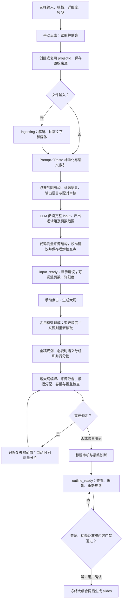

# PPT 容量失败排查与 input → 页数估算 → outline 完整逻辑

> **历史实现记录**：本文的“代码校准优先”和“auto 可增删页”已由后续方案替代；当前 v2 以 LLM 阅读为唯一页数建议，详见 [LLM 页数权威方案](../exec-plans/completed/ppt-llm-page-authority-20261019.md)。下文保留用于解释当时失败，不能作为当前推荐逻辑。

> 2026-10-19；以 application-local-run17 的当前代码和失败记录复放为依据。本文描述本项目的实际实现，不把对 Gamma 内部实现的推测当成事实。LLM 按用户要求使用模拟调用，原始失败任务只读，不替用户重新扣费生成。

## 1. 本次错误究竟是什么

“内容超出所选模板的可读容量。来源已保留，请检查排版或展示合同。”来自前端 `pptFailureMessage()` 对 `source_artifact_capacity` 等字符串的通用翻译。它本身不能说明失败页、原因或修复动作，也不能证明模型不可用。

本次定位到最近的相关失败项目 `99695350f8ea691b867b3c3381e776e4`：

| 维度 | 保存记录 |
|---|---|
| 输入 | 审计知识库（P0）建设方案，约 20,906 字符，71 个语义来源单元 |
| 模板／详细度 | 内置 blue；简洁；overview；无全文备注 |
| 模型阅读建议 | 13 页，范围 11–15 |
| 代码校准 | 推荐 34 页，范围 33–46；结构测量 44 个正文页当量、加首尾 46 |
| 用户实际选择 | 13 页，显式页数 |
| 最后错误 | `source_artifact_capacity`，18 pt，正文可用高度 5.03 英寸、所需 10.3287 英寸 |
| 原记录归因 | `content_invalid / local_capacity`，没有有效页级详情 |
| 候选记录 | 还残留一次表格 rowEnd 越界的 schema 错误，与最后异常不是同一检查 |

**存在真实超载，同时存在流程错误，不能只改提示或取消门禁。**

确定性复放得到：第 3、4、5、6、13 页的完整冻结来源放不下。例如第 3 页同时归属 `b_0011 / b_0013 / b_0015`，整表组合需要约 10.33 英寸高度；第 5、6 页还将大 Schema 表 `b_0030` 重复整表归属。简洁模式不会自动授权生成阶段删表格单元格。

原始异常栈为：

```text
startOutline → auditOutlineSubjects → outlineSubjectRows
→ bindSourceArtifacts → fitSourceLayout → source_artifact_capacity
```

标题审核为了取得最终选中正文，先执行了一次实际排版。之前已识别的超载页因此在标题审核中直接抛异常，最终覆盖了可展示、可修改的容量诊断。显式 N 不走自动加页分片，局部修复失败后尤其容易到达这一路径。

另发现三个问题：

1. 局部大纲修复 prompt 无论显式／自动页数都允许分成多页，Delta 校验没有单独冻结显式页数。
2. 短协议 Delta 校验失败后立即退出，虽有两次尝试的循环，却没有给它一次定向纠正机会。
3. 同一个 reading checkpoint 下，`/page-estimate`、任务页数统计、`input.ready` 事件有的用模型初估 13，有的用校准 34。用户改成显式 13 后，缓存早退又保留 `pageBudget.mode=auto`。

## 2. 本轮修改：改 code 还是 prompt

| 修改 | 层 | 具体行为 |
|---|---|---|
| 标题审核与物理排版解耦 | code，`ppt-outline-subject-audit.mjs` | 用 `sourceComponentParts` 和冻结 row/line range 提取精确单元格／文本／证据，不为取得审核正文强行排版。仍校验 ID、范围、图结构证明。 |
| 保留真正容量门禁 | code，`ppt-outline-source-fit.mjs`、API | 确认、开始生成仍走真实 `bindSourceArtifacts`；超载大纲可展示和修改，不能开始写稿或正式导出。 |
| 有位置的容量异常 | code，`ppt-source-artifacts.mjs` | 异常标记 `capacity_invalid/local_capacity`，携带 pageIndex、slideId、字号、可用／所需高度及来源 ID。 |
| 稳定的页级容量诊断 | code，`ppt-density-packing.mjs`、API | 密度问题有明确 pageIndex、slideId、测量信息；未解决密度问题是 blocking，不依赖标题字符串反查页。 |
| 显式页数冻结 | code + prompt，`ppt-outline-protocol.mjs` | 自动模式可分片；显式模式局部替换每个原位置恰好一页。违反时拒绝 Delta，保留原候选及预算；不能借修复偷偷增加页数。 |
| Delta 失败定向纠正 | code + prompt，API | 同一失败范围最多再纠正一次；返回原 schema、原 permitted indexes 和具体校验原因，不重新生成全稿。 |
| 缓存预算同步 | code，`ppt-input-understanding.mjs` | 只改 N 时不重读、不丢弃理解，但同步 auto/explicit、requested、measuredExceedsRequest；不把建议值覆盖用户值。 |
| 估算出口统一 | code，API、`ppt-page-counts.mjs` | 读取完成后的 API、事件、任务统计统一优先使用校准预算；模型初估另存供解释。 |
| 可读的页面提示 | UI + 中英繁三语 | 显示“第 X 页”、正文字号和内容高度／可用高度，提供现有重新规划／编辑入口；不再只有笼统容量异常。 |

**修复后对同一 13 页记录复放：**状态为 `outline_ready`，保留 13 页；第 3、4、5、6、13 页列为 blocking；错误字段清空；`fitValidated=false`；`/generate` 和 `/export` 均拒绝 409。这里的 `outline_ready` 表示大纲已可查看／编辑，不表示容量已通过，更不表示成品验收成功。

### 补充定位：代码块边距与分片角色

补测自动 N 时，同一输入分片后仍有一个目录树片段反复溢出。发现 `codeFontSize()` 选择等宽代码字号只检查文字墨迹高度，而 `measureComponent()` 返回的是文字高度加 7.2 pt 文本框内边距。于是出现反常结果：稍矮的区域自动换成 15 pt 能通过，稍高的区域保留 16 pt 却因遗漏边距而失败。

修复分为两处：

- `ppt-density-capacity.mjs`：字号选择与最终测量均包含 7.2 pt 边距，保留既有代码字号下限，不放宽溢出容忍值。
- `ppt-outline-capacity-repair.mjs`：内容分片携带原内容角色，使预测时和最终编译后的布局选择一致；封面／目录／结束角色不会机械复制给每个分片。

修复后，用同一来源作**独立自动预算测量复放**，完整组件分片到 29 页，候选 issues 与真实冻结来源容量 issues 均为 0；没有删行／列或把内容送到备注。这证明该份来源存在通过容量检查的组织方案，**不是本次用户显式 13 页已通过，更不是已经完成真实模型写稿或 PowerPoint 视觉验收**。

## 3. 用户实际操作与状态变化



正常新建界面不会把“读取”与“生成大纲”合成一次自动推进。`readOnlyInput=true` 是后端的真实停止边界；完成阅读后没有隐藏调用 writer、生成成品或直接进入成功状态。

## 4. 输入进入后端：并不是根据文件大小直接估算

入口：`PptCreateWizard → PptWorkspace.analyzeDraft → POST /ppt/projects`；已有项目继续用 `POST /ppt/projects/:id/outline`。前端 `/api/ppt/...` 代理到后端 `/ppt/...`。

- **Prompt**：保存 `prompt`。内容较长、多章节、带表格／代码／媒体等时也经 `normalizePaste / estimationSource` 进入完整来源索引；短主题 prompt 可以没有实证来源单元。短 prompt 是写作任务，不等于已经存在事实／实验结果，不能编造结果来填满页数。
- **Paste**：`normalizePaste` 处理 Markdown、段落、表格、图、代码和图片，保持来源位置与 ID。
- **File**：保存原字节、SHA256、名称、扩展名，再由 `startIngest / extractFile` 解码抽取。支持 Markdown/TXT/HTML/CSV/DOCX/PDF/XLSX/PPTX/PNG/JPG，当前单文件上限 8 MiB。文件名不作为额外正文或用户指令。
- **版本更新**：先合并基稿／原始来源和本轮补充，再走同一个读取边界；不是仅按补充文件大小估算。
- **文件补充要求**：`mergeSourceSupplement` 把明确补充内容纳入来源／要求，防止正文读取遗漏；用户没有给出的 filename fallback 不作为补充指令。
- **来源数量冲突**：例如原文乘法与总数矛盾，进入来源警告；原文不被静默“纠正”。需在生成前确认或换源。
- **模板**：内置模板保存 `templateSpec`；上传／公司模板可保存 `templateFidelity`，包含页面角色、槽位、字体、原生组件、媒体以及后续 slideMap。

新 v2 在读取前内部以 `pages=3` 满足 schema；若 `awaitingInputRead=true`，该值不可展示成有效建议。v1 的旧启发式估算仍为兼容历史项目保留，不是新界面的默认流程。

## 5. 读取前处理与语义 IR

`startOutline` 在页数建议发布前依次执行：

1. 来源缺少 semantic 时建立 `withSemanticIndex`。
2. `syncPresentationPolicy` 根据语言、代码展示及内容合同建立展示投影；完整原始来源仍保存。
3. `prepareSourceGraphAudit` 校验 ASCII／结构图转成图 IR 时是否保留节点、边、顺序、并行与分支。不是把所有文本行当幻灯片页。
4. `prepareTopicTitleProjection` 处理展示标题的主语言。
5. `prepareLanguageProjection` 处理显式输出语言；不能把英文原表仅因标题汉化就当作已翻译。
6. `prepareLanguagePairAudit` 审核可能的中英等价配对；pairId 本身不是删掉一侧内容的证据。

IR 主要包含：

| 对象 | 职责 |
|---|---|
| `source.text / sha256 / segments` | 抽取后的完整输入、身份和可定位段落 |
| `semantic.inventory.items` | Definition / Mechanism / Table / Equation / Code / Process / Summary 等可归属单元 |
| `relationships` | 比较、步骤、条件、支持、并行、分支等结构约束 |
| `evidenceAtoms` | 数值、约束和机制的原文证据及来源位置 |
| `originalSourceInventory` | 发生选择／语言投影时仍可追溯的原始目录 |
| `inputUnderstanding` | 完整阅读后的逻辑组和模型页数判断；不是最终逐页大纲 |
| `contentSelection` | 大纲明确选用 slides / summary / excluded 的取舍账本 |
| `planning.slidePlan` | 每页冻结来源、范围、证据及写作合同 |

来源是资料，不是可执行的开发指令。正文事实、用户明确生成要求、模型规划输出和程序验收合同分别处理。

## 6. LLM 如何读取完整 input

`prepareInputUnderstanding()` 的数据包包含 `completeInput`，不是仅把每个单元的 180 字 preview 交给模型。preview 只用于定位目录 ID；同时传入来源类型、章节、表格数据行数、关系、图投影信息、用户要求、详细度、原生模板组件与显式 pageRequest。

返回合同为：

```json
{
  "version": 1,
  "subject": "整体主题",
  "primaryLanguage": "zh",
  "groups": [{
    "question": "这一组回答什么读者问题？",
    "sourceUnitIds": ["真实来源ID"],
    "coreMessage": "不同于其他组的一条来源支持的核心消息",
    "relations": ["definition", "support"]
  }],
  "recommended": 13,
  "min": 11,
  "max": 15,
  "reason": "为什么这些内容适合这个范围"
}
```

校验包括：3–100 页，`min ≤ recommended ≤ max`，1–30 逻辑组，主题／问题／主张长度合法，coreMessage 不重复，每个来源 ID 恰好归属一个读取组，没有未知 ID、重复归属或遗漏。读取组拥有来源，不等于要将每句原文都上页。

`callWithContract` 先规范常见字段别名和字符串数字，再执行完整校验；最多两次定向合同修复，返回具体缺失字段、缺失来源、重复 ID 和 schema 示例。规范化不替模型创造语义分组或事实。

读取完成保存时间和 `sourceIdentity`。关键规划节点若有已配置的 `planningFallback`，合同修复耗尽后可换该备用模型一次，并记录原因；网络、取消、执行预算错误不通过这一路径无限重试。

## 7. 页数估算怎样计算、为什么会出现 13 → 34

它有三个不同的数，必须区分：

1. **模型语义建议**：读完输入后认为清晰叙事需要多少页，即 `inputUnderstanding.recommended/min/max`。
2. **代码结构／密度估算**：`measuredPageEstimate / sourceDensityPlan / pageCapacity` 测量当前来源展示对象、字体及画布，给出保守容量成本。
3. **用户预算与最终页数**：`pages / pageDecision`；显式用户输入有权保持 13，不会被建议 34 覆盖。最后逐页实际测量才决定是否能确认。

`contentCanvas` 使用实际模板正文槽位或内置版式区域，预留标题、脚注等；`measureComponent` 结合字体、换行、表格单元格、代码与结构内容计算成本；它不是总字数简单除一个常数。

当前 `measuredPageEstimate` 对必须保持结构且非 policy-omitted 的对象测高。大对象估算多页，小对象按比例累计；再记录正文当量并加首尾。`sourceDensityPlan` 另外结合叙事深度、去重、章节及结构成本得到代码建议。

当前 `reconcilePageBudget` 的确切公式（最后四舍五入并约束 3–100）：

```text
recommended = max(model.recommended, code.recommended)
max         = max(model.max, recommended, measured.structuralPages, code.range.max)
min         = min(recommended, max(model.min, code.range.min))
```

注意：`structuralPages` 主要扩展上限，不直接替代 recommended。它是当前原始展示对象的保守估算，不能当作“数学证明至少需要这么多页”。完整字段表、目录树和完整比较对象多时，代码估算会远大于模型基于核心叙事的初估。模型没有明确选择表格行／语义摘要，而大纲将所有原始表格都归属为完整展示时，这种差异就会实际变成超载。

这条记录正是模型建议 13，而完整来源的代码密度建议 34，原始结构估算 46。**34 也不是已经逐页排版证明能通过的最终页数**；不能直接宣称换成 34 就一定通过。最终还要校验整张表单元格宽度、实际分片、标题空间、模板分配及覆盖。

本轮未把 34 简单改回 13，也未删除所有结构成本来消除错误；只统一各出口使用校准预算、另保留模型初估及依据。

### 缓存与调整规则

`understandingIdentity` 包含：来源完整文本／hash、生成策略、模板身份、用户要求。

- 只改页数：复用阅读结果，不再次花一次阅读调用；本轮修复预算的 auto/explicit 与 requested 元数据同步。
- 改详细度、语言、模板或来源：identity 改变，需要重新读取／估算。
- 模型或执行路由本身不包含在读取 identity 中；换模型不强制抹掉同一来源理解。后续规划检查点另有模型／prompt 身份，不等于可盲目复用全部结果。
- 已确认大纲：不重新执行这一步来推翻确认合同。

## 8. 简洁／标准／详细实际控制什么

`detailProfile()` 同时进入读取、规划与写作；不是仅改 UI 标签。

| 档 | 规划意图 | 解释块参考 | 非结构内容保留比例参考 |
|---|---|---|---|
| 简洁 | 一条核心主张、足够的机制、代表性例子与必要条件；合并短内容 | 2–3 | 0.42 |
| 标准 | 说清是什么、为什么、何时适用；机制＋例子＋边界 | 3–4 | 0.60 |
| 详细 | 完整来源支持的机制、示例、推导、限制；续页有新增目的 | 4–6 | 0.80 |

这些是估算／提示参考，不是硬性字数目标，更不是允许截断 42% 的表格。冻结表格、公式、流程、必须展示对象与条件／风险有独立约束。v2 `archive=none`；不创建“完整细节见备注”或全文备注。

字号轻微调整属于另外的 `sourceTypography=bounded` 合同：先尝试同字号布局；必要时按小步调整，通常正文下限取 16 pt 与原字号 90% 等保护值的较大者，组件自有字号、编辑锁定及 native code 规则另作约束。详细度不负责任意缩字号。

## 9. 从读取结果到逐页 outline

### 9.1 先整体规划

- `prepareSemanticGroups` 对新的、自动 N、overview/editorial 且来源单元超过 24 的输入先建立全稿语义分组：问题、核心消息、narrativeRole、每个来源的 supportRole。
- 所有来源 ID 恰好一组；关系／双语等不能被随意割裂；主张不重复；主张及支持材料必须实际覆盖输入。
- 小输入／显式 N 没有这一分组调用时，仍用 `globalOutlinePlan` 给所有页共享全稿章节和来源关系背景；不会为每个输入段落固定分配一页。
- 语义组中的 pages 是暂定份额，代码可重新平衡；不等于最终已生成页面。

### 9.2 哪些任务并行

`skeletonBatches` 只在适合长来源的自动规划时分批；每批保留完整来源单元及允许 ID、共享全稿 ledger，最多 3 个并行。显式 N、版本更新、用户给定 outline 或短输入通常为单次短大纲调用。

每批已完成结果按 `promptHash + model + group index` 保存；其他批失败不重做已完成组。输出截断／无效 JSON／空输出／部分超时网络错误允许本组一次重试，截断可提高本组输出预算。流式显示的是已经闭合的 JSON 页草稿；标记未验证，不能把生成中的半个对象当接受大纲。

### 9.3 短大纲包含什么

页级信息主要是 role、section、title、reader question／focus／description、sourceUnitIds、必要 sourceArtifactRanges、媒体 ID、允许的 repeatSourceUnitIds 和 selection。它引用真实来源，不复述完整正文或让模型指定最终几何坐标。正文稍后由 writer 按冻结来源检索完整内容。

### 9.4 候选编译与检查的顺序

`assessOutlineCandidate()` 在隔离的候选对象上执行：

1. 标题层级与已授权语言展示处理。
2. `compileOutlineCandidate` 修正可确定的合同格式错误并记录 correction。
3. `compileContentSelection` 校验逐单元取舍；保留原始 inventory，建立实际展示 source projection。
4. `compileSkeleton` 验证来源、角色、关系、归属和必要事实；自动模式可以移除真正无展示内容的空页。
5. `packOutline` 只在允许且能实际放下时合并同问题／相关页；显式 N 不能借打包改总数。
6. 标题／续页标识规范化；`normalizeOutline` 形成稳定页结构。
7. 为原生模板重新分配角色合适且实测可容纳的模板页；不能只按页号盲目套用。
8. `revalidateOutlineFits / candidateFit` 测每页选中的实际结构与计划正文。v2 的 focus 是后续正文成本代理，最终 writer 正文还要独立测量。
9. `buildPlanning` 建每页来源／证据／写作合同。
10. 汇总显式页数冲突、所有权、报告逻辑、重复主题、冻结结构缺失／重复、容量溢出等 issues。

实际输出字体／排版尚未由 LLM 在 outline 阶段生成，不能仅因为模型回传 `capacity_ok=true` 就通过。

## 10. 自动 N 与显式 N 的修复差异

**自动 N：**先保持事实尝试合法取舍与版式、完整组件测量分片，再局部 LLM 分片；每次回到完整候选检查。代码还会合并／平衡偏薄的相邻页。分片保留原始行／列或完整文本行，后续页拥有增量内容。总数最多 100；超出原范围要提示确认，不自动开始写稿。

**显式 N：**保持页数。允许失败范围内重排、修改冗余计划表达、选择合规版式与已授权的展示选择；不静默把 13 拆成 20。完整来源对象仍不能放下时，保留可编辑候选和具体页，用户增页或重新决定大纲展示方式。

**局部修复顺序：**schema 的表格范围、元数据、摘要合同、归属、selection、关系等按诊断定向修；已接受候选保留。之后处理实际容量、标题语义和原生标题容量。不是遇到任一失败就从头重写。

行范围：表格 header 不属于数据区；`rowStart` 从 1 开始，`rowEnd` 排除该行；文本 `lineStart` 从 0 开始，`lineEnd` 排除该行。分片必须准确覆盖全部已选行／列，不能用超出表长的 rowEnd“补全”。

本轮局部 Delta 第一次失败时，第二次提示只给同一范围的拒绝 Delta 与确切校验原因；修复用尽仍保留上次可编译候选，输出剩余问题。

## 11. 为什么可看到大纲，但仍不能点生成

最终步骤是两类独立检查：

- **语义标题审查**：标题是否被本页实际选中来源支持；不拿相邻页资料给本页标题作证。现在不依赖该页物理排版成功。可复用已验证页的 hash；只修复标题并复核改动页。
- **冻结来源排版检查**：使用真正 writer 的 `bindSourceArtifacts / bindSourceMedia` 路径测试原始表格、流程、证据和媒体是否完整放得下。这一步不能被标题“aligned”替代。

剩余容量、标题或页数问题写入 `outlineCorrections.warnings`，阻止自动继续及未修改大纲的确认。前端允许编辑之后发出重新验证请求，后端仍会再次测量；修改标题／focus 不能绕过真实冻结表的容量。

确认大纲的 hash 包含来源、策略、selection、页数、模板与页内容身份；生成前也比较是否仍是同一合同。`candidateOutline.accepted` 表达候选编译检查点可用，不是 publish／成品状态；应结合 blocking 警告和 `fitValidated` 阅读。

## 12. 超时、传输错误和本地容量错误分别处理

- `model_transport`：队列／连接／模型执行问题，保留已读来源和完成的组；查看节点、HTTP 状态、首字时间／已收字符等安全诊断。
- `model_contract`：返回无效 JSON、截断、漏字段／ID等；有限修复，必要时配置的备用规划模型一次。
- `local_capacity`：真实字体／槽位／表格等容量不足；不该被当作“API 不可用”。本轮 source artifact 的异常现在明确为此归因。
- `local_coverage`：来源缺失、重复或范围不完整，与几何容量不是同一个问题。
- `budget / cancelled`：停止／保留检查点，不擅自多调用模型或发布失败稿。

当前 BYOK bridge：最多 3 个租约，普通模型执行预算约 240 秒、任务队列／租约约 300 秒；达到配置条件的大 outline/review 约 420／450 秒。队列等候与领取后的执行计时分开。不能因为 UI 轮询慢，就无限扩大所有阶段 timeout。

目前真实账户曾返回额度不足；本轮没有再请求真实模型，也没有把模拟语义审核当作真实生成质量证明。

## 13. 代码入口与复测方法

| 责任 | 文件／函数 |
|---|---|
| 两步读取与大纲界面 | `src/components/ppt/create/PptCreateWizard.tsx`；`PptWorkspace.analyzeDraft` |
| 已保存阅读任务继续 | `src/components/ppt/create/PptInputReview.tsx` |
| 路由与调度 | `apps/cowork-server/lib/ppt-api.mjs`；`startIngest / startOutline / assessOutlineCandidate` |
| 完整阅读、缓存身份与预算 | `ppt-input-understanding.mjs` |
| 结构估算与预算公式 | `ppt-page-floor.mjs`、`ppt-planning.mjs`、`ppt-density-packing.mjs` |
| 来源投影与取舍校验 | `ppt-presentation-policy.mjs`、`ppt-content-selection.mjs` |
| 全稿与分组规划 | `ppt-global-outline-plan.mjs`、`ppt-semantic-groups.mjs` |
| 短协议、组装及定向 Delta | `ppt-outline-protocol.mjs` |
| 完整结构分片 | `ppt-outline-capacity-repair.mjs` |
| 标题语义审核 | `ppt-outline-subject-audit.mjs` |
| 模板字体与实际容量 | `ppt-density-capacity.mjs`、`ppt-source-layout-fit.mjs`、`ppt-source-artifacts.mjs` |
| 冻结来源验收／确认 | `ppt-outline-source-fit.mjs`、`ppt-outline-confirmation.mjs` |
| 诊断提示 | `PptOutlineCorrections.tsx`、`PptOutlineDiagnostic.tsx`、`src/lib/ppt-error.ts` |

本地回归：

```sh
node --import tsx --test src/__tests__/unit/ppt-capacity-recovery.test.ts
node apps/cowork-server/selftest-ppt-input-read-stage.mjs
npm test
```

实际 Chrome/CDP 验证使用隔离开发端口 3147/3148，模拟数据，不给用户 API 发调用；3143 更新后再做同样的容量提示检查。详细执行结果和证据在本轮 `outputs/ppt-capacity-investigation-20261019/`，用户原始内容的快照不提交到仓库。

## 14. 边界和仍需真实验证的部分

- 本轮解决的是容量异常导致整步失败、显式页数逃逸与预算出口不一致；没有声称原始 13 页候选已经变得可读。
- 全量结构测量对 overview 比较保守；真实语义选择产生后才知道每页的最终需求。今后可以提供“当前全量结构方案成本”与“已审核叙事选择方案成本”双情景，但不能没有可审核 selection 就承诺低页数能装下所有表格。
- 模型是否给出恰当的 13 页选择、各语言表达是否准确、最终媒体／字体／PPTX 是否符合 Gamma 参照，仍需恢复真实 LLM 后逐页验收。
- 旧失败记录不会因部署而伪造为成功。用户重试或调整预算后会使用修复后的链路，原始输入及历史记录保留。

## 15. 本轮验收记录

- 最终 `npm test`：typecheck 通过，3011 passed、0 failed、1 skipped；新增 6 条容量／缓存／页数／代码边距／分片角色回归。
- 实际 Chrome 开发环境：12 项相关流程通过，包含读取停止、调整详细度、复用同一任务、局部重组、超载禁止确认、具体测量提示；CDP 截图已检查。
- 原生结构回归：真实 parser、完整／分片目录树缩进、删除／重排反例与真实 PPTX glyph export 通过。首次调用系统 Python 缺 python-pptx，切换已安装的 bundled Python 后通过；没有为此改产品代码或安装依赖。
- 真实用户失败记录只读快照＋模拟模型：显式 13 页进入可编辑状态并正确阻止超载生成／导出；自动测量 29 页完整来源能通过候选及冻结来源容量检查。
- 3143 冻结版本部署及生产浏览器记录见执行计划最终状态；不触发真实模型调用、不触碰 3141。

3143 已更新并完成生产页面复验：真实 Chrome/CDP 查看同一 13 页来源的模拟候选，第 3／4／5／6／13 页容量定位、字号及高度均显示，确认生成禁用，console/page errors 为 0。额外合并了同页重复且互相矛盾的“需要先拆分”与“写作时解决”提示，保留明确的阻断提示。真实后端只读 `/page-estimate` 返回 34（33–46），不再错误返回原模型 13。

前端构建 v32 通过且冻结源码校验通过；构建后仅后端 API 的诊断去重一处调整，服务直接加载该模块，已独立复放并重启验证。最终前端源码与构建一致，运行时后端 hash 和差异见 `runtime-source-manifest.json`。3141 端口监听状态未变。未调用真实 LLM，也未改写原失败项目。
