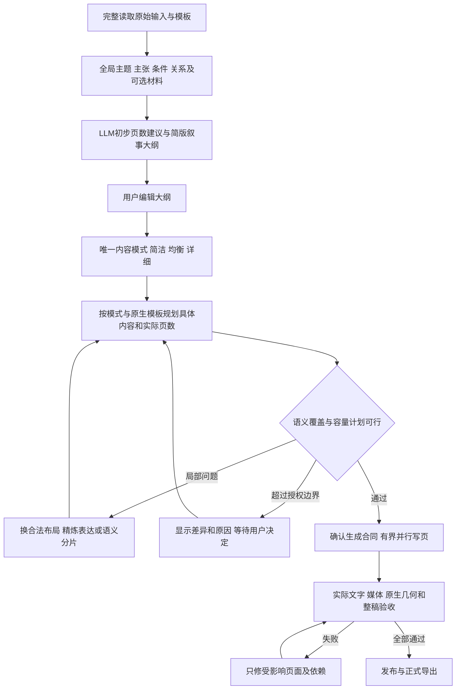

# PPT：先规划简版大纲、后选择内容模式与容量展开的改进方案

> 2026-10-21｜**用户已确认，现已实施工程改进。** [实施与测试记录](../exec-plans/completed/ppt-outline-first-implementation-20261021.md)。
> 以下第1–12节保留确认前的研究和真实失败历史；其中“本轮/待确认/不commit”描述的是前一讨论阶段。当前按用户新指令完成工程回归后本地commit；真实完整workflow仍暂缓。
> 本轮只补完上一轮中断的页数复评修复，并运行隔离 fixture/API 和工程回归；按用户要求不运行完整 workflow、不调用真实 LLM、不生成新 PowerPoint、不提交。
> 上一轮 Factor Zoo 尚未通过大纲容量门禁，writer 未开始、publishedRevision=0；不存在可供本轮宣称“已验收”的新成品。

## 1. 结论与需要确认的设计

建议采用：**完整读取 → 全局语义计划与初步页数建议 → 简版大纲 → 唯一一次内容模式选择（简洁／均衡／详细）→ 按模板容量展开和分页 → 页面生成 → 逐页与整稿验收 → 导出。**

核心变化不是隐藏长正文，而是把现在一个“outline”承载的三件事拆开：

1. **阅读理解**：哪些事实、解释、条件和关系来自输入；哪些是核心、哪些可选。
2. **叙事大纲**：每个逻辑单元回答什么问题，为什么按此顺序，哪些材料组合，哪些不重复讲。
3. **物理页面计划**：选定内容深度后，哪些具体主张、表格行、公式、媒体占用哪个原生模板区域，需要几张实际幻灯片。

容量必须参与规划，但不能拿“原文全部上页”的负载当作精炼大纲的不可突破页数下限；也不能只测短标题，就宣布尚未撰写的正文可放下。

建议默认允许最终页数与初估不同，采用**有边界的弹性目标**；用户明确要求“恰好 N 页”时保留固定页数合同。增减页必须有语义和容量证据、可追踪差异，不能成为无上限扩页或绕过内容取舍的办法。

本方案不恢复“完整细节去向”、不把省略内容塞进备注、不出现“来源细节见备注”。原始输入在项目来源存储中保留，页面只呈现经过选择和结构化的内容。

## 2. 证据、版本和判断边界

### 2.1 本轮依据

- 真实失败总账：[Factor Zoo 真实验收记录](ppt-factor-zoo-editorial-real-acceptance-20261020.md)。
- 初轮根因：[Qwen / Process Improvement 评审](ppt-factor-zoo-qwen-process-improvement-real-review-20261020.md)。
- 历史 Gamma 实操：[模板优先工作流研究](ppt-gamma-template-first-editor-workflow-audit-20261019.md)，其中 ML 输入的 11 页和 18 页属于其他实验，不与本轮 Factor Zoo 混写。
- 用户本轮 Gamma 截图：Writing slides 7/17；已写入的公式、比较表、组合说明与仅含标题的待填页面同时可见。
- 用户本轮模块截图：已规划 3/14 来源组、暂估 25 页；卡片直接出现长解释、公式源串和“No source content units owned on this page”等内部说明。截图显示的是一个界面时刻，**不能据此把当前保留项目的 24 页改记成 25 页，也不能认定所有路径都同样展示**。
- 当前代码检查：`ppt-input-understanding.mjs`、`ppt-page-floor.mjs`、`ppt-editorial-planner.mjs`、`ppt-api.mjs`、`ppt-content-selection.mjs`、`ppt-outline-source-fit.mjs`、`ppt-density-capacity.mjs`、`PptCreateWizard.tsx`、`ppt/project-view.mjs`。

本轮项目 `8ff80c5b356dc9c2409171ee4a41dab1` 的事实：同一 Factor Zoo 原文规范化后 41,415 UTF-16 字符、182 个来源单元；同一 Process Improvement 原生 8 页模板；slides 接口的真实 qwen3.8-max；读取建议 **12（10–14）**，测试者通过界面明确选择 **24**。其他历史项目的 10／14／16 页属于不同尝试。最新复评的两份回答均无效，不能作为新的已采用建议。

### 2.2 Gamma 能证实什么，不能证实什么

官方 Agent 文档描述先审阅计划，再生成；生成中的幻灯片实时出现在网格里，已有页面可查看，后续可定向修改。[官方 Agent 流程](https://help.gamma.app/en/articles/15002203-how-do-i-create-with-agent-in-gamma)

Classic Generate API 将卡片数量、切分方式和每卡文字量分别作为参数；这支持“数量与表达量应区分”的产品思路，但不能把 Classic API 参数直接当作截图中 Agent 的内部实现。[官方 Generate 参数](https://developers.gamma.app/guides/generate-api-parameters-explained.md)

Gamma 当前说明新版本演示稿使用固定 16:9 画布及网格；同一帮助页下方仍有旧 fluid-card 的说明，须区分版本。历史已提取的两份 Factor Zoo PPTX 也都是 13.333×7.5in。**不能用“Gamma 无限画布，所以它不超限”解释差距。**[官方幻灯片说明](https://help.gamma.app/en/articles/11016396-what-are-slides-in-gamma-and-how-do-they-work)

截图能支持“先有标题／页面意图，再逐页填充”的可见工作流；**不能证明后台使用哪种 NLP 模型、真实并发度、完整规划 token、容量算法，或已经检查所有来源事实**。本方案中的全局语义图、分阶段调度和容量合同是针对我们代码的设计，不声称逆向获得 Gamma 私有架构。

截图也显示 Gamma 保留待填标题占位；它不是“只显示完成页”的证据。本模块建议以紧凑列表保留待生成任务，仅把正在生成和已完成页展开为完整画布，进度计数区分两者。

## 3. 当前读取 input → 估算 → outline 的实际逻辑

| 阶段 | 当前行为 | 已有价值 | 目前代价／风险 |
|---|---|---|---|
| 解析来源和模板 | 保存不可变原文、原始 inventory、类型／语言对、原生模板页面角色与槽位 | 来源和模板可核对 | 段落类型误判会把可摘要说明冻成结构对象 |
| 阅读前准备 | 部分来源图、语言投影等检查 | 保留来源结构 | 前置失败容易被笼统理解成“估算失败” |
| 完整阅读 | reader 接收 completeInput、来源 ID、关系、模板结构信号，输出 groups 和 recommended/min/max | 先理解分组，再建议页数；完整送达可验证 | 阅读身份含整个 policy；深度等变化耦合缓存；完整送达不等于理解正确 |
| 读取后暂停 | readOnlyInput 请求停在 input_ready；UI显示建议 | 用户能调整页数 | 初估过乐观时后续修复压力大 |
| 全局及逐页规划 | 消费阅读组、语义关系与当前 N；新编辑 prompt 明确 exactly N | 避免代码产生另一个推荐数 | “建议／目标”过早变成硬总数，取舍还未稳定就冻结页数 |
| 单次 skeleton 响应 | 同时返回 slides 任务、所有来源 disposition、owner、实际 summaryText／summaryRows／summaryGraph | 能进行真实来源审核 | 大纲已经成为半份正文；回复大，细节、归属、页数容易互相冲突 |
| 编译与审核 | 绑定显式 owner、物化 selection、派生页面合同，审核表格／摘要／关系／全局覆盖 | 防漏、重复、错条件和虚构 | 内容先写满，再多轮修复；恢复必要条件又可能使物理容量失败 |
| 模板物理预检 | `inspectFrozenOutlineSources` 消费实际选中内容、原生字体和区域 | 避免坏页面进入 writer | 当前“大纲确认”要等正文级容量通过，语义骨架难以先获得用户反馈 |
| 有界修复 | 单元格、正文、owner分配、小窗口；失败保留检查点；显式页数复评 | 比重写全稿安全 | 既有架构仍可能多轮无进展；不是增加一个 prompt 就能解决 |
| 确认及生成 | 全部门禁满足才确认，writer后还有媒体、排版、整稿审查与发布 | 正式导出受保护 | 本轮一直未到 writer，不能拿工程绿灯代替输出质量 |

当前 v2 `reconcilePageBudget()` 已不再用代码测量覆盖 LLM 的推荐 N；`applyReadingPageBudget()` 保留模型推荐并尊重显式选择。**现阶段的主要冲突已不是“两套推荐数”本身，而是初估、固定目标、执行页数仍混在同一个约束生命周期里。**旧路径仍有不同自动分页分支，迁移时要按合同版本分流，不能全局改一个 `exactly N` 字符串。

此外，当前 `OutlineEditor` 已将部分详情折叠，但渐进候选展示仍可能消费执行大纲字段。只优化最终编辑器，不能消除截图中的生成中长内容泄露。

## 4. 密度限制究竟如何影响语义规划

### 4.1 必须分开的四类约束

| 约束 | 应处阶段 | 应如何使用 | 禁止用法 |
|---|---|---|---|
| 来源完整性与必要条件 | 阅读／全局语义计划／实际内容审核 | 原文不变、主张有证据、选中主张条件完整 | 把原文每个 only/must 或所有历史背景都变成必上页 |
| 解释深度 | 大纲后唯一模式选择 | 约束机制、例子、推导、限制的展开程度 | 用固定保留率或字数倍率证明质量；来源短也凑字 |
| 物理容量 | 模板分析、页面展开、实际渲染 | 原生区域、字体、换行、公式、表格、媒体共同测量 | 原文高度÷页面高度推导另一套推荐页数；只测标题 |
| 工程资源 | 调用／编译／渲染 | 对象数、token、任务数、耗时等独立报错 | 把11个短对象或网络超时笼统报成capacity_invalid |

`detailProfile()` 现有 supportBlocks、retention 等字段会进入提示上下文。它们至多是写作参考，不能作为来源覆盖或几何通过证据；新合同不让“目标比例”驱动正文补齐。页面上可以只有一个完整流程，也可以有多个短对比点，关键是任务清晰、解释足够和真实可读。

### 4.2 反复超限的根因链

1. **从保留原文出发，而非先选择读者任务**：最早10页模型只给61个来源owner，ledger却要求更多来源可见；旧编译补齐到168个，瞬间膨胀。该自动补齐已修，但架构教训仍成立。
2. **把结构保护误当选择义务**：整表若已选择必须保留比较成员，不等于这张重复表本身一定要选；现在已拆 ifSelected，后续仍须维持。
3. **语义单元太粗**：一段包含定义、机制、历史、边界，使用一段一个owner／summary容易带着全部附属解释上页。需要来源支持的 claim 级选择，但不能变成任意句子碎片。
4. **各组展开早于整稿分配**：前18页偏理论，最后几页塞实践任务；扩到24页仍失衡。完整读完和逐组并行并不自动等于全局规划。
5. **必要条件恢复与容量压缩互相抵消**：若第一版选择没有明确“最小完整解释包”，critic只能不断补回条件，容量修复又压缩它。
6. **重复内容被当成独立覆盖要求**：矩阵已经解释某模型，却又要求导言和年代表重复；反过来，只有模型名的表格也不能替代机制。需要基于实际可见含义判断替代关系。
7. **布局不合理导致假性或可避免溢出**：序号独占行、关系图再嵌套窄栏、错误同页关系、未结合真实模板区域。已修的流程inline编号说明，不改字数也可能改善容量。
8. **物理问题被转成文字问题**：单个不可分的长表格行、标题框、公式宽度、双语组合不能靠“更简洁”一概处理。
9. **大响应和多重修复成本**：217,609 bytes 的大scope请求及32,768输出token上限曾在420秒截止；不是增加超时就能解决的内容规划问题。

因此，不建议删除所有 density 检查，也不建议在现有巨型 outline 后加更多“请简洁”的提示。应让**语义取舍先定结构、模板容量先参与页面预算、正文写作严格消费预算**。

## 5. 目标流程：轻大纲不等于弱规划



### 5.1 全局语义计划先于第一次估算

reader 完整阅读后先形成语义任务图，再给初步范围。这可以在同一模型调用中按有序字段输出，不必为了流程图人为增加一次调用。输入太长时使用有覆盖清单的分段读取与全局整合，禁止只给目录／摘要冒充全文。

全局计划保留：主题、受众／用途、章节关系、核心主张与条件包、例子候选、比较轴、跨页依赖、可合并重复、可选推导及来源定位。来源段落ID不直接等于逻辑卡片，更不等于物理页。

**同一来源可支持多个不同主张，但同一核心主张只能有一个主要解释位置**。其他页可以引用已解释结论或承担不同例证，不复制整段正文。使用现有 claimIds/source refs 扩展，避免建立第二套互相矛盾的事实库。

覆盖分三层：全部原文被阅读；核心任务在叙事大纲有位置；实际发布稿中的必要主张／条件有可见表达。第一层全量，不意味着后两层全部原文上页。

### 5.2 面向用户的大纲与内部计划分开

每项默认只显示：

- 主题标题；忠实的次语言标题作为辅助层级。
- 一句“这一单元要说明什么”。
- 少量短要点，通常2–4条作为编辑目标，不强制凑数。
- 必要时一个组合说明，例如“分组矩阵 + SMB/HML公式”；不显示内部ID／owner／capacity字段。

默认不显示整段英文、全部表格单元格、LaTeX源串、No source content units owned、Opening slide for the N-page deck 等执行说明。除字段白名单外，还要审核可见title/intent/points是否仍混入内部操作说明；发现后定向重写该字段，不能用字符串删除算法误伤真实来源内容。内部完整计划仍可通过诊断工具查看；原始来源通过“查看来源”访问，不能转为备注占位文案。

这一步确认的是**语义结构**，不是宣告页面已渲染通过。状态使用 `semantic_outline_ready`；区分“结构可编辑”“容量待规划”“页面验收通过”。

例如同源 FF3 单元可显示：“FF3如何构造规模与价值因子”；短要点为“独立2×3分组”“组合到SMB/HML的关系”“适用边界”。完整矩阵、公式变量与必要条件放入内部证据包，直到选定模式和布局后才撰写。

### 5.3 按容量规划，而非写完再截断

每个逻辑单元先产生**展开规格**，包括必显主张、条件、用户已允许的可选解释、语言策略、媒体类型、表格选行／分片、公式与变量、候选模板布局。随后构成物理页面计划。

每页记录：稳定 pageId、logicalCardId、目标任务、claim refs、可见语言、原生模板版式、标题／辅助标题／正文／媒体区域、字体与允许下限、组件类型与数量、预算、不可拆组合、续页关系。

容量预算必须考虑联合布局，不是各组件单独fit即可：标题换行占高、辅助语言、表头和脚注、公式宽度、图例、图节点文字、双语正文、对象间距都要计入。给媒体预留实际区域，不能文字写满后再塞图。

正文尚未写出时使用**带不确定性的范围预测**：来源支持的展开清单、候选内容长度、原表选行、必要公式和最小标签样例；标记 estimated，而非 actual_fit。可先精确准备高风险不可分对象（长表行／公式／流程标签），但不要求一次写完全部正文才显示大纲。

预算比较对象始终是“本页预定展示的投影”，不是整段原文或所有排除表。单个表独立4.52in、可用5.73in只能证明它单独可能放下，不能自动要求两页，也不能证明再加解释仍可放下。

写作后共用当前原生测量／绑定／渲染合同计算 actual_fit，发生偏差时仅修本页或必要依赖。顺序：适配合法版式 → 去掉重复表达但保留已确认事实 → 重新组合已选对象 → 在授权页数范围内做语义续页 → 必要时提出新取舍供用户确认。小幅缩字号沿用已授权可读下限，最后才考虑；绝不裁字、丢行或移备注。

> 代码检查发现通用 bounded font floor 含16pt，而本模板部分原生正文为14pt。现有正常原生14pt并非因此全部无效；后续应按模板角色统一floor语义，fixture同时覆盖原生14pt、通用新建正文下限及用户锁字，不能无意将模板正文放大或许可继续缩小。这是待验证风险，不冒称本轮容量根因已实测成立。

## 6. 允许实际页数偏离初估：具体合同

### 6.1 四个数字明确分工

| 字段（拟新增合同） | 来源 | 能否变化 |
|---|---|---|
| readingEstimate | 阅读模型完整读后给出的推荐、范围、理由与假设 | 历史记录不可覆盖；后续只新增版本 |
| pagePreference | 用户目标或明确恰好N页，含fixed／adaptive、可接受边界 | 只有用户设置或明确授权流程可以改变 |
| plannedPageCount | 内容模式确定、真实模板约束参与后，语义分页计划的数量 | 授权范围内可变，记录每次增减原因 |
| actualPageCount | 已验收成品实际页数 | 与最终revision绑定，必须等于正式导出页数 |

推荐数仍由LLM给出；代码只计算候选页数组长度、章节合计、授权边界和几何结果。这些是**验证／计数**，不是另一套模型建议。若模型推荐28却章节合计33，不能静默把推荐改33；应让模型修数值合同。

### 6.2 默认自适应与明确固定

- **自适应目标（建议默认）**：初估是参考，用户可以给目标和最大可接受页数。读取／模式规划后的模型范围可作为建议，但必须在界面说明并由“生成”操作确认有效边界，不能隐藏替用户扩大范围。
- **固定N**：用户输入“恰好N页”、在高级页数选项锁定N，或有历史明确exact合同。总页数含封面、可选导航、章节／结尾页；不可偷偷增加。
- 不设统一±20%或按字符量推算页数；不同来源与模板差异很大。程序上限仍受产品100页等资源限制，资源上限不是推荐值。
- 对未选模式的初估标注“按当前主题与模板的初步建议，内容模式和实际展开后可能调整”；可用均衡展开情景作为明确的估算假设，但不提前保存为用户的内容模式选择。

### 6.3 何时自动调整，何时停下

| 情况 | 处理 |
|---|---|
| 模式选择后由目标25变成27，用户已接受最多28，核心主题／已确认事实不变 | 容量规划区显示25→27及具体拆分页原因；“生成页面”确认当前合同，无额外逐页弹窗。数字仅为示例，不是Factor Zoo新测试结果 |
| 生成中某必要表格＋说明确实需续页，仍在已授权28页内 | 原子更新page revision、顺序、count、来源分片和进度；保留已完成无依赖页，界面提示“为保持可读性新增续页” |
| 需要超过上限、删掉必显事实、改变语言／模板字号合同或锁定页 | 保留草稿，给具体差异与原因；等待用户选择增加上限／修改范围／返回编辑，不自动发布 |
| 固定N无法容纳 | 局部换布局、精炼、合并重复；仍失败则明确是哪几项不可容纳，不能code校准成N+X |
| 主题过短，原目标页数会产生空页 | adaptive允许合并有相同任务的短卡；fixed提示需改变数量或范围，不编内容凑页 |

大纲展示应区分“逻辑单元”和“实际页”：同一逻辑单元可以因真实容量拆成两页，但续页必须有新增解释任务；不能用重复标题复制全表。减少页数须保留全部已确认必显内容；合并／拆分记录 before/after claims，而不只记录数组变长。

生成中新增页要事务化：稳定pageId不因插入而改变；已排队writer检查planRevision，过期回复不能写进新页；更新进度总数、导航、导出清单、确认hash、critic依赖。用户锁页不进入自动重排。无论N是否变化，最终必须重新检查全局覆盖、重复与正式导出页数。

### 6.4 对历史合同的兼容

新自适应语义合同仅用于明确启用的新建／未确认项目。已确认或已编辑项目不自动解锁、不改N。旧页数复评功能仍是安全的显式恢复入口；它与新流程共享来源身份、几何证据和模型建议历史，但新流程不再等容量反复失败后才规划页数。

## 7. 大纲之后唯一一次选择内容模式

### 7.1 为什么合理，以及不可忽略的代价

合理之处：用户先判断是否讲对主题、顺序和组合，再决定展开程度；不会在还没看懂输入内容组织时选一个抽象“详细”。也能避免反复切换模式触发完整重读。

代价：模式会改变例子、推导、组件和实际页数，所以简版大纲之后不能直接进入不受容量约束的自由writer。必须保留“按模式展开与容量规划”阶段。大纲先确认语义边界；模式及展开计划共同决定最终生成合同。

“唯一一次”指**只有一个权威设置位置**：大纲后的“内容模式”步骤。移除读取前、模板页、生成弹窗中的重复详细度控件；编辑器不再出现第二套全稿简洁／详细选择。用户确需改模式时返回同一步修改，撤销受影响展开计划，不重复设置、不重写原始输入。局部AI“把这段压缩”是局部编辑，不改变全稿模式。

界面用“简洁／均衡／详细”，内部暂沿用 `concise / standard / detailed` 以兼容；“均衡内容”与高级设置“执行策略 balanced”必须采用不同label和帮助文案，后者只控制路由／预算，所有档位硬门禁相同。

### 7.2 三档不是字数倍率

| 模式 | 内容取舍与解释 | 典型页面结构（参考，不是硬配额） | 不能省什么 |
|---|---|---|---|
| 简洁 | 核心定义／结论 + 最短足够机制；选最有代表性的证据或例子，省重复引言和可选推导 | 一个清楚任务、少量支持、一个有效关系组件 | 必要条件、关键数字含义、比较成员、风险限定、用户明确必显 |
| 均衡 | 核心主张 + 为什么／如何 + 有源代表例子或机制图 + 适用边界 | 概念与证据相互解释，适度比较与流程 | 同上；不能用只有名称的矩阵替代必要机制 |
| 详细 | 在同一核心结构上展开有源推导、实现步骤、对照、例子及局限；必要时语义续页 | 机制／实例／边界分层，续页有不同任务 | 同上；不因“详细”引入无来源数据、重复全文或密集小字 |

同一模板字号与可读性底线跨三档一致，详细通常意味着更多解释空间，可能更多页，而不是更小字号。来源不足时三档可以相近，不强制1:3:8、0.42/0.6/0.8保留率或媒体种类配额。某些输入已有强制教学要求，不因“简洁”就把必要方法删掉。

### 7.3 三阶段 prompt 合同草案

**全局大纲planner（模式未选）**：

> 完整阅读来源，把它组织成面向目标读者的语义任务。先确定核心主张、条件、比较／流程关系与前后依赖，再给简短大纲。每项只输出标题、一句意图、简短要点及源定位；不要撰写完整正文、填完所有表格或输出内部实现说明。把可选例子／推导标为可展开材料，不能用它们挤掉后部核心任务。初估页数标明模板／语言／假设，不承诺物理排版已经通过。

**模式展开planner（唯一模式已选）**：

> 按已确认语义结构与所选模式选择具体解释包。核心主张及其必要条件必须保留；选可选材料时说明其价值，遵守已确认范围。为每页明确任务、来源证据、组件、模板候选区域与预算；比较／流程必须保留相应结构。先按真实字体和区域预检高风险对象，再决定组合、续页与实际页数。只允许在授权范围内变更，不用代码生成第二个推荐N，不转备注，不发明例子数据。

各档追加不同指令：简洁要求最低充分解释；均衡要求 what/why/how 与适用边界；详细要求有源展开及不同续页任务。三个模式使用同一个事实／关系验证器，不提供“宽松门禁”。

**逐页writer（模式与布局已定）**：

> 只生成当前pageId批准的解释包；读取关联完整原文和全局摘要，保留必要条件、语言与媒体语义。按指定组件／区域预算写作，不重复已由其他页负责的主张。不能临时删表格行、改比较对象、修改事实范围或自行新增页；不足以容纳时返回 typed fit request 与具体组件，交给planner处理。输出实际正文和可编辑媒体，不输出规划理由或来源系统说明。

writer不必每次携带全部原文，但必须拿到其所讲主张对应的完整来源及必要上下文，不能只根据轻大纲凭空补文。

### 7.4 取舍确认的边界

模式在大纲后选择，并不撤销用户“确认大纲时决定取舍，生成时不临时删改”的既有要求：

- 简版大纲确认核心主题与语义边界；模式步骤旁展示拟省略的可选细节、表格选行／展开范围及页数变化摘要。
- 最终“生成页面”以这些信息共同冻结 `generationContract`。在此之前可以回到大纲修改；无需每行弹窗。
- 生成后允许改写表述、换合法布局、在授权范围内分片；不许暗中减少已冻结事实／行。新增真正的内容取舍必须回到同一计划确认位置。
- 原图／表被用户明确要求完整保留时，三档都尊重该要求。

## 8. 数据、代码和状态如何落地

### 8.1 拟新增结构（名称为方案，不是现有API）

```ts
interface PlanningContract {
  version: 3;
  sourceReadIdentity: string;
  semanticPlanRevision: string;
  logicalCards: Array<{
    id: string;
    title: string;
    intent: string;
    points: string[];
    requiredClaimIds: string[];
    optionalExpansionIds: string[];
    relationIds: string[];
  }>;
  contentMode: null | 'concise' | 'standard' | 'detailed';
  pagePreference:
    | { mode: 'fixed'; exact: number }
    | { mode: 'adaptive'; target?: number; min?: number; max: number };
  capacityPlanRevision?: string;
  physicalPages?: Array<{
    id: string;
    logicalCardId: string;
    claimIds: string[];
    layoutId: string;
    componentPlan: unknown[]; // 实施时必须是有判别字段的强类型联合
    measurement: { state: 'estimated' | 'actual'; basisHash: string };
  }>;
}
```

这个结构是现有来源／claim／模板IR上的规划视图，不替换原始来源、已存在页面内容IR或正式文件格式。不将原文同时复制到多套可修改存储。

**身份拆分**：

- `sourceReadIdentity`：原文、原始inventory、parser版本及读取合同；模板／模式变化不否定“原文已经完整送读”。
- `semanticPlanIdentity`：读取身份 + 受众／用途／必显范围／语言约束／相关规划版本。只改页数不必重读原文；语义要求变化要重整计划。
- `capacityPlanIdentity`：语义计划 + 唯一内容模式 + 当前模板几何／字体／组件 + 页数授权 + 已选事实／行范围。
- `pageRevision`：页面批准内容、layout、renderer版本、编辑epoch。未变化页可复用；受影响依赖重新验收。

模板变化仍要重做模板分析和容量计划；全局语义阅读可复用不代表旧模板fit仍有效。模式改变不重传整份原文阅读，但新的展开任务仍拿到完整相关来源。模型／provider变化需保留出处与新任务记录，不能复用另一个配置的未验证回答。

### 8.2 具体改动清单

| 优先级／模块 | Code改动 | Prompt改动 | 关键验收 |
|---|---|---|---|
| P0 规划版本与身份 | `ppt-input-understanding.mjs`、`ppt-generation-policy.mjs`、store/project-view/types；新增显式版本适配器 | reader不预先选择用户内容模式；建议带情景假设 | 切模式不重读；改源必须读；旧已确认稿不迁移 |
| P0 轻大纲 | `ppt-outline-protocol.mjs`、`ppt-editorial-planner.mjs`，增加受控public semantic outline projection | 只写任务、意图、短要点、源claim关系；禁止全文ledger混在首响应 | 大纲请求无逐页完整正文要求，前后主题覆盖；内部术语不进入UI／PPTX |
| P0 唯一模式步骤 | `PptCreateWizard.tsx`、`PptWorkspace.tsx`、types、三语言i18n；同一编辑入口 | 模式展开prompt与writer消费同一值 | 仅一个控件；返回修改无状态分裂；执行策略独立 |
| P0 页数合同 | `ppt-page-floor.mjs`、`ppt-content-selection.mjs`、`ppt-outline-compile.mjs`、`ppt-api.mjs`；统一fixed/adaptive语义 | 取消新adaptive路径的exactly N；明确目标、上限、增减原因 | 固定N不漂；adaptive在授权范围内变化；历史推荐不被覆盖 |
| P0 内容归属 | `ppt-editorial-contract.mjs`、`ppt-page-contract.mjs`、selection／coverage／obligation模块 | 按主张＋必要条件包选择；主要解释位置唯一 | 同原段多主张有证据；同主张不重复；不按最近页补归属 |
| P0 容量展开 | 新容量规划编排器复用 `ppt-density-capacity.mjs`、`ppt-outline-source-fit.mjs`、模板binder与render-contract | 给真实区域／联合负载／高风险对象，先规划再逐页写 | 预估与actual区分；整页fit不由单对象fit推断；不只测简版大纲 |
| P1 写作调度 | `ppt-api.mjs`、现有任务队列／writer合同；先冻结全局计划，再有界并行 | 只写当前任务和批准事实；返回typed fit request | 并行回复不改别页；插页时过期结果被拒；已完成页保留 |
| P1 修复与缓存 | 复用allocation/selection/table/prose小任务，统一诊断枚举和依赖失效 | 错字段只修字段、错行只修行、不复写全稿 | 限次、无进展停止、保存成功子任务、累计预算不重置 |
| P1 UI与渐进展示 | 统一生成中候选／最终OutlineEditor的public projection；版本化进度事件 | 内部计划文案不可作为可见文案 | 标题占位与真正页面分开；进度分母变更有原因；仅验收页可发布 |
| P1 模板及媒体 | 同源geometry/font/theme token贯穿组件计划、预览和原生导出 | 按关系选媒体，不追求每几页几种图配额 | 原生关系语义、可编辑性、模板字号／颜色、导出一致 |
| P2 可观测性 | 分阶段耗时／输入输出token／repair次数／候选版本／overflow类型及页数变更日志 | typed失败不混称容量 | 可重放真实故障；非敏感诊断可下载；不记录凭据 |

不要把所有 `generationPolicy.version===2` 机械替换成 `>=2`。新合同通过集中能力判断进入新路径；旧full_source、人工指定大纲、已确认/锁定页继续旧授权边界。回滚feature flag时保留新项目记录，显示“需要新规划版本”，不能用旧full_source编译器猜测其含义。

## 9. 上一轮问题总账与逐项 fixture 方案

### 9.1 Fixture的定义与验收层次

这里的 fixture 是**可重复的输入、模型回答、模板、状态快照和断言**，不是让模拟模型只吐预期成功结果。

- **L1** 纯函数／合同：固定真实坏回答或最小等价拓扑，不调用LLM。
- **L2** API／状态：临时独立store、注入modelCall、可控延迟／失败，检查状态、回滚、版本与请求范围。
- **L3** 真实浏览器交互：真实前后端与模板，仅模型回答可脚本化；验证点击、恢复、控件、进度、导出禁用。
- **L4** 原生渲染：真实模板和组件→PPTX→独立Office/LibreOffice→PDF/逐页PNG；看字形、裁切、可编辑对象。不得只用SVG成功代替。
- **L5** 真实模型完整workflow及人工逐页评审：最终才执行；本轮明确暂不做。

“已有回归”指已有修复与工程覆盖；**均不等于本轮Factor Zoo最终通过**。“新增”指本方案确认后才实施。

### 9.2 阅读、合同与错误归因

| ID／实际问题 | 根因与修复方向 | Fixture输入、正反断言 | 层级／状态 |
|---|---|---|---|
| F01 描述型封面未识别，创建500 | 不能要求封面没有副标题；原生角色识别依赖字号层级与结构 | 原封面大标题＋短描述应识别cover；大指标数字内容页不能误判cover | L1/L4已有；最终稿待验 |
| F02 Qwen拒绝uniqueItems／JSON请求400 | provider wire schema兼容与服务端严格合同分开 | 拒绝该keyword的provider stub；wire不带它，重复IDs仍服务器拒绝；JSON审查带明确JSON指令 | L1/L2已有 |
| F03 引用offset／弯引号／缺参与者 | 精确证据定位不能靠模糊修正 | emoji UTF-16、唯一逐字quote、重复quote、直弯引号、缺关系端点；只唯一合法位置可绑定，失败报告具体证据 | L1已有；新增原始坏reply回放 |
| F04 阅读修复重写N／截断 | 多字段全量重写与输出预算耦合 | 首reply缺reason/证据，delta只改该字段；推荐／分组／参与者不变；输出截断报typed错误不采部分JSON | L1/L2已有 |
| F05 readManifest被误当理解完成 | 送达与语义正确不同 | 全182单元送达但刻意漏后部策略，manifest可完整、coverage仍失败；删原文尾段则manifest也失败 | L1已有；L2新流程补强 |
| F06 超时／400与容量失败须分开（历史403／额度作为回归） | 失败来源混用 | 注入schema400、鉴权403、quota、429、超时、502/503；保留阶段/provider code、允许的重试边界，不产生capacity verdict | L2已有部分；新增错误矩阵 |
| F07 页数复评28但分项33、理由1781；重试24但分项28 | 通用“修正”没有给原回答与精确差异 | 真实拓扑：校验合计及理由长度；模型仅返回数值delta；章节名称／目的／selectionChanges冻结；缺字段、二次不自洽、额外改内容均拒；原12及用户24不变 | L1/L2本轮补完 |
| F08 复评把排除表或原始长表当必显 | 对象范围与实际投影混淆 | 选中投影表、有owner行范围、excluded表、非法范围各一；只送可见投影，坏测量标unavailable；单独fit不声称整页fit | L2本轮补完 |

### 9.3 内容取舍、归属、语义和恢复

| ID／实际问题 | 根因与修复方向 | Fixture输入、正反断言 | 层级／状态 |
|---|---|---|---|
| F09 61 owner自动补成168 | 最近页自动补齐掩盖不自洽selection | 真实owner topology；无owner要typed失败，修复后每个可见对象有显式owner，代码不替用户增选 | L1已有 |
| F10 0语义摘要／106summary回退摘句 | schema仍给全文或sentenceIndices逃逸 | 长双语段落；新修复必须实际summaryText／合法graph；旧历史摘句可读取，新reply不能冒充精炼；不靠字符更少判语义通过 | L1已有；L5效果未验 |
| F11 only/must与表格结构使可选全文必显 | ifSelected与必选混淆 | 可选推导含only但整个未选可省；已选结论所依赖only条件不可省；完整表被选中时不能丢必需行 | L1已有 |
| F12 source章节／outlineSeed保护错误 | AI种子被当用户大纲；章节首句被当唯一代表 | AI种子不能关闭真正主要主题覆盖；表格充分解释可替首段；只有无关假设仍被core拒绝；人工大纲保持授权 | L1已有 |
| F13 双语一侧恢复、一侧excluded；重复ID当译文 | 恢复scope缺语言对闭包 | 实际b_0173/174及核心缺口对；两成员共同可见/合法共同省略，不能用同ID两次；一组修好不因另一未触碰组失败而丢失 | L1已有，v13后补强；L5未复测 |
| F14 “同主题”强制同页 | reading obligation把章节关联误成物理邻接 | 定义→后续应用可linked_pages；公式与必要变量/条件不可失联；更改placement有来源与审查回执 | L1已有 |
| F15 摘要省必要条件／数值范围 | 忠实性与压缩取舍边界不清 | Gaussian、均衡、不可交易风险等真实坏摘要；必须拒省必要条件；可省独立历史背景，不能要求原段全部同义重印 | L1/L2已有；新解释包补强 |
| F16 core审查只看含excluded组／局部组 | 只检查整条删掉的内容，没有看压缩后信息损失 | 0excluded但摘要丢核心仍失败；另一组实际可见机制可抵重复；只有标题／隐藏focus不能抵必要正文；整稿变更使cache失效 | L1已有 |
| F17 评分卡与taxonomy漏Momentum等成员 | 删行及摘要破坏比较集 | 原表行键、比较对象、列口径；真实缺成员必须补，重复年代回顾表可按合同省；“其他”不得偷偷合并 | L1已有 |
| F18 选3行却2行、换rowIndices留旧summaryRows | 选行与单元格投影生命周期不同步 | 换行选择失效旧投影；同选行保留；行列缺失、越界、混原始／投影索引拒绝；全部原始行保留在source | L1已有 |
| F19 摘要repair丢primaryPageIndex／94页码错 | 字段重建与索引混淆 | 仅由唯一明确owner同步冗余索引；不按距离猜；修改summary不改owner；重复/未知ID精确报错 | L1已有 |
| F20 section过长／reason80与240不一致 | 内部metadata合同不同步使整批废弃 | 82～123字符section、120/241字符reason；只修指定字段，保留正文/N/owner；有一条坏记录不重发全部正确正文 | L1已有 |
| F21 解释段落箭头误当Process／9步变10步 | parser把叙述连接或建议前缀当节点 | 模型演进句可摘要；真实九步链保持九步，“流程应为”限定保留但不是第十步；不得发明英文节点说明 | L1/L4已有 |
| F22 重排后旧pageContract／副标题／claim派生关系残留 | 缓存/派生IR与实际owner不同步 | 重排两个不同主题，重建owned合同、titleSecondary、claim refs；锁页及人工合同不重写；不存在的新requiredUnit拒绝 | L1已有 |
| F23 相互替代删除两个重复表／清空最后owner | reduction只看单提案合法 | A替B且B替A要整体拒绝；选一个可见充分证据允许；唯一owner/语言对不能被窗口清空 | L1已有 |
| F24 核心negative误要求重印年代表 | reviewer把阅读描述当必显事实 | 缺真正CAPM可检验预测必须恢复；已解释机制但没重复年代不应恢复全文；复核畸形不得算通过 | L1已有；需真实语义抽查 |
| F25 未完成checkpoint覆盖已修版本、最后一次修复被丢 | 恢复优先级／循环尾验证问题 | 新旧retainedAt、合同hash、无时间戳兼容；第8次合法delta必须再assessment；未通过checkpoint可恢复不能发布 | L1已有 |
| F26 批次空操作／23批重做／回执仅内存 | 无操作任务与缓存身份错误 | 无可编辑项0调用；23结构合法reply可回放但仍须semantic审核；缓存绑定原文/投影/model；重启回执保留，新投影不能借旧pass | L1/L2已有 |

### 9.4 容量、媒体、运行环境与UI

| ID／实际问题 | 根因与修复方向 | Fixture输入、正反断言 | 层级／状态 |
|---|---|---|---|
| F27 前部3页定义／末页31来源、24页仍超限 | 全局任务分配滞后于正文 | Factor Zoo14主题最小拓扑；前后任务先分配，缺末部方法应失败；不得用24或17作固定成功数字 | L1/L2新增全局规划fixture |
| F28 规划内容15.2in塞5.73in／仅改keyPoints仍溢出 | 实际选中内容与简版提纲分离不足 | 复现同宽字体的长双语＋表；缩短outline标题不能使actual geometry变绿；更合适布局/合法续页可过；不得删批准行 | L1/L4已有测量，新增前置预算链 |
| F29 11对象被对象数阈值拒绝 | 资源保护冒充物理容量 | 11短组件可以fit；11长组件不能；65对象报资源上限而非文字溢出 | L1已有 |
| F30 图表单独fit、合并页不fit；关系图再塞窄栏 | 缺整页联合测量／布局嵌套 | 同一关系图全宽与窄栏、加标题/双语说明/图例；总框必须fit，单体fit不能背书；极小框仍失败 | L1/L4已有部分，新增预算联动 |
| F31 九步流程序号独占行 | 同一内容不同原生组合影响容量 | 相同文字/顺序/字体测stacked与inline；数学runs保留、编号不重复；PPTX/PDFglyph一致 | L1/L4已有实际通过 |
| F32 纯表fallback被当关系媒体完成 | representation receipt只看内容覆盖 | 请求关系图却只生成表应media失败；合法同语义关系组件可过；不能为了多样性画无源因果／收益图 | L1已有；整稿L4/L5待验 |
| F33 标题框／媒体文字超限 | 只量正文或组件外框 | 长双语标题、辅助标题、多行公式、CJK字体fallback、媒体节点长标签；测具体槽位和内部文字；换布局而非裁剪 | L4新增本模板组合fixture；最终稿仍未知 |
| F34 模板灰色被取accent／SVG缺原生字体 | theme角色与字形加载路径不一致 | 原模板#cc5500与Roboto family；所有8页预览含字形；最终导出不得残留35%等模板样例数据 | L1/L4原模板已验；生成稿待验 |
| F35 相同容量allocation反复调用／大JSON420秒超时 | 调度无进展、范围过大 | 相同／更差负载停止重复；只发body/cell/owner delta；注入截止保持typed timeout、已完成批次及累计预算，不把超时当“无问题” | L1/L2已有；成本L5待量化 |
| F36 verdict缺reason导致正文被恢复 | reviewer schema错误误路由内容修复 | 一条畸形verdict只修该审查，其他正向保留；不能修改正文；二次无效明确schema失败 | L1已有 |
| F37 ENOSPC后孤立frontend／API503 | 环境失败与业务失败混淆 | 临时store写入ENOSPC、恢复检查点；模拟frontend可达/backend失败，UI显示服务错误；不得在真实磁盘造满或触及3141 | L2故障注入新增；真实恢复曾成功 |
| F38 显式重试耗旧attempt／新投影计同任务第6次 | 任务键与候选身份不全 | 显式新run可继续，但累计token费用不清零；变化projection/prompt新任务；同一任务重试限额仍有效 | L1已有 |
| F39 驱动503退出关闭worker／30秒大响应未收完 | harness与产品view=live协议不一致 | 有界GET重试并保留HTTP序列；真实failed立即停止；202尚未开始不能误记完成；页面关闭后状态可恢复 | L2/L3驱动已有修正 |
| F40 accepted=true但容量阻断／失败恢复缺页数操作 | 状态含义与入口不同步 | semantic_ready可编辑不等于page_plan_ready；确认/写页/正式export分别有门禁；失败任务回同向导，原源/模板/N保持 | L2/L3旧合同已验；新状态新增 |
| F41 内部规划文案混进大纲／模式重复控件 | UI消费执行字段，语义与正文同schema | 注入No source content units owned及长正文到内部字段；public projection不可泄露；逐阶段控件扫描，唯一模式入口 | L1/L3新增 |
| F42 局部AI目标／确认框层级与旧smoke入口 | UI状态目标失效或测试旧路径 | 改选区后旧请求不能改新目标；弹窗不被composer遮挡；正确高级入口；手工成品依赖不能冒充通用smoke | L3已有99项整套通过；新流程需重跑 |
| F43 原文2×3×3=27及无12股票数值 | 输入本身不一致／数据缺失 | 原文不可改；生成不能把27独立背书；可按确认范围省矛盾数字或显式指出；不能虚构tickers/收益填示例图 | L1/L2已有边界，L5人工复核 |

### 9.5 新流程必须新增的端到端模拟fixture

1. **模式未选也能看轻大纲**：完整输入182单元→全局结构→可编辑大纲；不请求完整summary ledger，不出现内容模式的提前选择，不谎报物理通过。
2. **唯一模式与缓存**：选择均衡→容量计划；返回同一步选详细，只失效展开／受影响页面，reader调用数不增加；原文改动则必须重读。
3. **全局先行**：组内reply故意先到后部或前部；没有global plan不能开始逐页writer；最终顺序由稳定cardId／关系决定而非响应到达顺序。
4. **弹性页数**：初估、目标、最终计划故意不同；仅授权范围内可成功。上限溢出、fixed N、用户锁页分别有反例；确认对话显示具体变化，不用单个“总数正确”断言替代语义审查。
5. **语义续页**：一个逻辑卡片拆两页，表头可合理重复但行范围精确覆盖、无漏无重；公式与变量边界完整。整行本身放不下时，单纯加页仍失败，必须合法投影或换布局。
6. **联合预算**：单独表格可放，加上必需说明超限；planner在写作前发现并规划区域／续页。writer扩写比预测多时，再次actual检查并有界修复，不能跳过。
7. **实际正文覆盖**：标题和内部requiredClaimIds齐全、正文故意漏限定，必须失败；压缩表格已充分表达机制时不能强制恢复重复导言。
8. **晚到回复与插页**：生成中插页、取消、改变模式、重开项目；旧revision的text chunk与完成reply均不得写入新计划；无关页内容hash保持。
9. **双语与媒体合同**：同事实双语是语义一份、几何两份；不能为fit丢一侧；主要语言标题和辅助语言标题各自测量；流程、矩阵、比较组件符合来源和模板。
10. **发布与导出**：planned页与actual页数、顺序、ID、导出slide数严格一致；任意硬门禁失败不得正式导出；空标题占位不算完成页。

所有新增fixture都应提供明确失败注入，不以固定“success:true”模拟LLM。原始坏回复脱敏后固定保存，记录来源项目／stage／hash及预期错误；新架构成功fixture不能改写旧真实失败记录。

## 10. 本轮已完成的收尾修复与测试边界

本轮改动仅限上一轮未完成的页数复评：

- `ppt-page-reassessment.mjs`：严格数值delta字段、范围、长度检查；冻结章节语义和取舍；合计／长度diagnostics；不继承缺失必填字段来伪通过。
- `ppt-api.mjs`：提供已选投影表及实际owner区域／范围测量；首轮完整模型建议、第二轮只修数值与理由；不适合delta的坏结构退回完整schema修复；仍最多两次。task key含实际prompt hash；最终保存前检查项目身份。
- `selftest-ppt-page-reassessment.mjs`：真实28/33与1781字符拓扑、合法delta、不合法delta、二次失败、N/阅读不变、并发／过期、投影与excluded／坏范围测量回归。

本轮实跑：

- 复评独立API／合同fixture通过，未调用外部模型。
- `npm test`：**3027通过、1既有跳过、0失败（3028测试）**，最终日志 `/tmp/ppt-factor-closeout-final-20261021.log`（追加用户要求／页面意图的过期校验后再次全量通过；首次日志 `/tmp/ppt-factor-closeout-20261021.log`）。
- `git diff --check` 通过（文档收尾后再次检查）。
- 上一轮已结束的真实Chrome smoke日志确认 **99通过**（`/tmp/ppt-factor-smoke-v14.log`）；属于先前UI版本的证据，不冒充本方案尚未实施的新UI验收。
- 本轮不重启3143；新后端修复尚未重新加载到正在运行的服务，不宣称线上实际复评已成功。3141未改动。
- 保留原失败项目／阅读／候选／全部原始模型回复；无新成品，无commit。

## 11. 确认后的实施顺序与退出条件

| 顺序 | 交付 | 继续下一步的条件 |
|---|---|---|
| 0 | 固定真实失败fixtures、状态迁移和诊断基线 | 能稳定复现，不接真实LLM也能识别原问题 |
| 1 | 新规划合同／身份、逻辑卡片与物理页分离、轻大纲public projection | 全局覆盖与归属检查通过，内部文案不进入UI；旧合同无回归 |
| 2 | 唯一模式步骤、三档prompt与统一状态机 | 实际Chrome验证只选一次、返回与恢复；无需为模式重复阅读 |
| 3 | adaptive/fixed页数合同、容量展开、增减页事务 | F27–F33及9.5页数／容量负例通过；没有代码第二推荐数 |
| 4 | writer／媒体预算消费、并发与局部修复 | 过期拒绝、必要条件保留、无重复主张、actual fit有证据 |
| 5 | 本模板和跨模板原生渲染、三档与双语矩阵 | 字体／颜色／标题／媒体／表格／流程均可读，无备注占位、无样例数据污染 |
| 6 | 经用户允许后恢复3143真实Qwen完整流程 | 同一Factor Zoo input和模板、真实reader→大纲→唯一模式→容量计划→writer→critic→正式PPTX/PDF；3141保持 |
| 7 | 每页全尺寸人工评审、汇总改进、最终回归与commit | 内容和版面全部必要验收通过；不能用模拟或npm通过替代真实成品 |

不要为了提速先移除所有门禁。新路径可以更早展示**语义大纲**，但不能更早伪造“内容通过”“容量通过”或放开正式导出。

## 12. Double check：一致性与仍需用户确认的选择

- [x] 把历史不同项目的10／14／16／24页与截图25页、Gamma17页分别记录，不混写为同一次测试。
- [x] 区分Gamma截图／官方产品流程／本模块代码／我们的推断；未声称知道Gamma私有并行算法。
- [x] 未以“无限画布”解释Gamma差距；固定PPT页面和双语物理代价保留。
- [x] 先完整阅读，再给初估；先有全局规划，再逐页展开，不依赖各组独自抢占页数。
- [x] 内容模式只有大纲后一个权威入口；估算假设不冒充用户选择；高级执行策略独立。
- [x] 初估、用户偏好、实际计划、最终导出四个数有来源；代码验算不替代LLM建议。
- [x] 大纲前不要求全部正文，但容量规划必须在writer前有足够真实对象依据；actual渲染仍验收。
- [x] 取舍在最终生成合同冻结前明确；生成中不临时删事实／行，必要调整在授权边界内。
- [x] 双语不为fit静默变单语；模板字号底线、用户锁页、固定N继续生效。
- [x] 源／模式／模板／页数／版本变更分别使正确缓存失效；晚到回复和插页有事务边界。
- [x] 不恢复备注细节，不用空占位／标题／隐藏计划冒充正文覆盖。
- [x] 43项问题/回归项及10组新增工作流fixture均给出失败条件；已有修复与待实施方案明确区分。已检查43个ID无重复、文档相对链接均存在、代码落点存在、Markdown代码围栏闭合。
- [x] 本轮只完成既有中断修复和本地回归，没有全workflow、新真实LLM调用或commit。
- [x] 用户已确认实施第5–8节新架构，工程验收见实施记录；第11节的真实LLM整稿与人工逐页验收按最新指示暂缓。

**建议确认的组合**：轻大纲先确认主题与组合；随后仅一次选择简洁／均衡／详细；默认自适应目标并明确页数上限，保留高级“恰好N页”；在授权边界内自动进行有理由的语义分页，超出边界或改变确认事实时再请求决定。此组合解决的是规划职责和合同次序，尚不能承诺未经L5实测的成功率。


## 13. 确认后的实施交付

新规划合同、轻大纲公开视图、唯一内容模式、模型物理页分配、有界逐页物化、原生容量预算、弹性/固定页数、精确续页及过期事务保护均已落地；既有源/语义/原生/导出门禁保留。实际字段复用既有来源与pageContract IR，不建立第二套事实库。

[实施记录](../exec-plans/completed/ppt-outline-first-implementation-20261021.md)列出代码落点、fixture映射、全量单元测试、Chrome/CDP及原生PPTX/PDF回归结果。首次建议12与实际计划3的隔离API正例，配合固定页数/上限/过期版本负例，证明页数的不同语义已分离；它不预测真实Factor Zoo会生成3页。

下一步真实Factor Zoo验收仍需恢复完整LLM流程并逐页评审。本次没有修改3141/3143的运行服务，也不将本地代码commit当作部署完成。
