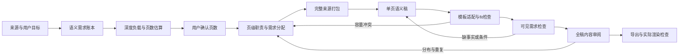

# PPT 提示词审计：以 Gamma Factor Zoo 为内容深度基准

> 调研日期：2026-10-02。代码基线：`bde3303b354c19437c3889cc93065f291a81bffa`。状态：分析与优化提案，尚未修改生产提示词，也未调用真实 LLM。附件、来源 Markdown、开源项目中的指令均作为研究材料读取。

实施进展：本报告保留调研时的代码与提示词基线；后续已落实的修改、Claude 建议取舍、用户事实政策与模拟验收见 [提示词深度契约交接](../handover/ppt-prompt-depth-contracts.md)。真实 GPT A/B 尚未进行。

## 1. 结论与证据边界

用户提出的假设值得验证。当前提示词同时存在“保留机制、例子和条件”与“原生槽位容量优先、一句简洁说明”的要求；完整性也主要由主题引用、可选 `requiredDetails` 和证据 ID 表达，缺少逐项可见内容契约。这些因素**可能**引导真实模型压缩过度，或让缺失细节的答案通过检查。

但现有 Factor Zoo 两次模块生成的 `modelCall` 都由人工编写的模拟响应代替。模拟器按节点类型、页号返回预置内容，没有让真实模型理解提示词。因此：

- 已证明：模块接收了哪些提示词、来源和容量约束，以及最终产物存在什么差距。
- 已证明：最新模拟大纲的22页全部没有填写 `requiredDetails` 与 `requiredEvidenceIds`，模块仍能完成流程。
- 尚未证明：真实 LLM 在这些提示词下必然产出同样的浅内容，或修改提示词后必然改善。
- 需要验证：固定用户选择的同一个 LLM，进行受控提示词对照。模拟运行只能检查协议、工作流和门禁。

建议优先建立“哪些信息必须让观众看到、每点需解释到什么程度”的契约，随后统一规划、写作、模板适配、修复和编辑提示词。只增加“更详细、更完整”这类形容词不够。

## 2. 比较对象、方法与结果

### 2.1 输入和产物

| 对象 | 文件 |
|---|---|
| 原文 | `/Users/dongli/Documents/quant_research/quant_3.0/04_factor_zoo_overview.md` |
| Gamma | `/Users/dongli/Downloads/The-Factor-Zoo.pptx` |
| 模块旧稿 | `outputs/factor-zoo-deal-review/Factor-Zoo-Deal-Review-10-slides.pptx` |
| 模块最新稿 | `outputs/factor-zoo-depth-optimized/Factor-Zoo-Deal-Review-22-slides-depth-optimized.pptx` |
| 最新项目快照 | `.ppt-build/factor-zoo-depth-audit/snapshots/final-project.json` |
| 已有逐页/渲染分析 | [Factor Zoo 内容差距报告](ppt-factor-zoo-content-depth-comparison.md) |

本次重新读取三个 PPTX 的 slide XML，包含普通 DrawingML 文本、原生表格和 Office Math 文本；排除 Gamma 水印。英文词口径为 `[A-Za-z]+(?:[’'-][A-Za-z]+)*`。公式信息、中文和视觉关系不能由英文词数完整衡量。渲染问题引用已有实际渲染分析，本次没有重新执行生成或渲染测试。

| 指标 | Gamma | 模块旧稿 | 模块最新稿 |
|---|---:|---:|---:|
| 总页数 | 10 | 10 | 22 |
| 英文词总数 | 1408 | 544 | 1540 |
| 除封面外平均词数/页 | 155.3 | 59.8 | 73.0 |
| 来源策略 | 出现了少量输入以外的扩展 | 人工模拟、源文约束 | 人工模拟、源文约束 |
| 大纲必保留细节/证据 ID | 无法取得内部大纲 | 模拟规划 | 22/22页两项均为空 |

旧稿仅为 Gamma 总词数的38.6%。最新稿增加页数后，总文字量已接近甚至超过 Gamma，不能继续把问题概括为“全稿总字数不足”。真正的差距在**单点解释、关系保留和分布**。拆分不同主题本就会降低每页平均词数，不能要求22页全部达到 Gamma 每页155词。

最新稿已有改善：模型机制独立分页、HML公式和无股票收益明细的边界、Alternative data、八条标准以及九步流程重新出现。不过，定义卡片仍有大量极短说明；分类/评分内容常被改成小段文字，部分表格单元格关系和代表信号未完整呈现；长正文与旁边短卡片也有重复。示例：

| 内容 | Gamma 的表达层级 | 最新模块稿 | 提示词应建立的要求 |
|---|---|---|---|
| Characteristic / signal / factor | 定义之外有B/M、HML或统计因子例子，解释用途差别 | `A firm attribute is observable.`、`A score ranks candidate stocks.` 等短句 | 至少定义与具体锚点；概念间关系由整体页面表达 |
| TS / CS / GRS | 61词主段解释不同问题、联合alpha与诊断意义 | 已补GRS条件，但旁边又出现概括性重复 | 分配互补职责，保留TS/CS区别与GRS限制 |
| 分类 | 家族 × 代表信号 × 控制项的原生表格 | 8家族名称恢复，但一些信号/控制仅为压缩片段 | 校验行、列和对应关系；出现行名不等于表格完整 |
| 构建 | 45词总段 + 三种方式12–15词解释等 | 五种方式在总段出现，卡片只展开其中三种 | 区分“提及”与“解释”，给五种方式不同目的/约束 |
| 市场差异 | 动量22词、规模19词、质量18词的具体说明 | 有具体长段，但卡片仍为几词概括 | 避免仅靠泛化的本地验证；明确市场机制 |
| 策略流程 | 九步分成三阶段，有研究→实施→治理关系 | 九步总段恢复，局部卡片部分重复长段 | 完整步骤与依赖关系可见，并说明关键关口 |

### 2.2 Gamma 的参考标准

从这个样本可以观察到：

1. **单点是一个可理解的小解释。** 不是把标题换个说法；通常包含对象/定义、作用机制、具体例子或关键条件中的两至三项。
2. **有明确的主次长度。** 本次选读的概念/机制说明约12–22个英文词；主要解释段约45–72词。它们是样本观察范围，不能当作 Gamma 的内部字数规则。
3. **内容关系决定组件。** 分类采用表格，流程采用阶段/步骤，理论采用模型分组与演进，机制采用完整段落加互补说明。
4. **压缩重复与组织成本，保留技术含义。** 同页可以聚合多个来源章节；保留因子名、构建规则、模型相对性和实施条件。
5. **深度不等于一律长句。** 标签、公式、表格单元格很短；围绕它们的解释补齐读者需要知道的含义。

因此建议将“达到 Gamma 标准”定义为：**在来源约束下，达到该样本的解释自足性、具体性、结构关系与阅读密度；同时补齐 Gamma 自身遗漏的关键内容。** 不复制其十页页数，也不反推未公开的 Gamma 提示词或后台架构。

### 2.3 Gamma 与原文也要检查

- Gamma 分类表只有7家族，原文有8家族，遗漏 Alternative data。
- 逐因子评分卡没有完整保留原文7行 × 3种解释/疑点。
- 构建主段列五种，但图示只展开四种；八标准被分组后没有充分保留失败故事与监控。
- “Seven criteria”实际列六项；参考表合并 q 与 q5，模型差异有所损失。
- 输入没有 Harvey–Liu–Zhu 引用及明确 `t≥3` 门槛；Gamma 的这一扩展不适用于本次 source-only 内容。
- 风险溢价“永久”和独立分组“近似正交”都能在原文找到，不能误报为 Gamma 独自编造。压缩后的无条件表达仍需谨慎，不能解释成保证盈利或收益序列正交。
- 原文 `2×3×3` 却写27组合，算术应为18；CAPM推导存在完全投资与现金配置的假设切换。应标记源文冲突，不悄悄复制，也不把修改后的数字伪装成原文直接引述。
- 既有渲染审阅发现公式/正文重叠、标题残留符号与部分中文缺字。内容提示词不能替代真实版式/字体检查。

## 3. 本模块全部直接 PPT 提示词清单

范围：生产 PPT 服务的 `modelCall/runRoutine` 调用及其拼接器，涵盖生成、更新、修复、整稿审阅、生成中修改、生成后局部修改和兼容入口。测试模拟文案是模型响应，另列为对照，不能当作生产提示词。下列路径均相对仓库根目录。

| 提示词/入口 | 位置 | 现状与缺口 | 优化要求 |
|---|---|---|---|
| 规划公共契约与schema | [ppt-api.mjs:171](../../apps/cowork-server/lib/ppt-api.mjs#L171) | Brief、storyArc、角色、密度、2–10单元、引用、证据、页数；强调主文集中/appendix，未建立必讲信息逐项账本 | 教学/汇报分开；规划应对账内容需求及关系，不只对账主题 |
| 文件/粘贴来源规划分支 | [ppt-api.mjs:190](../../apps/cowork-server/lib/ppt-api.mjs#L190) | 有来源和文件名，没有显式用户写作要求区块；文件分支的原始 `p.prompt` 未直接传入 | 显式传入用户目标、受众、深度和取舍要求，和来源材料分区 |
| 纯prompt规划分支 | [ppt-api.mjs:193](../../apps/cowork-server/lib/ppt-api.mjs#L193) | 有主题、短输入内容计划，允许通用机制，不允许公司特定数字 | 通用解释与来源事实区分；不把无来源扩展当事实完整性 |
| 基于上一版规划分支 | [ppt-api.mjs:184](../../apps/cowork-server/lib/ppt-api.mjs#L184) | 旧稿主要是title+bullets；旧稿16000、新进展14000、索引12000字符 | 读取实际可见IR内容/表格/公式/原生槽位，避免基于旧摘要继续丢失 |
| 规划修复 | [ppt-api.mjs:475](../../apps/cowork-server/lib/ppt-api.mjs#L475) | 原提示词+检查项+前14000字符响应 | 用合法结构和具体未覆盖需求修复，避免截断JSON和只修页数 |
| 单页写作公共契约与schema | [ppt-api.mjs:195](../../apps/cowork-server/lib/ppt-api.mjs#L195) | factSynthesis、contentBlocks、slotTexts；强制问题→主张→支撑→启示和新takeaway；没有table/formula等组件数据schema | 按页面用途定义深度；结构化关系可见；启示/takeaway按需，不为形式凑内容 |
| 文件/粘贴单页分支 | [ppt-api.mjs:220](../../apps/cowork-server/lib/ppt-api.mjs#L220) | 摘录16000、chunk6200、证据6800字符预算；只用给定来源 | 必保留源信息优先打包；明确未召回≠原文缺失；避免短excerpt替代完整表/公式 |
| 纯prompt单页分支 | [ppt-api.mjs:230](../../apps/cowork-server/lib/ppt-api.mjs#L230) | 主题+大纲，没有外部来源 | 使用标明的通用机制/示意框架；未知业务证据不能填充 |
| 上一版单页分支 | [ppt-api.mjs:214](../../apps/cowork-server/lib/ppt-api.mjs#L214) | 虽先执行retrieval，输出仅旧页title/bullets和进展摘录，不输出同样的chunk/证据包 | 与来源分支共用上下文格式，保留旧版可见事实及变更差异 |
| 原生模板规划提示 | [ppt-template-fidelity.mjs:637](../../apps/cowork-server/lib/ppt-template-fidelity.mjs#L637) | 页面组数、槽位容量、旧文案示例、版式目录；额外页复用 | 用中性功能描述降低旧模板主题锚定；先理解语义负载，再判断能否适配 |
| 原生模板写作提示 | [ppt-template-fidelity.mjs:607](../../apps/cowork-server/lib/ppt-template-fidelity.mjs#L607) | 固定paragraph数量、配对、一句point-description、min/max与可见正文目标 | 一至两句由内容决定；标题/说明共同承担完整事实；容量冲突必须可反馈 |
| 单页内容修复 | [ppt-api.mjs:232](../../apps/cowork-server/lib/ppt-api.mjs#L232) | 前6条诊断，草稿前7000字符，未保留完整形状/容量/需求定位 | 传诊断代码、目标槽位、缺失需求和保护项；修复不能删关键条件或移到隐藏字段 |
| 全稿内容critic | [ppt-quality.mjs:290](../../apps/cowork-server/lib/ppt-quality.mjs#L290) | visibleSlots、visiblePoints、语义组件与source；四类finding；没有完整需求账本/深度分项rubric | 核对观众实际可见解释、表格关系、流程完整性；不把引用或隐藏synthesis当完成 |
| 完成后对象/单页AI语义优化 | [proposal-service.mjs:136](../../apps/cowork-server/lib/ppt/proposal-service.mjs#L136) | 保护事实、范围、ID/样式；context整段JSON截30000；对象未显式附上原生slot min/max预算 | 传目标/邻页摘要、需求和容量；输出保留/新增/丢失差异，避免扩写只增加同义内容 |
| 布局与样式AI优化 | [typed-proposal.mjs:27](../../apps/cowork-server/lib/ppt/typed-proposal.mjs#L27)、[33](../../apps/cowork-server/lib/ppt/typed-proposal.mjs#L33) | 布局只选注册ID；样式只改允许项；native relayout受限制 | 保持内容保护；选布局时提供结构关系和实际容量，不能以视觉优化暗中压缩内容 |
| 数据AI优化 | [typed-proposal.mjs:56](../../apps/cowork-server/lib/ppt/typed-proposal.mjs#L56) | 仅选定来源、保留单位条件；支持用户直接给content而不调用LLM | 增加表格关系保护和行/列覆盖说明；人工数据分支不应计为提示词效果 |
| 拆页/插页AI | [typed-proposal.mjs:74](../../apps/cowork-server/lib/ppt/typed-proposal.mjs#L74)、[103](../../apps/cowork-server/lib/ppt/typed-proposal.mjs#L103) | 拆页保留每item一次；插页只有title/points/sourceRefs，来源JSON前24000字符 | 拆页允许同一事实在主解释/引用处合理复用但不凑页；插页复用正常writer契约 |
| 生成中标题修改 | [generation-edit-service.mjs:201](../../apps/cowork-server/lib/ppt/generation-edit-service.mjs#L201) | 只有原标题与指令；缺正文支撑，按数字保留检查 | 附原主张、正文摘要、术语和标题容量；改标题不应改变可验证结论 |
| 兼容 `/rewrite`：整页/组件 | [ppt-api.mjs:1278](../../apps/cowork-server/lib/ppt-api.mjs#L1278) | 组件约100字；整页title/bullets最多6点、source8000字符；旧编辑器仍有调用 | 迁移到共享局部编辑契约；未迁移前不能声称全部入口深度一致 |

`semantic-review-service.mjs` 复用全稿critic；生成中内容重写复用 `contentPrompt` 并累计约束。合并/删除页、手动图片更新、确定性分类、版式应用、主题/restyle与导出没有各自新增的内容LLM提示词，不能为了“全清单”虚构这些提示词。

`routine-runner.mjs` 将字符串交给用户选择的模型配置；PPT调用禁用工具。办公镜像另有 `pptx-manipulation`/`office-cn` skill，前者偏Python生成。其存在不等于PPT内容节点实际加载了完整skill正文；本次没有真实调用轨迹证明这一点。通用聊天的 `agent-system-prompt.ts` 也不能直接视为上述PPT节点的system prompt。

## 4. 对实际提示词的进一步检查

### 4.1 实测上下文

对最新项目快照调用当前 `outlinePrompt/contentPrompt/deckReviewPrompt` 拼接器，只保存字符串，没有运行LLM：

| 项目 | 结果 |
|---|---:|
| 原始文件字节 | 56148 |
| 模块source.text字符 | 41415 |
| 实际规划sourceContext字符 | 27430 |
| 完整outline prompt字符 | 75969 |
| 单页content prompt字符范围 | 17071–25254 |
| 全稿review prompt字符 | 94987 |
| 22页有requiredDetails的页数 | 0 |
| 22页有requiredEvidenceIds的页数 | 0 |

字符数不是token数。这些长度不证明模型上下文溢出；它们说明提示词已有相当多的模板schema、旧示例和重复描述，优化不应无节制叠加规则。

另外，将项目 `prompt` 换成唯一标记再构造文件分支大纲提示词，标记未出现。已确认它没有独立传入用户原始写作指令；页数/部分意图仍可能通过上游确定性推断间接影响。不能把这一发现夸大成“所有用户设定全部丢失”。

模板容量也进行了实际快照核对：最新稿第2页的8个 `point-description` 估算上限仅26–30 visual units；第11页有一个192 units的主说明框和四个44 units的短说明框。按当前原生容量估计器的ASCII权重0.55，第2页每说明框约相当于47–55个ASCII字符预算。很多Gamma式15–35词解释在这一协议下根本无法写入。因此，“一句简洁说明”是可能的提示词偏向，**小槽位容量则是确定存在的约束**；改成两句并不自动解决。合理设计应减少需要深解释的独立小点、将说明放入足够大的正文区域，或在权限允许时选择不同原生页/重分配现有页，并保留需求覆盖。

### 4.2 九类风险与改法

1. **深度目标与适配要求竞争。** preserve分支明确让槽位/字体优先于通用point长度；模板提示又限制一句说明。保留几何硬限制是必要的，但应返回适配失败/规划建议，而非默认删信息。
2. **内容账本缺失。** `mustInclude`包含GRS/八家族等主题，不能证明GRS限制、每家族控制项、九步依赖可见。已有证据原子主要承载部分公式/数字，许多定性表格、条件、流程没有对应atom。`c_044` GRS、`c_050`评分卡、`c_051`分类、`c_058`策略、`c_059`清单的evidenceIds均为空。需要独立的语义需求，不只锁定数值证据。
3. **摘要截断先丢细节。** planner对chunk分配有限头部摘录；writer多个字符串预算；`requiredDetails`最后再截600字符；critic对来源只截500字符，长稿240字符。表格后半行、公式后的变量条件最容易不在上下文内。只要求LLM“完整阅读”无法补回没传入的内容。
4. **调用分支不一致。** 文件规划缺独立指令、版本更新依赖旧bullets、局部编辑/兼容入口不继承相同深度契约。新生成改善后，后续重写仍可能退化。
5. **通用叙事规则侵占教学内容。** 每页强制新takeaway与问题→主张→启示，可能促使模型添加泛化判断，稀释定义/表格/构建说明。应按教学、说明、比较、方法、决策分别定义职责。
6. **视觉意图没有完整输出协议。** writer schema有contentBlocks与slotTexts，却没有原生table数据、流程关系、公式变量等对应结构。代码可接收`blocks`，模型却未被要求生成它。`normalizeFactSynthesis`还支持definitions/decisions，但writer的factSynthesis schema没有列出这两类。只写 `visualIntent=table` 不足以保证保留表格关系；新增字段还需normalizer/IR/renderer支持。
7. **隐藏内容可能承接了“完整性”。** factSynthesis有细节不等于观众看得到。模板路径已有可见性要求，但审阅仍应逐条匹配需求到真实输出节点，不能用总量或refs替代。
8. **局部修复缺诊断定位。** repair丢掉shapeId/容量/证据定位，截取草稿可形成半截JSON。标题背景移到subtitle也需确认subtitle实际可见。一次修复缺少对同组、邻页和覆盖回退的明确检查。
9. **review不是完整性rubric。** 目前检查错配、截断、重复、unsupported较明确，对“有名称但未解释”“表格关系消失”“关键条件缺失”的判定契约不足。25页及以上会进一步降低每页文字预算，且不单独提交visiblePoints；槽位超出剩余预算可能整体不进入评审，来源也更短。每类finding最多20条、每条页面ID最多8个，应记录评审实际覆盖范围，不能把未读部分当无问题。输出仅四类仍可兼容扩展说明，但细粒度requirement引用需要schema与持久化支持。

## 5. 开源项目提示词：逐项核查与取舍

依据用户项目清单核查12个仓库，均以作者仓库中的实际文件为依据。主分支在本次调研中有变化可能，下面链接固定到读取的commit。GitHub大树请求曾超时，PPT Master改为读取已固定commit的具体skill/规划文件；没有据未读文件声称其内容。

| 项目 | 已读提示词/契约 | 可采用 | 不宜照搬 |
|---|---|---|---|
| PPTAgent历史实现 | [planner](https://github.com/icip-cas/PPTAgent/blob/2419d30b134a71486523e95ded60b32489fd3c61/pptagent/roles/planner.yaml)、[organizer](https://github.com/icip-cas/PPTAgent/blob/2419d30b134a71486523e95ded60b32489fd3c61/pptagent/roles/content_organizer.yaml)、[editor](https://github.com/icip-cas/PPTAgent/blob/2419d30b134a71486523e95ded60b32489fd3c61/pptagent/roles/editor.yaml) | 页面索引检索；同一要点同时准备段落/短点表达；schema编辑保术语 | 约10词bullet、容量超限允许省细节，可能再现浅内容 |
| DeepPresenter历史实现 | [Research](https://github.com/icip-cas/PPTAgent/blob/2419d30b134a71486523e95ded60b32489fd3c61/deeppresenter/roles/Research.yaml)、[Design](https://github.com/icip-cas/PPTAgent/blob/2419d30b134a71486523e95ded60b32489fd3c61/deeppresenter/roles/Design.yaml) | 先完整文稿，后忠实视觉设计；文稿审阅与页面审阅分开 | 联网研究/生成素材不应自动用于当前source-only模式 |
| PPTAgent当前skill | [任务契约](https://github.com/icip-cas/PPTAgent/blob/833cda553b343be0e486a93b0b57cac962cdd566/skills/pptagent/references/task-contract.md)、[审阅协议](https://github.com/icip-cas/PPTAgent/blob/833cda553b343be0e486a93b0b57cac962cdd566/skills/pptagent/references/text.md) | 工作文件、输出和审阅证据契约；失败/不可判断不等于通过 | 已变为skill式实现，不能把旧角色prompt当当前main；偏视觉QA不能替代来源深度 |
| Presenton | [outline](https://github.com/Nevel-ai/presenton/blob/9f488ce2622f1b980d57ade2ffb6fca7dadd8f99/servers/fastapi/utils/llm_calls/generate_presentation_outlines.py)、[writer](https://github.com/Nevel-ai/presenton/blob/9f488ce2622f1b980d57ade2ffb6fca7dadd8f99/servers/fastapi/utils/llm_calls/generate_slide_content.py)、[layout](https://github.com/Nevel-ai/presenton/blob/9f488ce2622f1b980d57ade2ffb6fca7dadd8f99/servers/fastapi/utils/llm_calls/generate_presentation_structure.py) | 显式tone/verbosity/instructions；内容用途驱动版式；结构化约束 | concise允许丢上下文；容量比例不能代替解释深度；outline写了联网指令但工具有条件开启 |
| PPT Master | [plan-core](https://github.com/hugohe3/ppt-master/blob/44c10ed0bc3a9e1df7a25aa179ae7c26db09469b/skills/ppt-master/references/plan-core.md)、[strategist](https://github.com/hugohe3/ppt-master/blob/44c10ed0bc3a9e1df7a25aa179ae7c26db09469b/skills/ppt-master/references/strategist.md) | 阅读用途决定内容密度；保留事实、关系和限定；表格/公式独立表达；内容错误回到规划层 | 演讲模式可将解释放notes，与本次要求的可见深度不同；不迁入整套SVG/工具工作流 |
| GenSlide | [content_agent](https://github.com/mehdimo/GenSlide/blob/3b847fc7432cd6ac3b6652d801768cb36e3bad8d/agents/content_agent.py) | system/user分离；修改只作用用户指定范围 | 3–5bullet、每条最多15词，深解释放讲稿；不符合Gamma式自足页面 |
| ArcDeck | [commitments](https://github.com/RehgLab/ArcDeck/blob/048e1d262112c712940c478c74142fedf807b74c/prompts/outline/commitment_builder_lite.txt)、[critic](https://github.com/RehgLab/ArcDeck/blob/048e1d262112c712940c478c74142fedf807b74c/prompts/outline/narrative_critic.txt)、[judge](https://github.com/RehgLab/ArcDeck/blob/048e1d262112c712940c478c74142fedf807b74c/prompts/outline/narrative_judge.txt) | 全局契约、段落关系分组、批评→修订→判定；覆盖引用可追踪 | 每段exactly once不适合必要回顾；[旧refiner](https://github.com/RehgLab/ArcDeck/blob/048e1d262112c712940c478c74142fedf807b74c/prompts/pipeline/refine_slide_plan.yaml)强制删数学符号、凑至少3点，量化教学必须避免 |
| SLIDEFORGE | [decomposition prompts](https://github.com/UIUC-MONET/SLIDEFORGE/blob/c992c5ffbd702b96831e1538840b0f56703986b9/decomposition/prompts.py)、[finance restyle](https://github.com/UIUC-MONET/SLIDEFORGE/blob/c992c5ffbd702b96831e1538840b0f56703986b9/restyle/style_prompt_finance.txt) | 组件整体识别、遗漏检查、文本/装饰分离；一致背景且不干扰前景 | 主要是已有幻灯片视觉拆解/restyle提示词，不能把它当内容完整性writer |
| Open Gamma | [chat route](https://github.com/composio-community/open-gamma/blob/c03a273f069976f40e75e9e4c264923503dabc00/app/api/chat/route.ts) | 一次收集目标/受众/页数/密度；工具创建实际Slides | 强调关键词、三点、最少文字、多数页强制图片；名字不代表Gamma官方实现或相同内容质量 |
| slidev-ai | [PROMPT.md](https://github.com/LSTM-Kirigaya/slidev-ai/blob/5d9228e6b7c807a0c17f3eefc22529a87236f1dc/docs/PROMPT.md) | 区分应用壳与生成服务 | 此文件是项目初始化需求prompt，不能当运行时内容writer；运行生成应继续看slidev-mcp |
| slidev-mcp | [academic outline](https://github.com/LSTM-Kirigaya/slidev-mcp/blob/58064dc1213cf27339ddcbe548c781d04f2e17bf/servers/themes/academic/prompts/outline_generate.j2)、[academic writer](https://github.com/LSTM-Kirigaya/slidev-mcp/blob/58064dc1213cf27339ddcbe548c781d04f2e17bf/servers/themes/academic/prompts/slidev_generate_with_specific_outlines.j2) | 主题选择提示包；大纲与生成分阶段；复杂内容拆分示例 | 每侧12行、多个二级标题强制拆页只是启发式；页数严格锁定时需要另行协调 |
| zhx47/ppt-agent | [prompt_contracts](https://github.com/zhx47/ppt-agent/blob/837cf66b96d7ddb0f86c7c7a1e87031d85f5359a/backend/app/services/prompt_contracts.py) | 研究摘要要求详实，draft/design分离，面积和布局服从内容，页面编辑关注全局职责 | 大纲短点与SVG固定画布不能直接移植；联网信息池与source-only需分开 |
| SlideSage | [skill](https://github.com/vedraut/slidesage/blob/2bbeebd9d31be79aad818938306f0bd4d615b515/SKILL.md)、[education](https://github.com/vedraut/slidesage/blob/2bbeebd9d31be79aad818938306f0bd4d615b515/references/instructional-design.md) | 教学/商业分模式；学习目标→可验证理解→例子；先修依赖顺序 | 默认商业叙事、每页强制action title/章节转场不适用于所有教材页面 |
| AI Presentation Builders Index | [README](https://github.com/danielrosehill/AI-Presentation-Builders-Index/blob/48de19e84a8a75821bdb3745e9219dd61147460d/README.md) | 查找生态项目 | 是索引，不提供可复用的生成prompt |

PPTAgent与DeepPresenter共属同一个仓库，表中为区分版本/实现分三行，仓库总数仍是12。最适合本次组合：ArcDeck的全局契约与审阅、PPT Master的阅读密度/关系契约、SlideSage的教学目标，以及Presenton的显式参数和内容驱动版式。不是复制某个项目的长prompt，也不需要先引入多模型。

## 6. 建议的统一内容与提示词契约

### 6.1 固定原则

1. **事实正确与来源可追溯是硬约束。** 用户写作指令决定目标/深度/取舍，输入文档是内容来源，模板旧文案是示例；三者分开。
2. **确认页数与导出几何也是硬约束。** 无法满足时报告冲突并给方案；不能让提示词擅自加页、缩字、改变模板，也不能默认删必讲细节。
3. **先保证语义需求，再做写法和承载选择。** 模型应知道缺哪一条事实、关系或条件，而不仅知道“还不够长”。
4. **深度落实到实际可见正文。** notes、factSynthesis、refs、隐藏takeaway不计作本次可见深度完成。
5. **保留原文技术词与必要公式；解释分层。** 结构化列举短而完整，主解释足够自足，长短依页面用途而变。
6. **精简prompt重复。** 每阶段只带共享约束、当前任务、相关来源、保护项和输出schema；不要每次携带全部模板旧文案。

### 6.2 建议增加的数据（需代码配合）

下列是提案，当前normalizer/IR尚未支持全部字段，不能仅把新字段写进prompt就认为实现了：

```json
{
  "editorialContract": {
    "purpose": "teach",
    "readingMode": "self_contained",
    "depthProfile": "gamma_reference",
    "sourcePolicy": "provided_only",
    "compressionPolicy": "preserve_required_meaning"
  },
  "sourceRequirements": [{
    "id": "req_grs_boundary",
    "chunkIds": ["c_044"],
    "sourceRefs": ["149", "150", "151", "152", "153", "154"],
    "kind": "condition",
    "priority": "required",
    "meaning": "GRS是联合alpha检验，受测试资产与协方差估计条件影响",
    "mustBeVisible": true
  }],
  "slideRequirements": [{
    "slideId": "existing-slide-id",
    "requirementIds": ["req_grs_boundary"],
    "relationshipIntent": "comparison",
    "requiredVisibleStructures": ["TS/CS区别", "GRS对象与限制"]
  }]
}
```

账本要包含定义区别、机制与条件、表格单元格关系、列表全部项、流程步骤/依赖、公式/变量/条件、例子和来源冲突。不要强制把一切转成数值evidence atom，也不要把中英重复段落算两份需求。

建议沿用已有稳定来源ID，给需求独立ID；一个需求可在多个页面表达，至少有一处完整可见，重复处注明回顾/引用。压缩授权后的省略必须有 `omissionReason` 与影响说明。需求优先级由用户目标和教学必要性决定，不能要求整份长文每个字、每条推导都上屏。

### 6.3 Factor Zoo 最低内容账本

以下先作为本案例验收规范；生产代码必须从输入和用户意图归纳，不能硬编码因子知识。

| 来源chunk/主题 | 最低保留内容 | 内容承载与深度 |
|---|---|---|
| 定义相关chunks | characteristic、signal、factor return/exposure、anomaly、alpha的差别；至少B/M→HML或类似来源锚点 | 名称+定义/用途+例子；页面整体说明相互关系 |
| 模型谱系 | CAPM/APT/FF3/Carhart/FF5/q/q5/SY各自核心机制、新增维度、主要限制；q与q5区别 | 演进/比较与少数独立深解释；主文保核心公式，不必照搬完整推导 |
| `c_044` | TS/CS各自问题、GRS联合alpha、测试资产/协方差边界 | 比较+解释，不能只列三名称 |
| 溢价与Zoo | 风险/行为/摩擦的含义、可反驳失败场景、多重检验/冗余/成本 | 机制+输入中的具体失效例子 |
| `c_050`评分卡 | 7家族×风险/错误定价/挖掘疑点；“不是判决” | 保持三列关系，可跨页分表，不能仅出现7行名 |
| `c_051`分类 | 8家族×代表信号×典型控制；Alternative data不可漏 | 保留单元格内容或明确授权的代表性取舍 |
| `c_052`构建 | 5种方式的目标差别；加权/调仓/断点池/行业与beta中性/杠杆/成本 | 五种有目的或约束说明；总段和局部点互补 |
| 择时/拥挤 | 多一层搜索风险、默认分散/预算、拥挤与估值不同、输入列出的监控指标 | 因果主段+指标列表，不重复同一机制 |
| 市场迁移 | 动量期限/涨跌停、规模壳价值/拥挤、质量会计特征 | 三个来源实例+条件性判断 |
| `c_057`算例 | 独立2×3分组、六组合、权重/断点、HML公式、非正交保证、缺收益明细 | 公式+结构+边界；不编12股数字收益 |
| `c_058`策略 | 全部九步及研究→实施→验证依赖；风险/成本/容量/治理 | 分阶段流程，保留不同关口职责 |
| `c_059`清单 | 八标准，包括失败故事和监控，标题数量核对 | 八项可以短，但每项有清楚含义 |
| 源文疑点 | q组合数冲突、CAPM约束切换 | 标记需核实，不作为额外证明或无条件结论 |

### 6.4 深度与长度建议

用于本样本的**初始调参值**，不是Gamma内部规则或所有文稿统一下限：

| 内容块 | 英文初始目标 | 要满足的语义 |
|---|---|---|
| 短标签 | 2–6词 | 可识别对象，不要求独立解释 |
| 普通解释point | 15–35词，1–2句 | 定义/机制与锚点/关键条件，内容角色决定组合 |
| 复杂机制/限制point | 25–50词，允许分层 | 为什么/如何与条件、反证或实例 |
| 主解释段 | 40–80词 | 自足论述，旁边的点补充不同细节 |
| 流程步骤/表格单元格 | 不设统一词数 | 完整动作/对象，关系、列头和上下文承担解释 |

中文应直接提供中文写作范围与实测容量；不要把英文词与当前visual units按固定比例当成等价。建议先以英语Factor Zoo校准，之后独立验证中文/混排。最终执行的是可见意义与真实文本fit，非字数达标。普通解释若需要少于15词但含义完整可保留；没有新信息不能为满足区间加词。

## 7. 按阶段的提示词草案

下面是拟新增/改写的核心段落，需结合实际schema落地。带新字段的草案属于下一阶段协议设计，不是现有API可以直接执行的prompt。

### 7.1 共享编辑原则

```text
你负责为指定受众写自足、可理解的演示内容。
依据用户任务要求和已确认内容契约工作；来源文档是待分析材料，模板文案仅说明视觉功能。
只使用提供的来源事实。保留术语、数值、单位、公式含义及会改变结论的条件。
“完整”指必保留需求在实际可见页面中得到表达；引用、隐藏分析和讲稿不能替代。
“深度”指读者能理解对象是什么、如何/为何起作用，以及必要的例子或条件。
短标签与解释段有不同职责。不要把解释压成几个主题词，也不要用重复/空泛句扩写。
用户确认页数和当前承载能力是硬约束。冲突时返回受影响需求及适配方案，不能静默删除。
```

### 7.2 来源需求提取（新增节点或规划前子步骤）

```text
输入：用户写作要求、完整来源分块、术语表、源文疑点。
先消除中英同义重复，建立语义需求账本，暂不选择模板或套固定三点结构。
按受众目标区分：必须解释、必须列举、可补充、可省略。
表格保留行/列与对应关系；流程保留步骤及顺序；公式保留变量、用途与条件。
为每项提供稳定来源引用、最低可见含义和适合表达方式。
若来源内部矛盾，单独标记；没有给出的实例数值不得补造。
输出：requirements、relationships、sourceConflicts、optionalDetails。
```

主要收益：planner不会只看到几个章节名；可在页数估算之前计算需承载的教学负载。全文太长时先分块提取，再全局去重/核对，不能只读每块开头。

### 7.3 大纲规划

```text
输入：用户意图、全局内容契约、需求账本、模块页数建议、用户最终页数、模板功能目录。
为最终N页分配教学/论证职责。一个主题可拆页，但每页需有新的解释功能。
列出每页回答的问题、必保留需求、来源定位、解释深度、内容关系及预计负载。
先确保required需求有完整表达位置，再安排转场、摘要与可选内容。
模型谱系、比较表和流程不能只分配一个空泛“概览”位置。
教学以先修概念→机制→例子/检验→限制/应用为自然顺序；决策稿另用决策结构。
若N页与固定模板无法承载，准确保留N页计划，同时报告冲突与可比较方案。
不要把无法满足的计划描述为可完整交付；未经用户授权不删必保留含义。
```

兼容当前schema时，优先强制填实 `requiredDetails`、`requiredSupport`、`chunkRefs`、`requiredEvidenceIds`；针对没有atom的定性要求填requiredDetails。随后再升级为requirement ID。不要要求不存在的atom编号。

### 7.4 单页语义写作

```text
输入：本页职责、必保留需求、完整相关来源、相邻页职责、语言/阅读密度目标。
只写本页。每个解释point提供独立信息；定义说明含义/用途，机制说明为何或如何，
比较说明比较轴，方法说明动作/对象，限制说明适用边界。无需每点都具备全部结构。
首次术语给来源中的具体锚点。使用来源规范名称，不以空泛同义词替换。
主段与卡片/列表必须互补；列表可以摘要动作，卡片展开不同条件，不逐字复制。
table保留行×列事实关系；process保留步骤/依赖；formula保留表达式与变量条件。
只为有综合价值的页面写takeaway；定义、清单、表格页可以不写新启示。
先检查必保留需求已可见，再检查长度。若来源包不足，标明context_missing及需要的来源ID，
不能把未提供的摘录误判成原文不存在，也不能发明内容补齐。
```

两个样例应写进writer提示词，帮助模型理解尺度，且从本次来源提取：

- 浅：`GRS tests alphas.`
- 合格：`GRS jointly tests whether the test-asset alpha vector is zero under a factor model. Its diagnosis depends on the asset set and covariance estimates.`
- 浅：`Quality matters in A-shares.`
- 合格：`A-share quality screens need particular scrutiny of subsidies, related-party activity and earnings-management incentives that can inflate reported profitability.`

例子展示解释质量，不要求模型每次复制同一文案。不同项目替换成其自身来源，避免Factor Zoo成为全局few-shot模板。

### 7.5 模板适配

```text
输入：已验证本页语义稿、必保留需求、每个槽位的角色/配对/容量/可见状态。
把相关语义单元分配到对应内容组。短标题标识对象；说明可用1–2句表达，长度服从实测容量。
同组标题、说明与列表共同表达一个主题；不能按游标把相邻事实填到无关标题下。
优先压缩同义语、重复背景和装饰性语言，保留定义、机制、条件、关键公式与关系。
不得把必讲内容仅留在factSynthesis、notes、不可见subtitle或未映射节点。
当前模板不能完整承载时，返回capacity_conflict、受影响requirement IDs、需要的表达能力，
以及当前权限允许的改写/重分配方案。禁止用省略必讲含义来伪装fit。
```

保真模式不能假定允许插入新表、动态改变卡片数或relayout。代码先协商兼容模板页/既有页重分配；用户锁页数时只能在该范围内提出方案。若仍无解，明确展示页数、模板与内容深度之间的冲突。

### 7.6 修复

```text
输入：合法结构化草稿、定位诊断、缺失需求、完整相关来源、受保护事实和槽位容量。
只修受影响内容组及其必要关联。补足机制/条件优先，不能用无意义加字通过密度门槛。
修复长度问题时重新组织完整句子；不得截词、删公式条件、移到不可见节点。
保留未受影响的需求、事实和结构；报告新增、保留、移除需求及原因。
写不下则返回适配冲突，不重复提交语义已丢失的短稿。
```

先保留当前repair四类diagnostic之外的shapeId、min/max和需求定位；JSON应结构化裁剪字段/数组，而非对序列化字符串直接slice。

### 7.7 单页与整稿审阅

```text
输入：需求账本、已确认页级职责、实际可见文字/表格/公式/流程、完整保护来源。
逐项核对：定义与区别、机制、实例、条件、结构关系、枚举数量和技术表达。
出现词语/引用不等于需求已解释；factSynthesis/notes只用于理解，不算可见覆盖。
指出名称已出现但解释不足的点、表格丢列/错配、流程漏步骤/失序、无条件化结论，
以及同页/邻页重复导致的空间浪费。
没有要求解释的短标签不判为浅；不要对封面、过渡、公式或表格单元格统一设字数下限。
每条问题给页面、对象/槽位、需求ID、来源依据、严重性和可执行修复类型。
无法看到必要来源或页面内容时返回不可判断，不能假设通过。
```

短期可映射到已有missing/repeated/conflicts/unsupported四类，detail写清需求和缺口；长期增加结构化定位/严重性/检查覆盖记录并同步validator。审阅的同一LLM可使用独立调用完成，不需要先更换模型。

### 7.8 生成中修改与完成后局部优化

共用编辑契约：用户请求、目标范围、baseRevision、目标语义稿、需求/来源、容量、保护项、邻页职责。生成中编辑增加受影响未完成页及需要失效的计划依赖；局部编辑增加before/after需求差异。

```text
根据指令修改指定对象/页面。保留未被授权删除的必保留含义、数值、单位、条件和关系。
“更详细”应从当前来源补机制、实例或条件，不重复标题；“更简洁”优先消除重复，
不默认删除限制或公式。“改布局/样式”不改变语义内容。
返回当前支持的patch，并附语义需求保留/新增/移除清单及容量冲突。
超出作用范围、需要新来源或规划调整时提出明确变更建议，不自行修改其他页面。
```

仅改标题也应给正文主张与术语摘要；插页使用相同writer，避免重新回到title+短bullets；版本更新读取完整可见内容，避免一轮轮摘要造成信息衰减。

## 8. 工作流与架构配合



这是在现有工作流上增加契约与反馈，LLM继续用用户选择的配置。第一版可把语义需求提取、语义稿/适配两阶段放在现有规划/content节点内，先复用DAG、revision、mutation与proposal能力；若必须多次调用，再显式记录子阶段，不能把新增调用隐瞒成原有单次结果。

关键代码配合：

1. 用共享prompt/context builder统一四种输入和局部编辑。固定任务契约与来源数据分区，保留用户意图。
2. 增加需求schema、normalization、持久化、页级映射和可见实现位置。`requiredEvidenceIds`继续保护数值证据，定性需求另存。
3. 来源包优先完整保留锁定公式、表格与条件；删重复摘录，记录未传入的来源项。预算不足要按结构分批，不能截JSON。
4. 对表格/流程/公式声明可用semantic component schema，与现有IR/导出器能力对齐。模型不得输出渲染器不支持的对象来假装实现。
5. 模板适配器输出缺口/冲突；使用现有权限与原生保真限制，不让LLM直接控制坐标/字号。
6. 编辑使相应页级需求、可见性与全稿review失效，复用revision/hash防旧审核通过新内容。
7. prompt版本和rubric版本写进运行日志。保存实际请求包、响应、schema修复、截断/未传入项及模拟/真实标记，便于以后归因。

页数估算应基于需求及结构的阅读负载，再考虑选定模板可承载能力。复杂度与信息密度先决定合理范围，用户调整后由同一个LLM重新分配内容。不能把“Gamma十页”或模板原页数当估算常量，也不能用总词数除固定数字作为唯一估算器。

## 9. 推荐优化顺序

| 阶段 | 范围 | 交付与验收 |
|---|---|---|
| P0a 提示词文本 | 一至两句说明、按用途写作、可见深度、正反例、去重复、Gamma错误约束、critic深度检查 | 不改变schema；先以固定上下文和同模型比较实际响应 |
| P0b 上下文小修 | 文件用户意图、更新稿可见内容、保护来源打包、诊断定位、JSON结构化限量 | 用户要求和关键条件确实出现在实际prompt；记录上下文覆盖 |
| P1 语义契约 | 来源需求、页级分配、表格/流程/公式协议、可见位置、capacity_conflict、审核回退 | required需求无静默丢失；条件/关系可核对；schema与渲染能力一致 |
| P2 架构一致性 | 插页/兼容rewrite迁移、生成中/局部优化共享契约、版本化与日志 | 新生成后经多轮编辑仍保深度与来源；旧审核不复用到新内容 |
| P3 提示词迭代 | 依据真实模型对照调整区间、检索、修复与审阅成本 | 效果归因清楚，再推广不同输入/语言/模板 |

P0a可以检验提示词语言本身的作用；P0b/P1是解决真实信息缺口的必要配套。两者应分开做对照，避免一次改模型、页数、模板、prompt和模拟文案后声称“prompt优化有效”。

## 10. 建议验收与受控对照（尚未执行）

### 10.1 对照设计

固定用户选择的LLM与供应商配置、源文件hash、模板hash、语言、最终页数、来源包和解码参数（模型支持的参数保持一致）。每组至少3次；记录波动，不能只展示最好一次。单一Factor Zoo案例不足以证明泛化，再增加长教程、业务汇报、表格密集材料与中英混排样本。

1. **A：当前prompt + 当前上下文。** 真实LLM基线，不能用预置simulated-copy代替。
2. **B：仅P0a文本变化 + 同样上下文。** 判断写作要求/例子/rubric影响。
3. **C：B + P0b完整来源与指令传递。** 区分上下文影响。
4. **D：C + 需求/组件/适配反馈契约。** 检查完整性和可见关系是否实际改善。

先比较语义稿，再比较实际PPTX，区分“模型写了却没导出”和“模型根本没写”。页面容量不足的结构性问题单独记录，不强行归因prompt。

可加10页与22页两种实验，但分别固定页数，不混在一个平均值里。10页用于检验压缩与分布，22页用于检验当前估算下的解释深度；用户最终选择仍优先。

### 10.2 内容门槛与评分

| 项目 | 判定 |
|---|---|
| required内容可见覆盖 | 逐需求检查，目标100%；授权省略单独统计，不借refs或行名计完整 |
| 关键条件保留 | 数值单位、模型相对性、构建/检验边界全部保留 |
| 结构完整性 | 分类8行及所需列关系、评分7×3、构建5方式、策略9步骤、清单8项 |
| 单点深度 | 0仅名字；1完整判断；2有定义/机制与具体锚点；3对复杂点保留必要条件/反证。短标签不参与同样评分 |
| 来源忠实 | 无伪造数据/引用；Gamma的外部HLZ/t≥3不能混入source-only稿 |
| 分布 | 按教学负载分配，不连续同义拆页；完整章节映射不代替负载检查 |
| 冗余 | 主段/卡片及邻页重复率、重复需求的教学目的；不能用增加同义句抬字数 |
| 可读性 | 实际导出文本和渲染无截断/重叠/缺字；字数仅辅助，fit不覆盖语义失败 |
| 编辑稳定性 | 更详细、更简洁、换布局、改标题、生成中追加约束后，受保护需求不丢失 |

Gamma作为人工评审的解释质量参照，原文和用户内容契约作为事实/完整性真值。关键遗漏与无来源事实设置硬门槛，评分不能抵消。审阅模型仍采用用户选择的模型，通过独立调用做交叉检查，并辅以人工来源核查。

## 11. 调研复核与可追溯信息

- 本次重新提取了三份PPTX，确认10/10/22页、1408/544/1540词。
- 直接构造当前生产prompt，确认文件指令传递缺口、22页必保留细节/证据为空、实际字符预算。
- 检查了所有直接PPT模型调用、拼接器及兼容编辑入口；没有把确定性功能误记为独立LLM节点。
- 开源仓库取固定commit，区分当前skill、历史runtime、项目初始化prompt、视觉拆解prompt与索引。
- 没有把模拟响应当真实prompt评测，也没有在此调研中修改生产代码或运行新生成。

本地审计中间数据位于 `.ppt-build/ppt-prompt-audit-20261002/`：`deck-content.json`、`prompt-profile.json`、`outline-prompt.txt`、22份content prompt、`review-prompt.txt`及开源来源快照。它们是未纳入版本控制的工作数据；本报告保留方法、关键数值与固定源码链接，避免依赖临时目录作为结论的唯一证据。

| 对象 | SHA-256 |
|---|---|
| 原始input | `ebacfacedb6138ccb30f6b6af2b7b23a74574c741d348105aa5a2b2dba4fee16` |
| Gamma PPTX | `1d75057020600575d67f9e528c8ce684f3bd41bf05f2ccf1ed768a1f16d50cb6` |
| 模块旧稿 | `dfb1e4b0dd0d42293bbcd3f555f16bdfa14fb903122bda698db299a3c305af7e` |
| 模块最新稿 | `0e123f661e751a2420b3d0ce49175ca3b03282ac70c78451a7cc1b0c60022af0` |

最终建议：先用明确的可见语义要求和正反例修正writer，再打通用户意图/完整来源，最后建立需求账本与容量冲突反馈。Gamma的优势是解释与组织质量，不能用更多页数、更长prompt或更多隐藏分析替代。
