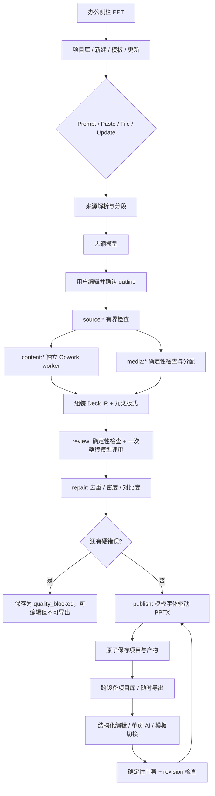

# PPT 模块质量评审、耗时基线与当前 Workflow

更新时间：2026-09-20
评审范围：本仓库 M1–M5 当前代码、确定性 PPTX 渲染器、一个 10 页企业汇报样例。
边界：本机没有部署新版远端 Cowork/真实模型链路，因此内容模型耗时、容器冷启动、网络、跨设备同步与真实媒体生成不在本次实测内。

## 1. 评审样例

用例：**AI Native Lab 企业推广季度复盘**，10 页，包含封面、管理摘要、大数字、可编辑图表、可编辑表格、对比、时间线和结论页。业务数字均为示例数据。

- [PPTX 成品](artifacts/ppt-m5-quality-sample.pptx)
- [输入 IR](artifacts/ppt-m5-quality-sample-ir.json)
- [耗时原始数据](artifacts/ppt-m5-render-benchmark.json)

文件由当前 `ppt-render.mjs` 直接从 Deck IR 生成。OOXML 检查结果：10 页、3 个原生可编辑图表、0 个包完整性 finding、0 个布局 finding、0 个布局 warning；字体 token 只有模板声明的 `Noto Sans CJK SC`，不包含旧的 `Arial Unicode MS`。

本机 LibreOffice 没有 Noto CJK，不能用其字体替换结果评价中文外观。Cowork 镜像已安装 `fonts-noto-cjk`。目标环境仍需用 Microsoft PowerPoint 和部署镜像做最终视觉复验。

## 2. M5 后的质量评审

### 2.1 内容

| 维度 | 当前结果 | 说明 |
|---|---|---|
| 叙事完整性 | 已有整稿检查 | 初始生成只调用一次整稿模型，输出缺失、重复、冲突和证据不足 |
| 信息密度 | 有硬约束 | 每种版式声明要点上限；去重不会再把纯文本页面清空，空内容页直接阻断发布 |
| 来源覆盖 | 有确定性检查 | 来源 ID 必须存在；有来源材料时，包含数字的内容页缺引用会阻断 publish |
| 模型权限 | 有边界 | 整稿评审无工具权限，不能输出坐标、字体、布局或改写后的 PPTX |
| 内容警告 | 不阻断发布 | 模型发现写入质量报告供用户判断；确定性硬错误决定发布门槛 |

### 2.2 字体与可读性

| 维度 | 当前结果 | 说明 |
|---|---|---|
| 模板字体 | 通过代码约束 | 标题、正文、东亚字体来自模板快照；不再把模板统一成某个硬编码字体 |
| 中文覆盖 | 有硬门禁 | 中文内容要求模板明确提供标题和正文东亚字体 token |
| 最小字号 | 有硬门禁 | registry 按版式声明标题和正文下限；表格为 13/14 pt，常规正文至少 16–20 pt |
| 对比度 | 可检查并修复 | 标题与背景要求 4.5:1，正文要求 3:1；安全文字色由代码修复 |
| 字体可用性 | 部署侧约束 | PDF 严格查找模板字体，缺失即失败；PPTX 保留原字体 token，不静默替换 |

### 2.3 布局与视觉

| 维度 | 当前结果 | 说明 |
|---|---|---|
| 版式覆盖 | 已实现 | 封面、摘要、大数字、对比、图表、表格、图文、时间线、结论共九类 |
| 几何控制 | 确定性 | 模型只给语义内容或 `layoutId`；坐标来自版本化 registry |
| 重叠 | 有硬门禁 | 使用同一 registry 的固定区域做相交检查 |
| 图片清晰度 | 有检查 | 不能解码会阻断；低于 640×360 进入警告 |
| 图表/表格 | 可编辑 | PPTX 保留原生图表和表格；当前图表类型仍限柱状图和饼图 |
| 长内容 | 部分解决 | 要点数量和字号有界；长表拆页、列宽语义和精确文本测量仍可继续增强 |
| 空白页 | 已修复根因 | 缺少必要视觉块的图表/表格/图文版式自动回退；摘要和结论按编号纵向铺开；无内容页阻断发布 |

### 2.4 结论

M5 已补齐 Gamma-like 架构中最关键的版式 registry、有界并行 DAG 和发布前质量门禁。它显著提高结构可靠性和可解释性，但不能仅凭本地确定性测试宣称达到 Gamma 的真实首稿质量。真实模型内容质量、端到端时延、字体部署和跨 Office 一致性仍需线上评测集验证。

## 3. 五个用例的确定性导出时长

运行方式：本机 bundled Python，每个用例预热后独立进程运行 7 次，取中位数。范围仅为 **IR → 可编辑 PPTX**，包含 Python 启动、原生图表/表格、OOXML 规范化和文件写入。

| 用例 | 页数 | 中位数 | 最小–最大 | 文件大小 |
|---|---:|---:|---:|---:|
| 纯文本简报 | 3 | 313 ms | 304–370 ms | 38 KB |
| 图表与表格汇报 | 8 | 512 ms | 395–617 ms | 59 KB |
| 企业季度复盘 | 10 | 381 ms | 369–399 ms | 62 KB |
| 混合内容长报告 | 20 | 506 ms | 497–529 ms | 98 KB |
| 当前上限压力用例 | 30 | 634 ms | 592–708 ms | 133 KB |

渲染增长近似线性，30 页仍低于 1 秒中位数。这个结果不能外推为完整生成时间。尚未计入：Cowork 容器启动、大纲模型、内容 worker、一次整稿评审、文件解析、媒体任务、网络和下载。

## 4. 与 Gamma-like 标准的对照

`gamma.md` 没有给出可验证的公开秒数 SLA。这里按架构原则判断：

| 标准 | 当前状态 | 判断 |
|---|---|---|
| 结构化 Presentation IR | `slides + blocks + layoutId + sourceRefs` 是编辑事实源 | 达到 |
| LLM 处理语义，软件处理几何 | 模型不操作坐标，版式和导出由代码控制 | 达到 |
| Layout Registry | 九类版式有内容上限、字号和区域契约 | 达到首版 |
| 有界并行 DAG | 来源、内容和媒体节点持久化；同项目最多 3 个独立 worker | 达到首版 |
| Theme Tokens | 颜色与标题/正文/东亚字体随模板冻结 | 达到首版 |
| 自动 QA 与 repair | 字体、字号、重叠、对比度、图片和来源进入门禁 | 达到首版 |
| 一次整稿评审 | 只输出四类内容发现，普通编辑不重复调用 | 达到 |
| 局部 mutation | 页补丁、单页 AI、模板重渲染、更新版本节点复用 | 基本达到 |
| 媒体智能 | 目前检查和分配用户图片，未做视觉理解、搜索或生成 | 未达到 |
| Responsive Reflow | 固定 registry 和密度降级，尚无完整文本测量/拆页求解 | 部分达到 |
| 生产性能证据 | 没有真实模型、容器和跨设备 P50/P95 | 未证明 |

结论：**确定性导出和执行架构已达到首版 Gamma-like 门槛；真实首稿质量和端到端速度仍不能判定。**

## 5. 内容深度优化方案（待确认，本轮未实施）

### 5.1 当前内容偏短的原因

1. 内容节点的输出契约只有 `title + 0–5 bullets`，允许非封面页返回 0–1 条要点。
2. 大纲只定义 `title/focus/refs`，没有要求每页覆盖哪些事实、解释什么因果或得出什么含义。
3. 各页并行生成时只看到本页来源摘录和全局标题列表，缺少可验证的“本页证据预算”。
4. 整稿模型按设计只报告缺失、重复、冲突和证据不足，不会补写内容；因此它能发现薄弱页，却不会让页面自动变详细。
5. 仅提高字数下限会制造重复和无来源扩写，尤其是来源材料本身不足时。

### 5.2 三种方案

| 方案 | 做法 | 优点 | 风险 |
|---|---|---|---|
| A. 只改提示词 | 要求普通内容页输出 3–5 条、更长要点 | 改动小、无额外调用 | 模型可能用同义反复凑长度，稳定性弱 |
| B. 结构化页面内容契约 | 大纲增加 `purpose/keyMessage/evidenceRefs/visualIntent`；内容节点输出结论、证据、解释和行动含义；代码检查内容单元和来源覆盖，过薄时只允许该页一次有界重试 | 深度、证据和延迟可控；仍保持模型不碰坐标 | 需要扩展 IR、提示词、迁移和评测集 |
| C. 作者模型后再加逐页编辑模型 | 每页先写初稿，再由第二次模型调用扩写和润色 | 内容最丰富 | 调用数、成本和延迟接近翻倍，也更容易引入无来源内容 |

推荐 **方案 B**。它保留现有一次整稿评审的边界；额外调用只发生在确定性检查判定为“过薄”的单页内容节点，每页最多一次，并继续受 DAG 并发 3 的限制。

### 5.3 建议的页面契约

- 普通摘要/结论页：2–4 个内容单元，每个单元包含明确主张及一条解释或证据。
- 图表/表格页：一个图表结论，加 1–3 条解释；数字必须绑定来源编号。
- 大数字页：一个核心指标、比较基线和业务含义。
- 时间线页：每个阶段包含时间、交付物和完成条件，不用一句口号代替阶段内容。
- 来源不足时输出结构化 `evidenceGap`，由 UI 提示补充材料；不以虚构数字或重复文字填满页面。
- 内容密度按中文加权字符数、内容单元数和视觉块共同判断，不使用统一字数下限。

### 5.4 建议验收指标

- 非封面空内容页为 0。
- 普通内容页少于 2 个有效内容单元的比例低于 5%。
- 相邻页完全重复要点为 0，同时不能因去重产生空页。
- 有来源项目的数字引用覆盖率为 100%。
- 10 页首稿人工评审中，“需要补充内容”的页面比例低于 15%。
- 同一评测集记录首稿接受率、平均人工修改分钟数以及 P50/P95 生成时长。

## 6. 下一步优化

1. 在部署环境记录每个 `dagNode` 的 queue、container、model、review、repair 和 render 时间，形成 P50/P95。
2. 建立固定评测集，覆盖中英混排、深浅模板、长标题、长表、4 张图片和 3/10/30 页项目；记录首稿接受率和人工修改分钟数。
3. 对长表实现拆页和重复表头，对图片实现焦点裁切、重复图检测和版权来源，对图表增加折线/堆积/组合及单位脚注。
4. 对需要跨设备严格一致的自定义字体，提供组织级字体包或评估合法嵌入；不能获得字体时明确阻断 PDF，不做静默替换。
5. 建议内部 SLO 待线上数据冻结：大纲 P50 ≤ 8 秒、10 页无图片首稿 P50 ≤ 45 秒、单页改写 P50 ≤ 8 秒、10 页导出 P95 ≤ 3 秒。以上不是 Gamma 官方承诺。

## 7. 当前 Workflow

### 7.1 创建与输入

Next `/api/ppt` 只做代理与登录身份透传，Cowork 服务端按 uid 保存项目。Prompt 直接进入大纲；Paste 保存文字及最多 4 张 PNG/JPEG；File 支持 Markdown、HTML、DOCX、PDF、XLSX 和 PPTX。上传文件先做大小、签名和 ZIP 安全检查，再在项目 Cowork 容器解析。

### 7.2 大纲、DAG 与质量门禁

来源标准化为带 `id/location/text` 的段落。大纲确认后，`source:*` 检查先建立可靠依赖；`content:*` 与 `media:*` 在各自边界内并行，内容 worker 使用独立 sid/容器。成功节点可恢复复用；更新版 `keep` 页直接复用旧 IR。

内容汇总后先做确定性 review，再执行一次无工具整稿评审，然后进入 repair。模型发现只记录为内容提示。字体缺失、布局硬错误、图片损坏或数字缺来源等未解决问题会阻断 publish，并把 Deck IR 保存为可编辑的 `quality_blocked` 项目。用户修复后保存会重新运行确定性门禁，通过时才生成 PPTX 并开放导出，整稿模型评审不重复调用。

### 7.3 模板、字体与渲染

模板快照冻结 palette 和标题/正文/东亚字体。上传模板只有在颜色和字体可稳定提取时才标为 `mapped`。PPTX、PDF、Web 预览和质量检查使用同一 Deck IR、`layoutId` 和字体 token。PPTX 保留图表、表格、形状可编辑性。

### 7.4 编辑、版本与项目管理

编辑器支持九类版式、标题/要点、图片、图表、表格、形状、搜索、撤销/重做及页/块 AI 改写。保存使用 revision 乐观锁并重新执行确定性门禁；整稿模型评审不会因普通保存重复调用。项目库支持搜索、筛选、排序、收藏、置顶、标签、文件夹、复制、批量操作和回收站。版本更新创建新项目，旧版本不被覆盖。

### 7.5 尚未完成的生产证明

本地测试证明结构、状态机、账号隔离、门禁规则、字体 token 和真实 PPTX 包。仍需在部署环境验收真实模型并发与限流、容器冷启动、服务恢复、跨设备同步、目标 Office 字体与版式、真实 PDF、安装包及高分辨率图片项目的容量和下载时间。
